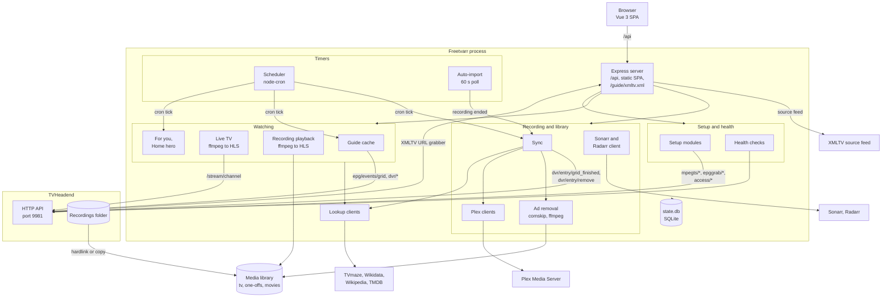
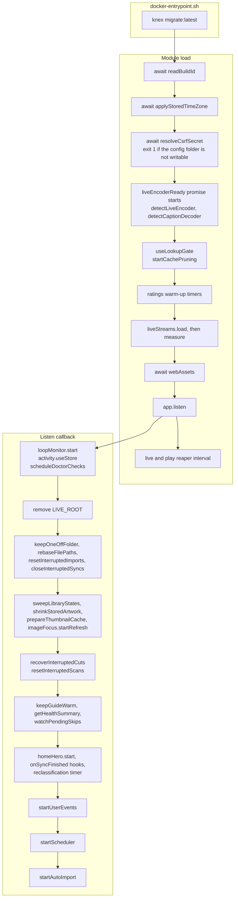
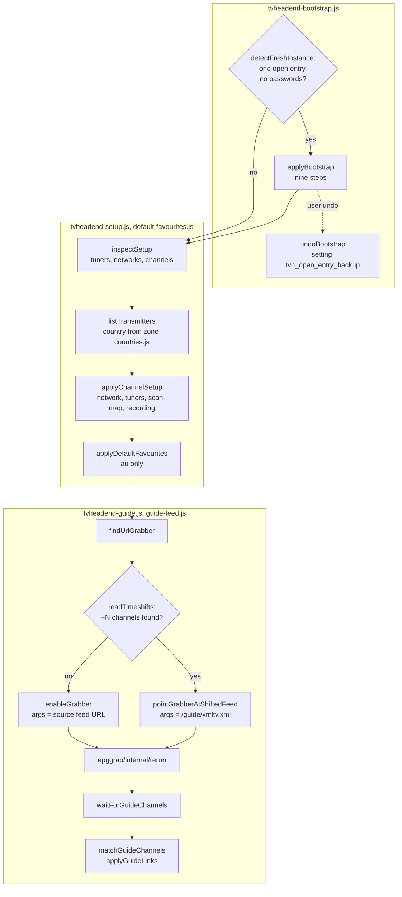
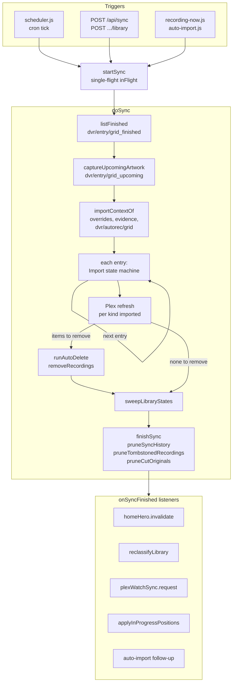
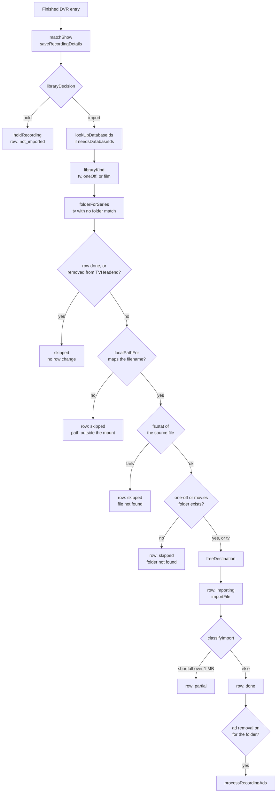
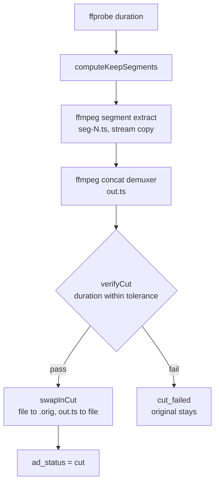
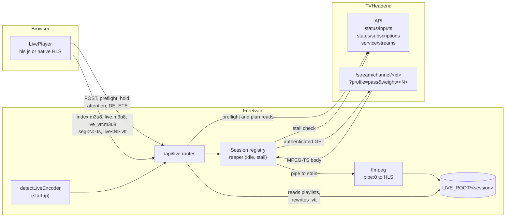

# Technical deep dive

Reference for the Freetvarr implementation: the modules, the data they keep, the calls they make, and the constants they use. The user-facing companion is the [guide](/guide/); the project summary is [`README.md`](https://github.com/furey/freetvarr/blob/main/README.md).

## Contents

- [Overview](#overview)
- [Architecture](#architecture)
- [Startup order](#startup-order)
- [Storage](#storage)
- [TVHeadend client](#tvheadend-client)
- [TVHeadend setup](#tvheadend-setup)
- [Guide](#guide)
- [Recording rules](#recording-rules)
- [Sync pipeline](#sync-pipeline)
- [Import state machine](#import-state-machine)
- [Library kinds](#library-kinds)
- [Ad removal](#ad-removal)
- [Removal from TVHeadend](#removal-from-tvheadend)
- [Live TV](#live-tv)
- [Recording playback](#recording-playback)
- [Pictures and programme info](#pictures-and-programme-info)
- [Plex](#plex)
- [Sonarr and Radarr](#sonarr-and-radarr)
- [For you and Home hero](#for-you-and-home-hero)
- [Search](#search)
- [Jobs and health](#jobs-and-health)
- [Web client](#web-client)
- [Security model](#security-model)
- [Full environment reference](#full-environment-reference)
- [Docker deployment](#docker-deployment)
- [Build and test](#build-and-test)

## Overview

Freetvarr is one [Node.js](https://nodejs.org/en/docs) process. It runs an [Express](https://expressjs.com/) server that serves a REST API under `/api` and a static [Vue 3](https://vuejs.org/guide/introduction.html) single-page app. The process reads the [TVHeadend](https://docs.tvheadend.org/documentation/development/json-api) API, the TVHeadend recordings folder, [Plex](https://support.plex.tv/articles/categories/your-media/), optional [Sonarr](https://sonarr.tv/) and [Radarr](https://radarr.video/), and third-party lookup services. It writes files into the media library folders, rows into a [SQLite](https://www.sqlite.org/docs.html) database, and DVR entries and rules into TVHeadend.

## Architecture



### Module map

| Modules                                                                                                                                          | Job                                                                                                                                                                                                            | Talks to                                                                                                                                                                                                                        |
| ------------------------------------------------------------------------------------------------------------------------------------------------ | -------------------------------------------------------------------------------------------------------------------------------------------------------------------------------------------------------------- | ------------------------------------------------------------------------------------------------------------------------------------------------------------------------------------------------------------------------------- |
| `src/server.js`                                                                                                                                  | Builds the Express app: security middleware, `/api` routes, `/healthz`, the guide feed at `/guide/xmltv.xml`, the static SPA, the startup sequence                                                             | Every module below                                                                                                                                                                                                              |
| `src/scheduler.js`, `src/schedule-runs.js`                                                                                                       | Runs one [node-cron](https://github.com/node-cron/node-cron) task from the setting `sync_cron` (default `*/30 * * * *`); each tick starts a sync, a guide refresh, viewing-history upkeep, and For you upkeep  | `src/sync.js`, `src/epg.js`, `src/user-events-log.js`, `src/for-you-service.js`                                                                                                                                                 |
| `src/sync.js`                                                                                                                                    | Lists finished TVHeadend recordings, matches them to show rules, imports them, writes every outcome, refreshes Plex, removes imported recordings from TVHeadend                                                | `src/tvheadend.js`, `src/plex.js`, `src/commercials.js`, `src/show-folders.js`, `src/show-identity.js`, `src/artwork.js`, `src/db.js`                                                                                           |
| `src/show-folders.js`, `src/show-identity.js`, `src/show-identity-store.js`, `src/show-identity-choice.js`, `src/database-ids.js`                | Name a new show folder and find the TVmaze, TVDB, and TMDB ids of a show                                                                                                                                       | TVmaze, TMDB, `shows` table, `show_identity_picks` table                                                                                                                                                                        |
| `src/folder-matcher.js`                                                                                                                          | Ranks existing media folders with [Fuse.js](https://www.fusejs.io/) for `GET /api/folder-suggest`; the sync does not use it                                                                                    | Media root folder                                                                                                                                                                                                               |
| `src/auto-import.js`, `src/recording-now.js`                                                                                                     | Poll the running recordings every `60 s`, then start a sync after a recording ends                                                                                                                             | `src/tvheadend.js`, `src/sync.js`                                                                                                                                                                                               |
| `src/tvheadend.js`, `src/http-auth.js`                                                                                                           | HTTP client for the TVHeadend API with Digest or Basic auth; transport for the setup, guide, bootstrap, and health modules                                                                                     | TVHeadend                                                                                                                                                                                                                       |
| `src/tvheadend-bootstrap.js`, `src/tvheadend-setup.js`, `src/tvheadend-guide.js`, `src/tv-login.js`, `src/zone-countries.js`                     | Wizard steps that lock an open TVHeadend, set up tuners and channels, set up the guide, and create a watch-only TV app login                                                                                   | TVHeadend `access/*`, `passwd/*`, `mpegts/*`, `epggrab/*`                                                                                                                                                                       |
| `src/guide-feed.js`, `src/guide-sources.json`                                                                                                    | Stream the source XMLTV feed with time-shifted copies of programmes at `GET /guide/xmltv.xml`                                                                                                                  | [XMLTV](https://wiki.xmltv.org/index.php/XMLTVFormat) source feed                                                                                                                                                               |
| `src/epg.js`, `src/guide-cache.js`, `src/guide-history.js`, `src/guide-search.js`                                                                | Cache the TVHeadend guide and recording state; save airings to `guide_programs`; search the guide                                                                                                              | `src/tvheadend.js`, `src/db.js`                                                                                                                                                                                                 |
| `src/pending-skips.js`, `src/watchlist.js`, `src/repeat-match.js`, `src/autorec-match.js`                                                        | Single-episode skips, watchlist titles, and matching of guide airings to autorec rules and repeats                                                                                                             | `src/epg.js`, `src/tvheadend.js`                                                                                                                                                                                                |
| `src/live-tv.js`, `src/live-encoder.js`, `src/live-streams.js`, `src/live-benchmark.js`, `src/tuner-status.js`                                   | Pipe a TVHeadend channel stream through [FFmpeg](https://ffmpeg.org/documentation.html) into [HLS](https://ffmpeg.org/ffmpeg-formats.html#hls-2) files; pick the encoder; set the stream limit; read tuner use | TVHeadend, `ffmpeg`, `os.tmpdir()/freetvarr-live`                                                                                                                                                                               |
| `src/playback.js`, `src/in-progress-playback.js`, `src/in-progress-positions.js`                                                                 | Play library files and running recordings as HLS sessions under the same stream limit                                                                                                                          | `ffmpeg`, `ffprobe`, media library, TVHeadend `/dvrfile`                                                                                                                                                                        |
| `src/commercials.js`                                                                                                                             | Detects and cuts ad breaks with [Comskip](https://github.com/erikkaashoek/Comskip) and `ffmpeg`                                                                                                                | `comskip`, `ffmpeg`, `ffprobe`, media library                                                                                                                                                                                   |
| `src/plex.js`, `src/plex-watch*.js`, `src/plex-library*.js`, `src/external-ids*.js`                                                              | Plex discovery and section refresh; watched-state sync; whole-library listing                                                                                                                                  | Plex, `plex_watch_state` table, `library_items` table, `external_ids` table                                                                                                                                                     |
| `src/arr-client.js`, `src/arr-store.js`, `src/arr-files.js`, `src/arr-routes.js`                                                                 | Optional Sonarr and Radarr client for file lists, unmonitor, and delete                                                                                                                                        | Sonarr, Radarr                                                                                                                                                                                                                  |
| `src/for-you*.js`, `src/top-rated.js`                                                                                                            | Score the guide against viewing history; run the heavy work in a child process                                                                                                                                 | `user_events` table, `text_embeddings` table, Hugging Face models, optional Ollama                                                                                                                                              |
| `src/home-hero-service.js`, `src/hero-picture-proof.js`, `src/art-pool.js`                                                                       | Build the Home hero snapshot from library, guide, watchlist, and For you                                                                                                                                       | `src/epg.js`, `src/for-you-service.js`, `settings` table                                                                                                                                                                        |
| `src/artwork*.js`, `src/show-artwork.js`, `src/fallback-artwork.js`, `src/programme-images.js`, `src/image-thumbnails.js`, `src/image-focus*.js` | Find, store, resize, and crop pictures                                                                                                                                                                         | [TVmaze](https://www.tvmaze.com/api), [TMDB](https://developer.themoviedb.org/docs/getting-started), [Wikidata](https://www.wikidata.org/wiki/Wikidata:Main_Page), [Wikipedia](https://www.wikipedia.org/), Plex, config folder |
| `src/programme-ratings.js`, `src/programme-credits.js`, `src/classification-labels.js`, `src/genre-enrichment.js`, `src/known-as.js`             | Look up ratings, cast, classifications, genres, and alternative titles                                                                                                                                         | `src/outbound-http.js`, lookup tables                                                                                                                                                                                           |
| `src/outbound-http.js`, `src/lookup-gate.js`, `src/cache-prune.js`                                                                               | Shared client for third-party requests; hourly lookup limit; daily deletion of expired lookup rows                                                                                                             | Third-party hosts, lookup tables                                                                                                                                                                                                |
| `src/library*.js`, `src/library-files.js`, `src/library-delete*.js`, `src/foreign-delete.js`, `src/show-folder-rename.js`                        | Library listing, watched marks, moves, deletes, and folder renames                                                                                                                                             | `recordings` table, `shows` table, media library, `src/arr-*.js`                                                                                                                                                                |
| `src/doctor.js`, `src/health-summary.js`, `src/path-check.js`, `src/docker-host.js`                                                              | Health checks and the health level shown in the navigation                                                                                                                                                     | TVHeadend, Plex, media library, `src/db.js`                                                                                                                                                                                     |
| `src/activity.js`, `src/activity-routes.js`, `src/activity-store.js`, `src/progress.js`, `src/event-loop-lag.js`                                 | Job registry, live progress, job-run storage, and event-loop monitoring                                                                                                                                        | `job_runs` table                                                                                                                                                                                                                |
| `src/web/`, `src/web-assets.js`, `src/build-id.js`                                                                                               | Vue 3 client files, asset caching, and the build id                                                                                                                                                            | Browser                                                                                                                                                                                                                         |
| `src/db.js`, `knexfile.js`, `migrations/`                                                                                                        | [Knex](https://knexjs.org/) connection, settings helpers, and schema                                                                                                                                           | `state.db`                                                                                                                                                                                                                      |

## Startup order

`docker-entrypoint.sh` runs `node node_modules/.bin/knex migrate:latest`, then `exec node src/server.js`. `src/server.js` runs the steps below in order.



The module load step registers the routes between `resolveCsrfSecret` and `webAssets`. `liveEncoderReady` and `liveStreams.load` run without a wait; the live routes await `liveEncoderReady` when a session starts.

### Boot timers

| Timer               | Started by                   | First run                 | Repeat                                     | Effect                                                                                                                         |
| ------------------- | ---------------------------- | ------------------------- | ------------------------------------------ | ------------------------------------------------------------------------------------------------------------------------------ |
| Cron tick           | `startScheduler`             | Next match of `sync_cron` | Cron (default `*/30 * * * *`)              | Sync, guide refresh, viewing-history upkeep, For you upkeep                                                                    |
| Recording poll      | `watchForFinishedRecordings` | `60 s`                    | `60 s`, only while a sync schedule can run | Detects a finished recording; `src/auto-import.js` starts a sync after `60 s` of quiet, at most `5` min after the first finish |
| Reapers             | Module load                  | `5 s`                     | `5 s`                                      | End idle or stalled live sessions and idle playback sessions                                                                   |
| Doctor checks       | `scheduleDoctorChecks`       | `2` min                   | `3` h                                      | Refresh the health report                                                                                                      |
| Ratings warm-up     | Module load                  | `2` min                   | `1` h                                      | Look up ratings for upcoming programmes                                                                                        |
| Cache prune         | `startCachePruning`          | `10` min                  | `24` h                                     | Delete expired lookup rows                                                                                                     |
| Home hero build     | `homeHero.start`             | `20 s`                    | `5` min                                    | Rebuild the hero snapshot                                                                                                      |
| Library folder sort | Listen callback              | `3` min                   | None                                       | `runReclassificationOnce`                                                                                                      |
| Guide warm-up       | `keepGuideWarm`              | Immediate                 | `5 s` after each local midnight            | Reload the guide and recording state                                                                                           |
| Pending skips       | `watchPendingSkips`          | After each guide load     | `5` min                                    | Reload the recording state while a skip or a repeat waits; the reload disables the skipped entries                             |
| Watchlist sweep     | `mountWatchlist`             | None                      | `15` min                                   | Create a recording or series rule for a guide airing that matches a title in mode `record`                                     |

## Storage

Freetvarr stores state in SQLite through Knex and [better-sqlite3](https://github.com/WiseLibs/better-sqlite3). `knexfile.js` sets `useNullAsDefault: true` and runs two pragmas on each new connection: `journal_mode = WAL` ([WAL mode](https://www.sqlite.org/wal.html)) and `synchronous = NORMAL`. `src/db.js` wraps the Knex instance with `trackQueries` from `src/event-loop-lag.js`.

`DB_PATH` sets the database file. When `DB_PATH` is unset, the file is `config/state.db` in the repository root. The example Compose file sets `DB_PATH=/config/state.db`. The config folder is the directory of `DB_PATH`. `docker-entrypoint.sh` migrates the database before the server starts.

### Settings helpers

| Helper                                                  | Behaviour                                                                              |
| ------------------------------------------------------- | -------------------------------------------------------------------------------------- |
| `getSetting(key)`                                       | Returns the `value` of the `settings` row, or `null` when the row is missing           |
| `setSetting(key, value)`                                | Inserts the row, or replaces `value` on a key conflict                                 |
| `deleteInChunks({ database, table, where, chunkSize })` | Deletes rows by `rowid` in chunks of `200` and yields to the event loop between chunks |

### Tables

| Table                       | Migration                                                                      | Holds                                                                                                                                                                                       | Main writer                                                       |
| --------------------------- | ------------------------------------------------------------------------------ | ------------------------------------------------------------------------------------------------------------------------------------------------------------------------------------------- | ----------------------------------------------------------------- |
| `settings`                  | `0001`                                                                         | Key and text value of every saved setting                                                                                                                                                   | `src/db.js` (`setSetting`)                                        |
| `shows`                     | `0001`, `0037`, `0038`, `0039`                                                 | Show rules: `show_pattern`, `dest_folder`, `season_template`, `enabled`, `delete_after_import`, `ad_removal`; identity ids and `identity_state`; `kept_folder`; `origin` (`user` or `auto`) | `src/show-folders.js`, `src/server.js`                            |
| `recordings`                | `0001`, `0003`, `0004`, `0006`, `0007`, `0009`, `0018`, `0023`, `0026`, `0030` | One row per TVHeadend recording: status, paths, sizes, ad status and backups, episode details, playback position, watched time, library state, classification, `genres_json`                | `src/sync.js`                                                     |
| `syncs`                     | `0001`                                                                         | One row per sync: start, finish, status, `summary_json`                                                                                                                                     | `src/sync.js`                                                     |
| `guide_programs`            | `0002`                                                                         | Saved guide airings keyed by `channel_id` and `start`, with `program_json`                                                                                                                  | `src/guide-history.js`                                            |
| `show_artwork`              | `0005`                                                                         | Cached picture sources per `title_key`                                                                                                                                                      | `src/show-artwork.js`                                             |
| `watchlist`                 | `0008`, `0014`                                                                 | Titles to notify or record, with optional channel and padding                                                                                                                               | `src/watchlist.js`                                                |
| `user_events`               | `0010`                                                                         | Viewing-history events: kind, series key, title, positions, source                                                                                                                          | `src/user-events-log.js`                                          |
| `text_embeddings`           | `0011`                                                                         | Embedding vectors per `text_hash` and `model_id`                                                                                                                                            | `src/for-you-engine.js`                                           |
| `title_genres`              | `0011`                                                                         | Cached genres and categories per `title_key`                                                                                                                                                | `src/genre-enrichment.js`                                         |
| `show_nicknames`            | `0012`                                                                         | User-added search names per `show_key`                                                                                                                                                      | `src/search-aliases.js`                                           |
| `title_known_as`            | `0012`                                                                         | Cached alternative titles per `title_key`                                                                                                                                                   | `src/known-as.js`                                                 |
| `artwork_lookups`           | `0013`                                                                         | Cached picture lookups per `lookup_key`                                                                                                                                                     | `src/fallback-artwork.js`                                         |
| `programme_ratings`         | `0015`, `0020`                                                                 | Cached rating lookups; `miss_reason` records why a lookup found nothing                                                                                                                     | `src/programme-ratings.js`                                        |
| `programme_classifications` | `0016`                                                                         | Classification label per `title_key` and `start_ms`                                                                                                                                         | `src/classification-labels.js`                                    |
| `programme_credits`         | `0017`, `0020`                                                                 | Cached cast and crew lookups; `miss_reason` as in `programme_ratings`                                                                                                                       | `src/programme-credits.js`                                        |
| `programme_categories`      | `0019`                                                                         | Category per `title_key` and `start_ms`                                                                                                                                                     | `src/classification-labels.js`                                    |
| `art_pools`                 | `0021`                                                                         | Cached picture pools per `pool_key`                                                                                                                                                         | `src/art-pool.js`                                                 |
| `show_artwork_choices`      | `0022`                                                                         | The picture chosen per `show_key` and `kind`                                                                                                                                                | `src/artwork-choices.js`                                          |
| `image_focus`               | `0024`, `0027`                                                                 | Focus point (`x`, `y`), `keep_box`, and `width_hashes` per picture URL                                                                                                                      | `src/image-focus-service.js`                                      |
| `pending_skips`             | `0025`, `0031`                                                                 | Skipped single airings by `program_id`, with `end_ms` indexed                                                                                                                               | `src/pending-skips.js`                                            |
| `programme_kind_overrides`  | `0028`, `0029`                                                                 | User-set kind per `show_key`                                                                                                                                                                | `src/programme-kind.js`                                           |
| `job_runs`                  | `0032`                                                                         | Finished job runs as `run_json`                                                                                                                                                             | `src/activity-store.js`                                           |
| `series_evidence`           | `0033`, `0039`                                                                 | Facts per `show_key` as `facts_json`; `database_ids` and `database_ids_at`                                                                                                                  | `src/series-evidence.js`                                          |
| `plex_watch_state`          | `0034`                                                                         | Watched flags and offsets on both sides per `recording_id`                                                                                                                                  | `src/plex-watch.js`                                               |
| `library_items`             | `0035`                                                                         | Plex library items keyed by `rating_key` and `part_id`, with file paths and watched state                                                                                                   | `src/plex-library-store.js`                                       |
| `external_ids`              | `0036`                                                                         | TVDB, TMDB, and IMDb ids per `title_key`, `kind`, and `source`                                                                                                                              | `src/external-ids-store.js` (saved by `src/plex-library-scan.js`) |
| `show_identity_picks`       | `0037`                                                                         | The picked or declined show identity per `title_key` and `network_family`                                                                                                                   | `src/show-identity-store.js`                                      |

### Config folder

| Path                                       | Holds                                                                 | Set by                                            |
| ------------------------------------------ | --------------------------------------------------------------------- | ------------------------------------------------- |
| `state.db`, `state.db-wal`, `state.db-shm` | The database and its WAL files                                        | `DB_PATH`                                         |
| `csrf-secret`                              | The CSRF secret, written with mode `0600` when `CSRF_SECRET` is unset | `src/csrf-secret.js`                              |
| `artwork/`                                 | Saved pictures of shows and recordings                                | `ARTWORK_PATH`, else `artwork/` beside `state.db` |
| `uploads/artwork/`                         | Pictures that a user uploads                                          | `src/artwork-uploads.js`                          |
| `image-cache/`                             | Resized picture files, `100 MB` default limit                         | `src/image-thumbnails.js`                         |
| `models/`                                  | Downloaded For you models                                             | `src/for-you-engine.js` (`modelCacheDir`)         |
| `comskip.ini`                              | Optional Comskip settings; replaces the built-in `assets/comskip.ini` | `src/commercials.js`                              |

Back up `state.db`, `state.db-wal`, and `state.db-shm` together.

## TVHeadend client

TVHeadend exposes a JSON API at `<tvh_url>/api/<path>`. `src/tvheadend.js` holds the HTTP client and the normalisers for TVHeadend objects.

### Transport

- `apiGet(path, params, conn)` sends a `GET` with the parameters in the query string.
- `apiPost(path, form, conn)` sends a `POST` with a `application/x-www-form-urlencoded` body built by `URLSearchParams`. Object fields travel as JSON strings in one form field (`node` or `conf`).
- `apiPost` clears the past-airings cache before and after every write.
- `tvhRead` and `tvhWrite` export `apiGet` and `apiPost`. `src/tvheadend-setup.js`, `src/tvheadend-guide.js`, `src/tvheadend-bootstrap.js`, and `src/doctor.js` build their own paths and call the client through these two functions.
- `resolveConnection` reads the settings `tvh_url`, `tvh_username`, and `tvh_password`, and strips trailing slashes from the URL. An empty URL throws a `TvheadendError` with stage `config` and code `no-url`.
- `sendAuthenticated` sends every request and accepts every HTTP status. `request` maps the status to an error.

### Authentication

When a username is set, `sendAuthenticated` sends the first request with the cached `Authorization` header. On a `401` it stores the `www-authenticate` challenge, signs the request, and sends it once more. A second `401` clears the cached challenge.

`authorizationFor` in `src/http-auth.js` reads the scheme of the challenge. `Basic` gives a base64 header. `Digest` gives an MD5 or SHA-256 response, with `qop=auth`, a random `cnonce`, and a nonce count that rises with each reuse of the challenge. Any other scheme gives no header.

`createChallengeCache` keys challenges by `<url>|<username>` and drops an entry idle for `90 s`. `verifyLogin` requests `<url>/login` without redirects, reads its challenge, then requests `/api/serverinfo` with the signed header.

### Timeouts and caches

| Request                        | Timeout                       | Meaning                                                |
| ------------------------------ | ----------------------------- | ------------------------------------------------------ |
| Default API call               | `15 s` (`REQUEST_TIMEOUT_MS`) | Also applies to `/dvrfile/<uuid>` and to channel icons |
| Discovery probe                | `1.5 s`                       | One `serverinfo` request per candidate address         |
| Programme image from TVHeadend | `5 s`, `4 MiB` maximum        | `fetchProgrammeImage` rejects a non-image content type |
| Live stream                    | None                          | `openChannelStream` sets `timeout: 0`                  |

| Cache               | Lifetime         | Holds                                                         |
| ------------------- | ---------------- | ------------------------------------------------------------- |
| Past airings        | `10` min         | Finished, removed, and failed entries; cleared on every write |
| Tuner count         | `10` min         | Leaf count of `hardware/tree`                                 |
| Service multiplexes | `10` min         | One record per service from `mpegts/service/grid`             |
| Default DVR profile | Process lifetime | The profile `uuid`                                            |
| Default languages   | Process lifetime | The `language` value from `config/load`                       |

### Auto-discovery

`detectServers` serves `POST /api/tvh-detect`. It runs these steps in order:

1. If the `TVH_URL` environment variable is set, `detectServers` returns that URL as the only candidate with `source: 'env'`. It probes nothing.
2. `rankCandidates` lists candidate URLs on port `9981`, in this order:
   - The hint addresses: the request hostname and the local socket address, with loopback excluded.
   - The host IPv4 addresses, private ranges first. Addresses from `172.17.0.0` to `172.31.255.255` and link-local `169.254.x.x` are excluded.
   - The hosts `tvheadend`, `host.docker.internal`, and `127.0.0.1`.
3. `probeServer` requests `/api/serverinfo` on every candidate in parallel with a `1.5 s` timeout. A hit is a `200` response with `sw_version` in the body, or a `401` response whose `www-authenticate` header contains `tvheadend`.
4. `preferLanOverLoopback` drops loopback hits when any other hit exists.
5. `dropAliasDuplicates` drops a hit on `host.docker.internal`, `tvheadend`, or `localhost` when its `serverinfo` body equals the body of a numeric-address hit. It also keeps only the first hit for each distinct body.

With no hit, the result is `ok: false` and the route answers `502`.

### Error mapping

`TvheadendError` carries `stage`, `status`, and `code`. `stage` is the API path for transport errors.

| Condition                              | `stage`                         | `status`   | `code`                                           |
| -------------------------------------- | ------------------------------- | ---------- | ------------------------------------------------ |
| Network failure                        | The path                        | None       | The Node error code (for example `ECONNREFUSED`) |
| HTTP `401` or `403`                    | The path                        | The status | `auth`                                           |
| Any other HTTP status of `400` or more | The path                        | The status | None                                             |
| No `tvh_url` setting                   | `config`                        | None       | `no-url`                                         |
| Stream refused with `401` or `403`     | `stream`                        | The status | `auth`                                           |
| Stream refused with `503`              | `stream`                        | `503`      | `no-tuner`                                       |
| Stream refused with another status     | `stream`                        | The status | `http`                                           |
| Connection reset before video          | `stream`                        | None       | `no-source`                                      |
| Guide load finds no channels           | `epg`                           | None       | `no-channels`                                    |
| A create call returns no `uuid`        | `record` or `series`            | None       | `no-uuid`                                        |
| No matching entry or rule              | `cancel`, `series`, or `remove` | None       | `not-found`                                      |

`POST /api/tvh-test` answers `502` with `error`, `stage`, and `code` from the thrown `TvheadendError`.

### Normalised values

- Series key: `seriesKey` returns `` `${channelId}|${title.trim().toLowerCase()}` ``. Events carry it as `series_link`, and autorec rules carry it as `seriesLinkId`. A rule for any channel uses an empty channel id, so its key starts with `|`.
- Season and episode: `dvr/entry/*` returns `episode_disp` (for example `Season 3.Episode 7`). `parseEpisodeDisp` reads the numbers with the patterns `Season\s+(\d+)` and `Episode\s+(\d+)`, each independent and case-insensitive. A missing part gives `null`. Guide events carry `seasonNumber` and `episodeNumber`, which become `series_no` and `episode_no`.
- Guide text: `normaliseEvent` and `normaliseEntry` pass the subtitle and synopsis through `cleanGuideText` ([Consumer advice](#consumer-advice)).
- Channels: `listChannels` drops channels with `enabled: false`. `hd` is true when any enabled service has DVB type `0x11`, `0x19`, or `0x1f`, false when one has `0x01` or `0x16`, and otherwise follows the channel name. `offAir` is true when every service of the channel is disabled.

### Endpoints

#### `src/tvheadend.js`

| Endpoint                                          | Method        | Use                                                                                                                                                                                                          |
| ------------------------------------------------- | ------------- | ------------------------------------------------------------------------------------------------------------------------------------------------------------------------------------------------------------ |
| `serverinfo`                                      | `GET`         | **Test connection** (version and API version); discovery probe; `verifyLogin`                                                                                                                                |
| `channel/grid`                                    | `GET`         | Channel lineup, `limit 1000`, sorted by number                                                                                                                                                               |
| `epg/events/grid`                                 | `GET`         | Guide events, `2000` per page, `4` pages in parallel, sorted by start                                                                                                                                        |
| `epg/events/load`                                 | `GET`         | One programme by `eventId`                                                                                                                                                                                   |
| `dvr/entry/grid_upcoming`                         | `GET`         | Scheduled and running recordings, `limit 1000`                                                                                                                                                               |
| `dvr/entry/grid_finished`                         | `GET`         | Finished recordings (`limit 5000`); the import queue                                                                                                                                                         |
| `dvr/entry/grid_failed`, `dvr/entry/grid_removed` | `GET`         | Past airings for repeat checks, `5000` per page, at most `10` pages, cached `10` min; the finished and failed grids each give their newest `5` entries by `stop_real` to the recently ended list             |
| `dvr/entry/create_by_event`                       | `POST`        | **Record**: sends `event_id`, `config_uuid`, and a library `comment`                                                                                                                                         |
| `dvr/entry/cancel`, `dvr/entry/stop`              | `POST`        | Cancel a scheduled entry; stop a running one ([Stop a recording](#stop-a-recording))                                                                                                                         |
| `dvr/entry/remove`                                | `POST`        | Delete the file; the entry stays as a removed entry, which `dvr/entry/grid_removed` lists ([Remove after import](#remove-after-import))                                                                      |
| `dvr/entry/prevrec/set`                           | `POST`        | Mark an entry as previously recorded before removal                                                                                                                                                          |
| `dvr/autorec/grid`, `dvr/autorec/create`          | `GET`, `POST` | Series rules ([Recording rules](#recording-rules))                                                                                                                                                           |
| `idnode/save`                                     | `POST`        | Padding (`start_extra`, `stop_extra`) on a new entry; enable or disable a scheduled entry; update an autorec rule (`enabled`, `maxcount`, padding); set retention to `Forever` (`2147483647`) before removal |
| `idnode/delete`                                   | `POST`        | Delete an autorec rule; delete a scheduled re-record before removal                                                                                                                                          |
| `idnode/load`                                     | `GET`         | `loadRecording` reads one entry (`grid: 1`) for in-progress playback                                                                                                                                         |
| `dvr/config/grid`                                 | `GET`         | Default DVR profile (the profile with an empty name, else the first), cached; `getRecordingStorage` reads its `storage` path without a cache                                                                 |
| `epggrab/channel/grid`                            | `GET`         | Channel logo fallback (`limit 10000`); a failure leaves the TVHeadend icons                                                                                                                                  |
| `status/inputs`                                   | `GET`         | Tuner readings and active inputs                                                                                                                                                                             |
| `hardware/tree`                                   | `GET`         | Recursive walk that counts tuners; the multiplex each tuner carries                                                                                                                                          |
| `status/subscriptions`                            | `GET`         | What holds each tuner                                                                                                                                                                                        |
| `mpegts/service/grid`                             | `GET`         | Multiplex and DVB type of every service (`limit 10000`)                                                                                                                                                      |
| `service/streams`                                 | `GET`         | Elementary streams and PIDs of a channel                                                                                                                                                                     |
| `config/load`                                     | `GET`         | Default language for the live TV audio track                                                                                                                                                                 |
| `/dvrfile/<uuid>`                                 | `GET`         | Reads a recording that TVHeadend still writes, with a `Range` header ([From the start](#from-the-start)); outside `/api`                                                                                     |
| `/stream/channel/<uuid>`                          | `GET`         | Live TV ([Live TV](#live-tv)); outside `/api`; query `profile=pass` and `weight=50`; user agent `Freetvarr-live/<session>`                                                                                   |

`removeKeepingHistory` runs in this order: delete the scheduled re-records, set retention to `Forever`, call `dvr/entry/prevrec/set`, call `dvr/entry/remove`.

#### `src/tvheadend-setup.js`

| Endpoint                                                                          | Method               | Use                                                                                         |
| --------------------------------------------------------------------------------- | -------------------- | ------------------------------------------------------------------------------------------- |
| `hardware/tree`, `mpegts/network/grid`, `channel/grid`, `dvr/entry/grid_upcoming` | `GET`                | `inspectSetup` reads tuners, networks, the channel count, and recordings in progress        |
| `mpegts/input/network_list`                                                       | `GET`                | Networks that a tuner can use                                                               |
| `dvb/scanfile/list`                                                               | `GET`                | Transmitter list for a delivery system                                                      |
| `mpegts/network/create`                                                           | `POST`               | Create the TV network                                                                       |
| `idnode/save`                                                                     | `POST`               | Turn on tuners and attach the network; set the default DVR profile `rerecord-errors` to `0` |
| `mpegts/network/scan`, `mpegts/mux/grid`                                          | `POST`, `GET`        | Start a rescan; read scan progress                                                          |
| `mpegts/service/grid`, `service/mapper/save`, `service/mapper/status`             | `GET`, `POST`, `GET` | Map services to channels                                                                    |
| `status/inputs`                                                                   | `GET`                | Detect a tuner in use by another client                                                     |
| `dvr/config/grid`                                                                 | `GET`                | Read the default DVR profile                                                                |
| `config/load`, `config/save`                                                      | `GET`, `POST`        | Read and save the tuner address (`hdhomerun_ip`, `local_ip`, `local_port`)                  |

#### `src/tvheadend-guide.js`

| Endpoint                                                      | Method        | Use                                                                                                                |
| ------------------------------------------------------------- | ------------- | ------------------------------------------------------------------------------------------------------------------ |
| `epggrab/module/list`                                         | `GET`         | Find the XMLTV URL grabber                                                                                         |
| `idnode/load`                                                 | `GET`         | Read the grabber settings `path`, `enabled`, and `args`                                                            |
| `idnode/save`                                                 | `POST`        | Enable the grabber with `args` and `priority 3`; save guide channel links; drop the listings of a relinked channel |
| `epggrab/config/load`, `epggrab/config/save`                  | `GET`, `POST` | Set `epgdb_periodicsave` and `epgdb_saveafterimport`                                                               |
| `epggrab/internal/rerun`                                      | `POST`        | Start a guide import                                                                                               |
| `epggrab/channel/grid`, `channel/grid`, `mpegts/service/grid` | `GET`         | Guide channels, TV channels, and service LCNs for matching                                                         |
| `epg/events/grid`                                             | `GET`         | Count the events of a channel while new listings load                                                              |

#### `src/tvheadend-bootstrap.js`

| Endpoint                                     | Method | Use                                             |
| -------------------------------------------- | ------ | ----------------------------------------------- |
| `access/entry/grid`, `passwd/entry/grid`     | `GET`  | Detect an open instance (anonymous)             |
| `access/entry/create`, `passwd/entry/create` | `POST` | Create a login; restore the open entry on undo  |
| `idnode/load`                                | `GET`  | Read the open entry for the backup              |
| `idnode/delete`                              | `POST` | Delete the open entry; roll back created logins |
| `serverinfo`                                 | `GET`  | Confirm that anonymous access ends              |

#### `src/tv-login.js`

| Endpoint                                     | Method | Use                                        |
| -------------------------------------------- | ------ | ------------------------------------------ |
| `access/entry/grid`, `passwd/entry/grid`     | `GET`  | Check for a taken name; read the auth code |
| `access/entry/create`, `passwd/entry/create` | `POST` | Create the watch-only login                |
| `idnode/delete`                              | `POST` | Roll back, or delete the login             |

#### `src/doctor.js`

| Endpoint                                                                                           | Method | Use                                                          |
| -------------------------------------------------------------------------------------------------- | ------ | ------------------------------------------------------------ |
| `serverinfo`, `channel/grid`, `epg/events/grid`, `config/load`, `dvr/config/grid`, `hardware/tree` | `GET`  | Reach, channel, guide depth, logo, and recording path checks |
| `status/inputs`, `dvr/entry/grid_upcoming`                                                         | `GET`  | Rights probes: a `403` response names the missing right      |
| `access/entry/grid`                                                                                | `GET`  | Open access check, `limit 100`                               |

## TVHeadend setup

The setup wizard runs three modules against TVHeadend in order: `src/tvheadend-bootstrap.js` (logins), `src/tvheadend-setup.js` (tuners and channels), and `src/tvheadend-guide.js` (guide). `src/tv-login.js` runs on request from Settings. Each module takes an `http` object with `get`, `post`, and (for bootstrap) `verifyLogin`; `src/server.js` supplies `tvhRead`, `tvhWrite`, and `verifyLogin`.



### Bootstrap

`detectFreshInstance` requests `access/entry/grid` and `passwd/entry/grid` without credentials. Its result `reason` is one of three values:

| `reason`             | `fresh` | Condition                                                                                                  |
| -------------------- | ------- | ---------------------------------------------------------------------------------------------------------- |
| `secured`            | `false` | TVHeadend rejects the anonymous request with `401` or `403`                                                |
| `has-users`          | `false` | Any other access list or password list                                                                     |
| `open-default-entry` | `true`  | One access entry with username `*`, comment `Default access entry`, and `admin: true`; no password entries |

`applyBootstrap` runs nine steps in this order. Each step reports `pending`, `running`, `done`, or `failed`.

| Step id              | Action                                                                                            | Rollback on failure |
| -------------------- | ------------------------------------------------------------------------------------------------- | ------------------- |
| `check-fresh`        | Run `detectFreshInstance`; stop with code `not-fresh`                                             | None                |
| `create-admin`       | Create an access entry and a password entry for the admin user                                    | Yes                 |
| `create-freetvarr`   | Create the same pair for user `freetvarr`, with a random password of `24` bytes                   | Yes                 |
| `verify-freetvarr`   | Sign in as `freetvarr`; `11` attempts, `1 s` apart                                                | Yes                 |
| `verify-admin`       | Sign in as the admin user, with the same retry rule                                               | Yes                 |
| `back-up-open-entry` | Read the open entry with `idnode/load` and save it as JSON in the setting `tvh_open_entry_backup` | Yes                 |
| `save-connection`    | Save `tvh_url`, `tvh_username`, and `tvh_password`                                                | Yes                 |
| `remove-open-entry`  | Delete the open entry with `idnode/delete`                                                        | None                |
| `confirm-locked`     | Request `serverinfo` anonymously until it answers `401`                                           | None                |

Both access entries get the comment `Created by Freetvarr`, the rights `admin` and `webui`, `streaming` rights (`basic`, `advanced`, `htsp`), `dvr` rights (`basic`, `htsp`, `all`, `all_rw`, `failed`), and the allowed network prefixes from the request. A rollback deletes the created `uuid` values through anonymous `idnode/delete` calls.

`suggestLanPrefixes` offers the `/24` network of each non-loopback IPv4 address (link-local excluded) plus `127.0.0.0/8`. `validateBootstrapInput` requires an admin name that is not `*` or `freetvarr`, with no spaces or commas, a password of `8` characters or more, and at least one valid CIDR prefix.

`undoBootstrap` posts the saved entry (without `uuid` and `index`) to `access/entry/create`. The undo route then deletes the setting.

| Route                         | Method | Behaviour                                                                                                                               |
| ----------------------------- | ------ | --------------------------------------------------------------------------------------------------------------------------------------- |
| `/api/tvh-bootstrap/status`   | `GET`  | Fresh-instance result, suggested prefixes, the step list, and `undoAvailable`; `400` without a URL; `502` when TVHeadend is unreachable |
| `/api/tvh-bootstrap/progress` | `GET`  | `running` and the live step list                                                                                                        |
| `/api/tvh-bootstrap/apply`    | `POST` | Runs the steps; `400` on invalid input, `409` when a run is active or the instance is not fresh, `502` on another failure               |
| `/api/tvh-bootstrap/undo`     | `POST` | Restores the saved entry; `404` without a backup                                                                                        |

The apply and undo routes share a limiter of `10` requests per minute; the status route allows `30`.

### Tuners and channels

`inspectSetup` reads these values in parallel: tuners from `hardware/tree`, networks from `mpegts/network/grid`, the channel count from `channel/grid`, and recordings in progress from `dvr/entry/grid_upcoming`. A tuner is a leaf node of the hardware tree that is an `mpegts_input` or a frontend class. The class suffix gives its delivery system. The supported systems are `dvbt`, `dvbc`, `atsc_t`, `atsc_c`, and `isdb_t`. The system with the most tuners is the primary one. `mpegts/input/network_list` gives the networks that the first such tuner can use.

`zone-countries.js` maps the process time zone to a lower-case country code. `Australia/*`, `America/Indiana/*`, `America/Kentucky/*`, `America/North_Dakota/*`, and `America/Argentina/*` match by prefix; other zones match by an exact list. `listTransmitters` reads `dvb/scanfile/list` for the delivery system and retries on HTTP `400` up to `10` times, `1 s` apart. `pickTransmitter` ranks transmitters of the country by the last segment of the time zone: exact name, then name that starts with it, then name that contains it.

`suggestChannelSetup` returns one of these states: `no-tuner`, `unsupported-tuner`, `has-channels`, or `ready`.

`applyChannelSetup` runs five steps:

| Step id     | Action                                                                                                                                                                                                                         |
| ----------- | ------------------------------------------------------------------------------------------------------------------------------------------------------------------------------------------------------------------------------ |
| `network`   | Use the chosen existing network, or create one with `mpegts/network/create` from the transmitter key                                                                                                                           |
| `tuners`    | Turn on each tuner and add the network to its `networks` list                                                                                                                                                                  |
| `scan`      | Poll `mpegts/network/grid` and `mpegts/mux/grid` every `2 s`; fail with `no-signal` when the scan finds no services and with `scan-timeout` after `30` min; rescan with `mpegts/network/scan` when the network already existed |
| `map`       | Call `service/mapper/save` for enabled, unencrypted TV services that have no channel; poll `service/mapper/status`; fail with `map-empty` when services were pending and none mapped, and with `map-timeout` after `20` min    |
| `recording` | When the default DVR profile has `rerecord-errors` of `10`, set it to `0`                                                                                                                                                      |

After a successful run, the apply route calls `applyDefaultFavourites` ([Default favourites](#default-favourites)).

`tunerAddressConfig` validates a manual tuner address. It saves `hdhomerun_ip` through `config/save`. Inside a Docker VM it also saves `local_ip` and `local_port` `9983`. The tuner type is [HDHomeRun](https://info.hdhomerun.com/info/hdhomerun_flex_quatro).

| Route                          | Method | Behaviour                                                                                                  |
| ------------------------------ | ------ | ---------------------------------------------------------------------------------------------------------- |
| `/api/tvh-setup/status`        | `GET`  | Suggestion, tuners, networks, channel count, transmitters, `dockerVm`, tuner address, and the current job  |
| `/api/tvh-setup/progress`      | `GET`  | `running`, steps, and `result`                                                                             |
| `/api/tvh-setup/tuner-address` | `POST` | Saves the tuner address                                                                                    |
| `/api/tvh-setup/apply`         | `POST` | Needs `tuner_ids` and either `network_id` or `transmitter_key`; answers `202`; `409` while a run is active |

### Guide feed

XMLTV feeds come from `src/guide-sources.json`. It lists feeds from [i.mjh.nz](https://i.mjh.nz/) per country code: `au` has eight city feeds (Adelaide, Brisbane, Canberra, Darwin, Hobart, Melbourne, Perth, Sydney) and `nz` has one. `suggestGuide` picks the feed whose region equals the last segment of the time zone, or the only feed of the country.

`applyGuideSetup` runs three steps:

| Step id    | Action                                                                                                                                         |
| ---------- | ---------------------------------------------------------------------------------------------------------------------------------------------- |
| `feed`     | Find the grabber, read the feed channels, enable the grabber, and start an import (below)                                                      |
| `download` | Poll `epggrab/channel/grid` every `3 s` until every feed channel exists; fail with `download-timeout` after `5` min unless some channels exist |
| `link`     | Match TV channels to guide channels, save the links, and return unmatched channels with a guess                                                |

The `feed` step runs these actions in order:

1. `findUrlGrabber` lists `epggrab/module/list` and takes the module whose title matches `XMLTV URL grabber`. Without one, the code is `no-grabber`.
2. `fetchFeedChannels` reads the head of the feed up to the first `<programme` tag (`2 MiB` maximum) and parses the channels. An error gives `feed-unreachable`; zero channels give `feed-empty`.
3. When Freetvarr has an address that TVHeadend can reach, `readTimeshifts` finds TVHeadend channels named `+N` (the pattern `\+\s*(\d+)\s*(hd)?$`) that the feed does not carry. It matches each to a base channel by name, sibling, or network.
4. With no time-shifted channel, `enableGrabber` saves `enabled: true`, `args` set to the feed URL, and `priority` `3`. Then `keepGuideSaved` and `epggrab/internal/rerun` run.
5. With time-shifted channels, `pointGrabberAtShiftedFeed` stores the feed URL in the setting `guide_source_url`. It saves the Freetvarr feed URL as the grabber `args`, calls `keepGuideSaved`, and starts an import. Then it waits up to `150 s` for TVHeadend to request `/guide/xmltv.xml`.
6. If that request does not arrive, `enableGrabber` saves the source feed URL as `args` and `epggrab/internal/rerun` runs again.

`keepGuideSaved` sets `epgdb_periodicsave` to `1` when it is `0`, and `epgdb_saveafterimport` to `true` when it is `false`.

The `link` step uses `matchGuideChannels`. A TV channel matches guide channels whose feed LCN equals the channel number or the LCN of one of its services. Without a number match, it matches by a normalised name. `applyGuideLinks` saves each changed guide channel's `channels` list with `idnode/save` and calls `epggrab/internal/rerun` when any link changed. `guessGuideChannel` proposes a guide channel for each unmatched channel by name, by a linked sibling, or by network (ABC, Seven, Nine, Ten, SBS).

Time-shifted channels get a guide channel id of `<baseId>.plus<hours>`.

`GET /guide/xmltv.xml` (`src/server.js`, `src/guide-feed.js`) serves the shifted feed. It answers `404` when `guide_source_url` is empty and `502` when the source fails before output starts. Otherwise it streams the source feed (gunzipped when the URL ends in `.gz`) through `createShiftedFeedStream`:

1. The stream waits for the first `<programme` tag, then calls `readTimeshifts` through the stored TVHeadend connection.
2. It writes the feed head, then one `<channel>` element for each time-shifted channel, with the base channel's icon and the channel LCN.
3. For each `<programme>` of a base channel it writes the original and a copy. The copy has `start` and `stop` moved by the shift hours (offsets kept) and its `channel` attribute changed to the shifted id.
4. It passes the rating and category data of each programme, with the shifted copies, to the classification store ([Classification](#classification)).

The feed route allows `10` requests per minute.

After a successful apply, the server clears the guide cache and clears it again after `2` min (`GUIDE_IMPORT_SETTLE_MS`).

| Route                     | Method | Behaviour                                                                                                                                   |
| ------------------------- | ------ | ------------------------------------------------------------------------------------------------------------------------------------------- |
| `/api/tvh-guide/status`   | `GET`  | Suggestion (`has-guide` or `ready`) and the current job; reports `guide_source_url` as the feed when the grabber points at Freetvarr        |
| `/api/tvh-guide/progress` | `GET`  | `running`, steps, and `result`                                                                                                              |
| `/api/tvh-guide/apply`    | `POST` | Needs an `http://` or `https://` `url`; answers `202`; `409` while a run is active                                                          |
| `/api/tvh-guide/links`    | `GET`  | Channels with their guide ids, and the guide channel options                                                                                |
| `/api/tvh-guide/links`    | `POST` | Saves manual links. When a link changed, a background task polls for new listings (every `3 s`, up to `5` min), then clears the guide cache |

### TV app login

`createTvLogin` makes a TVHeadend login for a TV app such as Kodi ([TV apps](/guide/tv-apps)). `validTvLoginName` allows letters, digits, dots, dashes, and underscores. A name already in `access/entry/grid` gives code `taken`.

The access entry has comment `TV apps login, created by Freetvarr`, the rights `streaming` (`basic`, `advanced`, `htsp`), `admin: false`, `webui: false`, and an empty `dvr` list. Its prefix list is copied from the access entry of the connected user, or from the LAN prefixes. The password is `12` random bytes in base64url. `createTvLogin` reads `authcode` back from `passwd/entry/grid`. On any failure it deletes the entries it made.

`deleteTvLogin` deletes only the access and password entries that have the stored username and the comment above.

| Route           | Method   | Behaviour                                                                                           |
| --------------- | -------- | --------------------------------------------------------------------------------------------------- |
| `/api/tv-login` | `GET`    | The stored login (settings `tv_login_username`, `tv_login_password`, `tv_login_auth_code`), or `{}` |
| `/api/tv-login` | `POST`   | Creates the login; `409` for `taken`, `400` for an invalid name, `502` otherwise                    |
| `/api/tv-login` | `DELETE` | Deletes the stored login; `404` without one, `409` when the body name differs                       |

## Guide

### Guide cache

`getCachedGuide` in `src/epg.js` returns one in-memory guide for the current local day. `createGuideCache` (`src/guide-cache.js`) holds it, keyed by local midnight.

- `loadGuide` runs `listChannels`, `listEvents`, `loadTitleGenres`, and `loadSeriesEvidence` in parallel. The window runs from local midnight to the end of day `7` (`GUIDE_DAYS`).
- `listEvents` reads `epg/events/grid` pages sorted by start. It reads page `0`, then `4` pages at a time (`EVENT_PAGE_CONCURRENCY`). It stops at an event that starts after the window or at a page of fewer than `2000` events (`EVENT_PAGE_SIZE`).
- A load with zero channels throws `TvheadendError` (stage `epg`, code `no-channels`).
- `GUIDE_TTL_MS` is `60 min`. A guide with no events expires after `60 s` (`GUIDE_EMPTY_TTL_MS`).
- An expired guide of the same day is returned while a reload runs in the background. After midnight the request waits for the reload.
- A failed reload returns the cached guide with `stale: true` and retries after `60 s`.
- One load runs at a time. `clearGuideCache` drops the cache and ignores the load in flight.
- `onGuideLoaded` listeners run through `setImmediate` after each load.

Three triggers reload the guide:

- Each tick of the sync cron calls `getGuideSnapshot` (`cron:guide` in `src/scheduler.js`). The setting `sync_cron` sets the schedule; the default is `*/30 * * * *`. The tick reloads only when the guide has expired.
- `keepGuideWarm` loads the guide and the recording state at startup, then again `5 s` after each local midnight.
- Guide setup and guide link changes call `clearGuideCache`, which forces the next read to reload.

`getRecordingState` caches the merged TVHeadend recording state for `45 s`. After a failure it starts no new load for `60 s` and serves the last state with `stale: true`. `invalidateRecordingState` clears it after each write.

### Guide history

`saveGuidePrograms` writes every loaded event to the table `guide_programs` (migration `0002_guide_history.js`). `loadGuide` calls it on each load.

| Column                  | Meaning                                                    |
| ----------------------- | ---------------------------------------------------------- |
| `channel_id`, `start`   | Primary key                                                |
| `end`                   | Event end in milliseconds; indexed                         |
| `program_id`            | TVHeadend event id; indexed                                |
| `dvr_state`, `dvr_uuid` | State and `uuid` of the DVR entry for the event, or `NULL` |
| `program_json`          | The full normalised event                                  |

On each save, in one transaction:

1. For each channel, the save deletes rows that overlap the span of the loaded events.
2. It inserts the loaded events in chunks of `500`, merging on `(channel_id, start)`.
3. It deletes rows with `end` before the start of yesterday (local midnight).

`syncSavedDvrState` copies the DVR state of scheduled recordings onto rows whose event has not ended, and clears it on other future rows.

`getGuideDay` merges saved rows with live events. `loadEndedProgramsByChannel` loads saved rows that ended before now. `mergeGuidePrograms` keeps a saved row only when no live event overlaps it, then sorts by start. `toGuideCell` adds `past` (the event ended) and `recorded` (past, and the row has a `dvr_uuid`). `recorded` records the DVR entry at the last sighting, not the recording outcome.

### Guide days

`guideDayWindow({ startMs, day })` returns `dayStart`, `dayEnd`, and `spillEnd` from calendar dates in the process time zone (`TZ`, set from the setting `time_zone`). A day on a daylight-saving change lasts `23` or `25` hours. `spillEnd` is `dayEnd` plus `180` min (`EPG_SPILL_MIN`), which is `3am` the next day.

`programsInWindow` returns every event that overlaps the window, unclipped. A programme that crosses midnight appears in both days at full length.

`GET /api/epg/guide?day=0..6` returns `getGuideDay` with `loadingListings` (channel ids whose new listings still load). Another `day` gives `400`. The response holds `day`, `dayStart`, `dayEnd`, `spillEnd`, `fetchedAt`, `stale`, the channel preferences, ordered `channels`, and `programs` by channel id. `test/guide-day.test.js` covers the Sydney changes on `2026-10-04` and `2027-04-04`.

### Series evidence

`loadGuide` gives each event a `kind` of `movie`, `one-off`, or `series` through `displayKindOf` (`src/display-kind.js`):

1. `movie` when `isFilmAiring` holds.
2. `one-off` when the airing has a sports genre and the stored `databaseIds` value is `none`, or is unset and the title has a year.
3. `series` when the title has a TVmaze record, or the event has a season, an episode, or an episode title.
4. `series` when the title airs `3` or more times in the loaded week; otherwise `one-off`.

`saveGuideEvidence` writes per-title facts to the table `series_evidence` (migration `0033_series_evidence.js`; columns `database_ids` and `database_ids_at` from migration `0039`).

| Column                            | Meaning                                                          |
| --------------------------------- | ---------------------------------------------------------------- |
| `show_key`                        | Primary key; the show key of the title                           |
| `facts_json`                      | `recurs`, `realSeason`, `sports`, `awardShow`, `minDatedEpisode` |
| `database_ids`, `database_ids_at` | `none` or `found`, with the lookup time                          |
| `updated_at`                      | Last change in milliseconds                                      |

`seriesFactsOf` derives the facts from the loaded airings. `recurs` is true when at least `2` distinct episodes first air on `2` different local days. `realSeason` is true for a season number that does not look like a year. `changedEvidenceOf` merges new facts with stored facts by logical OR, and the save writes only changed keys in chunks of `200`. The sync, the library, and library reclassification read the table through `loadSeriesEvidence`.

### Channel order

`getChannelPrefs` reads these settings:

| Setting                  | Meaning                                        |
| ------------------------ | ---------------------------------------------- |
| `epg_pinned_channels`    | JSON array of pinned channel ids, in pin order |
| `epg_hidden_channels`    | JSON array of hidden channel ids               |
| `epg_channel_sort`       | `default`, `number`, or `name`                 |
| `epg_hide_sd_simulcasts` | `1` hides the SD twin of a simulcast pair      |
| `epg_hide_sd_channels`   | `1` hides every channel that is not HD         |

`setChannelPrefs` merges a partial update. Pinning a channel removes it from the hidden list.

`orderChannels` (`src/channel-order.js` re-exports `src/web/channel-order.js`) puts pinned channels first in pin order. The rest follow the sort: `name` uses `localeCompare` for `en-AU` with numeric ordering, `number` puts channels without a number last, and `default` keeps the TVHeadend order. A channel is `hidden` when it is not pinned and is in the hidden list, is a hidden SD simulcast, or is not HD while `epg_hide_sd_channels` is on.

`GET /api/epg/channel-prefs` returns the preferences. `PUT /api/epg/channel-prefs` accepts `pinned_ids`, `hidden_ids`, `sort`, `hide_sd_simulcasts`, and `hide_sd_channels`.

#### Default favourites

`applyDefaultFavourites` (`src/default-favourites.js`) runs after a successful channel setup. It acts only when the time zone maps to `au`, the setting `default_favourites_applied` is unset, and no channel is pinned. `pickBigFive` chooses one channel for each of ABC, Seven, Nine, Ten, and SBS. It skips time-shifted and off-air channels, and ranks channels by HD service, HD name, HD channel number, preferred number order, and brand name. The function pins the picks and sets `default_favourites_applied` to `1`.

#### Channel logos

`channelLogoSources` lists the channel's `icon_public_url` first, then the icons from `epggrab/channel/grid`. `getChannelImage` takes the first source that returns an image. A relative source is fetched from TVHeadend with authentication; an absolute `http` source is fetched directly. A fetched logo is saved as channel artwork. When no source answers, the saved artwork serves. The route is `GET /api/epg/logo/:channelId`. The memory cache lasts `24 h` for a hit and `10 min` for a miss.

### Skipped episodes

The upcoming list holds series-rule airings that TVHeadend has not scheduled yet (`source: 'series'`). `cancelProgram` calls `cancelRecording`. When that throws `not-found` for such an airing, `addPendingSkip` stores a row in the table `pending_skips` (migrations `0025` and `0031`).

| Column                | Meaning                          |
| --------------------- | -------------------------------- |
| `program_id`          | Primary key; the guide event id  |
| `channel_id`, `title` | Channel and title                |
| `start_ms`, `end_ms`  | Airing time; `end_ms` is indexed |
| `created_at`          | Row creation time                |

`withPendingSkipsApplied` runs on each recording-state load. `entriesToSkip` matches a scheduled, enabled entry to a row by channel, start time, and either event id or title. The match calls `skipScheduledEntry` (`idnode/save` with `enabled: false`) and deletes the row. `listPendingSkips` deletes rows whose `end_ms` has passed. `recordProgram` on a row removes the row.

`watchPendingSkips` calls `enforcePendingSkips` on each guide load and every `5 min`. The function reloads the recording state when any pending skip exists or a repeat awaits its original.

### Repeats and rules

#### Repeat matching

`src/repeat-match.js` decides whether two airings are the same episode (`isSameIdentity`):

1. Equal episode URIs match.
2. Otherwise, when both have a season and an episode, equal numbers match.
3. Otherwise, when both have URIs, they differ.
4. Otherwise the titles must be equal, the subtitle must be real (not empty, not a placeholder, not equal to the title) and equal, and the descriptions must agree (one starts with the other, or one is empty).

`earlierAiringOfEntry` finds an earlier airing of an upcoming entry. It needs a different `uuid`, an earlier start, the same autorec id or title, and the same episode. A recorded past airing wins (latest first); a removed entry counts as recorded when its status contains `completed ok` or another finished entry has the same episode. Otherwise the earliest pending airing wins. The result holds `status`, `startDate`, `channelName`, and `uuid`.

`splitRepeats` (`src/tvheadend.js`) marks a scheduled entry as a repeat when it has an earlier airing of the same episode or TVHeadend names an original (`duplicateOfStart`). It also marks a disabled entry as a repeat when its earlier airing is recorded.

`withRecordedRepeatsSkipped` disables each enabled repeat whose original is recorded, unless TVHeadend marks it as a duplicate itself.

`dvrAiringMatchOf` applies the same identity check to a guide airing that a rule will record. It compares the airing with the DVR entries of that rule and prefers the status in this order: `recording`, `scheduled`, `recorded`, `skipped`.

#### Autorec matching

`autorecMatchFieldsOf` adds a `match` object to each autorec rule: `title`, `fulltext`, `weekdays`, `start`, `startWindow`, `minDuration`, `maxDuration`, `serieslink`, and `unsupported`. `unsupported` is true when the rule sets any of `tag`, `content_type`, `cat1`, `cat2`, `cat3`, `star_rating`, `btype`, `brand`, or `season`.

`autorecMatchesAiring` returns false for a disabled or unsupported rule, or a rule with no title and no `serieslink`. Otherwise all of these must hold:

- The rule channel, when set, equals the airing channel.
- The title matches. A literal title (no unescaped regular-expression characters) matches as a case-insensitive substring. Other titles match as a case-insensitive regular expression; a pattern longer than `200` characters or with an estimated cost above `1000000` steps never matches. A full-text rule also tests the episode title and synopsis. Each text is cut to `500` characters.
- The `serieslink` equals the programme `serieslink_uri`.
- The weekday is in `weekdays` (`1` Monday to `7` Sunday).
- The start time is inside the start window, which may wrap midnight.
- The duration is inside the minimum and maximum, when set.

`escapeAutorecTitle` escapes regular-expression characters in titles of rules that Freetvarr creates.

#### Airing identity

`airingIdentityOf` (`src/airing-identity.js`) groups guide airings that are the same broadcast on twin channels. A group holds airings with the same lower-case title in one channel family, whose base start times differ by `60 s` or less (`TWIN_START_TOLERANCE_MS`). A family is an SD and HD simulcast pair, or an original channel with its time-shifted channels. The base start is the start minus the shift offset.

`twinsOf` returns the other airings of a group with the same offset. `preferredOf` picks, among visible airings that have not ended and have the smallest offset, the lowest rank: HD simulcast first, then pinned channels, then channel order. `twinAnnotationOf` adds `twins` and `rule_link` (the `seriesLinkId` of the first autorec rule that matches the airing or a twin) to guide cells.

### Consumer advice

`cleanGuideText` (`src/consumer-advice.js`) cleans an episode title and a synopsis. `stripBoilerplate` removes `Consumer Advice: ...`, `Audio Described (AD).`, and a leading `From: <country>.`. It splits the advice list on commas, semicolons, `&`, `/`, and `and`. A single letter from `a`, `d`, `h`, `l`, `n`, `s`, `v` becomes upper case. The result holds `episodeTitle`, `synopsis`, and a de-duplicated `advice` list. `normaliseEvent` and `normaliseEntry` call it.

## Recording rules

Freetvarr writes two kinds of rule to TVHeadend: single DVR entries and autorec rules (series recordings). `src/tvheadend.js` makes every call. `src/epg.js` wraps each call and clears the cached recording state after it.

### Single recordings

`POST /api/epg/record` takes `channel_id`, `program_id`, `epg_program_id`, and optional `lead_time`, `lag_time`, and `add_to_library`. `recordProgram` in `src/epg.js` first checks `pending_skips`. When the programme has a saved skip, it deletes the skip and makes no TVHeadend call. Otherwise `scheduleRecording` in `src/tvheadend.js` runs these steps:

1. Look for a disabled entry for the same programme in `dvr/entry/grid_upcoming`.
2. If one exists, send `idnode/save` with `enabled: true`, `start_extra`, and `stop_extra`, and stop there.
3. Otherwise send `dvr/entry/create_by_event` with `event_id`, `config_uuid` (the default DVR profile), and `comment`.
4. Send `idnode/save` with `start_extra` and `stop_extra` on the new entry.

The `comment` is the library tag: `freetvarr: add to library`, or `freetvarr: not for the library` when `add_to_library` is `false`. `normaliseEntry` reads the tag back as `libraryChoice` (`include` or `exclude`). The padding defaults are `DEFAULT_LEAD_MINUTES` (`2`) and `DEFAULT_LAG_MINUTES` (`10`). When the call returns an entry UUID, the route saves the guide image as the recording's artwork ([Recording artwork](#recording-artwork)).

`POST /api/epg/cancel` with `program_id` calls `cancelRecording`. `cancelAction` picks the call:

| Entry                         | Action   | Calls                                                        |
| ----------------------------- | -------- | ------------------------------------------------------------ |
| `sched_status` is `recording` | `stop`   | `stopRecordingEntry` ([Stop a recording](#stop-a-recording)) |
| Scheduled, made by an autorec | `skip`   | `idnode/save` with `enabled: false`                          |
| Scheduled, single entry       | `cancel` | `dvr/entry/cancel`, then `dvr/entry/remove` (errors ignored) |

A cancel for a series airing that TVHeadend has not scheduled yet saves a row in `pending_skips` instead.

### Series recordings

`POST /api/epg/record-series` takes `series_link`, `channel_id`, `program_id`, `epg_program_id`, and optional `lead_time`, `lag_time`, `episodes_to_keep`, `any_channel`, `paused`, and `add_show_rule`. `enableSeriesTag` returns the existing autorec when one has the same series key (`existed: true`). Otherwise it sends `dvr/autorec/create` with `conf` set to the JSON from `newAutorecConfOf`:

```javascript
{
  enabled: !paused,
  name: title,
  title: escapeAutorecTitle(title),
  fulltext: false,
  channel: channelId,
  start: 'Any',
  start_window: 'Any',
  weekdays: [1, 2, 3, 4, 5, 6, 7],
  pri: 2,
  record: 1,
  start_extra: leadTime,
  stop_extra: lagTime,
  maxcount: episodesToKeep,
  config_name: configName,
  comment: 'freetvarr',
}
```

The values come from the request:

| Field         | Value                                                                                                       |
| ------------- | ----------------------------------------------------------------------------------------------------------- |
| `title`       | The guide title with regular-expression characters escaped (`escapeAutorecTitle` in `src/autorec-match.js`) |
| `channel`     | The channel UUID, or `''` when `any_channel` is `true`                                                      |
| `start_extra` | `lead_time`, default `2` minutes                                                                            |
| `stop_extra`  | `lag_time`, default `10` minutes                                                                            |
| `maxcount`    | `episodes_to_keep`, default `0`                                                                             |
| `record`      | `1` (`DUPLICATE_DETECTION_EPISODE_NUMBER`): TVHeadend duplicate detection by episode number                 |
| `config_name` | The UUID of the default DVR profile                                                                         |
| `comment`     | `freetvarr` (`CREATOR_TAG`); only autorecs carry this tag                                                   |

The series key is `` `${channelId}|${title.trim().toLowerCase()}` ``, with an empty channel part for an any-channel rule. `listAutorecs` reads `dvr/autorec/grid` and turns each escaped `title` back into the literal title with `literalTitleOf`. Unless `add_show_rule` is `false`, the route then calls `ensureShowFolder` with origin `user` ([Library kinds](#library-kinds)).

### Rule changes

| Route                                | Function               | TVHeadend call                                                                                  |
| ------------------------------------ | ---------------------- | ----------------------------------------------------------------------------------------------- |
| `POST /api/epg/pause-series`         | `setSeriesTagsEnabled` | `idnode/save` with `enabled: !paused` on each autorec in `series_link_ids`                      |
| `PATCH /api/library/shows/:key/rule` | `updateSeriesTags`     | `idnode/save` with `maxcount`, `start_extra`, and `stop_extra` on every autorec of the show key |
| `POST /api/epg/cancel-series`        | `disableSeriesTag`     | `idnode/delete` on the autorec ([Stop a recording](#stop-a-recording))                          |

`rulePatchFrom` in `src/library.js` checks the rule patch. `episodes_to_keep` must be a whole number from `0` to `999`. `lead_time` and `lag_time` must be whole numbers from `0` to `MAX_PADDING_MINUTES` (`240`, in `src/recording-padding.js`). `POST /api/epg/record` and `POST /api/epg/record-series` pass the padding through without this cap.

### Recording defaults

`src/recording-defaults.js` stores the **Add to library** default in the setting `add_to_library_default`. Any stored value other than `false` reads as `true`. `GET /api/recording-defaults` returns `{ add_to_library }`, and `PUT /api/recording-defaults` takes a boolean `add_to_library` (anything else gives `400`).

### Watchlist

`src/watchlist.js` holds the routes and the sweeper; `src/watchlist-items.js` holds the checks and matching. The table is `watchlist` (migrations `0008` and `0014`):

| Column                           | Meaning                                                                    |
| -------------------------------- | -------------------------------------------------------------------------- |
| `title`, `title_key`             | The title (up to `200` characters) and its show key, unique                |
| `mode`                           | `notify` (show matches in the guide) or `record` (make a series recording) |
| `channel_id`                     | Optional channel filter                                                    |
| `lead_time`, `lag_time`          | Padding minutes, `0` to `240`, `record` mode only                          |
| `seen_through`                   | Epoch milliseconds; matches after it count as `unseen`                     |
| `fulfilled_at`, `series_link_id` | Set when the sweeper makes the series recording                            |

| Route                       | Action                                                                   |
| --------------------------- | ------------------------------------------------------------------------ |
| `GET /api/watchlist`        | Lists the rows with their guide matches; `?all=1` adds fulfilled rows    |
| `POST /api/watchlist`       | Upserts by `title_key`; returns `201` for a new row, `200` for an update |
| `PATCH /api/watchlist/:id`  | Changes `mode` or `seen_through`                                         |
| `DELETE /api/watchlist/:id` | Deletes the row                                                          |

All write routes use `epgLimiter`. `guideMatchesFor` lists up to `20` future airings on visible channels whose show key equals `title_key`.

The record sweeper runs every `15` minutes, before each `GET /api/watchlist`, and after each write that sets `record` mode. One sweep runs at a time. For each unfulfilled `record` row, it takes the first match that has a `series_link`. It calls `recordSeries` with `anyChannel: true` and the row's padding, then sets `fulfilled_at` and `series_link_id`. Then it calls `onSeriesCreated`. In `src/server.js`, that callback calls `ensureShowFolder` with origin `user` only when `add_to_library_default` reads as `true`.

## Sync pipeline

`src/sync.js` runs the sync. A sync imports each new finished recording into the library and refreshes Plex. It then removes imported recordings from TVHeadend where the series folder asks for it.

### Triggers

`startSync({ trigger, showId })` starts a sync. These callers use it:

| Trigger              | Caller                                                                                           |
| -------------------- | ------------------------------------------------------------------------------------------------ |
| `cron`               | `src/scheduler.js`, on each tick of the setting `sync_cron` (default `*/30 * * * *`)             |
| `recording-finished` | `src/auto-import.js`, after a recording ends                                                     |
| `manual`             | `POST /api/sync` with no `show_id`                                                               |
| `manual-single`      | `POST /api/sync` with an integer `show_id`; the sync imports only entries that match that folder |
| `manual:import`      | `POST /api/recordings/:recording_id/library` with `choice: 'include'`                            |

`POST /api/sync` returns `202` for a new sync and `200` when one already runs. It returns `400` for a bad `show_id` or a missing TVHeadend URL. `syncLimiter` allows `5` requests a minute. For the `cron` and `recording-finished` triggers, a missing TVHeadend URL returns `{ skipped: true }` and writes no `syncs` row.

`scheduleWith` in `src/scheduler.js` validates the expression with node-cron and falls back to `*/30 * * * *` when it is invalid. Each tick runs these jobs through `measureJob`, each independent of the others:

- `cron:sync`: `startSync({ trigger: 'cron' })`.
- `cron:guide`: `getGuideSnapshot` (the guide refresh, see [Guide](#guide)).
- `cron:viewing-history`: `pruneUserEvents`, then `backfillUserEvents`.
- `cron:for-you`: `runForYouUpkeep` ([For you and Home hero](#for-you-and-home-hero)).

The scheduler also registers an `activity.plan` entry titled `Sync and TV guide refresh`. `startScheduler` runs again when `POST /api/settings` changes `sync_cron` or `time_zone`, and after `POST /api/reset`. `GET /api/sync-status` returns `activeSyncId`, `cron`, and `nextRunAt`.

### Auto-import

`watchForFinishedRecordings` calls `getRecordingNow` (in `src/recording-now.js`) every `60 s`. `GET /api/recording-now` calls it too. `getRecordingNow` caches its answer for `4 s`. It tracks each active recording. When one leaves the active list, it loads the entry with `idnode/load` and calls the `onRecordingFinished` listeners, unless TVHeadend removed the entry. On the first poll, it also tracks entries that ended in the last `60` minutes. It announces those only when they have no `recordings` row.

`createAutoImport` in `src/auto-import.js` waits for quiet before it starts a sync:

- Each finished recording resets a timer of `60 s` (`QUIET_MS`).
- The timer never fires later than `5` minutes (`MAX_WAIT_MS`) after the first finish in the batch.
- When the timer fires and a sync runs, it sets one follow-up. The next `onSyncFinished` call starts that sync.

Both the poll and the auto-import start only when `scheduledSyncsOn` is true: the cron expression runs on at least one day (`scheduleEverRuns` in `src/schedule-runs.js`).

### Single flight

`inFlight` in `src/sync.js` holds `{ syncId, promise }` of the running sync. `startSync` waits for any sync that is starting (`starting`), then returns `{ syncId, alreadyRunning: true }` while `inFlight` is set. `getActiveSyncId` returns `inFlight.syncId`. Each sync is a `sync` job in [Activity](#activity), titled `Sync #<id>`.

### Sync order

`doSync` runs these steps. A failure to read the `shows` table or `dvr/entry/grid_finished` ends the sync with status `error`. A `show_id` with no enabled `shows` row does the same.



1. `listFinished` reads `dvr/entry/grid_finished` (`limit: 5000`).
2. `captureUpcomingArtwork` saves the image of each enabled upcoming entry ([Recording artwork](#recording-artwork)).
3. `recordingClassifications` and `importContextOf` load the kind overrides, the `series_evidence` facts, the `recordings` rows by show key, and the autorec names from `dvr/autorec/grid`.
4. Each finished entry runs through the [Import state machine](#import-state-machine).
5. Each library kind with an import refreshes its Plex section. The TV folder uses `notifyPlexSectionRefresh`; one-offs and films use `refreshSection` with `plex_oneoff_section_id` and `plex_movies_section_id`.
6. `runAutoDelete` removes the queued recordings from TVHeadend ([Remove after import](#remove-after-import)).
7. `sweepLibraryStates` checks that each imported file still exists ([Library delete](#library-delete)).
8. `finishSync` writes the status and summary, then runs `pruneSyncHistory`, `pruneTombstonedRecordings`, and `pruneCutOriginals` ([Ad removal](#ad-removal)).

`notifyPlexSectionRefresh` in `src/plex.js` sends `GET <plex url>/library/sections/<id>/refresh` with a `5 s` timeout. It returns `{ triggered: true }` on a `2xx` and `{ error }` on a failure. With no URL, token, or section, it returns `{ skipped: true, reason: 'plex not configured' }`.

The sync status is `ok`, or `partial` when any item failed. `summary_json` holds these fields:

| Field                               | Content                                                                                                      |
| ----------------------------------- | ------------------------------------------------------------------------------------------------------------ |
| `trigger`, `showId`                 | The trigger, and the folder of a `manual-single` sync                                                        |
| `imported`, `skipped`, `failed`     | Counts per item outcome                                                                                      |
| `errors`                            | Error messages                                                                                               |
| `items`                             | Up to `100` items (`SYNC_ITEMS_CAP`), then a count in `itemsOmitted`                                         |
| `steps`                             | Milliseconds per step (`list`, `imports`, `plexTv`, `plexOneOffs`, `plexMovies`, `removals`, `libraryCheck`) |
| `plex`, `plexOneOffs`, `plexMovies` | The Plex refresh result per kind                                                                             |
| `delete`                            | The `runAutoDelete` result                                                                                   |
| `ads`                               | Counts of ad scans, detections, cuts, failures, and ad seconds                                               |

At startup, `closeInterruptedSyncs` sets each `running` row to `error`. It adds the message `Freetvarr restarted before this sync finished.` `resetInterruptedImports` sets each `importing` row back to `pending`.

### Finish listeners

`onSyncFinished(listener)` adds a listener and returns a function that removes it. The `finally` step of `beginSync` clears `inFlight`, then calls each listener with `{ syncId, trigger }`. It also does this after a sync that ended with `error`. A listener that throws logs a warning. `src/server.js` adds these listeners:

- `homeHero.invalidate`.
- `reclassifyLibrary('sync')` ([Folder moves](#folder-moves)).
- `plexWatchSync.request({ trigger: 'sync' })` ([Watched sync](#watched-sync)).
- `applyInProgressPositions` ([Recording playback](#recording-playback)).

### Sync history

`src/sync-history.js` reads and prunes the `syncs` table:

| Item                    | Value                                                                                                                                                |
| ----------------------- | ---------------------------------------------------------------------------------------------------------------------------------------------------- |
| `GET /api/syncs`        | `page`, `pageSize` (default `50`, maximum `200`), `show` (comma list of `imports`, `fails`, `removals`, `empty`), and `trigger` (`manual` or `cron`) |
| Response                | `{ syncs, total, emptyCount }`; each sync carries its parsed `summary`                                                                               |
| Empty sync              | Status `ok`, no imports, no failures, and no removals                                                                                                |
| `pruneSyncHistory`      | Keeps the newest `100` empty syncs, then the newest `500` syncs; never deletes a `running` row                                                       |
| `DELETE /api/syncs`     | Deletes every row except the active sync                                                                                                             |
| `DELETE /api/syncs/:id` | `409` for the active sync, `404` for an unknown ID                                                                                                   |

## Import state machine

### Show matching

`matchShow(shows, title, { sport })` in `src/sync.js` picks the series folder (a row in the `shows` table) for a title. It takes the longest matching `show_pattern`. A pattern matches as whole words anywhere in the title, case-insensitive (`wordBoundedPattern`). For a sport-coded recording, a row with `origin` `auto` matches only when its show key equals the title's show key. So the `auto` row `Rugby League World Cup 2026` does not match `Women's Rugby League World Cup 2026`. An entry is sport-coded when one of its genre codes is a DVB sport code (`0x40–0x4F`).

### Decision tree

`doSync` runs each finished entry through these steps. `saveRecordingDetails` first upserts the entry's details on its `recordings` row (channel, air time, synopsis, genres, `tvh_filename`).



1. `libraryDecision` decides import or hold, in this order:
    1. `library_choice` `exclude` on the row holds, with the reason `Kept out of the library`.
    2. `library_choice` `include` on the row imports. **Import** in the [Recording log](/guide/recordings#recording-log) sets it.
    3. The entry's library tag `exclude` holds, with the reason `Recorded with Add to library off`.
    4. A matched folder, the setting `import_unmatched` not `false`, or the library tag `include` imports.
    5. Anything else holds, with the reason `No series folder for this title, and Import every recording is off`.
2. `holdRecording` sets `status` `not_imported`, `error` to the reason, and `file_path` to `null`. It leaves a row with status `done` or `importing`, or with `deleted_from_tvh_at` set, unchanged.
3. `lookUpDatabaseIds` runs when `needsDatabaseIds` is true and the row is not filed (`done`, or removed from TVHeadend). See [Sport and database ids](#sport-and-database-ids).
4. `libraryKind` gives `tv`, `oneOff`, or `film` from `seriesKindOf` ([Library kinds](#library-kinds)). A film with no movies folder gives `oneOff`.
5. For `tv` with no matched folder, `folderForSeries` calls `ensureShowFolder`. The title is the autorec name for an entry from a series recording, else the entry title. The new row gets origin `user` for an entry from a series recording, else `auto`.
6. `processItem` returns `skipped` with no row change for a row with status `done` or with `deleted_from_tvh_at` set.
7. `processItem` writes `skipped` with the reason in `error` in these cases: the path does not map, the source file is missing, or the one-off or movies folder is missing.
8. `importItem` imports the file and classifies it. It runs ad removal ([Ad removal](#ad-removal)) only for a `done` item with a series folder. The folder's `ad_removal` must not be `off`, and the setting `ad_removal_enabled` must be `true`.

Each import is an `import` job in [Activity](#activity), titled `Import · <title>`.

### Path translation

`localPathFor({ tvhFilename, tvhRecordingsPath, recordingsRoot })` replaces the `tvh_recordings_path` prefix of the TVHeadend filename with `recordings_root` ([Full environment reference](#full-environment-reference)). A filename outside that prefix gives `null`. The row then gets `skipped` with the error `TVHeadend file path is outside the recordings mount`. A failed `fs.stat` on the mapped path gives `skipped` with `file not found at <path>; check the recordings mount`.

### Destination paths

| Kind     | Function          | Path                                                                                     |
| -------- | ----------------- | ---------------------------------------------------------------------------------------- |
| `tv`     | `buildDestPath`   | `<media_root>/<dest_folder>/<season folder>/<episodeFilename>`                           |
| `oneOff` | `buildOneOffPath` | `<oneoff_root>/<title>/<title> - <YYYY-MM-DD HHMM>[ - <episode title>].<ext>`            |
| `film`   | `buildFilmPath`   | `<movies_root>/<name>/<name>.<ext>`; `<name>` is `Title (Year)`, or `Title` with no year |

These rules complete the table:

- The season folder comes from `shows.season_template`, default `Season {season}`. `{season}` and `{season_padded}` give the season padded to two digits; `{season_unpadded}` gives it unpadded. No season gives `00`.
- `episodeFilename` gives `<folder> - SxxEyy[ - <episode title>].<ext>`. Without episode numbers it gives `<folder> - <YYYY-MM-DD>[ - <episode title>].<ext>`, with the UTC air date.
- `<folder>` is `dest_folder` without a `{tvdb-…}`, `{tmdb-…}`, or `{imdb-…}` id hint.
- An episode title of the form `Episode 6` or `Episode 6 of Season 2` is left out of a numbered filename.
- The one-off stamp is the local start time.
- `<ext>` is the extension of the TVHeadend file, or `ts` when it has none.
- `createValidFilename` removes `\ / : * ? " < > |` and joins repeated spaces.
- `guardWithinRoot` throws `destination escapes media root` when a path resolves outside its root.

`ensureShowFolder` in `src/show-folders.js` returns the enabled folder that `matchShow` finds. When the caller passes origin `user`, it changes an `auto` row to `user`. With no match, it reads the folder names in the media root (`listShowFolders`, a plain `readdir`). It also looks up the show identity with a `5 s` wait. It then inserts a `shows` row with `show_pattern` set to the title and `dest_folder` from `newShowFolderOf`. That function takes the first of these:

1. An existing folder whose name holds the identity's `{tvdb-<id>}` or `{tmdb-<id>}`.
2. An existing folder named exactly as the identity name (case-insensitive).
3. An existing folder named exactly as the title, or the only folder named as the title plus a year, country, or id suffix. Folders with another show's id or country tag do not count.
4. The identity folder name: `<name> {tvdb-<id>}`, or `<name> {tmdb-<id>}` (`identityFolderOf`).
5. The title, through `createValidFilename`.
6. `Recordings`.

When the lookup is still pending, `settleShowIdentity` saves the identity columns later. A caller that passes `inBackground` (for example `ensureShowRule` in `src/server.js`) skips the inline lookup. The background lookup can then rename `dest_folder` while the folder has no recordings on disk.

### Free destination

`freeDestination` in `src/sync.js` tries the planned path, then copy 2, copy 3, and so on. A candidate is free in these cases:

- No other `recordings` row holds that `file_path`, and this row holds it.
- No `recordings` row holds it, and the file is missing or has the same `dev` and `ino` as the source.

The copy suffix is `- copy N` before the extension, or `(N)` for a film. When it uses a copy path, `importItem` logs which file it left alone, in the job log and the console.

### Hardlink or copy

`importFile` returns at once when the destination already exists with the source size. Otherwise it deletes the destination, then calls `fs.link`. On any error it calls `fs.copyFile`. During a copy, a `1 s` ticker (`PROGRESS_TICK_MS`) reports the copied size to `makeImportProgress` ([Progress registry](#progress-registry)).

A hardlink fails across filesystems, and across two bind mounts (`EXDEV`). Each `volumes:` entry in [Docker Compose](https://docs.docker.com/compose/) is a separate bind mount. The example compose file mounts `${DATA_PATH}` once at `/data` for Freetvarr, with `RECORDINGS_ROOT=/data/recordings` and `MEDIA_ROOT=/data/media/tv` ([Docker deployment](#docker-deployment)). The [Hardlinks](/guide/doctor#paths-hardlink) health check makes a test link from the recordings folder into the media, one-off, and movies folders.

### Classify and status

`classifyImport({ expectedSize, actualSize })` compares the `fs.stat` size of the source file in the recordings folder with the size of the imported file. A shortfall over `1,000,000` bytes (`SIZE_TOLERANCE_BYTES`) gives status `partial` with the byte gap in `error`. The sync counts a `partial` item as `failed`, and the next sync imports it again. Anything else gives `done` and stores the imported size in `size`. Both outcomes set `imported_at`.

When TVHeadend's `status` text is not `Completed OK`, `importItem` writes `TVHeadend reported: <status>` to `error`, unless the classify step wrote an error.

### Recording artwork

`src/artwork.js` stores pictures under `ARTWORK_PATH`, or under `artwork/` beside the database file (`DB_PATH`). Recordings use `recordings/<uuid>.<ext>` and channel logos use `channels/<id>.<ext>`. `saveArtwork` shrinks a recording picture over `150 KB` to `960 px` wide with FFmpeg.

These steps save recording pictures:

- `POST /api/epg/record` saves the guide image of a new entry.
- `captureUpcomingArtwork` saves the image of each enabled upcoming entry at the start of each sync. It skips entries that have a file, and image URLs that failed before in this process.
- `saveRecordingDetails` saves the entry image once per row, then sets `image_path` (`recordings/<uuid>`, or `null`) and `image_checked_at`.

`pruneTombstonedRecordings` runs in `finishSync`. It deletes `recordings` rows whose `deleted_from_tvh_at` is more than `30` days old (`RECORDING_TOMBSTONE_TTL_DAYS`). Then `pruneRecordingArtwork` deletes each recording picture that has no row and a file time at least `14` days old.

## Library kinds

`seriesKindOf` in `src/series-kind.js` gives `show`, `oneoff`, or `movie` for a title. The import calls it through `libraryKind` in `src/sync.js`. The [Library](/guide/recordings#library) calls it through `kindOf` in `src/library.js`, and the folder moves use `kindOf` too. The first rule that applies gives the kind:

1. A user choice stored in `programme_kind_overrides` (migrations `0028` and `0029`): `show` gives a show, `one-off` gives a one-off, and `movie` gives a movie. The choice `not-movie` only switches off rule 4.
2. A user rule gives a show. The import counts an entry from a series recording, or a matched folder with origin `user`. The Library counts a series recording for the show key, or a row in a folder with origin `user`.
3. A title match gives a show, unless the title is a sport one-off (rule 5). The import counts any matched folder. The Library counts a row with a folder or a Plex episode row.
4. A film by the guide's film rules (`looksLikeFilm`) gives a movie when a movies folder is set.
5. A sport one-off gives a one-off. See [Sport and database ids](#sport-and-database-ids).
6. Recordings on two or more local days give a show.
7. Series facts give a show. The title recurs (two or more episodes, first seen on two or more days), or it has a real season number.
8. An event title, or a TVmaze award show (`awardShow`), gives a one-off.
9. An episode number on a year season gives a show. For sport, only episode `2` or above counts.
10. Anything else gives a one-off.

A real season number is a season that `isYearSeason` rejects: not `1900–2100`, and more than one away from the two-digit year of the airing. `seriesFactsOf` builds the facts from the recordings, and `mergeSeriesFacts` adds the facts stored in `series_evidence` (migration `0033`).

`isEventTitle` matches these words in a title, case-insensitive:

- Finals and race days: `grand final`, `melbourne cup`, `derby day`.
- Awards: `award`, `awards`, `logies`, `ceremony`.
- Other events: `telethon`, `carols`, `concert`, `election`, `votes`.
- A title that starts `Live:` or `Special:`.

### Show origin

`shows.origin` (migration `0039`) is `user` or `auto`. These writes set `user`:

- `POST /api/shows` (**Add title**) and `PATCH /api/shows/:id` (a saved edit).
- `chooseShowIdentity` (a picked show identity).
- `ensureShowFolder` with origin `user`: **Record series** with a show rule, the watchlist sweeper, and an import from a series recording.

`ensureShowFolder` with origin `auto` makes the other rows: an import of a title with no series recording, and a folder move to Shows. Migration `0039` set existing rows with `identity_state` `none` to `auto`. It kept them `user` when `user_events` held a `record_request` event of type `series` for the title, or a `watchlist` row for the title had a `series_link_id`.

### Sport and database ids

`isMostlySport` is true when more than half of a title's recordings carry a DVB sport genre code (`0x40–0x4F`). `isSportOneOff` is true when the recordings are mostly sport and one of these holds:

- The stored fact `series_evidence.database_ids` is `none`.
- No fact is stored, and the title holds a four-digit year (`19xx` or `20xx`).

A stored fact of `found` gives no sport one-off. `databaseIdsOf` stores `found` when a settled lookup has a [TheTVDB](https://thetvdb.com/) or TMDB id, else `none`. The settled lookup states are `matched`, `confirm`, `chosen`, `choose`, and `none`. `database_ids_at` holds the time.

`needsDatabaseIds` in `src/database-ids.js` is true when all of these hold:

- The title has no override of `show`, `one-off`, or `movie`.
- The title has no user rule.
- The recordings are mostly sport.
- No fact is stored, or the stored fact is `none` and at least `30` days old.

The import then calls `lookUpDatabaseIds`, which waits up to `5 s` for the identity lookup. A lookup still `pending` after that saves its fact when it settles, with a `60 s` wait. The folder-move pass calls `settleDatabaseIds` for up to `5` titles per pass. It first takes the fact from the identity of the title's folder. Each title it looks up waits `30` minutes before the pass can look it up again. The guide labels in `src/display-kind.js` read the same fact.

### Show identity

`showIdentityFor` in `src/show-identity.js` finds the TVmaze show, and a TVDB or TMDB id, for a title. Its request carries the airing (`title`, `channelName`, `start`, `durationS`, `season`, `episode`) and `wait` (default `15 s`). It checks these in order:

1. A pick in `show_identity_picks` (migration `0037`) for the title key and network family gives state `chosen`. A pick with an empty family applies to every family.
2. A remembered result for `<title key>|<network family>`. Hits stay `24` hours and misses `6` hours, for up to `500` keys.
3. Within `10` minutes after a failed lookup, the state is `unreachable`.
4. With TVmaze lookups off, the state is `off`.
5. A new lookup. A lookup longer than `wait` gives `pending` and keeps running.

`createShowMatcher` in `src/show-match.js` runs the lookup through the TVmaze API:

1. Search `/search/shows` with the raw title and with the title stripped of a country tag.
2. When no named show is from the wanted country (from the title, else from the time zone), search again with the country name.
3. When there is still none, check the AKAs (`/shows/<id>/akas`) of up to `4` other shows.
4. Drop shows from another country than the title's, and shows that premiered more than a day after the airing.
5. When several shows share the name, drop shows whose last season (`/shows/<id>/seasons`) is more than one below the airing's season. This checks up to `4` shows.
6. Score each show and pick the winner.

| Score item     | Points | Condition                                                                                                     |
| -------------- | ------ | ------------------------------------------------------------------------------------------------------------- |
| `airTime`      | `100`  | `/shows/<id>/episodesbydate` has an episode within the airing (first `4` shows, only with more than one show) |
| `network`      | `40`   | A domestic show on the network family of the channel                                                          |
| `titleCountry` | `30`   | The show's country equals the country in the title                                                            |
| `domestic`     | `20`   | A domestic show with the `network` or `airTime` points                                                        |
| `running`      | `5`    | The show ran within a year of the airing                                                                      |

A single show wins. Otherwise the top show wins with at least `10` points and a lead of at least `20`. The TVDB id comes from the show's `externals.thetvdb`, or from a same-country show of the same name. A borrowed TVDB id gives state `confirm`, else `matched`. With no TVDB id and a TMDB key set, `tmdbShow` finds the TMDB id. No winner gives `choose` with up to `6` candidates, or `none`. The identity name adds `(<country>)` when the title has a country, or a show abroad shares the name.

| Route                            | Function              | Result                                                                                                                                                                                      |
| -------------------------------- | --------------------- | ------------------------------------------------------------------------------------------------------------------------------------------------------------------------------------------- |
| `GET /api/shows/:id/identity`    | `showIdentityStatus`  | `{ state, current, suggested, candidates, lookup }`; looks up without the pick, `20 s` wait                                                                                                 |
| `POST /api/shows/:id/identity`   | `chooseShowIdentity`  | Takes `tvmaze_id`. Sets the identity columns with `identity_state` `chosen`, `kept_folder` `null`, and origin `user`, and saves the pick. `409` with `code` `unreachable` or `unknown-show` |
| `DELETE /api/shows/:id/identity` | `declineShowIdentity` | Clears the identity columns, sets `identity_state` `declined`, and deletes the pick                                                                                                         |

The identity columns on `shows` are `tvmaze_id`, `tvdb_id`, `tmdb_id`, `database_title`, and `identity_state` (migration `0037`).

### Folder moves

`src/library-reclassify.js` moves recorded files when a title changes kind. `runReclassification` runs one pass at a time. `loadReclassifyInputs` reads the rows with status `done` or `partial` and a `file_path`, and groups them by show key. The key comes from `show_title_override`, else `title`. `planReclassification` then plans these moves:

- A `show` group: each file inside the one-off folder moves to `buildDestPath` under the matched folder, or under a new folder name.
- A `oneoff` group: each file inside the TV folder moves to `buildOneOffPath`.

`applyMove` skips a move with a reason in these cases:

- Ad removal runs on the recording.
- The row's `file_path` changed since the plan.
- The file is missing.
- A file exists at the target.

Skipped moves run again at the next pass. A move to a new folder first calls `ensureShowFolder` with origin `auto`. `moveFile` calls `fs.rename`. On `EXDEV` it copies with `COPYFILE_EXCL`, compares the sizes, and deletes the source. The `.orig` backup and the `.edl` file move with the video when the target name is free. The move then updates `file_path` and `show_id`, and deletes the source folder if it is empty and not a root.

After the moves, these steps run:

- After any move, Freetvarr refreshes the Plex TV section and the one-off section.
- After a move into Shows, `keepOneOffFolder` writes an empty `.freetvarr-keep` file to the one-off folder. Startup writes it too.
- `planRetiredTitleMatches` finds each enabled `auto` folder whose title is now a one-off and that keeps no row in the TV folder. The pass sets `enabled` to `false` and deletes its folder tree when it holds no files.

When `getSeries` cannot read TVHeadend's series recordings, the pass makes no move and switches off no folder. The pass runs in these cases:

- Once, `3` minutes after startup (`runReclassificationOnce`), when the setting `library_reclassify_v1` is not set. The pass writes the setting only when it skipped no move and could read the series recordings.
- After every sync (`onSyncFinished`).
- After `PUT` or `DELETE /api/programme-kind/:showKey`, with trigger `manual`.

A pass with moves is a `reclassify` job titled **Library folders** in [Activity](#activity). `node scripts/reclassify-library.mjs --db <copy of state.db> --dry-run` prints the planned moves and changes nothing. It reads no TVHeadend series recordings and makes no identity lookups.

### Folder name fix

`src/show-folder-rename.js` renames a series folder to the identity folder name (`<name> {tvdb-<id>}` or `<name> {tmdb-<id>}`). `planFolderFix` uses the stored identity on the row, else a lookup (none for `identity_state` `choose` or `declined`). It returns one of these states:

| State           | Meaning                                                                              |
| --------------- | ------------------------------------------------------------------------------------ |
| `not-found`     | No `shows` row (`404`)                                                               |
| `kept`          | `shows.kept_folder` equals `dest_folder`                                             |
| `no-match`      | No identity with a TVDB or TMDB id                                                   |
| `done`          | `dest_folder` is the identity folder name                                            |
| `managed`       | A `library_items` row under the folder has a Sonarr or Radarr manager                |
| `target-exists` | A folder with the new name exists                                                    |
| `ready`         | The rename can run; the plan carries `recordings`, `folderExists`, and `otherVideos` |

`GET /api/shows/:id/folder-fix` returns the plan. `POST /api/shows/:id/folder-fix` needs `to` equal to the plan's `to` and state `ready`, else it returns `409` with the plan. `renameShowFolder` refuses with `409` and a `code` (`bad-name`, `busy`, `target-exists`, `managed`, or `cross-device`). It refuses `busy` while a sync, a folder-move pass, or ad removal on one of the recordings runs. In one transaction it runs these steps:

1. Set `dest_folder` (and the identity columns) on the row and on every `shows` row with the old `dest_folder`.
2. Rebase `recordings.file_path` and `library_items.file_path` under the folder.
3. Rename the folder.

A failure after the rename renames the folder back. Then the Plex TV section refreshes. `POST /api/shows/:id/folder-fix/keep` sets `kept_folder` to `dest_folder`. A `PATCH /api/shows/:id` that changes `dest_folder` sets `kept_folder` to the new value (migration `0038`).

### Merge into another show

**Merge into another show** sends `POST /api/library/recordings/show` with `ids` and `title`. `moveRecordingsToShow` in `src/library.js` sets `recordings.show_title_override` (migration `0023`) on each row. A `null` title, or a title with the row's own show key, clears it. The override sets the show key of the row for the Library, the import's kind rules, and the folder moves.

## Ad removal

`src/commercials.js` runs Comskip (`comskip`) to find commercial breaks in an imported recording. In `cut` mode it then removes the breaks with FFmpeg (`ffmpeg`) and [`ffprobe`](https://ffmpeg.org/ffprobe.html). The three binaries are in the Docker image; they are not npm dependencies. `src/ad-original-routes.js` holds the manual scan route and the restore route.

### Ad gates

All of these must hold before the sync calls `processRecordingAds` (`processItem` in `src/sync.js`):

| Gate                                    | Source                                                                                               | Meaning                                   |
| --------------------------------------- | ---------------------------------------------------------------------------------------------------- | ----------------------------------------- |
| `ad_removal_enabled` is `'true'`        | `settings` table; Settings → RECORDING → Ad removal                                                  | Global switch; absent means off           |
| `shows.ad_removal` is `detect` or `cut` | `shows` column, values `off`, `detect`, `cut`, default `off` (`AD_REMOVAL_MODES` in `src/server.js`) | Per-show mode                             |
| The recording has a show folder         | `show` is set in `processItem`                                                                       | One-offs and films never reach ad removal |
| The import classified `done`            | `outcome.dbStatus === 'done'`                                                                        | A `partial` import is not processed       |

A failure in ad removal never fails the import or the sync. The sync summary counts the results in `summary.ads` (`scanned`, `detected`, `cut`, `failed`, `adSeconds`).

The manual scan route does not check `ad_removal_enabled`. It uses the show mode, and uses `detect` when the show mode is `off` or the recording has no show.

### Ad columns

| Name                         | Where                           | Meaning                                                                                         |
| ---------------------------- | ------------------------------- | ----------------------------------------------------------------------------------------------- |
| `ad_status`                  | `recordings`                    | `null` (not scanned), `scanning`, `detected`, `no_breaks`, `cut`, `detect_failed`, `cut_failed` |
| `ad_breaks_json`             | `recordings`                    | JSON array of `{ start, end }` in seconds; `null` when no breaks are stored                     |
| `ad_processed_at`            | `recordings`                    | Time of the last scan result                                                                    |
| `ad_cut_at`                  | `recordings` (migration `0026`) | Time of the last cut                                                                            |
| `ad_backup_saved_at`         | `recordings` (migration `0026`) | Time the `.orig` backup was made; `null` when no backup exists                                  |
| `ad_backup_uncut`            | `recordings` (migration `0026`) | `true` when the backup is the recording as imported, before any cut                             |
| `ad_original_retention_days` | `settings`                      | Days to keep a `.orig` backup; default `7`                                                      |

Migration `0026` also fills the three columns for rows with `ad_status = 'cut'` and a value in `ad_processed_at`: all three take that time, and `ad_backup_uncut` is `true`.

The status values mean:

| `ad_status`     | Meaning                                                                    |
| --------------- | -------------------------------------------------------------------------- |
| `scanning`      | A scan or cut is running                                                   |
| `detected`      | `detect` mode found breaks; the file is unchanged and a `.edl` file exists |
| `no_breaks`     | The scan found no breaks                                                   |
| `cut`           | The cut passed verification and replaced the file                          |
| `detect_failed` | `detect` mode failed                                                       |
| `cut_failed`    | `cut` mode failed at any step, including detection                         |

### Ad scan

`scanRecordingAds` sets `ad_status = 'scanning'` and creates the workdir `<recording folder>/.freetvarr-adcut/<file name>`. It then runs `detectBreaks`:

1. Pick the ini file (see below), copy it to `<workdir>/comskip.ini`, and append `output_edl=1`.
2. Read the duration with `ffprobe`; a failed probe gives duration `0`.
3. Run `nice -n 10 comskip --ini=<workdir>/comskip.ini --output=<workdir> <file>` with the scan timeout.
4. Read `<workdir>/<name>.edl` and pass it to `parseEdl`.

`parseEdl` keeps rows with three numeric columns, action `0` or `3`, `start >= 0`, and `end > start`. The result is stored as `{ start, end }` pairs. If the EDL file is missing, the scan fails with one of these messages: `comskip timed out after <n>s`, `comskip failed: <first line>`, or `comskip produced no EDL`.

The scan timeout is `clamp(round(duration) × 1500 ms, 60 min, 6 h)`. Constants: `MIN_COMSKIP_TIMEOUT_MS`, `MAX_COMSKIP_TIMEOUT_MS`, `COMSKIP_TIMEOUT_PER_SECOND_MS` in `src/commercials.js`. The `ffmpeg` timeout is `30 min` per call; the `ffprobe` timeout is `60 s`.

#### Skip file

In `detect` mode, `syncSkipMarkers` writes `<video name>.edl` beside the video. Each break is one row: `start`, `end`, and the action `3`, separated by tabs, with two decimal places on the times. Action `3` is the commercial break action of the [Kodi EDL format](https://kodi.wiki/view/Edit_decision_list). A result of `cut` or `no_breaks` deletes the file. A failed scan leaves the file as it is.

#### Comskip ini file

| Order | Path                                                                         | Source        |
| ----- | ---------------------------------------------------------------------------- | ------------- |
| 1     | `<dirname(DB_PATH)>/comskip.ini` (`/config/comskip.ini` in the Docker image) | User override |
| 2     | `assets/comskip.ini` in the application folder                               | Bundled file  |

`resolveComskipIni` picks the first file that exists. `GET /api/settings` reports the check as the boolean `comskip_ini_override`.

### Ad cut

`cutBreaks` runs only in `cut` mode, after a scan finds breaks.



1. `ffprobe` reads the duration of the source file.
2. `computeKeepSegments` clamps each break to `0` and the duration, drops empty breaks, sorts and merges overlapping breaks, and returns the gaps between them. An empty keep list fails the cut with `breaks cover the entire recording`.
3. For each keep segment, `ffmpeg -ss <start> -to <end> -i <source> -map 0:v -map 0:a -map 0:s? -c copy -avoid_negative_ts make_zero` writes `seg-<i>.ts` in the workdir. The progress phase is `cutting` with detail `segment <i>/<n>`.
4. A `list.txt` file names the segments. `ffmpeg -f concat -safe 0 -i list.txt -map 0 -c copy` writes `out.ts`.
5. `verifyCut` fails when `out.ts` is empty. It also fails when its `ffprobe` duration differs from the summed keep-segment length by more than `max(5, 2 × boundaries)` seconds, where `boundaries` is the number of breaks times two (`cutVerificationTolerance`). The progress phase is `verifying`.
6. `swapInCut` renames the file to `<file>.orig`, then renames `out.ts` to the file path. If the second rename fails, it renames the `.orig` back and throws.
7. The row gets `size`, `ad_cut_at`, and (when `swapInCut` made a backup) `ad_backup_saved_at` and `ad_backup_uncut` (`cutPatchOf`).

The workdir is removed on every exit path, and its parent `.freetvarr-adcut` folder is removed when empty.

A cut that starts when a `.orig` file exists runs on the `.orig`:

- `scanSourceOf` points a symlink `original<ext>` in the workdir at the `.orig` (or uses the `.orig` path when the symlink fails). Detection and the cut read that source.
- `swapInCut` finds the `.orig`, renames `out.ts` over the file, and leaves the `.orig` in place. `ad_cut_at` changes; the two backup columns do not.
- When that scan finds no breaks, `putBackupBack` renames the `.orig` over the file, deletes the `.edl` file, and the status is `no_breaks`.

### Ad recovery

A caught error at any step leaves the original file in place, logs `[ads] <file>: <message>`, and stores the failure status. The status is `cut_failed` in `cut` mode and `detect_failed` in `detect` mode. `ad_breaks_json` keeps the breaks when the failure came after detection. The `.edl` file is not changed.

At startup (`src/server.js`), `recoverInterruptedCuts` runs first, then `resetInterruptedScans`:

- `recoverInterruptedCuts` renames `<file>.orig` back to the file when the file is missing and the `.orig` exists.
- Otherwise it reconciles the columns with the disk through `backupReconcilePatchOf`. A `.orig` with no `ad_backup_saved_at` sets `ad_backup_saved_at` to `ad_processed_at` (or the current time) and `ad_backup_uncut` to `true`. It sets `ad_cut_at` to the same time when it is empty. A set `ad_backup_saved_at` with no `.orig` clears `ad_backup_saved_at` and `ad_backup_uncut`.
- `resetInterruptedScans` sets every `ad_status = 'scanning'` to `null`.

### Original backups

| Item          | Value                                                                                                                                           |
| ------------- | ----------------------------------------------------------------------------------------------------------------------------------------------- |
| Backup path   | `<file>.orig` (`backupPathOf`)                                                                                                                  |
| Retention     | `ad_original_retention_days` days after `ad_backup_saved_at`; a missing, non-integer, or non-positive value gives `7` (`originalRetentionDays`) |
| Setting route | `PUT /api/settings` accepts a positive integer, otherwise `400`                                                                                 |
| Prune         | `pruneCutOriginals` runs at the end of every sync, after `pruneSyncHistory` and `pruneTombstonedRecordings`                                     |
| Prune action  | Delete the `.orig` and clear `ad_backup_saved_at` and `ad_backup_uncut`                                                                         |
| Skipped rows  | Rows with a scan or restore in flight (`busy`)                                                                                                  |
| Row field     | `ad_backup_kept_until` on `GET /api/recordings` and on library rows, from `backupKeptUntil`                                                     |

### Ad routes

Both routes are in `src/ad-original-routes.js`. Both refuse when the row is missing, is not `done`, has no `file_path`, or the file is gone from disk.

| Route                                                 | Success                                                                                           | Refusals                                                                                                                                                                                              |
| ----------------------------------------------------- | ------------------------------------------------------------------------------------------------- | ----------------------------------------------------------------------------------------------------------------------------------------------------------------------------------------------------- |
| `POST /api/recordings/:recording_id/ad-scan`          | `202` with `{ started: true, mode }`; the scan runs in the background through `startManualAdScan` | `404 recording not found`; `409 recording is not imported`; `409 recording has no file path`; `409` library file gone; `409 an ad scan is already running`                                            |
| `POST /api/recordings/:recording_id/restore-original` | `200` with `{ ok: true, uncut, size, plex }`                                                      | The four row refusals above; `409` when the file is outside the library folders (TV, one-off, film roots); `409` busy (`RESTORE_ERRORS.busy`); `409` when the `.orig` is gone (`RESTORE_ERRORS.gone`) |

`restoreOriginal` renames the `.orig` over the file and deletes the `.edl` file. It then sets `size`, clears `ad_status`, `ad_breaks_json`, `ad_backup_saved_at`, and `ad_backup_uncut`, and also clears `ad_cut_at` when `ad_backup_uncut` was `true` (`restorePatchOf`).

After a restore, or after a manual scan that ends in `cut` or restores the `.orig`, the route calls `refreshPlexSection` for the library kind of the file, which refreshes the matching Plex library section. A failed or impossible refresh returns `{ skipped: true, reason }` in `plex` and does not fail the route.

### Scan lock

`scansInFlight` is a module-level `Set` of recording ids. `processRecordingAds`, `startManualAdScan`, and `restoreOriginal` add the id and remove it in a `finally`. A second call for an id in the set returns `{ status: 'busy', breaks: [], adSeconds: 0 }` (sync), `false` (manual scan), or `{ error: 'busy' }` (restore). Different recordings run at the same time. `isAdJobRunning(id)` and `adScansRunning()` read the set; `src/show-folder-rename.js`, `src/library-reclassify.js`, and the server idle check use them.

### Ad jobs

`processRecordingAds` runs inside `joinJob` with kind `ads` and the title `Ad removal · <title>`. When the caller is an `import` job, the scan joins that job and its phases appear as steps of the import. Otherwise the scan is its own `ads` job. The job outcome text per status is `Ads cut`, `Ads marked`, `No ads found`, `Ad scan failed`, or `Ad cut failed`.

The scan and the cut write their phases to the [progress registry](#progress-registry).

### Cut and removal

For a `cut` show, [Remove after import](#remove-after-import) queues the TVHeadend remove only when the result is `cut` or `no_breaks` (`shouldQueueAutoDelete`). A `cut_failed`, `busy`, or missing result (global switch off) does not queue the remove. A show in `detect` or `off` mode is not gated by ad removal.

## Removal from TVHeadend

`removeRecordings({ recordingIds })` in `src/tvheadend.js` removes finished recordings. It reads `dvr/entry/grid_finished` and `dvr/entry/grid_upcoming`. An ID not in the finished list goes to `unknown`. When no ID is removed, it throws `TvheadendError` with `code` `not-found`. For each known ID, `removeKeepingHistory` makes these calls in this order:

1. `idnode/delete` on each upcoming entry whose `parent` is this recording.
2. `idnode/save` with `retention: 2147483647` (`RETAIN_FOREVER`) on the entry.
3. `dvr/entry/prevrec/set` on the entry.
4. `dvr/entry/remove` on the entry.

The function returns `{ ok: true, removed, unknown }`. [Remove from TVHeadend](/guide/remove-from-tvheadend) in the user guide covers the switches.

### Remove after import

Removal runs in the same sync, right after the Plex refresh ([Sync order](#sync-order)). An item goes on the removal list when all of these are true:

- The item imported with status `done` in this sync. A `partial` import stays in TVHeadend.
- Its series folder has `delete_after_import` set (column `shows.delete_after_import`, default `false`).
- `shouldQueueAutoDelete` in `src/commercials.js` passes. A folder with `ad_removal` other than `cut` always passes. A `cut` folder passes only when the ad result is `cut` or `no_breaks`.

With the setting `ad_removal_enabled` off, the sync makes no ad result, and a `cut` folder keeps the TVHeadend copy. `runAutoDelete` then checks the Plex result. It skips the removal when the setting `delete_after_plex_refresh_only` is on (the default) and the TV section refresh did not return `triggered`. It does not skip when that refresh returned `plex not configured`.

`runAutoDelete` calls `removeRecordings` with the whole list. It sets `deleted_from_tvh_at` on each removed row and marks those summary items `removedFromTvh`. A failure logs the stage and stores `{ error, stage, code }` in `summary.delete`.

### Stop a recording

`src/web/stop-recording.js` holds the rule for the server and the dialog text. `STOP_RECORDING_KEEP_MIN_MS` is `5` minutes. `recordingSinceOf` in `src/tvheadend.js` sets `recordingSince` to the later of `start_real` (or `start` when `start_real` is missing) and `create`. `recordedMsOf` gives the time since then. `stopRecordingEntry` makes these calls:

| Recorded            | Entry from         | Calls                                                      |
| ------------------- | ------------------ | ---------------------------------------------------------- |
| `5` minutes or more | Any                | `dvr/entry/stop`; the next sync imports the finished entry |
| Under `5` minutes   | A series recording | `dvr/entry/stop`, then steps 2–4 of `removeRecordings`     |
| Under `5` minutes   | A single entry     | `dvr/entry/stop`, then `dvr/entry/remove` (errors ignored) |

**Cancel series** sends `POST /api/epg/cancel-series` with `series_link_id` or `series_link_ids`. With **Stop the episode on now** on (`stop_recording_now: true`), `disableSeriesTag` runs these steps:

1. List the autorec's entries in `dvr/entry/grid_upcoming` that are recording.
2. Delete the autorec with `idnode/delete`.
3. Stop each listed entry with `stopRecordingEntry`, as a single entry.

With **Keep title match** off, the request carries `title_match_id`, and the route deletes that `shows` row last.

### Library delete

`src/library-delete-routes.js` mounts two routes, both with `epgLimiter` (`20` a minute) and CSRF:

| Route                              | Body                                                                |
| ---------------------------------- | ------------------------------------------------------------------- |
| `POST /api/library/delete/preview` | `recording_ids`, or `show_key` with `scope`; optional `versions`    |
| `POST /api/library/delete`         | The same fields, plus `expected_count` and optional `remove_series` |

The fields have these rules:

- `recording_ids` is a non-empty list of up to `1000` IDs. It can hold IDs of other Plex items ([Whole library](#whole-library)).
- `scope` is `watched` (rows with `watched_at`) or `all`.
- `versions` maps a recording ID to `both` (the default), `recording`, or `other`. `other` keeps the recording and deletes only its other copies.
- `expected_count` is a whole number; anything else gives `400`.

The preview returns `count`, `bytes`, `missingCount`, `items` (each with its `copies`), `recycleBin`, `unmonitor`, and `sonarrSeries`. The delete returns `409` in these cases:

- `recheckManagers` cannot reach Sonarr or Radarr to check who manages the files (`blockedTextOf`).
- A sync runs.
- A recording in the request has status `importing`.
- A recording in the request has `ad_status` `scanning`.
- The planned count differs from `expected_count`. The body then carries the new `count`.

`recheckManagers` looks up each other copy, and each recording file that is not recording now, in the Sonarr or Radarr file lists. A recording file that an app now manages becomes a copy that the app deletes. `runForeign` deletes the other copies first. It groups them by file and picks one route per file:

- A copy with no manager: `deleteFileInRoots` under the root rules below.
- A managed copy: the app's episode-file or movie-file delete. With `unmonitor_on_delete` on, the app first stops monitoring the item. A `404` from the app counts as `missing`.
- A copy whose app is not connected: no delete, and a failed result with the reason.

A successful copy delete removes its `library_items` parts. A managed recording file whose app delete failed skips the rest of the delete for that recording.

`runDeletion` in `src/library-delete.js` then handles each recording:

1. Refuse a recording that TVHeadend is writing now. The result is not `ok`, and nothing changes.
2. Keep a file that another live row holds (same `file_path`, no `purged_at`, no `library_deleted_at`). The library status is `kept_shared`.
3. Otherwise delete the library file, its `.edl` file, and its `.orig` backup. A `library_replacement` path is never a target.
4. After a delete, remove up to `2` empty parent folders inside the root.
5. Remove the TVHeadend copy with `removeRecordings`, unless `deleted_from_tvh_at` is set (`already_removed`). A `not-found` gives `missing`.

A failed library delete skips step 5. Each target must pass these root rules:

- The path is absolute and inside the TV, one-off, or movies folder (the longest match wins).
- The `realpath` of its parent folder is inside the `realpath` of that root.
- `lstat` shows a regular file.

When the library status is `deleted`, `missing`, `kept_replacement`, `kept_shared`, or `none`, `deletionPatch` sets `library_deleted_at` and `library_choice` `exclude`. When the TVHeadend status is `removed`, `missing`, or `already_removed`, it also sets `deleted_from_tvh_at` and `purged_at`. It keeps an earlier `library_deleted_at` or `deleted_from_tvh_at`.

`bytesFreed` counts a file once per `dev` and `ino`, and only when the request removed all of its hardlinks (`nlink`). The count includes the TVHeadend source file. After the deletes, each kind with a library change refreshes its Plex section: TV through `notifyPlexSectionRefresh`, one-offs and films through `plex_oneoff_section_id` and `plex_movies_section_id`. Each Plex section of a deleted other copy refreshes once (`section-<id>`). The status is `200`, or `207` when any result is not `ok`. The body is `{ results, bytesFreed, plex, series }`. Each result carries `recordingId`, `ok`, `library`, `tvh`, `bytesFreed`, `error`, and `copies` for other copies.

With `remove_series: true` and Sonarr connected, Freetvarr deletes each Sonarr series of the deleted copies with `deleteFiles=false` and `addImportListExclusion=true`. The results go in `series`.

`sweepLibraryStates` in `src/library-files.js` runs in each sync. It checks each row with status `done` or `partial` and a `file_path`:

- The file exists: `library_state` is `null`.
- The file is missing and `findReplacement` finds a replacement: `library_state` is `replaced`, with the path in `library_replacement`. A replacement is a video file that names the same `SxxEyy`, in the same folder or a sibling `Season N` folder with the same number. A delete then gives `kept_replacement` and leaves that file alone.
- The file is missing with no replacement: `library_state` is `not_in_library`.

`POST /api/recordings/:recording_id/library` with `choice: 'include'` accepts a `not_in_library` row. It resets the row to `pending` and starts a sync with trigger `manual:import`.

#### Reset

`POST /api/reset` returns `409` while a sync runs. Otherwise it deletes all rows of `recordings`, `syncs`, `shows`, and `settings` in one transaction. Then it restarts the scheduler and returns `{ ok: true }`. The web client then sets the address hash to `#/welcome` and reloads the page.

## Live TV

Freetvarr plays live TV in the browser as [HLS](https://datatracker.ietf.org/doc/html/rfc8216) that its own FFmpeg process writes. Each session reads one TVHeadend channel stream as [MPEG-TS](https://en.wikipedia.org/wiki/MPEG_transport_stream) and pipes it into `ffmpeg`. The server code is `src/live-tv.js`, `src/live-encoder.js`, and the `/api/live` routes in `src/server.js`. The guide page is [Live TV](/guide/live-tv).



### Live start

`POST /api/live` takes `channel_id` and an optional `picture_rank`, and calls `startLiveChannel`. The route has a rate limit of `20` requests a minute and a CSRF check.

1. Look for a session on the channel (`forChannel`). When one exists, the new viewer joins it: the viewer count goes up, and no preflight or plan runs.
2. Run the preflight (`preflightChannel`). A refusal throws a `LiveTvError` with status `409`.
3. Build the plan (`planForChannel`). It reads the first service of the channel from `service/streams` and the default languages from `config/load`, then calls `pickStreams`.
4. Start the session (`sessions.start`). This step applies the stream limit ([Stream limit](#stream-limit)), spawns `ffmpeg`, and opens the TVHeadend stream.

The response carries the session view (`id`, `status`, `reason`, `bufferSeconds`, `captions`, `playlist`), `shared`, and the preflight `conflict`.

| Code              | Status | Cause                                                                                                 |
| ----------------- | ------ | ----------------------------------------------------------------------------------------------------- |
| `unknown-channel` | `404`  | The channel id is not in the guide channel list (`listGuideChannels`).                                |
| `off-air`         | `409`  | Every service of the channel is disabled in `mpegts/service/grid` (`isOffAir`).                       |
| `no-tuner`        | `409`  | No tuner is on the channel's multiplex and no tuner is idle. The body lists `holders` for each tuner. |
| `no-service`      | `409`  | The channel has no mapped service.                                                                    |
| `no-video`        | `409`  | The service has no video stream.                                                                      |
| `stream-limit`    | `409`  | The live and playback sessions already fill the stream limit. The body has `playing` and `limit`.     |

### Live stream plan

`pickStreams` returns the video, audio, and teletext streams and a `videoMode` (`copy`, `transcode`, or `vaapi`). Streams are mapped by PID (`0:i:0x<pid>`).

`detectLiveEncoder` in `src/live-encoder.js` runs once at startup. `liveEncoderReady` in `src/server.js` holds the result and logs a `[live] video` line with the reason. `LIVE_TV_TRANSCODE` selects the mode:

| `LIVE_TV_TRANSCODE`            | Encoder                                                |
| ------------------------------ | ------------------------------------------------------ |
| `auto` (default) or `hardware` | VAAPI when the device test passes, otherwise software. |
| `software`                     | Software (`libx264`).                                  |
| `copy`                         | No video encode; video is mapped with `-c:v copy`.     |
| Any other value                | Software, with the invalid value in the log reason.    |

The VAAPI test checks that `LIVE_TV_VAAPI_DEVICE` (default `/dev/dri/renderD128`) is readable and writable. Then it encodes two frames of `testsrc` through `deinterlace_vaapi` and `h264_vaapi`, first with `-low_power 1` and then without. Each test has a `20 s` timeout. A pass selects [VAAPI](https://ffmpeg.org/ffmpeg-codecs.html#VAAPI-encoders).

| Video                                                        | Encoder  | Plan                                                                                                                                                 |
| ------------------------------------------------------------ | -------- | ---------------------------------------------------------------------------------------------------------------------------------------------------- |
| H.264                                                        | VAAPI    | `vaapi`, `720`-line cap, deinterlace on                                                                                                              |
| H.264                                                        | Software | `transcode`, `540`-line cap, deinterlace on                                                                                                          |
| H.264                                                        | Copy     | `copy`, no cap, no deinterlace                                                                                                                       |
| HEVC, MPEG-2, or VC-1 above SD                               | VAAPI    | `vaapi` with hardware decode, `scale_vaapi` to `format=nv12`, `1080`-line cap above `1080` lines and `720` otherwise, deinterlace on except for HEVC |
| SD video, MPEG-4 video, or any non-H.264 video without VAAPI | Software | `transcode`; SD gets a `576`-line cap and deinterlace, HD gets a `540`-line cap                                                                      |

SD means a height of `576` lines or less, or MPEG-2 with no height. The copy encoder transcodes all video that is not H.264 in software.

The video arguments come from `videoCodecArgs`:

- [libx264](https://ffmpeg.org/ffmpeg-codecs.html#libx264_002c-libx264rgb): `-vf yadif=deint=interlaced,scale=-2:min(ih\,<cap>)` (the [yadif](https://ffmpeg.org/ffmpeg-filters.html#yadif-1) filter only when deinterlace is on), `-preset veryfast`, `-tune zerolatency`, `-crf 23`, `-g 50`, `-sc_threshold 0`, and `-pix_fmt yuv420p`.
- VAAPI: `-hwaccel vaapi -hwaccel_device <device> -hwaccel_output_format vaapi` before the input. The filter chain is `deinterlace_vaapi=auto=1` (when deinterlace is on), `scale_vaapi`, and `setsar=1`. The encoder is `h264_vaapi -qp 24`, with `-g 50 -keyint_min 50`.
- Both encode paths add `-force_key_frames 'expr:lt(t,4)*gte(t,n_forced)'`.

`pickAudio` takes the TVHeadend default languages in order and selects the first track with `audio_type` `0` in one of them. With no language match, it selects the first track with `audio_type` `0`. When no track has `audio_type` `0`, it selects from all audio tracks. Audio is always encoded to stereo AAC at `128k`.

The plan gains `teletext: { pid, page }` when the service has a `TELETEXT` stream and a `TEXTSUB` stream. The page is the `TEXTSUB` PID minus `0x2000` (`8993` gives `801`); a result outside `100–899` gives `801`. Captions need the `libzvbi_teletextdec` decoder in `ffmpeg`. `detectCaptionDecoder` checks `ffmpeg -decoders` at startup, and the startup log shows a `[live] captions on` or `[live] captions off` line. With no decoder, the plan has no teletext.

### Live HLS output

`ffmpegArgsFor` builds the arguments. Input and mapping:

- `-fflags +genpts+discardcorrupt` and a short probe (`-probesize 500000 -analyzeduration 500000`).
- With teletext: `-fix_sub_duration -txt_page <page> -txt_format text -txt_duration 4000`.
- `-f mpegts -i pipe:0`, then `-map` for the video, audio, and teletext PIDs.
- `-c:a aac -ac 2 -b:a 128k` and, with teletext, `-c:s webvtt`.
- `-muxdelay 0` and `-max_interleave_delta 500000`.

The HLS muxer options:

| Option                  | Value                                                                                   |
| ----------------------- | --------------------------------------------------------------------------------------- |
| `-hls_time`             | `2`                                                                                     |
| `-hls_init_time`        | `1`                                                                                     |
| `-hls_list_size`        | `liveSegmentCount`: the `LIVE_TV_BUFFER_MINUTES` buffer in `2 s` segments, at least `6` |
| `-hls_flags`            | `delete_segments+independent_segments+omit_endlist+temp_file+program_date_time`         |
| `-hls_segment_filename` | `<dir>/seg%d.ts`                                                                        |
| `-master_pl_name`       | `index.m3u8`                                                                            |
| `-var_stream_map`       | `v:0,a:0` plus `s:0,sgroup:subs,language:en,default:no` with teletext                   |

`LIVE_TV_BUFFER_MINUTES` defaults to `30` and is clamped to `0–120`. ffmpeg writes these files in `LIVE_ROOT/<session>`, where `LIVE_ROOT` is `os.tmpdir()/freetvarr-live`:

| File            | Content                                                                                                                                              |
| --------------- | ---------------------------------------------------------------------------------------------------------------------------------------------------- |
| `index.m3u8`    | Master playlist                                                                                                                                      |
| `live.m3u8`     | Media playlist                                                                                                                                       |
| `seg<N>.ts`     | Video segments                                                                                                                                       |
| `live_vtt.m3u8` | Caption playlist ([WebVTT](https://developer.mozilla.org/en-US/docs/Web/API/WebVTT_API) from [DVB teletext](https://en.wikipedia.org/wiki/Teletext)) |
| `live<N>.vtt`   | Caption segments                                                                                                                                     |

`GET /api/live/:session/:file` serves these names only (`LIVE_FILE_PATTERN`) with `Cache-Control: no-store`. A playlist request waits up to `15 s` for the session to go live, then returns `404` `stream not ready`. Before it sends a file, the server changes it:

- `index.m3u8`: `withCaptionLabels` renames the subtitle rendition to `English` and adds `AUTOSELECT=YES`.
- `live.m3u8` and `live_vtt.m3u8` in copy mode: `withoutCutInSegment` removes `seg0.ts` or `live0.vtt` and sets the media sequence to `1`. The `libx264` and VAAPI plans keep the first segment (`startsOnKeyframe`).
- `live_vtt.m3u8`: `withCaptionDateTimes` copies the `#EXT-X-PROGRAM-DATE-TIME` tag of each video segment onto the caption segment with the same number.
- `live<N>.vtt`: `servedCaptionSegment` rebuilds the cues from this segment and up to `3` earlier segments. It keeps a two-row roll-up screen, joins cues less than `1 s` apart, and adds the cue settings `line:<n>%,end align:start position:10% size:80%`.

When ffmpeg exits while the session is still `tuning`, the session restarts it once for each fallback, in this order:

1. The full probe (no probe arguments), when an error line matches `Could not find codec parameters`, `unspecified sample rate`, or `unspecified size`.
2. No teletext, when an error line names the teletext PID or matches `teletext`, `zvbi`, or `txt_`.

A restart aborts the TVHeadend request, deletes and makes the session folder again, spawns ffmpeg, and opens the stream again. Live sessions have no software fallback.

### TVHeadend stream request

`openChannelStream` in `src/tvheadend.js` sends `GET /stream/channel/<id>?profile=pass&weight=<N>`. The `User-Agent` header is `Freetvarr-live/<session id>`. The request goes through `sendAuthenticated`, which answers the `WWW-Authenticate` challenge of the server. It has no timeout and uses the session's `AbortSignal`. The credentials never appear in ffmpeg arguments or in a URL. The session pipes the response body into the stdin of ffmpeg and records the time of each chunk.

| Response                         | Session end code |
| -------------------------------- | ---------------- |
| `200`                            | Stream starts    |
| `503`                            | `no-tuner`       |
| Connection reset before any data | `no-source`      |
| `401`, `403`, or another status  | `upstream`       |

### Live session registry

`createLiveSessions` keeps one session for each channel, shared by every viewer of that channel. Each session has a `16`-hex-character id, the plan, the subscription weight, a viewer count, `lastSeenAt`, `lastByteAt`, and `heldUntil`. These requests refresh `lastSeenAt`:

- A playlist or segment request.
- A preflight request with `session=<id>`.

`DELETE /api/live/:session` takes one viewer off; the last viewer ends the session with code `stopped`. `POST /api/live/:session/hold` sets `heldUntil` to now plus `LIVE_TV_BUFFER_MINUTES`. With a buffer of `0`, a hold acts as a `DELETE`. `POST /api/live/:session/attention` takes `{ attending: true | false }` for watch tracking ([Recording playback](#recording-playback)).

The reaper (`tick`) runs every `5 s` (`LIVE_REAPER_MS`):

| Check                                                         | Result                                                     |
| ------------------------------------------------------------- | ---------------------------------------------------------- |
| Not held, and no request for `20 s`                           | End with code `idle`                                       |
| No bytes from TVHeadend for `10 s`                            | Stall                                                      |
| TVHeadend response ends (checked at once, outside the reaper) | Stall                                                      |
| ffmpeg exits with no fallback left                            | End with code `ffmpeg` and the first stderr line as detail |

A stall reads `status/subscriptions` (`stallReason`). A DVR subscription that started after the session gives `preempted` with the recording title. The session's own subscription (matched on its `User-Agent`) gives `no-input`. Neither gives `gone`.

Teardown runs in this order:

1. Abort the TVHeadend request and destroy the response stream.
2. Send `SIGTERM` to ffmpeg, then `SIGKILL` after `3 s`.
3. Delete the session folder.

The view of an ended session stays readable from the preflight for `60 s`. Server shutdown ends every session with code `shutdown`. Startup deletes `LIVE_ROOT`.

### Live preflight

`GET /api/live/preflight?channel=<id>` returns the tuner verdict and the session view for the channel. It reads the guide channels, `mpegts/service/grid` (cached `10` minutes), `status/inputs`, `status/subscriptions`, and the recording state (cached `45 s`). `tunerVerdict` applies these rules:

- A tuner already on the channel's multiplex is shared (`via: 'shared'`).
- Otherwise an idle tuner is needed (`via: 'idle'`).
- Otherwise the verdict is `no-tuner`.

`findConflict` checks each recording whose padded start falls in the next `60` minutes. It counts the distinct multiplexes at that start: recordings running then, that recording, and this channel. More multiplexes than tuners give a `conflict` with the recording title and start. The client polls the preflight every `1 s` while tuning and every `10 s` while playing.

### Live player

`src/web/components/live-player.js` is one Vue component, mounted once in `src/web/app.js` and teleported to `<body>`. Playback continues across page changes, in full screen, and in the Miniplayer. The session logic is in `src/web/shared/live-session.js`.

1. The tap handler calls `play()` then `pause()` on the empty `<video>` (`unlockLiveVideo`).
2. `startLiveSession` sends `POST /api/live`.
3. The client sets the master playlist as the source at once (`eager: true`) and starts the preflight poll.
4. With [hls.js](https://github.com/video-dev/hls.js), the video stays paused until `2 s` are buffered ahead (`LIVE_START_BUFFER_S`), or `4 s` after metadata loads (`LIVE_START_MAX_WAIT_MS`).

The client uses native HLS only when `MediaSource` is absent and `canPlayType('application/vnd.apple.mpegurl')` is not empty. Otherwise it uses hls.js, which runs on [Media Source Extensions](https://developer.mozilla.org/en-US/docs/Web/API/Media_Source_Extensions_API). A native error on the eager attach drops the source; a native error on a later attach falls back to hls.js. On a fatal hls.js media error, the client calls `recoverMediaError` once, rebuilds hls.js once, and then ends playback. A fatal network error on the eager attach drops the source, and the preflight poll attaches it again once the session is live.

The client imports hls.js only when a stream starts. `/vendor/hls.mjs` and `/vendor/hls.worker.js` come from `node_modules/hls.js/dist` (`src/web-assets.js`). The hls.js config is `liveSyncDuration: 4`, `liveMaxLatencyDuration: Infinity`, and `backBufferLength: 30`. **Go live** seeks to the live target.

Page events send `keepalive` requests with the `x-csrf-token` header:

| Event                                | Request                        |
| ------------------------------------ | ------------------------------ |
| Page hidden                          | `POST /api/live/:session/hold` |
| `pagehide` with `event.persisted`    | `POST /api/live/:session/hold` |
| `pagehide` without `event.persisted` | `DELETE /api/live/:session`    |
| Page visible again                   | Immediate preflight poll       |

### Pause and rewind

The player draws its own controls on all browsers (`live.customControls = true`). It shows `<player-scrubber>` when `bufferSeconds` is above `0` and the rewind span is at least `MIN_REWIND_S` (`4 s`, `canRewind` in `src/web/live-edge.js`).

`trackBehindLive` runs once a second and on `timeupdate`, `seeked`, and `pause`. It measures the playhead against the live target. The target is the hls.js `liveSyncPosition`, or `6 s` before the seekable end on native HLS. The seek floor comes from two functions:

- `seekFloorOf` (`src/web/live-start.js`): the oldest segment plus `4 s`, never above the target minus `4 s`, and never below the oldest segment.
- `bufferFloorOf` (`src/web/live-edge.js`): never earlier than `bufferSeconds` behind the target.

`keepSeekInsideBuffer` moves the playhead up to the floor on `seeking` and on `play`.

The player detects taps with pointer events (`onLivePointerDown`, `onLivePointerUp`) on the whole picture. A tap moves less than `10 px`; a touch tap also lasts less than `300 ms`. `zoneOf` in `src/web/double-tap.js` maps the left third of the picture to back and the right third to forward. Taps on the same side less than `300 ms` apart skip `10 s`. Each later tap on that side within `0.7 s` adds `10 s`. A single tap toggles pause after `300 ms`.

### Stream limit

`src/live-streams.js` sets how many live and playback sessions run at once. Both session registries check the sum of their sessions against `liveStreams.current()`. The guide page is [Live streams at once](/guide/player#live-streams-at-once).

At every startup, `src/server.js` calls `liveStreams.load()` and then `liveStreams.measure()`. `measure` skips the run while any live session, playback session, or ad scan runs. `src/live-benchmark.js` runs the benchmark:

1. Make the sample once: an `8 s` H.264 `1080i` MPEG-TS file with AC-3 audio, at `os.tmpdir()/freetvarr-live-benchmark/broadcast-1080i-8s.ts`.
2. Build the arguments from the live plan for the encoder: `hardwareDecodeArgs`, `videoCodecArgs`, and AAC audio, with output `-f null -` (no HLS mux).
3. Run `1`, `2`, `3`, and `4` parallel processes as `nice -n 10 ffmpeg`. Each process has a timeout of `8 s / 1.2`.
4. A round passes when every process finishes at `1.2×` real time or faster. The first failing round stops the run.
5. Store the result as JSON in the `live_benchmark` setting. The estimate is the stream count of the last passing round.

The copy encoder skips the run and stores an estimate of `4`. The stored benchmark counts only when its `encoder` matches the current encoder.

| Source                     | Value                           | Effect                                                                          |
| -------------------------- | ------------------------------- | ------------------------------------------------------------------------------- |
| `LIVE_TV_MAX_SESSIONS`     | An integer `1` or more          | Replaces the default and caps the user choice                                   |
| Benchmark                  | `estimated`                     | Default, capped at the tuner count and at `4`, never below `1`                  |
| No benchmark               | `2` for VAAPI, `1` for software | Default                                                                         |
| `max_live_streams` setting | `1–4`, or empty for the default | User choice; a choice above the tuner count falls to the highest offered choice |

`streamChoicesFor` offers the choices `1–4` up to the tuner count and the environment cap. `GET /api/live-streams` returns the limit, default, cap, choices, tuner count, and benchmark. `PUT /api/live-streams` takes `max_live_streams` as `1`, `2`, `3`, `4`, or `null`; any other value gives `400`.

**Measure again** sends `POST /api/live/benchmark`. It returns `409` with `code: 'busy'` while a stream plays or an ad scan runs. It returns `500` with `code: 'ffmpeg'` when an ffmpeg run fails.

### Multiview

Multiview plays up to three companion live sessions beside the main player's session. Each companion is an ordinary live session with its own preflight. The guide page is [Multiview](/guide/player#multiview).

`GET /api/live/tuner-status` (`src/tuner-status.js`) returns the tuners, what holds each one, the stream capacity (`max`, `inUse`, and the benchmark), and a cost for each channel:

| Cost             | Meaning                                                                                                |
| ---------------- | ------------------------------------------------------------------------------------------------------ |
| `free-tuner`     | The channel needs an idle tuner.                                                                       |
| `no-extra-tuner` | A tuner is already on the channel's multiplex. The entry adds `sharesWith`, the channel on that tuner. |
| `unavailable`    | The channel is off air (`reason: 'off-air'`) or has no tuner (`reason: 'no-tuner'`).                   |

The client polls the route every `5 s` while Multiview is open (`TUNER_POLL_MS` in `src/web/shared/multi-session.js`). The pure rules are in `src/web/multi-view.js`:

- Pictures: `primary` is the main player. `secondary`, `third`, and `fourth` are companions, each with its own `<video>`, hls.js instance, and preflight poll (`1 s` while tuning, `10 s` while playing). `order` lists the pictures on screen; its first entry is the main picture. `nextPictureOf` gives the first free companion slot.
- Limit: `pictureLimitOf` caps a compact screen (`(max-width: 767px), (max-height: 500px)`) at `2` and other screens at `4`, and never above the stream limit. `canAddPictureOf` also blocks a new picture when `streams.inUse` is at `streams.max`.
- Layouts: up to `2` pictures use **Side by side**, **Big and small** with a draggable inset, or the stacked layout on a portrait phone. From `3` pictures, `tileBoxesOf` returns 16:9 boxes for **Grid** (two by two) or **Big and small** (a main picture and a strip). The strip holds up to three pictures. It is right of the main picture in a landscape area and below it in a portrait area. The boxes become `--mv-x`, `--mv-y`, `--mv-w`, and `--mv-h` on each picture.
- Sound: one picture is audible at most. `soundAfterTap` holds the rule. When the audible picture stops or leaves, `soundAfterStop` moves the sound to the first picture in `order` that still plays.

A companion sends `picture_rank`, its index in `PICTURES` (`1`, `2`, or `3`). `liveStreamWeightOf` gives the subscription weight `50 - 10 × rank`. The main player sends no rank, so its weight is `50`; the companions get `40`, `30`, and `20`. When a recording needs a busy tuner, TVHeadend takes the subscription with the lowest weight. So the highest slot stops first: `fourth`, then `third`, then `secondary`.

An ended picture in Multiview keeps its slot. It shows the stop reason, for example `Stopped for a recording:` and the programme name, and offers **Pick a channel** and **Remove** (`endedActionsOf` in `src/web/multi-picture.js`).

## Recording playback

The player plays a recording, or a Plex library item, as HLS from a per-file ffmpeg session. The server code is `src/playback.js` and its routes in `src/server.js`; the client code is `src/web/shared/playback-session.js`. Playback sessions count against the [Stream limit](#stream-limit). The guide page is [Playback](/guide/recordings#playback).

| Route                               | Purpose                                                                             |
| ----------------------------------- | ----------------------------------------------------------------------------------- |
| `POST /api/recordings/:id/play`     | Start a session. The body takes `offset`, `replace`, `player`, and `part_id`.       |
| `GET /api/play/:session/:file`      | Serve `index.m3u8`, `play.m3u8`, `play_vtt.m3u8`, `seg<N>.ts`, and `play<N>.vtt`.   |
| `POST /api/play/:session/heartbeat` | Refresh the session and return its status; `404` with `code: 'gone'` after it ends. |
| `POST /api/play/:session/attention` | Set `attending` for watch tracking.                                                 |
| `DELETE /api/play/:session`         | Stop the session.                                                                   |
| `POST /api/recordings/:id/position` | Save the position (`0–86400` seconds).                                              |

The start route has a limit of `30` requests a minute. The heartbeat, attention, and position routes share a limit of `120` a minute.

### Playback start

`POST /api/recordings/:id/play` runs these steps:

1. Load the `recordings` row, or the Plex item row when the id is a Plex item id.
2. Pick the file from `playbackCandidates`: the library `file_path` for status `done` or `partial`, then the TVHeadend file through `localPathFor`. A row with status `importing` or a `purged_at` value has no candidates, and a row with `deleted_from_tvh_at` has no TVHeadend file.
3. Keep the first candidate whose real path is inside the media, one-off, movies, or recordings folder (`resolvePlaybackFile`). No match gives `410` with `code: 'missing'`.
4. Probe the file with ffprobe (`30 s` timeout). The server caches one probe, keyed by path, size, and modification time.
5. Pick the start offset. With no `offset`, `resumeStartFor` resumes from `playback_position_s` unless it is within `RESUME_END_MARGIN_S` (`30 s`) of the end.
6. Build the plan (`planForFile`) and start the session.

The response carries the session view, `resumed`, `adBreaks` from the EDL file beside the recording, and `source` (`library` or `tvheadend`). A probe failure or a file with no video gives `422`. An ffmpeg failure before the first segment gives `500` with `code: 'ffmpeg'`.

`planForFile` maps the ffprobe codecs onto the live stream types and calls `pickStreams`, so the plan rules match [Live TV](#live-tv). An audio track with the `visual_impaired` disposition counts as `audio_type` `3`. The teletext stream is the first `dvb_teletext` stream, on page `801`, when `ffmpeg` has the teletext decoder.

`playbackArgsFor` differs from the live arguments:

- `-ss <offset>` before the input, and `-i <file>` with `-nostdin`.
- Streams mapped by index (`0:<index>`).
- `-max_muxing_queue_size 1024`.
- `-hls_time 6` (`PLAY_SEGMENT_SECONDS`), `-hls_playlist_type event`, and `-hls_flags independent_segments+temp_file`.

The session folder is `LIVE_ROOT/play/<session>`. When ffmpeg exits with segments, the session is `finished`. The served media playlist gains `#EXT-X-START:TIME-OFFSET=0,PRECISE=YES`, and `#EXT-X-ENDLIST` once the session is finished. Caption segments go through the same `servedCaptionSegment` rewrite as live captions.

When ffmpeg exits before the first segment, the session spawns it again with the next fallback, in this order:

1. The full probe, for a short-probe session whose error says it lacks stream parameters.
2. No teletext, when the plan has teletext.
3. The software plan from `softwarePlanOf`, when the plan is `vaapi`.

With no fallback left, the session ends with code `ffmpeg`.

### Playback sessions

The client sends a heartbeat every `15 s` and saves the position on each heartbeat while it plays. It also saves the position when the page is hidden and on `pagehide`. The server reaper ends a session after `60 s` with no request. `pagehide` without `event.persisted` sends a `keepalive` `DELETE`.

`seekPlaybackTo` calls `seekPlan` in `src/web/playback.js`. A target inside the produced part of the session, less `1 s`, seeks in the current session. Any other target starts a new session at that offset after `400 ms`, with `replace` set to the old session. A fatal playback error restarts the session at the current position, up to `2` times.

### Playback positions

The position route writes `playback_position_s`, `played_at`, and `watched_at` on the `recordings` row. For a Plex item it calls `saveItemPosition`. A DVR entry that is still recording can have no row yet. For such an entry, `rememberInProgressPosition` in `src/in-progress-positions.js` stores the position in the `in_progress_positions` setting. The response then has `pending: true`. That setting keeps each position for `3` days. After each sync, `applyInProgressPositions` copies a stored position onto its new row when the row has no `playback_position_s`.

### Watch tracking

`src/watch-tracker.js` turns sessions into `user_events` rows. `src/user-events-log.js` connects it to the `onStart`, `onAttention`, and `onEnd` hooks of both session registries. `src/web/shared/attention-session.js` reports attention through the `attention` routes. It samples every `2 s`, on `visibilitychange`, and on media events. A picture is attended when the page is visible (or the video is in Picture-in-Picture) and the video plays. With more than one Multiview session on screen, a picture also needs sound or captions.

| Session  | `watch_start`                               | `watch_end`                                                                             |
| -------- | ------------------------------------------- | --------------------------------------------------------------------------------------- |
| Live     | At session start, with the programme on air | One row for each programme that overlaps an attended span of `60 s` or more             |
| Playback | At session start, with the start offset     | One row for each viewing, `15 s` after the last session ends, with the attended seconds |

A playback session that starts within `15 s` for the same recording continues the same viewing.

### From the start

**From the start** plays a programme that TVHeadend is still recording. The server code is `src/in-progress-playback.js`; the client calls `watchFromStart` in `src/web/shared/live-session.js` and plays in the live player. The guide page is [Start over](/guide/player#start-over).

`POST /api/play/in-progress` takes `dvrUuid`, `player`, and `replace`:

1. Find the entry in `listActiveRecordings`. No entry gives `404` with `code: 'not-recording'`.
2. Pick the source (`growingSourceFor`). The local file is used when `localPathFor` translates the TVHeadend path into the recordings folder. Otherwise the source is `GET /dvrfile/<uuid>` with a `Range: bytes=<offset>-` header.
3. Probe the source. An HTTP source copies its first `2 MB` to a temporary `head.ts` for ffprobe. An HTTP source with no data gives `410` with `code: 'missing'`.
4. Start a playback session with a feed. ffmpeg reads `pipe:0` with the short probe and writes `2 s` segments.

`feedGrowing` copies the file into the stdin of ffmpeg from the last offset and polls every `1 s` (`IN_PROGRESS_POLL_MS`). A `206` response gives the bytes from the offset. A `200` response gives the whole file, and `skipFirstBytes` drops the bytes already copied. When a read copies nothing, `recordingChecker` asks whether the entry still records. It reloads the entry at most every `5 s` (`RECORDING_CHECK_MS`). After two empty reads with the entry no longer recording, the feed ends the ffmpeg input.

The session view adds `growing`, `recordingStartedAt`, `scheduledEndAt`, and `liveEdgeSeconds`. The client adds `startPosition: 0` and `backBufferLength: 90` to the live hls.js config. It sends a heartbeat every `15 s`.

The client offers **From the start** in these places:

- In the live player (`fromStartRecordingOf` in `src/web/start-over.js`), for an active entry with these properties:
  - not failed, with `canPlayFromStart` and a `dvrUuid`;
  - on the same channel;
  - `start <= now < stopPadded`, where `start` is the unpadded start. `canPlayFromStart` is false for a failed recording (`src/recording-now.js`).
- On an in-progress library item (`canWatchFromStart` in `src/web/in-progress-display.js`): the item is in the `recording` phase and has `canPlayFromStart` and a `dvrUuid`.

`startOverOptionsOf` lists **From the start** and **Back to when you tuned in**. With one enabled option, the button runs it directly; with two, it opens a sheet. Playback starts at `recordingStartedAt` when the recording started more than `60 s` after the programme start.

## Pictures and programme info

Pictures and programme info come from the guide, Plex, TVmaze, Wikipedia, and TMDB. Lookups for pictures, scores, reviews, and cast share one outbound client, one lookup gate, and one daily prune.

### Picture routes

| Route                         | Parameters                                                                                                   | Used by                                              |
| ----------------------------- | ------------------------------------------------------------------------------------------------------------ | ---------------------------------------------------- |
| `GET /api/epg/image/:eventId` | `w`                                                                                                          | Guide cells, Live TV thumbnails, the programme sheet |
| `GET /api/epg/show-image`     | `title` (up to `200` characters), `shape` (`poster`; any other value gives landscape), `kind` (`movie`), `w` | For you, show pages, **Change picture**              |

The value of `w` is one of `192`, `384`, `768`, `1280`, or `1920`; the default is `768`. Any other value answers `400`. `GET /api/epg/logo/:channelId` accepts `96` or `192`.

| Answer | Headers                                | Meaning                                    |
| ------ | -------------------------------------- | ------------------------------------------ |
| `200`  | `Cache-Control: public, max-age=86400` | The route found a picture                  |
| `404`  | `Cache-Control: no-store`              | A lookup or an image load is still running |
| `404`  | `Cache-Control: public, max-age=300`   | No source has a picture                    |

The client (`src/web/components/images.js`) requests a failed picture once more after `5 s`. `GET /api/epg/show-image` has its own rate limit of `1200` requests a minute.

### Picture sources

`findProgrammeThumbnail` in `src/epg.js` serves `GET /api/epg/image/:eventId`. It tries these sources in order and stops at the first picture that loads.

1. Guide images, at most `4`, within `1.5 s` (`GUIDE_IMAGE_BUDGET_MS`). These are the image of the event (from the guide, the saved past event, or a recording in progress with that id), then the images of other airings with the same title.
2. The show chain, within `3 s` (`SHOW_IMAGE_BUDGET_MS`).

`GET /api/epg/show-image` starts at the show chain. The chain is `findShowThumbnail` for landscape and `findShowPoster` for `shape=poster`.

```mermaid
flowchart TD
  request["GET /api/epg/show-image"] --> chosen{"Chosen picture<br>for show and kind?"}
  chosen -- yes --> chosenImage["Serve the chosen picture"]
  chosen -- no --> kind{"kind"}
  subgraph series["Series"]
    plex["Plex art and thumb"] --> tvmaze["TVmaze"] --> online["Wikipedia and TMDB"]
  end
  subgraph film["Film"]
    onlineFilm["Wikipedia and TMDB"] --> airings["Guide images of other airings"]
  end
  kind -- series --> plex
  kind -- film --> onlineFilm
```



| Source             | Code                                                 | Rule                                                                                                                                                                                                                                     |
| ------------------ | ---------------------------------------------------- | ---------------------------------------------------------------------------------------------------------------------------------------------------------------------------------------------------------------------------------------- |
| Chosen picture     | `chosenShowImage` in `src/epg.js`                    | Reads `show_artwork_choices`; loads within `3 s`, else the answer is pending                                                                                                                                                             |
| Plex               | `plexSourcesOf` in `src/show-artwork.js`             | `art` and `thumb` of the item with the same title key in the sections `plex_tv_section_id` and `plex_movies_section_id`; the item list is cached for `10 min`; a list that takes over `1.5 s` gives a pending answer                     |
| TVmaze             | `createShowArtwork` in `src/show-artwork.js`         | The widest `background` image, then the show image; the show is matched by `createTitleMatcher().tvmazeShow` with guide hints and stored external ids (same matcher as ratings); series only; setting `show_artwork_lookup` (default on) |
| Wikipedia and TMDB | `createFallbackArtwork` in `src/fallback-artwork.js` | See [Online lookup](#online-lookup); the same setting `show_artwork_lookup` switches it off                                                                                                                                              |

The poster loader accepts portrait images only (`portraitOf` in `src/show-poster.js`). The landscape loader (`landscapeOf` in `src/image-thumbnails.js`) puts an image with a width to height ratio below `1.3` on a blurred `16:9` canvas (height up to `1080`).

Guide, Plex, and TVmaze images load through `fetchProgrammeImage` in `src/tvheadend.js`: `axios`, `5 s` timeout, `4 MB` limit, content type `image/*`. Wikimedia and TMDB images load through [Outbound HTTP](#outbound-http).

### Online lookup

`createArtworkLookup` in `src/fallback-artwork.js` finds pictures on Wikidata, Wikipedia, and TMDB. The guide supplies hints for a title (`programmeHintsOf` in `src/artwork-match.js`): the longest synopsis, release years, cast names, episode titles, and channel names of up to `8` airings. A title with no hints and no stored external ids gets no result.

1. With a TMDB key and stored external ids (`tmdb`, `tvdb`, `imdb`), Freetvarr skips Wikidata. The TMDB id is the stored `tmdb` id, else the result of `/find` with `tvdb_id`, then `imdb_id`.
2. Otherwise, for each title variant (the title, the title without a trailing `(YYYY)`, the title without a region suffix such as `UK`), `wbsearchentities` ([docs](https://www.wikidata.org/w/api.php?action=help&modules=wbsearchentities)) returns up to `10` items. Freetvarr keeps items whose label, matched text, or alias has the same title key.
3. If no item matches, a Wikipedia search ([MediaWiki Action API](https://www.mediawiki.org/wiki/API:Main_page); up to `5` articles in namespace `0`) supplies articles. Freetvarr keeps articles whose title, minus a bracketed disambiguation, has the same title key and a `wikibase_item`. The first variant with candidates wins.
4. One [SPARQL](https://www.wikidata.org/wiki/Wikidata:SPARQL_query_service/queries) query keeps items that are a film (`Q11424`) or a television programme (`Q15416`) through `P31/P279*`. It reads the earliest year (`P577` or `P580`), the English Wikipedia article, and the TMDB ids (`P4947`, `P4983`) and [IMDb](https://www.imdb.com/) id (`P345`).
5. `rankEntities` keeps items with an article and a fitting kind (a film for a film title; a series for an episode). The score is `8` for a year within one year of a year in the hints, `4` for any database id, and `(10 - position) / 10` for the search order. The top `3` remain.
6. For each item in order, the [pageimages](https://www.mediawiki.org/wiki/Extension:PageImages) and [extracts](https://www.mediawiki.org/wiki/Extension:TextExtracts) properties return the article image (`thumbnail` at width `1920`, else `original`; `pilicense=any`) and plain text. The first item that `matchEvidenceOf` accepts wins.
7. With a key, the TMDB id of the item gives the pictures: the stored `P4947` or `P4983` id, else `/find` with the IMDb id. If TMDB gives none, the Wikipedia image is the result. The reference stored is `tmdb:<movie|tv>:<id>` or `wikidata:<Q id>`.
8. With a key and no matching item, a TMDB search runs for each title variant. A failed Wikidata or Wikipedia request also falls back to this search.

The TMDB search path depends on the hints: `/search/movie` for a film (with `year` when the hints hold exactly one release year), `/search/tv` for an episode, and `/search/multi` otherwise. A result is a candidate when `title`, `name`, `original_title`, or `original_name` has the same title key. Results from the local country (the country of the time zone) come first; up to `3` candidates follow. A candidate wins in one of three ways.

- `matchEvidenceOf` accepts it.
- It is a TV result with `no-evidence`, from the local country, on a network that shares a name with a guide channel (`tmdbAirsOnGuideChannel`).
- It is the dominant film among film candidates with `no-evidence`: at least `500` votes, at least `10` times the votes of the next film, and a shared proper noun or distinctive word with the hints.

`matchEvidenceOf` in `src/artwork-match.js` compares the hints with the text of a candidate (title, overview, tagline, and the first `15` cast names for TMDB; title and extract for Wikipedia).

| Result            | Rule                                                                                                                                                         |
| ----------------- | ------------------------------------------------------------------------------------------------------------------------------------------------------------ |
| Reject `year`     | The candidate year is known, the hints hold a release year (in the title or as `(YYYY)` in the synopsis), and none is within one year                        |
| Reject `cast`     | The synopsis lists cast names, and none appears in the text; a cast list is a bracketed list or the text after "starring" (names of `2–4` capitalised words) |
| Accept `cast`     | At least one listed cast name appears in the text                                                                                                            |
| Accept `year`     | A year from `1920` to `2049` in the title or synopsis is within one year of the candidate year                                                               |
| Accept `synopsis` | The text holds `2` proper nouns of the synopsis, or `1` proper noun and `2` distinctive words, or `4` distinctive words (`6` letters or more)                |
| `no-evidence`     | None of the above                                                                                                                                            |

| TMDB picture rule | Value                                                                                    |
| ----------------- | ---------------------------------------------------------------------------------------- |
| Backdrop size     | `original`                                                                               |
| Poster size       | `w780`                                                                                   |
| Pictures per kind | Up to `8`, including the main picture (`MAX_TMDB_PICTURES`)                              |
| Gallery order     | `iso_639_1` of `en`, then none, then other languages (`include_image_language=en,null`)  |
| Source order      | First backdrop, first poster, remaining backdrops, remaining posters                     |
| Details request   | `language=en-AU`; `append_to_response=images`, or `credits,images` for search candidates |

### Lookup caches

| Store                       | Table                                | Key                                                                             | Hit    | Miss                                  |
| --------------------------- | ------------------------------------ | ------------------------------------------------------------------------------- | ------ | ------------------------------------- |
| Wikipedia and TMDB pictures | `artwork_lookups` (migration `0013`) | `wide-v1:<mode>:<kind>:<titleKey>`, or `wide-v1:<mode>:<titleKey>` for a series | `30 d` | `7 d`                                 |
| Plex and TVmaze pictures    | `show_artwork` (migration `0005`)    | `wide-v1:series-v2:<titleKey>`                                                  | `30 d` | `7 d` with guide hints; `6 h` without |
| Change picture pools        | `art_pools` (migration `0021`)       | `wide-v1:show:<showKey>` and `wide-v1:recording:<id>:<hash>`                    | `7 d`  | `1 h`                                 |
| Change picture TVmaze pool  | `show_artwork`                       | `wide-v1:art-pool:tvmaze-series-v2:<titleKey>`                                  | `30 d` | `7 d` with guide hints; `6 h` without |

- `<mode>` is `tmdb` with a TMDB key and `open` without one; `<kind>` is `movie` for films and absent otherwise.
- With stored external ids, `@tmdb-<id>.tvdb-<id>.imdb-<id>` (only the ids that exist) ends the key.
- `artwork_lookups.reference` holds `tmdb:<movie|tv>:<id>`, `wikidata:<Q id>`, or `miss:guide-network-v2`.
- An expired hit stays in use while a background lookup replaces it, until the data is `180 d` old (`DATA_MAX_AGE_MS`). A row under the key without the `wide-v1:` prefix is served as stale while a lookup replaces it.
- A failed lookup is not stored. The key waits `10 min` in memory (up to `2000` keys); a full queue does not count as a failure.
- The Plex pool and the TVmaze pool also keep a `10 min` memory copy.

Routes wait for a lookup within a budget, then answer pending. `GET /api/epg/image/:eventId` waits `1.5 s` for guide images. A show picture waits `3 s`. The Plex item list waits `1.5 s`. The **Change picture** candidate list waits `6 s`.

### Image cache

| Layer                      | Location                                                                  | Limit                                                                            |
| -------------------------- | ------------------------------------------------------------------------- | -------------------------------------------------------------------------------- |
| Programme images in memory | `createProgrammeImages` in `src/programme-images.js`                      | `64` entries, `32 MB`; misses are remembered for `10 min` (up to `2000`)         |
| Person images in memory    | A second `createProgrammeImages` instance                                 | `48` entries, `4 MB`                                                             |
| Thumbnail store            | `image-cache/` beside the database file, `<sha256 of key and width>.webp` | `IMAGE_CACHE_MAX_MB`, default `100`; the oldest file by modified time goes first |
| Recording image thumbnails | `image-cache/recordings/`                                                 | `20 MB`                                                                          |

- `createThumbnailStore` in `src/image-thumbnails.js` resizes to WebP at quality `72`, never enlarges, and keeps an SVG unchanged. At start it deletes `*.partial` files and loads the index of the folder.
- Widths: programme `192`, `384`, `768`; hero adds `1280` and `1920`; channel logo `96` and `192`.
- Store keys use these prefixes: `programme:`, `show-1080:`, `show-poster:`, `chosen-1080:`, `person:`, and `channel:`.

### Change picture

`src/artwork-choice-routes.js` serves the routes. A show key matches `^[a-z0-9]+(?:-[a-z0-9]+)*$` (up to `200` characters); `:kind` is `background` or `poster`; an id is `16` hex characters.

| Route                                                      | Does                                                                                          |
| ---------------------------------------------------------- | --------------------------------------------------------------------------------------------- |
| `GET /api/library/artwork-stamps`                          | Returns `{ stamps }`: for each show key, the stamp of its chosen `background` and `poster`    |
| `GET /api/library/shows/:key/artwork-candidates`           | Returns `{ title, tmdbKey, pending, chosen, candidates }`; `pending` is `true` after `6 s`    |
| `GET /api/library/shows/:key/artwork-candidates/:id`       | Serves one candidate; `w` is `192`, `384`, or `768`                                           |
| `PUT /api/library/shows/:key/artwork/:kind`                | Body `{ id }`; saves the choice; `404` when the picture is not offered for that show and kind |
| `DELETE /api/library/shows/:key/artwork/:kind`             | Clears the choice                                                                             |
| `POST /api/library/shows/:key/artwork/:kind/uploads`       | Saves the request body as an upload and chooses it                                            |
| `DELETE /api/library/shows/:key/artwork/:kind/uploads/:id` | Deletes an upload; clears the choice when that upload was chosen                              |

- A candidate id is the first `16` hex characters of the SHA-1 of `<kind>|<origin>`. An origin is a URL, `plex:<path>`, `recording:<id>`, or `upload:<showKey>/<file>`.
- Sources: Plex (`art` as `background`, `thumb` as `poster`), TVmaze, TMDB (`w1280` or `original` as `background`; `w780` as `poster`), Wikipedia (both kinds), the guide (the newest `6` saved recording images and up to `6` images of upcoming airings), and uploads. Each source and kind gives up to `12` candidates.
- The candidate list is kept in memory for `10 min` for up to `200` shows.
- The table `show_artwork_choices` (migration `0022`) has the columns `show_key`, `kind`, `origin`, `source`, and `chosen_at`; the primary key is `show_key` with `kind`. The stamp is `chosen_at` in base `36`.
- The write routes use the `20` a minute rate limit; the candidate list uses the `240` a minute limit.

Uploads (`src/artwork-uploads.js`):

| Limit                     | Value                                                                                                                  |
| ------------------------- | ---------------------------------------------------------------------------------------------------------------------- |
| Request body              | `20 MB` (`MAX_UPLOAD_BYTES`); larger answers `413`                                                                     |
| Image size                | `40` megapixels (`MAX_UPLOAD_PIXELS`)                                                                                  |
| Formats                   | `jpeg`, `png`, `webp`, and `heif`; HEIC with HEVC compression is rejected; a rejected file answers `415`               |
| Uploads per show and kind | `12`; the next answers `409`                                                                                           |
| Conversion                | One at a time, up to `4` waiting                                                                                       |
| Output                    | WebP quality `82`, cropped with the attention strategy to at most `1920×1080` (`background`) or `1000×1500` (`poster`) |
| Location                  | `uploads/artwork/<showKey>/<kind>-<time36>-<8 hex>.webp` beside the database file                                      |

`src/art-pool.js` builds the pools behind the show and episode pictures.

| Route                                                     | Returns                                                                                                                         |
| --------------------------------------------------------- | ------------------------------------------------------------------------------------------------------------------------------- |
| `GET /api/library/shows/:key/art-pool`                    | `{ images }`: the library picture, up to `12` unselected Plex arts, up to `12` TVmaze backgrounds, and up to `3` TVmaze posters |
| `GET /api/library/shows/:key/art-pool/:image_id`          | One pool picture (`w` as for `show-image`)                                                                                      |
| `GET /api/library/recordings/:recording_id/art`           | `{ images }`: the guide image and the Plex images of one recording                                                              |
| `GET /api/library/recordings/:recording_id/art/:image_id` | One picture of that list                                                                                                        |
| `GET /api/recordings/:recording_id/image`                 | The saved recording image; without `w` it returns the original                                                                  |

A warm-up `15 s` after start builds the pools of up to `12` shows and `12` recordings from recent plays and airings.

### Picture focus

Picture focus stores a face box or a focus point for each picture URL, so the client can crop heroes and posters around faces.

| Part        | Detail                                                                                                                                                                                                                                |
| ----------- | ------------------------------------------------------------------------------------------------------------------------------------------------------------------------------------------------------------------------------------- |
| Capture     | The middleware `imageFocus.tap` (`src/image-focus.js`) queues the body of each `GET` answer on a focus path (`FOCUS_IMAGE_PATHS` in `src/web/image-focus.js`) that has no current row                                                 |
| Worker      | `src/image-focus-worker.js` runs as a child process at priority `19` with one thread; each run takes up to `16` pictures, with a `3 min` timeout                                                                                      |
| Face model  | `assets/models/ultraface-rfb-320.onnx`, run through `onnxruntime-node` ([ONNX Runtime](https://onnxruntime.ai/docs/)) on a `320×240` input                                                                                            |
| Face rules  | Score `0.7` or more, overlap above `0.3` removed, width at least `2%` of the picture                                                                                                                                                  |
| Fallback    | With no face, or if the model fails to load, the focus is the attention point of `sharp`; with neither, the centre                                                                                                                    |
| Pillar band | A `192×108` sample finds a centred picture inside side bars; the box then spans that band                                                                                                                                             |
| Pacing      | First run `5 s` after the first picture is queued (`1 s` for a requested picture); `2 s` between batches; up to `2000` queued pictures and `32 MB`; a free-memory margin below `400 MB` pauses `10 min`; a failed run pauses `30 min` |
| Setting     | `face_focus_enabled`, default on, set through `PUT /api/settings`                                                                                                                                                                     |

- The table `image_focus` (migrations `0024` and `0027`) has the columns `url_key`, `source_hash`, `width`, `x`, `y`, `keep_box`, `method`, `version`, `updated_at`, and `width_hashes`. `method` is `faces`, `attention`, or `centre`.
- Each load keeps the newest `20000` rows by `updated_at` (`MAX_FOCUS_ROWS`) and deletes the rest. A row with `version` below the current `2` is rendered again in the background.
- `GET /api/image-focus?k=<key>&k=<key>` takes up to `40` keys and returns `{ enabled, items }`. `items` maps a key to `{ x, y, box }` and omits the `centre` rows. `warm=1` also renders missing pictures at `w=768`. The answer carries `Cache-Control: no-store`. With the setting off, it returns `{ enabled: false, items: {} }`.

### TMDB key

`src/tmdb-key.js` mounts the routes. The key lives in the setting `tmdb_api_key`.

| Route                         | Does                                                                                                                 |
| ----------------------------- | -------------------------------------------------------------------------------------------------------------------- |
| `GET /api/artwork/tmdb`       | Returns `{ key_set }`; never the key                                                                                 |
| `POST /api/artwork/tmdb/test` | Body `{ key }`, else the stored key; returns `{ ok, message }`; `400` when no key is available or the shape is wrong |
| `PUT /api/artwork/tmdb`       | Checks the key and saves it; returns `{ ok, key_set, checked }`                                                      |
| `DELETE /api/artwork/tmdb`    | Sets the key to an empty string                                                                                      |

- A key matches `^[\w.-]+$`, after trimming, with at most `1024` characters. Otherwise the route answers `400`.
- `validateTmdbKey` requests `GET /3/configuration` with no retry and resets the circuit breaker of `api.themoviedb.org` first. A `401` means `invalid`; a body with no `images` means `unexpected`; any other failure means `unreachable`.
- `PUT` answers `400` for `invalid` and `unexpected`. For `unreachable` it saves the key and answers `checked: false`.
- A key with a dot and more than `40` characters goes in the header `Authorization: Bearer <key>`. Any other key goes in the query parameter `api_key`.
- `POST` and `PUT` use the `20` a minute rate limit.

### Outbound HTTP

`createOutboundClient` in `src/outbound-http.js` sends every request for pictures, ratings, reviews, cast, and person images to a fixed list of hosts. The shared instance is `artworkClient` in `src/fallback-artwork.js`.

| Host                   | Concurrency | Gap       | Used for                 |
| ---------------------- | ----------- | --------- | ------------------------ |
| `www.wikidata.org`     | `2`         | `200 ms`  | `wbsearchentities`       |
| `query.wikidata.org`   | `1`         | `1000 ms` | SPARQL                   |
| `en.wikipedia.org`     | `2`         | `200 ms`  | Search, images, text     |
| `upload.wikimedia.org` | `2`         | `250 ms`  | Images                   |
| `api.themoviedb.org`   | `4`         | `50 ms`   | TMDB API                 |
| `image.tmdb.org`       | `4`         | `50 ms`   | TMDB images              |
| `api.tvmaze.com`       | `1`         | `500 ms`  | TVmaze API               |
| `static.tvmaze.com`    | `2`         | `100 ms`  | TVmaze images            |
| `www.tvmaze.com`       | `1`         | `1000 ms` | `HEAD /` link check only |
| `www.themoviedb.org`   | `1`         | `1000 ms` | `HEAD /` link check only |

| Rule            | Value                                                                                                                                 |
| --------------- | ------------------------------------------------------------------------------------------------------------------------------------- |
| Address         | `https` only, no user, password, or port, and a host from the table; a redirect must also stay on the list; at most `3` redirects     |
| JSON request    | `8 s` timeout (`20 s` for SPARQL), `2 MB` limit, content type ending in `json`, `2` retries                                           |
| Image request   | `10 s` timeout, `4 MB` limit, `image/jpeg`, `image/png`, `image/webp`, or `image/gif`, `1` retry                                      |
| Link check      | `HEAD`, `5 s` timeout, `64 KB` limit, no retry                                                                                        |
| Queue           | A host holds up to `200` waiting requests; more fail at once with `queue-full`                                                        |
| Retry statuses  | `408`, `425`, `429`, `500`, `502`, `503`, `504`, a timeout, or a network error                                                        |
| Retry delay     | `min(8 s, 500 ms × 2^attempt)` times a random factor from `0.5` to `1`; a `Retry-After` above `8 s` stops the retries                 |
| `404` and `410` | Not an error; the call returns `null`                                                                                                 |
| Other statuses  | `rejected`; they count as a failure for the host                                                                                      |
| Circuit breaker | `5` failures in a row open the breaker for `60 s`, doubling at each new trip up to `30 min`; one success resets it                    |
| User-Agent      | `Freetvarr (https://github.com/furey/freetvarr)` ([Wikimedia policy](https://foundation.wikimedia.org/wiki/Policy:User-Agent_policy)) |

- Errors name the host and the status, never the address, so a TMDB key never reaches a log.
- Title lookups for artwork, ratings, and credits each use a separate limiter of `2` at a time with up to `300` waiting.
- The calls below use `axios` directly and do not use this client:
  - `src/genre-enrichment.js` and `src/known-as.js` call TVmaze and Wikidata (SPARQL included) with an `8 s` timeout (`20 s` for SPARQL).
  - `src/show-artwork.js` calls TVmaze `search/shows` and `shows/:id/images`, and Plex section lists, with a `5 s` timeout.
  - `fetchProgrammeImage` in `src/tvheadend.js` loads guide, Plex, and TVmaze images.

`src/lookup-gate.js` limits lookups for titles that Freetvarr does not know. A title is known when it appears in the guide, `guide_programs`, `recordings`, or `watchlist` (the set reloads every `5 min`). An unknown title may start `60` lookups an hour (`UNKNOWN_TITLE_BUDGET`); a title already admitted in that hour passes again. A refused lookup answers `none` for ratings and credits, and no picture for pictures.

`src/cache-prune.js` runs `10 min` after start and then daily. It deletes rows with `expires_at` more than `90 d` in the past, then keeps the `20000` newest rows by `expires_at` in each table. The tables are `programme_ratings`, `programme_credits`, `artwork_lookups`, `show_artwork`, `art_pools`, `title_genres`, and `title_known_as`.

`src/link-health.js` checks `HEAD https://<host>/` for a host at most once every `5 min`. A host with no result counts as up. A timeout, a network error, a status of `408`, `425`, `429`, or `5xx`, or an open circuit breaker marks a host down. Any other answer counts as up. Ratings and credits replace a link to a host that is down with `null`.

### Ratings and reviews

`GET /api/epg/programme-ratings?title=&kind=movie&year=` returns `{ status, score, votes, source, url, reviews }`.

- `title` has up to `200` characters. `kind` is `movie` or absent. `year` is an integer from `1900` to `2100`; a film uses it only when the title has no stored external ids.
- `status` is `ready`, `pending`, or `none`. `reviews` is `{ snippet, count, url }` or `null`.
- The route waits up to `1.5 s` (`LOOKUP_WAIT_MS`) for a new lookup, then answers `pending`.
- `pending` also covers a failed lookup that is in its `10 min` backoff. The answer for `pending` carries `Cache-Control: no-store`; any other answer carries `private, no-cache`.
- `none` covers an unknown title that the lookup gate refused, a film with no TMDB key, both switches off, and a settled miss.
- The client asks again after `1 s`, `2 s`, `4 s`, `8 s`, and `15 s` (`RATINGS_RETRY_DELAYS_MS`).
- The route uses the `240` a minute rate limit.

| Setting                  | Default | Effect                                                   |
| ------------------------ | ------- | -------------------------------------------------------- |
| `ratings_lookup_enabled` | on      | Shows `score`, `votes`, `source`, and `url`              |
| `reviews_lookup_enabled` | on      | Shows `reviews`; reviews need a TMDB key                 |
| `tmdb_api_key`           | none    | Films and reviews need it; series scores work without it |

The settings are set through `PUT /api/settings`. With both switches off, the route answers `none`.

Film match order (`matchedFilm` in `src/programme-ratings.js`):

1. Stored external ids, through TMDB `/find` unless an id is a TMDB id.
2. The stored `tmdb:movie:<id>` reference of the picture lookup, when the release year fits.
3. With a year and no hints, a `/search/movie` request with `year`, an exact title key, and exactly one result within one year.
4. With hints, `/search/movie` for each title variant. A candidate needs a release year within one year of `year` (when `year` is set). It then needs accepted evidence, or it must be the dominant film (`500` votes, `10` times the next, a shared term).

Series match order (`createRatingsLookup`):

1. With a TMDB key, `matchedSeries`: stored external ids, then the stored `tmdb:tv:<id>` reference, then `/search/tv` candidates (local country first) that `tmdbSeriesProven` accepts. It accepts evidence, or `no-evidence` from the local country on a network that shares a guide channel name.
2. A TMDB `type` outside `Scripted`, `Documentary`, and `Miniseries` ends the lookup with the miss `not-story`. A TMDB score of `50` votes or more answers without TVmaze.
3. Otherwise TVmaze: stored ids through `/lookup/shows?thetvdb=` or `?imdb=`, else `/search/shows?q=` for each title variant.
4. `pickRatedShow` chooses a show from the candidates with an exact title key. The first step that leaves one show decides.
   1. A show whose name and summary pass `matchEvidenceOf` wins (cast names ignored; the year is the premiere year).
   2. Shows contradicted by year are dropped.
   3. One show on a network that shares a guide channel name (and, when known, the local country) wins.
   4. One show from the local country wins (network or web channel country), among those shows or among all remaining shows.
   5. A single candidate that remains plausible wins.
   6. One English show wins; else the English show with `weight` of `50` or more and `3` times the next.
5. If no show wins, `episodeMatchedShow` checks up to `4` candidates. It needs exactly one show whose `/episodes` hold a guide episode title.
6. A TVmaze `type` outside `Scripted`, `Animation`, and `Documentary` gives `not-story`. With no TVmaze `type`, the TMDB `type` decides; with no type at all the lookup ends with `not-story:unknown`.

The score of a TMDB match is `vote_average` rounded to one decimal, shown only with `50` votes or more (`MIN_TMDB_VOTES`). The score of a TVmaze match is `rating.average` (above `0`), with `votes: null`. Reviews come from the TMDB match; for a TVmaze match they come from the TMDB id in the stored references, the external ids, or `externals.imdb`.

`src/review-snippet.js` picks the sentence:

- It removes HTML and Markdown, then splits the text into sentences of `50–170` characters.
- It drops sentences with a spoiler word (such as `ending`, `twist`, `finale`) and first-person sentences that have no judgement word.
- The score of a sentence is `3` times its judgement words, minus the distance between the rating of the review and the average (`3` when unknown), minus `1` for the first sentence of a review.
- The highest score wins. No quotable sentence gives `reviews: null`. The `count` is `total_results` from TMDB.

| Store        | Detail                                                                                                                                                           |
| ------------ | ---------------------------------------------------------------------------------------------------------------------------------------------------------------- |
| Table        | `programme_ratings` (migration `0015`; `miss_reason` added in `0020`)                                                                                            |
| Key          | `<mode>:series-v2:<titleKey>` for a series; `<mode>:movie:<titleKey>` or `<mode>:movie:<titleKey>@<year>` for a film; `@<ids>` ends a key that uses external ids |
| Lifetime     | Hit `30 d`; miss `7 d`; failure `10 min` in memory; an expired hit stays in use until the data is `180 d` old                                                    |
| Miss reasons | `no-match`, `no-guide-details`, `no-score`, `not-story`, and `not-story:<type>`                                                                                  |
| Retry cutoff | A miss saved before `2026-10-31T23:30:00+11:00` (`MISSES_RETRIED_AFTER_MS`) is ignored                                                                           |

Background lookups:

- The ratings hourly warm-up (`warmUpcomingRatings` in `src/server.js`) starts `2 min` after start and then every hour. It looks up programmes in the next `24 h` whose kind is `movie` or whose XMLTV category is in `RATED_CATEGORIES`.
- A For you result also warms its items and the films of the next `7 d`.
- A warm-up queues at most `2000` titles and runs as background work, behind requests from the client.
- `ratingsLikely` on `GET /api/epg/programme` is `true` under the same rule; the client shows loading dots only for those programmes.

### Cast and crew

`GET /api/epg/programme-credits?title=&kind=movie&year=` returns `{ status, overview, cast, crew, source, url }`. The route has the same parameters, `1.5 s` wait, `pending` rules, retries, and rate limit as the ratings route. `crew` entries are `{ name, job }`.

| Field    | Detail                                                                                                               |
| -------- | -------------------------------------------------------------------------------------------------------------------- |
| `cast`   | Up to `12` entries `{ name, character, image, url }`, in TMDB billing order or TVmaze order, without repeated people |
| `image`  | `/api/epg/person-image?src=<url>&w=192`, or `null`                                                                   |
| `url`    | The TMDB or TVmaze page of the person; `null` when that site is down                                                 |
| `source` | `tmdb` or `tvmaze`                                                                                                   |

- Film crew: every `Director`, up to `2` writers (TMDB jobs `Screenplay` and `Writer`, shown as `Writer`), and up to `2` `Producer`. Films need a TMDB key; without one the route answers `none`.
- Series crew: every `Creator` and up to `2` `Executive Producer`. The cinematic rule of ratings does not apply to credits.
- Series with a TMDB key use the TMDB match of the ratings lookup. A match with a cast list answers from TMDB (`created_by` as creators) and skips TVmaze.
- Otherwise TVmaze supplies the show, `/cast`, and `/crew`. A TMDB match (stored references, external ids, or `/find` by IMDb id) replaces the cast with the TMDB `credits.cast`.
- The `overview` is the TVmaze summary, else the TMDB overview. A series with a TMDB cast list uses the TMDB overview.
- `/api/epg/person-image` accepts `src` of up to `300` characters on `https://image.tmdb.org/t/p/w185/` or `https://static.tvmaze.com/uploads/images/`, with no port, user, query, or hash. It answers `w=192` only, as WebP from the thumbnail store.
- The table `programme_credits` (migration `0017`; `miss_reason` added in `0020`) uses the key shapes and lifetimes of `programme_ratings`.
- The setting `credits_lookup_enabled` (default on) switches the lookup off.
- The Content Security Policy sets `img-src` to `'self'` and `data:` ([Security model](#security-model)).
- The show page (`src/web/views/show-view.js`) shows the credits `overview` as About text, else the newest episode synopsis. `src/web/components/show-credits.js` renders About and Cast and crew after the page appears.

### Classification

A classification is one of `G`, `PG`, `M`, `MA15+`, `R18+`, `P`, `C`, or `AV15+` (`CLASSIFICATIONS` in `src/classification-labels.js`).

| Part         | Detail                                                                                                                                                                  |
| ------------ | ----------------------------------------------------------------------------------------------------------------------------------------------------------------------- |
| Source       | `<rating>` and `<category>` elements of each XMLTV programme, recorded while `GET /guide/xmltv.xml` streams the source feed (`serveShiftedFeed` in `src/guide-feed.js`) |
| Label choice | The rating of an Australian system (`AU`, `AUS`, `ACMA`, or no system); else the first valid rating                                                                     |
| Normalising  | Spaces are removed and the text is upper-cased; `MA15`, `AV15`, and `R18` gain a `+`                                                                                    |
| Tables       | `programme_classifications` (`title_key`, `start_ms`, `label`; migration `0016`) and `programme_categories` (`title_key`, `start_ms`, `category`; migration `0019`)     |
| Prune        | Rows with `start_ms` more than `3 d` old are deleted when a feed load finishes                                                                                          |

- `fallbackClassification` returns the normalised TVHeadend `ratingLabel`, else maps the TVHeadend age `15` to `MA15+` and `18` to `R18+`. The programme sheet maps the age only.
- A recording gets its label when `src/sync.js` creates or imports it (column `recordings.classification`, migration `0018`). The insert keeps the first label through `coalesce(recordings.classification, excluded.classification)`.
- Each prune also copies labels from `programme_classifications` into recordings with a `null` label (`copyToRecordings`), matched by title and `aired_at`.
- `GET /api/library/shows/:key` returns `classification`: the newest recording with a label, else the label of the next airing. Each episode row returns its own.
- `GET /api/epg/programme` returns `programme.classification` and `programme.ratingsLikely`.

These payloads carry `classification`: guide cells, live now and next, upcoming recordings, For you items, library rows, show headers, episode rows, and series rule rows. Scores and reviews are not part of list payloads.

## Plex

`src/plex.js` holds the Plex connection and library helpers. The Plex URL, token, and section ids are settings: `plex_url`, `plex_token`, `plex_tv_section_id`, `plex_oneoff_section_id`, and `plex_movies_section_id`. The user guide covers the setup ([Plex](/guide/plex)).

| Route                             | Does                                                                                                                                                                                                                                                                  |
| --------------------------------- | --------------------------------------------------------------------------------------------------------------------------------------------------------------------------------------------------------------------------------------------------------------------- |
| `POST /api/discover-plex`         | GDM discovery: sends `M-SEARCH * HTTP/1.0` as a UDP broadcast to port `32414` and collects replies for `2 s`; returns `{ servers }` with `ip`, `port`, `name`, `version`, and `identifier` ([Plex GDM](https://developer.plex.tv/pms/)); the host network is required |
| `POST /api/plex-detect-token`     | Reads the `PlexOnlineToken` attribute from `Preferences.xml` and saves it as `plex_token`; answers `502` when it cannot                                                                                                                                               |
| `POST /api/plex-sections`         | Lists the sections of the Plex Media Server (`key`, `title`, `type`, `locations`)                                                                                                                                                                                     |
| `POST /api/plex-libraries`        | Plans one library each for the TV, one-off, and movies roots, and marks those that exist at the same folder                                                                                                                                                           |
| `POST /api/plex-libraries/create` | Creates the libraries in `libraries`, saves each new or existing key in the matching section setting, and returns `{ results, selected }`                                                                                                                             |
| `POST /api/plex-refresh`          | Starts a section refresh                                                                                                                                                                                                                                              |

- The path of `Preferences.xml` is the setting `plex_prefs_path`, else the environment variable `PLEX_PREFS_PATH`, else `/plex/Library/Application Support/Plex Media Server/Preferences.xml`.
- `POST /api/plex-libraries/create` uses the `5` a minute rate limit. Each library has a kind: `tv` (`TV Shows`, agent `tv.plex.agents.series`, scanner `Plex TV Series`), `movies` (`Movies`, agent `tv.plex.agents.movie`, scanner `Plex Movie`), or `oneoff` (`One-offs`, agent `tv.plex.agents.none`, scanner `Plex Video Files`).
- The create step answers `exists` when a section already uses the folder, and `failed` when Plex cannot browse the folder. The language comes from the country of the time zone: `en-AU` for `AU` and `NZ`, `en-CA`, `en-GB` for `GB` and `IE`, else `en-US`.
- Requests to Plex use `axios` with a `5 s` timeout. A section item list uses `15 s` and a `60 s` memory cache; library creation uses `10 s`.

After a sync, Freetvarr refreshes a section only when that sync imported at least one recording of the matching kind.

| Imported kind | Call                                       | Setting                  |
| ------------- | ------------------------------------------ | ------------------------ |
| TV            | `notifyPlexSectionRefresh()`               | `plex_tv_section_id`     |
| One-off       | `refreshSection('plex_oneoff_section_id')` | `plex_oneoff_section_id` |
| Film          | `refreshSection('plex_movies_section_id')` | `plex_movies_section_id` |

`refreshSection` returns `{ skipped: true }` when the setting is empty. The refresh request is `GET /library/sections/<id>/refresh`.

### Watched sync

`createPlexWatchSync` in `src/plex-watch-sync.js` copies watched marks and resume points in both directions. `src/plex-watch.js` wires it to the database and the settings. `src/plex-watch-plan.js` holds the decision rules and `src/plex-watch-client.js` holds the Plex requests.

Rows that take part:

- `recordings` rows with `file_path` and `imported_at` set, `status` of `done` or `partial`, and no `purged_at` or `library_deleted_at`.
- The Plex sections in `plex_tv_section_id`, `plex_oneoff_section_id`, and `plex_movies_section_id`. The sync needs `plex_url`, `plex_token`, and at least one section.

Matching: `matchPlexItem` in `src/library-actions.js` scores each Plex item by the number of shared trailing path segments with the recording file. A recording that matches two items, or an item that two recordings match, counts as ambiguous and takes no part.

| Trigger                                                    | `trigger` value | Pass                              |
| ---------------------------------------------------------- | --------------- | --------------------------------- |
| A TVHeadend sync finishes                                  | `sync`          | Quick, unless a full pass is due  |
| A watched mark or resume point changes (`noteWatchChange`) | `watch-change`  | Quick; waits `10 s`               |
| The Library opens (`libraryOpened`)                        | `library-open`  | Quick; at most once every `2 min` |
| `PUT /api/plex/watch-sync` turns a switch on               | `settings`      | Quick                             |
| `PUT /api/arr`                                             | `settings`      | Full                              |
| `PUT /api/plex/whole-library`                              | `settings`      | Full                              |
| `POST /api/plex/watch-sync/run` (**Sync watched now**)     | `manual`        | Full                              |

One run executes at a time. A request that arrives during a run joins one queued run; a queued `manual` stays `manual`. A new `request` replaces the timer of an earlier one.

A pass is full when any of these holds:

- The request asks for it (`full`) or the trigger is `manual`.
- The status has no `lastFullAt` or `lastRunAt` (the first run).
- The last full pass is at least `24 h` old.
- Some rows have no snapshot in `plex_watch_state` and the last full pass is at least `1 h` old.

A full pass reads every item of the sections, `500` to a page (up to `40` pages). A quick pass reads items with `lastViewedAt` newer than `lastRunAt` minus `2 min` (`QUICK_OVERLAP_MS`), plus the Plex items (`50` per request) of recordings whose Freetvarr state differs from the snapshot. A quick pass skips recordings that have no snapshot.

The table `plex_watch_state` (migration `0034`) has one row for each recording: `recording_id`, `rating_key`, `plex_watched`, `plex_offset_s`, `ft_watched`, `ft_position_s`, and `synced_at`. The plan for a row follows these rules.

| Rule                          | Detail                                                                                                            |
| ----------------------------- | ----------------------------------------------------------------------------------------------------------------- |
| Baseline                      | A row with no snapshot, or a snapshot with another `rating_key`, is a baseline                                    |
| Watched, baseline             | Watched on either side makes both watched                                                                         |
| Watched, later runs           | A change in Freetvarr wins; else a change in Plex wins                                                            |
| Resume point                  | Used only when both sides are unwatched; offsets within `15 s` (`OFFSET_TOLERANCE_S`) are equal                   |
| Resume point, baseline        | The side with a resume point wins; if both have one, the newer (`played_at` against `lastViewedAt`) wins          |
| Resume point, later runs      | The side that changed wins; if both changed, the newer wins                                                       |
| End margin                    | A Plex resume point within `30 s` of the end (`END_MARGIN_S`) also sets `watched_at` in Freetvarr                 |
| Toggles                       | `plex_watch_from_plex` blocks writes to `recordings`; `plex_watch_to_plex` blocks writes to Plex; both default on |
| Snapshot after a run          | Both sides as they stand after the copy                                                                           |
| Snapshot after a failed write | The Plex side as read now; the Freetvarr side as in the old snapshot; no snapshot when none existed               |
| Snapshot cleanup              | Each run deletes snapshots of recordings that no longer take part                                                 |

Writes to Plex use `GET /:/scrobble`, `/:/unscrobble`, and `/:/progress` (`state=stopped`, `time` in milliseconds), `4` at a time, with the identifier `com.plexapp.plugins.library` and a `10 s` timeout; reads time out after `15 s`.

The run order is: read rows and snapshots, read Plex items, copy from Plex, send to Plex, save snapshots, then the [whole library](#whole-library) step. Each run is an Activity job titled **Plex watched sync** ([Activity](#activity)).

| Failure              | Behaviour                                                                                                |
| -------------------- | -------------------------------------------------------------------------------------------------------- |
| Plex does not answer | `nextAttemptAt` is now plus `5 min × 2^(failures - 1)`, up to `2 h`; automatic runs stop until then      |
| Plex answers `401`   | The status stores a hash of the token (`errorKind` `token`); automatic runs stop until the token changes |
| `manual` trigger     | Ignores both stops                                                                                       |

| Route                           | Does                                                                                                                                                                            |
| ------------------------------- | ------------------------------------------------------------------------------------------------------------------------------------------------------------------------------- |
| `GET /api/plex/watch-sync`      | Returns `configured`, `fromPlex`, `toPlex`, `running`, `lastRunAt`, `lastFullAt`, `matched`, `unmatched`, `ambiguous`, `error`, `errorKind`, `lastErrorAt`, and `nextAttemptAt` |
| `PUT /api/plex/watch-sync`      | Body `from_plex` and `to_plex` (booleans); answers `400` for another body                                                                                                       |
| `POST /api/plex/watch-sync/run` | Runs a full pass; `409` when Plex is not set up; `502` when the run fails                                                                                                       |

The status is stored in the setting `plex_watch_status`. The switches are **From Plex** and **Back to Plex**. The user guide describes the controls ([Watched state](/guide/plex#watched-state)).

### Whole library

`createLibraryScan` in `src/plex-library-scan.js` runs at the end of each watched sync (`afterSync`). Its first step sends the pending pushes to Plex. The rest runs when the setting `plex_whole_library` is not `false` and at least one section is chosen.

- The sections are in `plex_library_sections`, a JSON list. The default is `plex_tv_section_id` and `plex_movies_section_id`. The one-off section is always removed.
- A full pass reads every item of each `show` or `movie` section. A quick pass reads items added or viewed since `lastRunAt` minus `120 s` (`QUICK_OVERLAP_S`).
- Each Plex file part becomes a row in `library_items` (migration `0035`; primary key `rating_key` with `part_id`). Items with no file path are dropped. A full pass deletes the rows of a section that it did not see.
- `localPathOf` in `src/plex-library.js` maps a Plex path to a local path. A path inside a Freetvarr root stays. Otherwise the part of the path after the last segment that has the name of a root folder joins that root. `/media/tv/Show/Season 01/x.mkv` becomes `<media_root>/Show/Season 01/x.mkv` when the media root folder is named `tv`.
- The row field `recording_id` is set when the file matches a Freetvarr recording.
- A full pass links managers for rows with no `recording_id`. A quick pass looks up each new row by path (`createArrLookup`). See [Sonarr and Radarr](#sonarr-and-radarr).
- The scan writes `external_ids` (migration `0036`; primary key `title_key`, `kind`, `source`). Plex show items and movie GUIDs (`tvdb://`, `tmdb://`, `imdb://`) go in with source `plex`; Sonarr series go in with source `sonarr`. A full pass replaces the rows of its source.

`src/library.js` merges `library_items` with the recordings:

- A Plex item whose file is one of the recordings adds no row. Its other files become versions of that recording.
- A Plex episode with the same show, season, and episode as a recording becomes another version of that recording.
- Any other Plex item becomes a row with the id `plex-<ratingKey>`, with `source: 'plex'`, on the shelves of the recordings.

A watched mark or resume point on a `plex-` row saves into `library_items` and sets `pending_push`.

| `pending_push` | Set by                                                   | Sent as                            |
| -------------- | -------------------------------------------------------- | ---------------------------------- |
| `scrobble`     | Mark watched, or a resume point within `30 s` of the end | `/:/scrobble`                      |
| `unscrobble`   | Mark unwatched                                           | `/:/unscrobble`                    |
| `progress`     | A resume point                                           | `/:/progress` with `view_offset_s` |

The scan sends all pending pushes at the start of `afterSync`, clears each flag after a successful write, and keeps a flag after a failure. A rescan keeps `pending_push`, `watched_at`, and `view_offset_s` of a row that has a pending push.

| Route                                     | Does                                                                                                                                                                                  |
| ----------------------------------------- | ------------------------------------------------------------------------------------------------------------------------------------------------------------------------------------- |
| `GET /api/plex/whole-library`             | Returns `enabled`, `sectionIds`, `sections`, and `itemCount`                                                                                                                          |
| `PUT /api/plex/whole-library`             | Body `enabled` (boolean) and `section_ids` (up to `20` ids of `1–9` digits); starts a full watched sync                                                                               |
| `GET /api/library/items/:ratingKey/image` | Plex artwork through `/photo/:/transcode`; `kind=thumb` or `art` (default `thumb`), `w` from `64` to `1280` (default `384`; an invalid `w` gives the default), height `1.5` times `w` |

The image route uses a `10 s` timeout, a `4 MB` limit, a memory cache of `300` entries, and a `5 min` memory of misses. A hit carries `Cache-Control: private, max-age=86400`. The setting is **Your whole library**; the user guide describes it ([Your whole library](/guide/plex#your-whole-library)).

## Sonarr and Radarr

Sonarr and Radarr link to Freetvarr in three places: the settings routes, the library scan, and the delete flow. The user guide covers the setup ([Sonarr and Radarr](/guide/sonarr-radarr)).

`src/arr-client.js` talks to the v3 API of each app with the header `X-Api-Key`.

| Rule                     | Value                                                                                                    |
| ------------------------ | -------------------------------------------------------------------------------------------------------- |
| Read                     | `8 s` timeout, `1` retry on a `5xx` or no answer (delay `500 ms` doubling, up to `4 s`)                  |
| Write                    | `15 s` timeout, no retry                                                                                 |
| Response                 | `20 MB` limit, no redirects                                                                              |
| Status `401`             | `ArrError` of kind `key`                                                                                 |
| Status `404`             | Kind `missing`                                                                                           |
| Status `409`             | Kind `conflict`                                                                                          |
| Other status below `500` | Kind `rejected`                                                                                          |
| Circuit breaker          | The breaker of `createCircuitBreaker` (`5` failures, `60 s`, up to `30 min`), one for each cached client |

`arrClientFor` in `src/arr-store.js` caches one client for each app under the key `<url>|<apiKey>`. A change to the URL or key makes a new client with a new breaker.

Settings (`src/arr-store.js`):

| Key                                | Meaning                                   |
| ---------------------------------- | ----------------------------------------- |
| `sonarr_url`, `radarr_url`         | Base URL without a trailing slash         |
| `sonarr_api_key`, `radarr_api_key` | Saved key                                 |
| `arr_unmonitor_on_delete`          | **Stop downloading it again**; default on |

Without a saved key, Freetvarr reads `ApiKey`, `Port`, and `UrlBase` from the `config.xml` of the app. The path is `/sonarr-config.xml` or `/radarr-config.xml`, or `SONARR_CONFIG_PATH` or `RADARR_CONFIG_PATH` ([Full environment reference](#full-environment-reference)).

| Route                     | Does                                                                                                                                                                                      |
| ------------------------- | ----------------------------------------------------------------------------------------------------------------------------------------------------------------------------------------- |
| `GET /api/arr`            | Returns `{ sonarr, radarr, unmonitorOnDelete }`; each app has `url`, `hasKey`, `keySource` (`saved`, `config.xml`, or `null`), and `configFound`; never the key                           |
| `PUT /api/arr`            | Body `sonarr` and `radarr` as `{ url, api_key }`, and `unmonitor_on_delete`; a URL needs `http://` or `https://`; a key matches `^[A-Za-z0-9]{16,64}$`; a save starts a full watched sync |
| `POST /api/arr/find`      | For each app, sends `GET /ping` (`2 s` timeout) to `http://<host>:<port><UrlBase>` for each host in order; the first host that answers wins                                               |
| `POST /api/arr/:app/test` | Returns `{ ok, version, count, recycleBin }`; `count` is the number of series (Sonarr) or movies (Radarr)                                                                                 |

- The hosts for `find` are the hosts of `plex_url` and `tvh_url`, `localhost`, `host.docker.internal`, `sonarr`, and `radarr`. The port is the `config.xml` port, else `8989` (Sonarr) or `7878` (Radarr).
- `recycleBin` is `{ on, days }`. `on` is `true` when `recycleBin` in the media management config is a non-empty folder; `days` is `recycleBinCleanupDays` when above `0`, else `null`.
- `PUT /api/arr`, `POST /api/arr/find`, and `POST /api/arr/:app/test` use the `20` a minute rate limit.
- A failed test returns `{ ok: false, error, kind }`.

Library links:

- A full library pass lists every Sonarr episode file and Radarr movie file and links each `library_items` row with no `recording_id` to the manager of its file (columns `manager`, `manager_file_id`, `manager_item_id`, and `manager_series_id`). Files match by exact path, else by the last `3` path segments.
- A quick pass looks up each new row with no `recording_id` by path.
- `src/delete-manager-check.js` repeats the lookup at delete time, also for Freetvarr recordings. When Freetvarr cannot reach an app, the delete stops and the reason comes from `blockedTextOf`.

A delete of a copy that an app manages (`src/foreign-delete.js`) follows this order:

1. If `arr_unmonitor_on_delete` is on, the delete unmonitors the monitored episodes of the file (`PUT /api/v3/episode/monitor`) or the movie (`PUT /api/v3/movie/editor`).
2. If the unmonitor call fails, nothing is deleted.
3. The delete calls `DELETE /api/v3/episodefile/<id>` or `DELETE /api/v3/moviefile/<id>`.
4. A `404` (kind `missing`) counts as done with the status `missing`.
5. Any other failure monitors the unmonitored items again and reports the failure.
6. After a success, `removeParts` deletes the `library_items` rows of that file.

A copy whose app is not connected is left alone, with a reason. With `remove_series: true`, Freetvarr also calls `DELETE /api/v3/series/<id>` with `deleteFiles=false` and `addImportListExclusion=true`. See [Library delete](#library-delete).

## For you and Home hero

### Suggestions

`src/for-you.js` ranks the programmes that air in the next 7 days of the guide for one household. The pipeline has five stages.

| Stage      | Module                                               | Mechanism                                                                                            |
| ---------- | ---------------------------------------------------- | ---------------------------------------------------------------------------------------------------- |
| Events     | `src/user-events.js`, `src/user-events-log.js`       | Writes rows to `user_events` (migration `0010`)                                                      |
| Profile    | `src/for-you-profile.js`                             | Folds events and recordings into one affinity per show                                               |
| Scoring    | `src/for-you.js`                                     | Scores each airing, then groups the best airing per show into sections                               |
| Similarity | `src/for-you-similarity.js`, `src/for-you-engine.js` | Compares programme texts by [BM25](https://en.wikipedia.org/wiki/Okapi_BM25) or by embedding vectors |
| Upkeep     | `src/for-you-service.js`                             | Runs the genre lookups and the embeddings once a day                                                 |

#### Events

`user_events` holds these kinds:

| Kind                                                              | Source                                                        |
| ----------------------------------------------------------------- | ------------------------------------------------------------- |
| `watch_start`, `watch_end`                                        | Live and recording playback sessions (`src/watch-tracker.js`) |
| `record_request`, `record_cancel`                                 | Guide and watchlist record and cancel requests                |
| `series_stop`, `series_pause`, `series_resume`                    | Series rule changes                                           |
| `recording_deleted`                                               | Library deletes                                               |
| `suggestion_shown`, `suggestion_accepted`, `suggestion_dismissed` | Feedback on For you cards                                     |
| `not_interested`, `thumb_up`, `thumb_down`, `programme_opened`    | Feedback on cards and programme sheets                        |

- The setting `viewing_history_enabled` stops all writes when it is `false`. `GET` and `PUT /api/events/settings` read and set it.
- `POST /api/events/feedback` accepts the feedback kinds from the browser.
- `DELETE /api/events` removes every row (**Clear viewing history**).
- Rows older than 730 days are deleted. `suggestion_shown` rows older than 30 days are deleted. The sync cron tick runs the prune.

#### Profile

`profileOf` computes the profile with these rules:

- Each event weight decays with a half-life of `60` days (`HALF_LIFE_DAYS`).
- A show is `abandoned` when at least `3` episodes started (`ABANDON_MIN_STARTS`), fewer than `15%` finished (`ABANDON_MAX_RATIO`, `0.15`), and the show has no thumbs up.
- An abandoned show keeps `0.3` of its affinity (`ABANDON_PENALTY`).
- A `series_stop` event within `90` days (`NOT_INTERESTED_DAYS`) halves the affinity of that show.
- Channel and hour habits count the live sessions per channel and per hour.

#### Sections

Fewer than `5` engaged shows (`COLD_START_SHOWS`) make the response a cold start. The Home row is then titled **New this week**. Cold start returns three sections, in this order:

| Order | Key         | Content                                      |
| ----- | ----------- | -------------------------------------------- |
| 1     | `premieres` | Premieres that are not films, news, or sport |
| 2     | `top-rated` | Films ranked by the weighted TMDB score      |
| 3     | `movies`    | Other films, not already in `top-rated`      |

A warm response returns these sections:

| Key           | Title                      |
| ------------- | -------------------------- |
| `coming-up`   | Coming up from your shows  |
| `new-seasons` | New seasons and returns    |
| `might-like`  | You might like             |
| `top-rated`   | Top rated movies this week |
| `movies`      | Movies this week           |
| `premieres`   | Premieres this week        |

`src/top-rated.js` weights a film score with a Bayesian prior: `(votes / (votes + 1000)) * score + (1000 / (votes + 1000)) * 6.5`. The constants are `PRIOR_VOTES` `1000` and `PRIOR_SCORE` `6.5`. `top-rated` holds at most `10` films (`TOP_RATED_LIMIT`). The setting `for_you_other_language_films` limits films with a non-English original language to `2` (`few`, the default), none (`none`), or no limit (`all`).

#### Scoring

`scoreAiring` adds one weighted contribution per feature, multiplies the sum by a penalty for dismissals and thumbs down, and keeps the best airing of each show. The features are `affinity`, `interest`, `new-season`, `back`, `premiere`, `habit`, `hour`, `genre`, `similar`, `pinned`, `prime`, and `image`. The `prime` feature applies to cold start and to films in prime time. The `image` feature applies to cold start only.

#### Genres

`src/genre-enrichment.js` reads genres from TVmaze and, for films, from Wikidata. It stores them in `title_genres`. The switch **Genres** in Settings → WATCHING → Film and TV info turns the lookup on. The setting key is `for_you_genre_lookup`. A lookup sends the programme title to TVmaze and Wikidata.

#### Similarity levels

Three levels set how `similar` compares programme texts:

| Level      | Method                                                                                                                                           | Model                                                                                                 |
| ---------- | ------------------------------------------------------------------------------------------------------------------------------------------------ | ----------------------------------------------------------------------------------------------------- |
| `basic`    | BM25 vectors over titles and descriptions (`bm25VectorsOf`)                                                                                      | None                                                                                                  |
| `standard` | Embeddings through [`@huggingface/transformers`](https://huggingface.co/docs/transformers.js) in a child process (`src/for-you-embed-worker.js`) | [`Xenova/all-MiniLM-L6-v2`](https://huggingface.co/Xenova/all-MiniLM-L6-v2), `q8`, `384` dimensions   |
| `plus`     | Embeddings from Ollama when it lists an embedding model; otherwise the local `plus` model                                                        | [`Xenova/bge-small-en-v1.5`](https://huggingface.co/Xenova/bge-small-en-v1.5), `q8`, `384` dimensions |

- The embedding vectors are cached in `text_embeddings` (migration `0011`), keyed by text hash and model id.
- The worker downloads the model files from Hugging Face on first use into the `models/` folder beside the database.
- The Ollama embedder calls `GET <url>/api/tags` (`3 s` timeout) and `POST <url>/api/embed` (`60 s` timeout) at `for_you_ollama_url`. The setting `for_you_ollama_model` names the model; without it, the first tag that matches `/embed|bge|minilm|e5/i` is used.

`src/for-you-capability.js` picks the level with the first rule that matches:

| Order | Condition                                                                          | Level      |
| ----- | ---------------------------------------------------------------------------------- | ---------- |
| 1     | Ollama lists an embedding model                                                    | `plus`     |
| 2     | The ONNX runtime does not load                                                     | `basic`    |
| 3     | Free memory is under `400 MB` (`MIN_HEADROOM_MB`)                                  | `basic`    |
| 4     | The speed check does not finish                                                    | `basic`    |
| 5     | Embedding the daily texts takes over `300 s` (`BASIC_BUDGET_S`)                    | `basic`    |
| 6     | The Standard time times `2.5` (`PLUS_SLOWDOWN`) is under `120 s` (`PLUS_BUDGET_S`) | `plus`     |
| 7     | None of the above                                                                  | `standard` |

- The estimate for `plus` is the `standard` time times `2.5`. There is no second benchmark.
- The daily text count is the measured count of distinct new texts per day. It defaults to `600` (`DEFAULT_DAILY_TEXTS`).
- The setting `for_you_tier_override` takes `auto`, `basic`, `standard`, or `plus`. The override `basic` always applies. An override to `standard` or `plus` is ignored when neither the local model nor Ollama can embed.
- `POST /api/for-you/probe` reruns the probe. The probe also runs at startup when its key (version, host name, architecture) changed.

#### Upkeep

- `runForYouUpkeep` runs on each tick of the sync cron schedule (`src/scheduler.js`).
- A tick starts upkeep when no upkeep has run, when the last run is over `36 h` old, or when the local hour is `2–5` and the last run was on another day.
- Upkeep runs the embeddings first, then the genre lookups.
- At `20 s` after startup, the service probes again if the stored probe is stale, then forces one upkeep run.
- The service builds the For you result at `3 s` after startup and on each guide load.

### Home hero

`src/home-hero-service.js` builds a snapshot of hero slides for the Home page. `GET /api/home/hero` returns it with `Cache-Control: no-store`.

#### Snapshot build

| Step           | Mechanism                                                                                                                                                                                              |
| -------------- | ------------------------------------------------------------------------------------------------------------------------------------------------------------------------------------------------------ |
| Read the feed  | `readFeedWith` reads the in-progress episode, new episodes, unwatched films, shows, on-now entries, upcoming recordings, active recordings, the watchlist, the For you payload, and the artwork stamps |
| Rank           | `rankedSlidesOf` calls `heroCandidatesOf` in `src/web/home-hero.js`; the For you and top-rated slides come from `src/web/for-you.js`                                                                   |
| Pick pictures  | `readPoolsWith` loads the picture pools from `src/art-pool.js`; the ladder for a slide is its pool pictures plus the show image                                                                        |
| Prove pictures | `proofHeroPicture` tests up to `6` pictures per slide (`PROOFS_PER_CANDIDATE`) and keeps up to `3` with different content (`PICTURES_PER_CANDIDATE`)                                                   |
| Limit          | One slide per show; at most `10` candidates (`HERO_CANDIDATE_LIMIT`, twice `HERO_SLIDE_LIMIT`); a slide with no proven picture is dropped                                                              |
| Save           | `createSnapshotSaver` writes the snapshot JSON to the setting `home_hero_snapshot`                                                                                                                     |

- The For you source waits up to `5 s` (`HERO_FOR_YOU_WAIT_MS`) and is optional.
- When a `library`, `tvheadend`, or `watchlist` read fails and the previous snapshot is under `2 h` old, the build keeps the previous snapshot and sets `stale`.
- The snapshot is `{ version: 1, builtAt, timeZone, candidates }`. The saver writes only when the candidates change or `10 min` have passed.
- A request with no snapshot waits up to `2.5 s` (`FIRST_BUILD_BUDGET_MS`) for the first build. After that it returns `{ builtAt: null, candidates: [], building: true }`.

#### Picture proof

`src/hero-picture-proof.js` resolves each picture through the image routes at a width of `1920` (`HERO_PROOF_WIDTH`) and measures it with sharp.

| Verdict `status` | Cause                                                                                   |
| ---------------- | --------------------------------------------------------------------------------------- |
| `pass`           | Width is at least `640` px (`MIN_HERO_PICTURE_WIDTH`) and the picture focus has settled |
| `too-small`      | Width is under `640` px                                                                 |
| `unreadable`     | The body is not an image or has no width                                                |
| `missing`        | No image resolves                                                                       |
| `pending`        | The image is still loading, or the picture focus has not settled                        |

- A `pass` verdict is cached for `6 h` (`PROOF_PASS_TTL_MS`). Other verdicts are cached for `30 min` (`PROOF_FAIL_TTL_MS`), except `pending`, which is not cached.
- A passed picture is also resolved at the widths `768` and `1280`, so the browser finds them in the thumbnail cache.
- The cache holds at most `2000` verdicts.

#### Timers and rebuilds

| Trigger                              | Delay                                                                                                                |
| ------------------------------------ | -------------------------------------------------------------------------------------------------------------------- |
| First build after `homeHero.start()` | `20 s` (`BUILD_START_DELAY_MS`)                                                                                      |
| Repeat build                         | Every `5 min` (`BUILD_INTERVAL_MS`)                                                                                  |
| `invalidate()`                       | `3 s` debounce (`INVALIDATE_DEBOUNCE_MS`)                                                                            |
| Follow-up build                      | At the next boundary plus `2 s` (`BOUNDARY_SLACK_MS`), or after `60 s` (`PENDING_RETRY_MS`) while a proof is pending |

- The next boundary is the earliest end of a candidate, start of an upcoming recording, start or stop of an active recording, or end of a pinned on-now entry.
- A follow-up build is scheduled only when it falls before the next repeat build.
- `invalidate()` runs after any write request with status under `400` whose path matches `HOME_HERO_WRITE_PATHS` (middleware in `src/server.js`), after each sync, after each For you result, and when a picture focus wait ends.
- `HOME_HERO_WRITE_PATHS` covers `/api/epg/` record, cancel, and channel-pref routes, `/api/library/`, `/api/recordings`, `/api/watchlist`, `/api/for-you/` hidden, picks, and settings, `/api/programme-kind/`, `/api/play/`, `/api/settings`, `/api/shows`, and `/api/recording-defaults`.

#### Client

`heroSlidesOf` in `src/web/home-hero.js` drops ended candidates, keeps one slide per show, orders them by the hourly remix (`src/web/hero-remix.js`), and keeps `HERO_SLIDE_LIMIT` (`5`) slides. `heroSrcsetOf` builds a `srcset` with the widths `768`, `1280`, and `1920` through the `w` query parameter. `src/web/components/home-hero-carousel.js` renders the slides.

## Search

Two indexes share one matching module, `src/web/search-index.js`.

| Index         | Built                                                             | Entries                                                                        | Used by                                |
| ------------- | ----------------------------------------------------------------- | ------------------------------------------------------------------------------ | -------------------------------------- |
| Overlay index | In the browser (`buildShowSearch` in `src/web/search-results.js`) | Shows from `GET /api/search/catalogue` and series rules from `GET /api/series` | `src/web/components/search-overlay.js` |
| Guide index   | On the server (`buildGuideSearch` in `src/guide-search.js`)       | One entry per show key in the guide snapshot                                   | `GET /api/epg/search`                  |

The overlay shows at most `8` show results (`MAX_SHOW_RESULTS`). It also calls `GET /api/epg/search` after a debounce, for the guide rows. The TV guide and the recording options sheet call the same route.

### Names

An entry matches on its title and on extra names:

| Source            | Origin                                                                                                          | Reason     |
| ----------------- | --------------------------------------------------------------------------------------------------------------- | ---------- |
| Curated nicknames | `src/data/show-aliases.json`                                                                                    | `alias`    |
| Your names        | Table `show_nicknames`; routes `GET` and `POST /api/show-nicknames/:key`, `DELETE /api/show-nicknames/:key/:id` | `yours`    |
| Learned names     | Table `title_known_as`, filled by `src/known-as.js` from TVmaze `akas` and Wikidata aliases                     | `known-as` |

- `src/search-aliases.js` loads the three sources (`loadSearchAliases`) and clears its cache when a name changes.
- `show_nicknames` allows names of up to `60` characters, `20` per show, and `2000` in all.
- `src/known-as.js` keeps only Latin-script names of up to `80` characters, at most `12` per title.

### Scores

`normaliseSearchText` folds case and accents, removes apostrophes, turns `&` and `+` into `and`, and reduces other characters to single spaces. A query shorter than `2` characters (`MIN_SEARCH_LENGTH`) returns no result. A second form of the query drops the region words `au`, `australia`, and `nz`.

| Reason     | Score              | Rule                                                    |
| ---------- | ------------------ | ------------------------------------------------------- |
| `title`    | `100`              | The query starts a word of the title                    |
| `contains` | `90`               | The query without region words occurs inside the title  |
| `alias`    | `85`               | The query starts a word of a curated nickname           |
| `yours`    | `85`               | The query starts a word of a name from `show_nicknames` |
| `known-as` | `80`               | The query starts a word of a name from `title_known_as` |
| `initials` | `70`               | The query equals the initials of the title              |
| `fuzzy`    | `60 × containment` | Trigram match with typo allowance                       |

- An `alias` or `yours` name that equals the query exactly scores `101` (`100` plus `EXACT_NICKNAME_BONUS`).
- An entry takes the highest score among its title and names.
- Ties sort by the next air time, then recording count, then match position, then shorter title, then title order.

#### Initials

- The rule applies only when the query is one word with at least `3` letters (`MIN_INITIALS_LETTERS`).
- The index holds three initial strings per title: all words, words without stop words (`the`, `a`, `an`, `of`, `and`, `at`, `in`, `on`, `to`, `with`, `for`), and words with numbers and all-capital tokens kept whole.
- Initials run only when direct matches number fewer than `3` (`INITIALS_BELOW`). They add at most `3` entries (`MAX_INITIALS`).

#### Fuzzy

- Fuzzy runs only when direct and initials matches are both empty.
- A trigram index selects titles that share at least `60%` of the query trigrams (`MIN_CONTAINMENT`). The best `50` are tested.
- Every query word must start a title word or lie within a typo distance of its length: `0` under `4` letters, `1` for `4–5`, `2` for `6` or more.
- At most `3` entries remain (`MAX_FUZZY`).

### Guide search

`searchGuideListings` in `src/guide-search.js` runs `searchIndex` over the guide titles, then adds episode matches.

- An episode match needs a word of `episode_title` that starts with the query. Its score is `50` and its reason is `episode`.
- A show that already matched by title adds no episode match.
- When any episode matches, the fuzzy title matches are dropped.
- Only airings that have not ended, on listed channels, count.
- The results sort by score, then start time, and stop at `100` (`GUIDE_RESULT_CAP`).
- Each result carries `score` (rounded), `reason`, and `matchedName` when a name matched.
- `createGuideSearchCache` rebuilds the index when the guide snapshot or the alias set changes.

## Jobs and health

Background work reports to the job registry in `src/activity.js`. The progress registry in `src/progress.js` holds the live numbers of one recording. The health checks in `src/doctor.js` read the state of the whole installation.

### Activity

The registry is an in-memory object made by `createActivity`. `src/activity.js` exports one instance as `activity`, and the functions `trackJob`, `joinJob`, and `currentJob`.

| Function                                                   | Effect                                                                                              |
| ---------------------------------------------------------- | --------------------------------------------------------------------------------------------------- |
| `begin(options)`                                           | Starts a job and returns its handle                                                                 |
| `track(options, fn)`                                       | Starts a job, runs `fn(handle)`, and finishes the job as `done`, or as `failed` when `fn` throws    |
| `join({ kinds, ...options }, fn)`                          | Runs `fn` on the current job when its kind is in `kinds`; otherwise starts a job as `track` does    |
| `current()`                                                | Returns the handle of the running job in the current async context, or `null`                       |
| `plan({ kind, title, every, nextAt })`                     | Registers a scheduled job for UP NEXT                                                               |
| `planEvery({ kind, title, every, firstDelayMs, everyMs })` | Registers a repeating job; the first run is `firstDelayMs` after registration, then every `everyMs` |
| `snapshot()`                                               | Returns `{ running, upNext, recent }`                                                               |
| `get(id)`                                                  | Returns one job with its detail, or `null`                                                          |
| `useStore(store)`                                          | Attaches the `job_runs` store and loads failed runs                                                 |
| `subscribe(listener)`                                      | Calls `listener` on every job change                                                                |

A handle has the methods `step(label)`, `update({ percent, etaSeconds, detail, step })`, `total(total, unit)`, `advance(count)`, `fact(label, value)`, `item({ label, state, detail })`, `log(text, level)`, `outcome(text, tone)`, `fail(reason)`, and `finish(state)`.

#### Job model

| Field                               | Meaning                                                                                                   |
| ----------------------------------- | --------------------------------------------------------------------------------------------------------- |
| `id`                                | `<kind>-<time in base 36>-<counter>`                                                                      |
| `kind`                              | A key of `JOB_KINDS`                                                                                      |
| `title`                             | The `JOB_KINDS` title unless the caller sets one                                                          |
| `state`                             | `running`, `done`, or `failed`                                                                            |
| `trigger`                           | The caller value, or the trigger of the parent job (for example `cron`, `manual`)                         |
| `parentId`                          | The id of the job running in the same async context, or `null`                                            |
| `ref`                               | Caller data, for example `{ syncId }` or `{ recordingId }`                                                |
| `progress`, `percent`, `etaSeconds` | A count `{ done, total, unit }`, or a percentage and an ETA; a new step clears `percent` and `etaSeconds` |
| `steps`                             | `{ label, state, startedAt, ms }`; a new step closes the previous one                                     |
| `facts`                             | `{ label, value }` pairs; a repeated label replaces the value                                             |
| `items`                             | `{ label, state, detail }` rows, at most `ITEMS_KEPT` (`200`)                                             |
| `log`                               | `{ at, level, text }` lines, at most `LOG_LINES_KEPT` (`100`); the oldest line leaves first               |
| `outcome`, `tone`, `error`          | The result text, a tone, and the first line of the failure message cut to `300` characters                |

A job started while another job runs in the same async context gets that job as its parent. The context is an [`AsyncLocalStorage`](https://nodejs.org/api/async_context.html#class-asynclocalstorage) store set by `track`.

#### Job kinds

`JOB_KINDS` maps each key to a title. A quiet kind sets `quiet: true`.

| Key          | Title                  | Quiet |
| ------------ | ---------------------- | ----- |
| `sync`       | Sync                   | no    |
| `import`     | Import                 | no    |
| `ads`        | Ad removal             | no    |
| `guide`      | TV guide refresh       | yes   |
| `history`    | Viewing history upkeep | yes   |
| `for-you`    | For you rebuild        | yes   |
| `hero`       | Home hero rebuild      | yes   |
| `focus`      | Picture focus          | yes   |
| `ratings`    | Ratings warm-up        | yes   |
| `prune`      | Cache prune            | no    |
| `health`     | Health checks          | no    |
| `reclassify` | Library folders        | no    |
| `plex-watch` | Plex watched sync      | yes   |

#### Retention

| Item               | Rule                                                                                                                                      |
| ------------------ | ----------------------------------------------------------------------------------------------------------------------------------------- |
| Finished ring      | `FINISHED_RING_SIZE` (`200`) finished jobs; the oldest leaves first                                                                       |
| Quiet kinds        | A finished run replaces the earlier finished run of the same kind and the same state                                                      |
| Recent list        | Finished jobs for `FINISHED_KEPT_MS` (`24 h`); failed jobs for `FAILED_KEPT_MS` (`7 days`)                                                |
| `job_runs` table   | Migration `0032`. Columns `id`, `kind`, `finished_at` (milliseconds), `run_json` (the job detail). A failed job is saved when it finishes |
| Quiet failed kinds | The save deletes earlier `job_runs` rows of that kind                                                                                     |
| Startup            | `useStore(createJobRunStore())` (`src/activity-store.js`) deletes rows older than `7 days` and loads the rest into the recent list        |

#### Scheduled jobs

UP NEXT lists the registered plans, sorted by `nextAt`.

| Kind      | Registered by                               | Schedule                                                             |
| --------- | ------------------------------------------- | -------------------------------------------------------------------- |
| `sync`    | `src/scheduler.js`                          | The `sync_cron` expression; the title is `Sync and TV guide refresh` |
| `health`  | `scheduleDoctorChecks` in `src/doctor.js`   | `2 min` after start, then every `3 h`                                |
| `prune`   | `startCachePruning` in `src/cache-prune.js` | Every day                                                            |
| `ratings` | `src/server.js`                             | Every hour                                                           |

#### Loop monitor

`measureJob(label, fn, job)` in `src/event-loop-lag.js` times `fn` and records its label in the loop monitor. When the third argument is set (for example `{ kind: 'guide' }`), it also runs `fn` through `trackJob` with those options. `trackRequests` wraps each `/api` request in `measureJob`, except `/api/health/loop` and the activity stream.

The monitor checks every `CHECK_EVERY_MS` (`500 ms`). It records a stall when the loop is blocked for `STALL_THRESHOLD_MS` (`100 ms`) or more. It logs at most one summary line every `LOG_EVERY_MS` (`10 s`) with the prefix `[loop]`, keeps the last `20` stalls, and records slices of `SLICE_MIN_MS` (`10 ms`) or more. `GET /api/health/loop` returns `thresholdMs`, `uptimeSeconds`, `stalls`, `worstStallMs`, `delayMs` (`p50`, `p99`, `max`, `mean`), `active`, `recentStalls`, and `jobs` (per label: `runs`, `totalMs`, `maxMs`).

#### Activity routes

All routes are in `src/activity-routes.js` and send `Cache-Control: no-store`.

| Route                       | Returns                                                                                                                                                                                                                                                                                                                      |
| --------------------------- | ---------------------------------------------------------------------------------------------------------------------------------------------------------------------------------------------------------------------------------------------------------------------------------------------------------------------------- |
| `GET /api/activity`         | `{ running, upNext, recent, runningCount, recordings, sessions, server }`. `recordings` are the recordings TVHeadend makes now; `sessions` are the live and playback sessions; `server` is `{ uptimeSeconds, stalls, worstStallMs, thresholdMs, tuners }` with `tuners` as `{ inUse, total }` cached for `15 s`              |
| `GET /api/activity/summary` | `{ running }`, the count of running jobs whose kind is not quiet                                                                                                                                                                                                                                                             |
| `GET /api/activity/stream`  | A [server-sent event](https://developer.mozilla.org/en-US/docs/Web/API/Server-sent_events) stream. Event `jobs` carries the same job lists as `GET /api/activity`, pushed at most every `ACTIVITY_PUSH_MS` (`500 ms`) after a change, and once on connect. A `: ping` comment follows every `ACTIVITY_HEARTBEAT_MS` (`15 s`) |
| `GET /api/activity/:id`     | One job with `steps`, `facts`, `items`, and `log`; `404` when the job has left the list                                                                                                                                                                                                                                      |

The client reads the stream with `EventSource`; without `EventSource` it polls every `2 s` (`POLL_MS` in `src/web/views/activity-view.js`). The number beside **Activity** in the Settings menu polls `GET /api/activity/summary` every `15 s`. The **Syncs** tab reads `GET /api/syncs` ([Sync history](#sync-history)).

### Progress registry

`src/progress.js` holds a module-level `Map` keyed by recording id. It is in memory only. An entry exists while an import copy, an ad scan, or an ad cut runs.

```javascript
{
  phase: 'importing' | 'scanning' | 'cutting' | 'verifying',
  percent: number | null,
  etaSeconds: number | null,
  etaLabel: string | null,
  detail: string | null,
  startedAt: number,
  updatedAt: number,
}
```

| Function                 | Effect                                                                                                       |
| ------------------------ | ------------------------------------------------------------------------------------------------------------ |
| `setProgress(id, patch)` | Merges `patch` into the entry, sets `updatedAt`, and calls `currentJob()?.update(...)`                       |
| `clearProgress(id)`      | Deletes the entry                                                                                            |
| `getProgress(id)`        | Returns the entry; returns `null` and deletes it when `updatedAt` is older than `PROGRESS_STALE_MS` (`30 s`) |
| `snapshotProgress(ids)`  | Returns an object of the fresh entries keyed by id                                                           |
| `makeImportProgress(id)` | Returns `setTotal`, `getTotal`, `update`, `stop`, and `startTime` for the copy                               |
| `formatEta(seconds)`     | Formats with [pretty-ms](https://github.com/sindresorhus/pretty-ms) and no decimals                          |

`setProgress` also updates the Activity job of the current async context. `jobUpdateOf` maps the phase to a job step:

| Phase       | Activity step       | Writer                                    |
| ----------- | ------------------- | ----------------------------------------- |
| `importing` | Copy from TVHeadend | `importFile` in `src/sync.js`             |
| `scanning`  | Scan for ads        | `startScanTicker` in `src/commercials.js` |
| `cutting`   | Cut ads             | `cutBreaks`                               |
| `verifying` | Check the cut       | `cutBreaks`                               |

| Phase       | `percent`                               | `detail`                                             |
| ----------- | --------------------------------------- | ---------------------------------------------------- |
| `importing` | `min(100, round(copied / total × 100))` | Always `null`                                        |
| `scanning`  | The estimate below, or `null`           | `null` with a percentage; `<n>s elapsed` without one |
| `cutting`   | `null`                                  | `segment <i>/<n>`                                    |
| `verifying` | `null`                                  | `null`                                               |

`importFile` in `src/sync.js` owns the import ticker. It runs only when `fs.link` fails and the file is copied. Every `PROGRESS_TICK_MS` (`1000 ms`) it reads the size of the destination file and calls `update(size)`. The rate is the bytes copied since the first reading divided by the elapsed time, after `0.5 s`. `etaSeconds` is the bytes left divided by that rate. `stop()` clears the entry.

The scan estimate: `expectedScanMs = floor(durationSeconds × SCAN_REALTIME_FACTOR × 1000)` with `SCAN_REALTIME_FACTOR` `0.5`. `percent = clamp(round(elapsed / expectedScanMs × 100), 0, 99)` (`computeScanPercent`). `etaSeconds = max(0, (expectedScanMs − elapsed) / 1000)`. A duration of `0` gives `null` for both. The ticker runs every `SCAN_TICK_MS` (`1000 ms`) and clears in a `finally` in `detectBreaks`. `scanRecordingAds` clears the entry in its own `finally`.

The merge points:

| Where                                    | Which ids                          | Result                                                                                            |
| ---------------------------------------- | ---------------------------------- | ------------------------------------------------------------------------------------------------- |
| `GET /api/recordings` (`src/server.js`)  | Every returned row                 | `progress`: the entry, or `null`                                                                  |
| `loadLibraryRows` (`src/library.js`)     | Rows with `ad_status = 'scanning'` | `ad_progress`: `{ phase, percent }`, or `null`                                                    |
| `describeEnded` (`src/recording-now.js`) | Ended recordings                   | The entry feeds the importing step (`percent`, `etaLabel`) and the ads step (`percent`, `detail`) |

The recordings list polls with a self-scheduling timer. The delay is `RECORDINGS_ACTIVE_POLL_MS` (`2 s`) when any row has a non-null `progress`, otherwise `RECORDINGS_POLL_MS` (`60 s`) (`src/web/views/recordings-view.js`). The recording-now poll uses `5 s` while recordings are active and `45 s` when idle (`src/web/shared/recording-now.js`).

### Health checks

| File                    | Role                                                                                                                                        |
| ----------------------- | ------------------------------------------------------------------------------------------------------------------------------------------- |
| `src/doctor.js`         | The checks, the runner, the report cache, the schedule                                                                                      |
| `src/health-summary.js` | The one-level summary built from the report, the last sync, and TVHeadend                                                                   |
| `src/path-check.js`     | Folder and hardlink probes                                                                                                                  |
| `src/docker-host.js`    | `detectDockerVm`, which reads the kernel release for `orbstack` (OrbStack), `linuxkit` (Docker Desktop), or `microsoft` (Docker on Windows) |
| `scripts/doctor.mjs`    | The command-line runner (`npm run doctor`)                                                                                                  |

#### Checks

`runDoctor` runs `tvh.reach` first. It runs `tvh.auth` only when TVHeadend answered. The other checks run in parallel. A check with `needsTvh` gets the status `skip` and the detail `Fix the TVHeadend connection first.` unless both first checks end in `pass` or `warn`.

A check returns `status` (`pass`, `warn`, `fail`, or `skip`), `detail`, `fix`, an optional `doc`, and an optional `action` (`{ label, href }`, or `{ label, post, done }`). The report is `{ ranAt, durationMs, summary, checks }`, where `summary` counts each status.

| Id                 | Guide section                                         | Checks                                                                                                                            |
| ------------------ | ----------------------------------------------------- | --------------------------------------------------------------------------------------------------------------------------------- |
| `tvh.reach`        | [Connection](/guide/doctor#tvh-reach)                 | `serverinfo` answers; `warn` when `api_version` is below `19`                                                                     |
| `tvh.auth`         | [Login](/guide/doctor#tvh-auth)                       | The configured login works                                                                                                        |
| `tvh.rights`       | [User rights](/guide/doctor#tvh-rights)               | `status/inputs` and `dvr/entry/grid_upcoming` answer without HTTP `403`                                                           |
| `tvh.open`         | [Open access](/guide/doctor#tvh-open)                 | No access entry with username `*` and admin rights                                                                                |
| `tvh.tuners`       | [Tuners](/guide/doctor#tvh-tuners)                    | At least one tuner, turned on; `warn` for a `169.254.x.x` address                                                                 |
| `tvh.channels`     | [Channels](/guide/doctor#tvh-channels)                | At least one channel                                                                                                              |
| `guide.depth`      | [Guide depth](/guide/doctor#guide-depth)              | `fail` when the guide ends in under `12 h`; `warn` under `48 h` or when over `25%` of channels have no listing in the next `24 h` |
| `guide.logos`      | [Channel logos](/guide/doctor#guide-logos)            | Share of enabled channels with a TVHeadend icon; `warn` for prefer-picons with no picon path                                      |
| `paths.recordings` | [Recordings folder](/guide/doctor#paths-recordings)   | The folder is readable (`checkRecordingsFolder`)                                                                                  |
| `paths.match`      | [TVHeadend recording path](/guide/doctor#paths-match) | The default DVR profile path equals the TVHeadend recordings path setting                                                         |
| `paths.media`      | [Media folder](/guide/doctor#paths-media)             | The folder is writable (`checkMediaRoot`)                                                                                         |
| `paths.hardlink`   | [Hardlinks](/guide/doctor#paths-hardlink)             | Imports from the recordings folder into the TV, one-off, and film folders hardlink; `warn` when a folder pair needs a copy        |
| `disk.free`        | [Free space](/guide/doctor#disk-free)                 | `fail` under `10 GB` free; `warn` under `20 GB` or under `10%` free                                                               |
| `plex.reach`       | [Plex library](/guide/doctor#plex-reach)              | The configured TV section exists, has type `show`, and reads the media folder                                                     |
| `plex.oneoffs`     | [Plex one-off library](/guide/doctor#plex-oneoffs)    | `warn` when the Plex one-off library has items and the one-off folder has no files                                                |
| `sync.health`      | [Syncs](/guide/doctor#sync-health)                    | `fail` when the cron schedule is not running; `warn` when the last sync is `error` or `partial`                                   |
| `live.encoder`     | [Live TV encoder](/guide/doctor#live-encoder)         | `ffmpeg` is on the `PATH`; `warn` for software encoding where hardware is possible                                                |
| `live.streams`     | [Live streams](/guide/doctor#live-streams)            | `warn` when the stream limit is above the benchmark estimate; `skip` before the benchmark runs                                    |
| `ads.comskip`      | [Ad removal tools](/guide/doctor#ads-comskip)         | `skip` when `ad_removal_enabled` is off; otherwise `comskip`, `ffmpeg`, and `ffprobe` are on the `PATH`                           |
| `host.env`         | [Time zone and network](/guide/doctor#host-env)       | `warn` for an unknown time zone, a UTC default, or only Docker bridge addresses                                                   |

Each check has `DEFAULT_TIMEOUT_MS` (`8000 ms`). A check that does not answer in time gets `fail` with the detail `No answer within 8 s.` An error with `code: 'auth'` and status `403` gives `skip`; any other error gives `fail`. Reads of the TVHeadend API in one run are memoised by path and parameters.

`getDoctorReport` caches the report for `REPORT_TTL_MS` (`15 s`) and shares one run between concurrent callers. `fresh: true` skips the cache. Each run is a `health` Activity job with one item per check. `peekDoctorReport` returns the cached report and its age.

`scheduleDoctorChecks` runs a fresh report `DOCTOR_FIRST_RUN_MS` (`2 min`) after startup and every `DOCTOR_EVERY_MS` (`3 h`) afterwards.

#### Path checks

| Function                | Used by                                              | Action                                                                                                                                                     |
| ----------------------- | ---------------------------------------------------- | ---------------------------------------------------------------------------------------------------------------------------------------------------------- |
| `checkRecordingsFolder` | `paths.recordings`, `POST /api/recordings-root-test` | Requires an absolute, readable directory; then runs `probeHardlink`                                                                                        |
| `checkMediaRoot`        | `paths.media`, `POST /api/media-root-test`           | Requires an absolute, writable directory                                                                                                                   |
| `probeHardlink`         | `paths.hardlink`, `checkRecordingsFolder`            | Writes `.freetvarr-link-probe-<pid>-<time>` in the source folder, links it into the target folder, deletes both files; `hardlinks: false` only for `EXDEV` |
| `compareRecordingPaths` | `paths.match`, `POST /api/tvh-recordings-path-check` | Compares two paths after trimming trailing slashes                                                                                                         |

A failed probe returns a `problem` value: `empty`, `relative`, `not-folder`, `missing`, `denied`, or `error`.

#### Health summary

`getHealthSummary` builds one level from these findings and returns the worst:

| Finding                                                             | Level            |
| ------------------------------------------------------------------- | ---------------- |
| TVHeadend URL not set                                               | `warn`           |
| TVHeadend not answering                                             | `fail`           |
| TVHeadend slow (stale recording state)                              | `warn`           |
| Failed recordings in the last day (`status = 'failed'`, not purged) | `fail`           |
| Last sync `error`                                                   | `fail`           |
| Last sync `partial`                                                 | `warn`           |
| A `fail` or `warn` doctor check, from a report no older than `6 h`  | `fail` or `warn` |

The summary is `{ level, sentence, sources, counts, storage, checkedAt }`. `level` is `ok`, `warn`, or `fail`. `counts` holds `importedLast7Days`, `failedLast24Hours`, and `syncs`. `storage` lists the recordings and media drives with `total` and `free` from `fs.statfs`; drives with the same totals count once. The TVHeadend probe waits `2500 ms`. The summary is cached for `10 s`.

| Route                                  | Behaviour                                                                                                          |
| -------------------------------------- | ------------------------------------------------------------------------------------------------------------------ |
| `GET /api/doctor`                      | The report as JSON; `?fresh=1` skips the cache; limited to `10` requests a minute; `500` on error                  |
| `POST /api/doctor/one-off-placeholder` | Creates the one-off placeholder file (`keepOneOffFolder`); `{ ok: true }`, or `409` with a message; CSRF-protected |
| `GET /api/health-summary`              | The summary; `?fresh=1` skips the cache                                                                            |
| `GET /api/health/loop`                 | The loop monitor numbers ([Loop monitor](#loop-monitor))                                                           |

`src/web-assets.js` serves `index.html` with the summary inlined. `pageHealthOf` returns `{ level, sentence }` from the cached summary (and refreshes it in the background), or waits up to `PAGE_HEALTH_WAIT_MS` (`300 ms`) for the first build. `withHealthMeta` inserts `<meta name="freetvarr-health" content="...">` after the charset meta, with the JSON escaped. When the wait ends with no summary, the page has no meta element. The client reads the meta element first, then polls `GET /api/health-summary` every `60 s` (`HEALTH_POLL_MS` in `src/web/shared/health.js`).

#### Command line

`npm run doctor` runs `node --env-file-if-exists=.env scripts/doctor.mjs`. The script calls `runDoctor`, prints one line per check as `STATUS  id  detail` with the `fix` text under each check that is not `pass`, and prints `<n> pass, <n> warn, <n> fail, <n> skip in <s> s`. It exits with `1` when any check fails, otherwise `0`.

## Web client

The client is native ES modules served as static files. Vue 3 compiles the in-browser templates at run time from `/vendor/vue.esm-browser.prod.js`. There is no bundler.

### Source layout

| Path                                    | Content                                                                      |
| --------------------------------------- | ---------------------------------------------------------------------------- |
| `src/web/index.html`                    | Shell with the module preloads, fonts, and stylesheets                       |
| `src/web/app.js`                        | Creates the Vue app, registers global components, and mounts it              |
| `src/web/route-table.js`                | Route names, aliases, and nav entries                                        |
| `src/web/shared/router.js`              | Reads `location.hash` and exposes `route`, `routeParams`, and `routeSection` |
| `src/web/view-modules.js`               | `VIEW_ENTRIES`: the lazy-loaded views and their components                   |
| `src/web/views/`                        | One module per page                                                          |
| `src/web/components/`                   | Shared components                                                            |
| `src/web/shared/`                       | State, API client, and session modules                                       |
| `src/web/styles/`, `src/web/styles.css` | Plain stylesheets                                                            |
| `src/web/tailwind.css`                  | Generated utility stylesheet                                                 |
| `src/web/view-preloads.js`              | Generated module lists per view                                              |

### Generated files

| File                       | Generator                                                                                                                            | Check                                                                                |
| -------------------------- | ------------------------------------------------------------------------------------------------------------------------------------ | ------------------------------------------------------------------------------------ |
| `src/web/tailwind.css`     | `npm run build:css` ([Tailwind CSS](https://tailwindcss.com/docs) CLI v4 from `src/tailwind.css`; it scans `src/web/**/*.{js,html}`) | `test/tailwind-css.test.js` fails when the committed file differs from a fresh build |
| `src/web/view-preloads.js` | `node scripts/generate-view-preloads.mjs`                                                                                            | `test/view-preloads.test.js` fails when the file differs from `viewPreloadsOf()`     |

Both files are committed. `src/web/styles.css` has no cascade layer. Tailwind puts its utilities in `@layer utilities`, so an unlayered rule in `styles.css` overrides a utility on the same element.

### Assets and build id

- `src/build-id.js` hashes (SHA-256) the version and the content of every `.html`, `.js`, `.css`, and `.woff2` file under `src/web`. The first `12` hex characters are the build id.
- `src/web-assets.js` serves the shell and the files. It adds `<meta name="freetvarr-build">` to `index.html` and rewrites each asset URL to `?v=<build>`.
- A request with `?v=` equal to the current build gets `Cache-Control: public, max-age=31536000, immutable`. Any other request gets `no-cache`. `index.html` always gets `no-cache`.
- `staticImportGraph` walks the static imports from `/app.js`. `index.html` receives a `modulepreload` link for each module in that graph.
- `index.html` also receives `<meta name="freetvarr-health">` (the health summary as JSON, see [Health checks](#health-checks)) and `<meta name="freetvarr-time-zone">`.
- `/vendor` routes serve `vue.esm-browser.prod.js` (from `vue`), `hls.mjs`, and `hls.worker.js` (from hls.js) out of `node_modules`.
- Every `/api` response carries `X-Freetvarr-Build`.

### Stale build

- `src/web/shared/api.js` reads the build id from the meta tag as `loadedBuild`. It stores the latest `X-Freetvarr-Build` header as `latestBuild`.
- `staleBuild` is true when both values exist and differ (`isStaleBuild` in `src/web/stale-build.js`).
- `GET /api/version` returns `version`, `build`, `node`, and `uptimeSeconds`; `?tvheadend=1` adds the TVHeadend version.
- `checkForNewBuild` calls `GET /api/version` at load and each time the tab becomes visible.
- `src/web/components/stale-build-banner.js` shows the update card when the build is stale.
- `src/web/version-check.js` compares release tags (`X.Y.Z`) against `https://api.github.com/repos/furey/freetvarr` for the Settings version row.

### Routing

- Routes use the URL hash. `resolveRoute` in `src/web/route-table.js` maps a hash to a view, parameters, and a section.
- The views are `home`, `for-you`, `live`, `guide`, `recordings`, `settings`, and `welcome`. Any other hash resolves to `home`.
- A hash in an alias form is rewritten to its canonical hash with `history.replaceState`.
- `src/web/app.js` loads each view except `home` through `defineAsyncComponent` (three retries after `1 s`, `2 s`, and `3 s`). It prefetches the views at idle time.
- `src/web/shared/router.js` keeps a scroll position per history entry and restores it on back navigation.

### Layout

| Layout             | Media query                                  | Navigation                                              | Gutter  |
| ------------------ | -------------------------------------------- | ------------------------------------------------------- | ------- |
| Phone              | `(max-width: 767px), (max-height: 500px)`    | Bottom tab bar, `64 px` plus the bottom safe-area inset | `16 px` |
| Tablet and desktop | `(min-width: 768px) and (min-height: 501px)` | Left rail of `88 px` plus the left safe-area inset      | `32 px` |
| Wide               | `(min-width: 1280px)`                        | Left rail                                               | `40 px` |

- `PHONE_LAYOUT_QUERY` in `src/web/shared/constants.js` holds the phone query for scripts.
- In landscape at `max-height: 500px`, the tab bar is `44 px` plus the safe-area inset.
- `body` uses `min-h-dvh`.

Pages show tables on wide screens and card lists on narrow screens through three patterns:

| Page file                                                    | Table                                | Card list               |
| ------------------------------------------------------------ | ------------------------------------ | ----------------------- |
| `src/web/views/syncs-view.js`                                | `hidden md:table` (`768 px` and up)  | `md:hidden` `list-rows` |
| `src/web/views/recordings-view.js` (recording log)           | `hidden lg:table` (`1024 px` and up) | `lg:hidden` `list-rows` |
| `src/web/views/series-view.js` (series rules, title matches) | `v-if="!narrow"`                     | `v-else` `list-rows`    |

`narrow` is `useMediaQuery(PHONE_LAYOUT_QUERY)`. A card is an `article.list-row` inside `.list-rows`. The classes `deck-card-*` style the text inside a card.

### Touch handling

- `src/web/index.html` sets the viewport to `width=device-width, initial-scale=1, maximum-scale=1, viewport-fit=cover`.
- `@media (hover: none) and (pointer: coarse)` sets `font-size: max(16px, 1em) !important` on text inputs, `textarea`, `select`, and editable elements.
- The Tailwind preflight sets `-webkit-tap-highlight-color: transparent` on `html`. `src/web/styles/base.css` repeats it on the control classes.
- `--control-compact-h` is `44px`, the minimum height of compact controls.
- `fmtTime` in `src/web/shared/time.js` joins the day, month, and year with non-breaking spaces (` `). It omits the year for the current year. A plain space separates the date from the clock time.

### Web app manifest

`src/web/manifest.webmanifest` sets `display: standalone`, `start_url: /`, and `scope: /`. It lists four icons: `icon-192.png`, `icon-512.png`, `icon-maskable-512.png`, and `icon-monochrome-512.png`. `index.html` links `apple-touch-icon.png`, `favicon.ico`, and `favicon.svg`. `src/web` has no service worker.

## Security model

[SECURITY.md](https://github.com/furey/freetvarr/blob/main/SECURITY.md) holds the reporting route and the accepted residual risks. Freetvarr has no login. Every protection below applies to a trusted LAN.

### Response headers

[Helmet](https://helmetjs.github.io/) sets the headers in `src/server.js`, with `useDefaults: false` on the [Content Security Policy](https://developer.mozilla.org/en-US/docs/Web/HTTP/Guides/CSP):

| Directive         | Value                                                           |
| ----------------- | --------------------------------------------------------------- |
| `default-src`     | `'self'`                                                        |
| `script-src`      | `'self' 'unsafe-eval'` (Vue compiles templates with `Function`) |
| `style-src`       | `'self' 'unsafe-inline'`                                        |
| `img-src`         | `'self' data:`                                                  |
| `media-src`       | `'self' blob:`                                                  |
| `worker-src`      | `'self' blob:`                                                  |
| `connect-src`     | `'self' https://api.github.com`                                 |
| `object-src`      | `'none'`                                                        |
| `base-uri`        | `'self'`                                                        |
| `form-action`     | `'self'`                                                        |
| `frame-ancestors` | `'none'`                                                        |

- `crossOriginEmbedderPolicy` is `false`.
- `hsts` is `false`, so no [`Strict-Transport-Security`](https://developer.mozilla.org/en-US/docs/Web/HTTP/Reference/Headers/Strict-Transport-Security) header is sent. The service uses plain HTTP.
- `X-Powered-By` is disabled. `trust proxy` is `loopback`.
- Every response carries [`X-Robots-Tag: noindex, nofollow`](https://developers.google.com/search/docs/crawling-indexing/robots-meta-tag#xrobotstag).

### CSRF

- [`csrf-csrf`](https://github.com/Psifi-Solutions/csrf-csrf) protects the state-changing routes with the `doubleCsrfProtection` middleware (double-submit cookie).
- `GET /api/csrf-token` calls `generateToken` with `overwrite` set to `true` and returns `{ token }`. The browser sends the token in the `x-csrf-token` header.
- The cookie is `freetvarr.x-csrf` with `httpOnly: true`, `sameSite: 'strict'`, `secure: false`, `path: '/'`, and `size: 32`.
- `getSessionIdentifier` returns the constant `'freetvarr'`.
- `cookie-parser` signs with the CSRF secret.
- The browser retries a request once, with a fresh token, only after a `403` whose message matches `/csrf/i` (`src/web/shared/csrf-retry.js`).

The secret comes from `CSRF_SECRET` when set. An environment value under `32` characters logs a warning. Otherwise `src/csrf-secret.js` reads the file `csrf-secret` in the folder of `DB_PATH`. When the file is missing, it writes `32` random bytes as hex, with mode `0600` and the `wx` flag, once. When the folder is not writable, the server logs the error and exits with code `1`.

### Rate limits

[`express-rate-limit`](https://express-rate-limit.mintlify.app/overview) runs each limiter per client address with a window of `60 s`.

| Limiter                  | Limit  | Routes                                                                                                                                                                                                                                                                                       |
| ------------------------ | ------ | -------------------------------------------------------------------------------------------------------------------------------------------------------------------------------------------------------------------------------------------------------------------------------------------- |
| `syncLimiter`            | `5`    | `POST /api/sync`, `/api/recordings/:id/delete-from-tvh`, `/api/recordings/:id/library`, ad-scan and `restore-original` routes, `/api/tvh-recordings-path-check`, `/api/tvh-shows`, `/api/tvh-test`, `/api/tvh-detect`, `/api/discover-plex`, `/api/plex-libraries/create`                    |
| `epgLimiter`             | `20`   | `POST /api/epg/` record, cancel, record-series, cancel-series, and pause-series; library rule routes; library delete; Plex whole-library and watched-sync routes; Sonarr and Radarr routes; watchlist; artwork-choice writes; TMDB key; show-nickname writes; programme-kind routes; For you |
| `liveLimiter`            | `20`   | `POST /api/live`, the live-stream limit routes, `POST /api/live/benchmark`                                                                                                                                                                                                                   |
| `playLimiter`            | `30`   | `POST /api/recordings/:id/play` and the From the start play route                                                                                                                                                                                                                            |
| `playPingLimiter`        | `120`  | Playback position, heartbeat, and attention routes; watched marks; viewing-history routes                                                                                                                                                                                                    |
| `doctorLimiter`          | `10`   | `GET /api/doctor`, `POST /api/doctor/one-off-placeholder`                                                                                                                                                                                                                                    |
| `bootstrapLimiter`       | `10`   | TVHeadend bootstrap, setup, guide, and TV login writes                                                                                                                                                                                                                                       |
| `bootstrapStatusLimiter` | `30`   | TVHeadend bootstrap, setup, and guide status and link reads                                                                                                                                                                                                                                  |
| `guideFeedLimiter`       | `10`   | `GET /guide/xmltv.xml`                                                                                                                                                                                                                                                                       |
| `ratingsLimiter`         | `240`  | `GET /api/epg/programme-ratings`, `/api/epg/programme-credits`, artwork-choice reads                                                                                                                                                                                                         |
| `showImageLimiter`       | `1200` | Show image route                                                                                                                                                                                                                                                                             |

### Error and process handling

- The terminal error handler passes the error to `next` when headers are sent. Otherwise it responds with status `err.statusCode`, `err.status`, or `500` and the body `{ "error": <message> }`. It never sends a stack trace.
- A `process.on('unhandledRejection')` handler logs the reason and does not exit.

### Path containment

- `POST /api/shows` and `PATCH /api/shows/:id` reject `dest_folder` and `season_template` values that start with `/` or `\` or contain a `..` segment.
- `buildDestPath` in `src/sync.js` resolves the destination and throws when it lies outside the media root.
- `GET /api/live/:session/:file` accepts a session id that matches `^[a-f0-9]{16}$` and a file name that matches `index.m3u8`, `live.m3u8`, `live_vtt.m3u8`, `seg<N>.ts`, or `live<N>.vtt`.

### Credential storage

- The TVHeadend password (`tvh_password`) and the Plex token (`plex_token`) are plain text in the `settings` table.
- `GET /api/settings` returns the booleans `tvh_password_set` and `plex_token_set`, not the values.
- `GET /api/arr` returns `hasKey` for Sonarr and Radarr, not the keys.
- `GET /api/artwork/tmdb` returns `key_set`, not the key.

### Supply chain

| Control       | Setting                                                                                                                      |
| ------------- | ---------------------------------------------------------------------------------------------------------------------------- |
| `.npmrc`      | `ignore-scripts=true`, `engine-strict=true`, `audit-level=high`, `save-exact=true`, `package-lock=true`, `min-release-age=3` |
| Install       | `npm ci` from the committed `package-lock.json`                                                                              |
| Native builds | `npm run rebuild:natives` rebuilds only `better-sqlite3` with `--ignore-scripts=false`                                       |
| Signatures    | `npm run setup` ends with `npm audit signatures`; the Dockerfile does not run it                                             |

## Full environment reference

### Runtime variables

Process code reads these variables. The setting rule for path variables is: a stored setting wins, then the variable, then the default.

| Variable                                   | Default                                                                            | Meaning                                                                                                                                                   |
| ------------------------------------------ | ---------------------------------------------------------------------------------- | --------------------------------------------------------------------------------------------------------------------------------------------------------- |
| `PORT`                                     | `3733`                                                                             | HTTP port; the picture-focus job also requests `http://127.0.0.1:<PORT>`                                                                                  |
| `DB_PATH`                                  | `<repo>/config/state.db`; `/app/config/state.db` in the image without the variable | SQLite file; its folder also holds `csrf-secret`, `models/`, `image-cache/`, `uploads/artwork/`, `artwork/`, and the `comskip.ini` override               |
| `ARTWORK_PATH`                             | `<folder of DB_PATH>/artwork`                                                      | Folder for saved artwork                                                                                                                                  |
| `NODE_ENV`                                 | `production` in the image and in compose                                           | Read by Express and its dependencies, not by `src/`                                                                                                       |
| `TZ`                                       | Unset                                                                              | Time zone fallback; see the next table                                                                                                                    |
| `CSRF_SECRET`                              | Unset                                                                              | Replaces the generated secret file ([CSRF](#csrf))                                                                                                        |
| `TVH_URL`                                  | Unset                                                                              | `detectServers` returns this address as the only candidate and skips the probe of port `9981`                                                             |
| `MEDIA_ROOT`                               | `/media/tv`                                                                        | Default for the setting `media_root` (TV library)                                                                                                         |
| `ONEOFF_ROOT`                              | `/media/one-offs`                                                                  | Default for the setting `oneoff_root`                                                                                                                     |
| `MOVIES_ROOT`                              | Empty                                                                              | Default for the setting `movies_root`; empty sends films to the one-off folder                                                                            |
| `RECORDINGS_ROOT`                          | `/recordings`                                                                      | Default for the setting `recordings_root` (TVHeadend files as Freetvarr sees them)                                                                        |
| `TVH_RECORDINGS_PATH`                      | `/recordings`                                                                      | Default for the setting `tvh_recordings_path` (the prefix TVHeadend reports)                                                                              |
| `PLEX_PREFS_PATH`                          | `/plex/Library/Application Support/Plex Media Server/Preferences.xml`              | Path of Plex `Preferences.xml` for token detection; compose sets `/plex-preferences.xml` only when the host variable is set                               |
| `SONARR_CONFIG_PATH`, `RADARR_CONFIG_PATH` | `/sonarr-config.xml`, `/radarr-config.xml`                                         | Path of the app `config.xml` for the API key, port, and URL base (Sonarr and Radarr; see [Sonarr and Radarr](#sonarr-and-radarr))                         |
| `LIVE_TV_BUFFER_MINUTES`                   | `30`                                                                               | Minutes of live TV kept for pause and rewind; rounded; clamped to `0–120`; a non-number gives the default; `0` keeps `12 s` (`6` segments of `2 s`)       |
| `LIVE_TV_TRANSCODE`                        | `auto`                                                                             | `auto`, `hardware`, `software`, or `copy`                                                                                                                 |
| `LIVE_TV_VAAPI_DEVICE`                     | `/dev/dri/renderD128`                                                              | VAAPI render device                                                                                                                                       |
| `LIVE_TV_MAX_SESSIONS`                     | Unset                                                                              | Cap on live streams and recording playbacks; an integer of `1` or more (fractions round down); any other value is ignored ([Stream limit](#stream-limit)) |
| `IMAGE_CACHE_MAX_MB`                       | `100`                                                                              | Megabytes of resized images in `image-cache/`; a number of `0` or more; any other value gives the default                                                 |
| `PATH`                                     | System                                                                             | The health checks search it for `comskip`, `ffmpeg`, and `ffprobe`                                                                                        |

### Time zone

The zone resolves in this order (`resolveTimeZone` in `src/time-zone.js`):

1. The stored setting `time_zone`, when it names a known zone (`tz_source` is `setting`).
2. The variable `TZ` (`tz_source` is `env`).
3. The zone of the system (`tz_source` is `system`).

At startup and on each save, a stored zone is copied to `process.env.TZ`. `GET /api/settings` returns `tz` (the effective zone), `time_zone` (the stored value or an empty string), `tz_source`, and `tz_env`. The browser reads the zone from the `freetvarr-time-zone` meta tag.

### Compose variables

Compose reads these variables from `.env`. The container does not see them.

| Variable                                   | Default                               | Meaning                                                                                                                |
| ------------------------------------------ | ------------------------------------- | ---------------------------------------------------------------------------------------------------------------------- |
| `PUID`, `PGID`                             | `1000`                                | Owner of the files; `user:` of Freetvarr, `PUID` and `PGID` environment of TVHeadend and Plex, and owner set by `init` |
| `CONFIG_PATH`                              | `./config`                            | Host root of the config folders                                                                                        |
| `DATA_PATH`                                | `./data`                              | Host root of `recordings/` and `media/`                                                                                |
| `FREETVARR_PORT`                           | `3733`                                | Becomes `PORT` in the container                                                                                        |
| `PLEX_PREFS_PATH`                          | Unset                                 | Host path of `Preferences.xml`; mounted at `/plex-preferences.xml`, or `/dev/null` when unset                          |
| `SONARR_CONFIG_PATH`, `RADARR_CONFIG_PATH` | Unset                                 | Host paths of `config.xml`; mounted at `/sonarr-config.xml` and `/radarr-config.xml`, or `/dev/null` when unset        |
| `COMPOSE_PROFILES`                         | Unset                                 | `plex` adds the `plex` service (Docker Compose profile)                                                                |
| `PLEX_CLAIM`                               | Unset                                 | Claim token for the `plex` service                                                                                     |
| `RENDER_GID`                               | None (required by the VAAPI override) | Group id of `/dev/dri/renderD128`; read by `docker-compose.hwaccel.example.yml`                                        |

Compose passes `TZ`, `CSRF_SECRET`, `TVH_URL`, `MOVIES_ROOT`, `LIVE_TV_MAX_SESSIONS`, `LIVE_TV_BUFFER_MINUTES`, `LIVE_TV_TRANSCODE`, `LIVE_TV_VAAPI_DEVICE`, and `IMAGE_CACHE_MAX_MB` from `.env` to the Freetvarr container. It sets `NODE_ENV`, `DB_PATH`, `MEDIA_ROOT`, `ONEOFF_ROOT`, `RECORDINGS_ROOT`, and `TVH_RECORDINGS_PATH` itself ([Docker deployment](#docker-deployment)).

## Docker deployment

### Image

`Dockerfile` builds `FROM node:24-bookworm-slim` in these steps:

1. Install `tini`, `tzdata`, `wget`, `comskip`, and `ffmpeg` with `apt-get`.
2. Enable the Debian `non-free` and `non-free-firmware` components.
3. Install `mesa-va-drivers` (VAAPI for AMD). On `amd64` only, install `intel-media-va-driver-non-free` (VAAPI for Intel).
4. Copy `package.json`, `package-lock.json`, and `.npmrc`.
5. Run `npm install -g npm@11.15.0`, then `npm ci --omit=dev --ignore-scripts`, then `npm run rebuild:natives`.
6. Remove from `node_modules/onnxruntime-node/bin/napi-v6` every platform folder except `linux`, and from `linux` every architecture folder except the build architecture.
7. Remove `node_modules/onnxruntime-web`, all files in `@huggingface/transformers/dist` except `transformers.node.mjs`, and `@huggingface/transformers/src` and `types`.
8. Run `npm cache clean --force`.
9. Copy the repository, set `NODE_ENV=production`, create `/config`, and `EXPOSE 3733`.

The image has no dev dependencies. `src/web/tailwind.css` is committed, so the Tailwind CLI is not needed.

| Item                   | Value                                                                                                                                             |
| ---------------------- | ------------------------------------------------------------------------------------------------------------------------------------------------- |
| `HEALTHCHECK`          | `--interval=30s --timeout=5s --start-period=20s --retries=3`, running `wget -q --spider http://127.0.0.1:${PORT:-3733}/healthz`                   |
| `ENTRYPOINT`           | `/usr/bin/tini -- /app/docker-entrypoint.sh`                                                                                                      |
| `docker-entrypoint.sh` | Runs `node node_modules/.bin/knex migrate:latest` against `DB_PATH` (`/app/config/state.db` without the variable), then `exec node src/server.js` |

[tini](https://github.com/krallin/tini) is process `1` and forwards `SIGTERM`.

### Image workflow

`.github/workflows/image.yml` builds the image natively on `ubuntu-24.04` (`amd64`) and `ubuntu-24.04-arm` (`arm64`).

| Trigger                                                                                                                                              | Result                                                                                                                                                                                                                                                                           |
| ---------------------------------------------------------------------------------------------------------------------------------------------------- | -------------------------------------------------------------------------------------------------------------------------------------------------------------------------------------------------------------------------------------------------------------------------------- |
| Push of a tag `X.Y.Z` (no `v`)                                                                                                                       | Build, test, push by digest, then `publish` creates the multi-architecture tags `X.Y.Z` and `latest` on `ghcr.io/furey/freetvarr` ([GitHub Container Registry](https://docs.github.com/en/packages/working-with-a-github-packages-registry/working-with-the-container-registry)) |
| Push to `develop` that changes `Dockerfile`, `docker-entrypoint.sh`, `.dockerignore`, `.npmrc`, `package.json`, `package-lock.json`, or the workflow | Build and test; no publish                                                                                                                                                                                                                                                       |
| `workflow_dispatch`                                                                                                                                  | Build and test; no publish                                                                                                                                                                                                                                                       |

The test steps check that `docker-entrypoint.sh` is executable, that `better-sqlite3` loads, that `ffmpeg` and `comskip` exist, and that the container answers `GET /healthz` within `30` tries at `2 s` intervals.

### Compose services

`docker-compose.example.yml` is saved as `docker-compose.yml`. `install.sh` downloads it, writes `.env`, creates `CONFIG_PATH` and `DATA_PATH`, and starts the services.

| Service                 | Image                                                                                          | Network                               | Identity                              | Starts after                             |
| ----------------------- | ---------------------------------------------------------------------------------------------- | ------------------------------------- | ------------------------------------- | ---------------------------------------- |
| `init`                  | [`busybox:stable`](https://hub.docker.com/_/busybox)                                           | `network_mode: none`, `restart: "no"` | Runs as root                          | None                                     |
| `tvheadend`             | [`lscr.io/linuxserver/tvheadend:latest`](https://docs.linuxserver.io/images/docker-tvheadend/) | `host`                                | `PUID` and `PGID` environment         | `init` completed                         |
| `freetvarr`             | `ghcr.io/furey/freetvarr:latest`                                                               | `host`                                | `user: "${PUID:-1000}:${PGID:-1000}"` | `init` completed and `tvheadend` started |
| `plex` (profile `plex`) | `lscr.io/linuxserver/plex:latest`                                                              | `host`                                | `PUID` and `PGID` environment         | `init` completed                         |

- The services publish no `ports:`. Freetvarr binds `${FREETVARR_PORT}` on the host. TVHeadend uses `9981` (HTTP) and `9982` (HTSP). Plex uses `32400`.
- Host networking lets TVHeadend find a network tuner by UDP broadcast. The containers reach each other by the LAN address of the host.
- `init` creates `/config/tvheadend`, `/config/freetvarr`, `/config/plex`, `/data/recordings`, `/data/media/tv`, and `/data/media/one-offs`. It sets the owner `PUID:PGID` on these folders, `/config`, `/data`, and `/data/media`.
- `CONFIG_PATH` and `DATA_PATH` must exist before `init` runs.
- `docker-compose.dev.yml` replaces the Freetvarr image with `freetvarr:dev` built from the checkout (`build: .`).
- `docker-compose.hwaccel.example.yml` is saved as `docker-compose.override.yml`. It maps `/dev/dri` into `freetvarr` and adds the group `${RENDER_GID}` (required) with `group_add`.

### Volumes

| Service     | Container path                                         | Host path                                                       | Content                                                                                                                                     |
| ----------- | ------------------------------------------------------ | --------------------------------------------------------------- | ------------------------------------------------------------------------------------------------------------------------------------------- |
| `init`      | `/config`                                              | `${CONFIG_PATH}`                                                | Parent of the config folders                                                                                                                |
| `init`      | `/data`                                                | `${DATA_PATH}`                                                  | Parent of the recordings and media folders                                                                                                  |
| `tvheadend` | `/config`                                              | `${CONFIG_PATH}/tvheadend`                                      | TVHeadend configuration, channels, and DVR entries                                                                                          |
| `tvheadend` | `/recordings`                                          | `${DATA_PATH}/recordings`                                       | `.ts` recordings                                                                                                                            |
| `tvheadend` | `/etc/localtime` (read-only)                           | `/etc/localtime`                                                | Host clock zone for TVHeadend                                                                                                               |
| `freetvarr` | `/config`                                              | `${CONFIG_PATH}/freetvarr`                                      | `state.db` with `-wal` and `-shm`, `csrf-secret`, `artwork/`, `uploads/artwork/`, `models/`, `image-cache/`, and the optional `comskip.ini` |
| `freetvarr` | `/data`                                                | `${DATA_PATH}`                                                  | `/data/recordings`, `/data/media/tv`, `/data/media/one-offs`, and `/data/media/movies` when set                                             |
| `freetvarr` | `/plex` (read-only)                                    | `${CONFIG_PATH}/plex`                                           | Settings folder of the `plex` service, for token detection                                                                                  |
| `freetvarr` | `/plex-preferences.xml` (read-only)                    | `${PLEX_PREFS_PATH}` or `/dev/null`                             | `Preferences.xml` of another Plex on the host                                                                                               |
| `freetvarr` | `/sonarr-config.xml`, `/radarr-config.xml` (read-only) | `${SONARR_CONFIG_PATH}`, `${RADARR_CONFIG_PATH}` or `/dev/null` | API keys of Sonarr and Radarr                                                                                                               |
| `plex`      | `/config`                                              | `${CONFIG_PATH}/plex`                                           | Plex settings and database                                                                                                                  |
| `plex`      | `/data/media`                                          | `${DATA_PATH}/media`                                            | Library folders at the paths Freetvarr uses                                                                                                 |

> [!IMPORTANT]<br>
> Freetvarr mounts `${DATA_PATH}` once at `/data`. Linux refuses a hardlink between two bind mounts, so an import across two mounts is a copy.

## Build and test

### Local development

```sh
git clone https://github.com/furey/freetvarr
cd freetvarr
cp .env.example .env
npm run setup
npm start
```

- `cp .env.example .env` is optional. `.env.example` lists `TZ`, `PUID`, `PGID`, `CSRF_SECRET`, `RECORDINGS_ROOT`, `TVH_RECORDINGS_PATH`, and `PLEX_PREFS_PATH`. The Docker image does not read it.
- `npm run setup` installs from the lockfile, rebuilds `better-sqlite3`, and verifies signatures.
- `npm start` runs `npm run migrate`, which creates `./config` and applies the migrations. There is no `prestart` hook. The server listens on `http://localhost:3733`.
- `npm start` and `npm run dev` load `./.env` with Node [`--env-file-if-exists`](https://nodejs.org/api/cli.html#--env-file-if-existsfile). Without a `.env` file they start with the defaults.
- `npm run dev` runs the same steps with `node --watch`.
- `better-sqlite3` is pinned to `12.11.1`, which has prebuilt binaries for Node 24.
- `package.json` sets `engines` to Node `>=24.0.0` and npm `>=11.10.0`. The `volta` block (for [Volta](https://volta.sh)) pins Node `24.21.0` and npm `11.15.0`. The image uses `node:24-bookworm-slim` with `npm@11.15.0`.
- A reachable TVHeadend is a runtime setting (`tvh_url`).

### Scripts

| Command                                                     | Runs                                                                                                                                                                                     |
| ----------------------------------------------------------- | ---------------------------------------------------------------------------------------------------------------------------------------------------------------------------------------- |
| `npm run setup`                                             | `npm ci --ignore-scripts && npm run rebuild:natives && npm audit signatures`                                                                                                             |
| `npm run rebuild:natives`                                   | `npm rebuild --ignore-scripts=false better-sqlite3`                                                                                                                                      |
| `npm run migrate`                                           | `mkdir -p config && knex migrate:latest`                                                                                                                                                 |
| `npm run migrate:refresh`                                   | `rm -f ./config/state.db && mkdir -p config && knex migrate:latest`                                                                                                                      |
| `npm start`                                                 | `npm run migrate && node --env-file-if-exists=.env src/server.js`                                                                                                                        |
| `npm run dev`                                               | `npm run migrate && node --env-file-if-exists=.env --watch src/server.js`                                                                                                                |
| `npm run build:css`                                         | `tailwindcss -i src/tailwind.css -o src/web/tailwind.css --minify`                                                                                                                       |
| `npm test`                                                  | `node --test --import ./test/setup/no-outbound-network.js 'test/*.test.js'`                                                                                                              |
| `npm run test:integration`                                  | `node --test --import ./test/setup/no-outbound-network.js --test-concurrency=1 'test/integration/*.test.js'`                                                                             |
| `npm run doctor`                                            | `node --env-file-if-exists=.env scripts/doctor.mjs`: runs the health checks against the configured database, prints one line per check and a summary, and exits `1` when any check fails |
| `node scripts/reclassify-library.mjs --db <file> --dry-run` | Prints the moves ([Folder moves](#folder-moves)) planned from a copy of `state.db`; reads the database only                                                                              |
| `node scripts/generate-view-preloads.mjs`                   | Writes `src/web/view-preloads.js`                                                                                                                                                        |

### Tests

The runner is the [Node test runner](https://nodejs.org/api/test.html). There are no test dependencies.

- `test/*.test.js` holds 280 unit test files.
- `test/setup/no-outbound-network.js` loads before every test file. It patches `net.Socket.prototype.connect` and throws `ENETBLOCKED` for any connection to a non-loopback host. It also sets the exit code to `1` at process exit when a connection was blocked.
- `test/fixtures/` holds recorded TVHeadend, TVHeadend setup, and Plex responses, a TVmaze search result, and a guide title list.
- `test/integration/` holds `tvheadend-bootstrap.test.js`, `tvheadend-guide.test.js`, and `tvheadend-setup.test.js`. `tvheadend-container.js` starts `lscr.io/linuxserver/tvheadend:latest` with `docker run` ([Docker](https://docs.docker.com/)), on a random loopback port and a temporary config folder, and removes both after the test. The integration tests need Docker.

| Area                       | Test files                                                                                                      |
| -------------------------- | --------------------------------------------------------------------------------------------------------------- |
| Sync and import            | `sync`, `sync-start`, `sync-history`, `import-safety`, `auto-import`, `interrupted-syncs`, `rebase-paths`       |
| Library and folders        | `library`, `library-*`, `series-kind`, `show-folders`, `show-identity`, `folder-matcher`, `movie-*`             |
| Delete and removal         | `library-delete*`, `foreign-delete`, `delete-manager-check`, `remove-from-tvheadend`                            |
| Ad removal                 | `commercials`, `ad-scan`, `ad-confirm`, `ad-backups`                                                            |
| Live TV and playback       | `live-*`, `playback`, `in-progress-*`, `from-start-*`, `multi-*`, `mini-*`                                      |
| TVHeadend client and setup | `tvheadend-*`, `tuner-*`, `guide-feed`, `welcome`, `setup-*`                                                    |
| Guide and search           | `epg*`, `guide-*`, `search-*`, `known-as`                                                                       |
| For you and Home           | `for-you*`, `user-events*`, `top-rated`, `genre-enrichment`, `home-*`, `hero-*`                                 |
| Plex, Sonarr, Radarr       | `plex-*`, `arr*`                                                                                                |
| Pictures and info          | `artwork*`, `programme-*`, `image-*`, `outbound-http`, `lookup-gate`                                            |
| Health                     | `doctor*`, `health-*`, `path-check`, `docker-host`                                                              |
| Security and server        | `csrf-*`, `http-auth`, `build-id`, `web-assets`, `db-pragmas`, `migration-rollback`, `compose-env`, `time-zone` |
| Client modules             | `route-table`, `view-preloads`, `tailwind-css`, `ui-consistency`, and the view helper tests                     |

### Docs media and site

The documentation site is a [VitePress](https://vitepress.dev/) project under `docs/`. It has its own `package.json` and lockfile.

| Item                         | Value                                                                                                                                                                                                             |
| ---------------------------- | ----------------------------------------------------------------------------------------------------------------------------------------------------------------------------------------------------------------- |
| `docs/.vitepress/config.mjs` | `base` is `/freetvarr/`; `rewrites` maps `DEEP_DIVE.md` to `deep-dive.md`; the markdown core rule `strip-alert-title-br` removes `<br>` after `[!NOTE]`, `[!TIP]`, `[!IMPORTANT]`, `[!WARNING]`, and `[!CAUTION]` |
| `docs/package.json`          | `npm run dev` and `npm run build` first run `scripts/fetch-docs-media.sh` (`predev`, `prebuild`)                                                                                                                  |
| `.github/workflows/docs.yml` | Builds with `npm ci` and `npm run build` in `docs/`; deploys to [GitHub Pages](https://docs.github.com/en/pages)                                                                                                  |

`docs.yml` triggers on a push to `main` that changes `docs/**` or the workflow, on a pull request with the same paths (build only), and on `workflow_dispatch`. The `deploy` job skips pull requests. The `concurrency` group `pages` queues runs and does not cancel them.

#### Media files

- The videos, posters, screenshots, `hero.webp`, and the logo GIFs are not in git. They are assets of the `docs-media` GitHub release.
- `scripts/docs-media.txt` lists each file as `<folder> <name>` (`public` or `img` under `docs/`).
- `scripts/fetch-docs-media.sh` downloads missing files; `--force` replaces existing files. It copies each `img` file to `docs/public/img/`.
- `scripts/upload-docs-media.sh` uploads every listed file that exists on disk with `gh release upload docs-media --clobber`. It then runs `gh workflow run docs.yml --ref main`.
- `DOCS_MEDIA_UPLOAD=0` skips the upload. `DOCS_MEDIA_DEPLOY=0` skips the workflow run.
- `docs/img/social-preview.png` and `docs/public/social/*.png` are in git.
- The README images load from `https://furey.github.io/freetvarr/img/`.

#### Capture scripts

Every capture script reads the server from `FREETVARR_URL` (default `http://localhost:3733`).

| Script                                                           | Output                                                             | Mechanism                                                                                                                                                                                                                                                  |
| ---------------------------------------------------------------- | ------------------------------------------------------------------ | ---------------------------------------------------------------------------------------------------------------------------------------------------------------------------------------------------------------------------------------------------------- |
| `scripts/capture-local-server.sh`                                | Throwaway server on port `3801`                                    | Fresh config folder under `scripts/.cache/capture-server`, clock offset to `19:45` (`capture-clock.mjs`, `CAPTURE_CLOCK_OFFSET_MS`), `sync_cron` set to `0 0 31 2 *`, TVHeadend read through `capture-tvh-proxy.mjs`, library filled by `capture-seed.mjs` |
| `scripts/capture-tvh-proxy.mjs`                                  | Port `9982`                                                        | Forwards only TVHeadend `grid`, `list`, `load`, `tree`, `class`, `status`, `serverinfo`, and `imagecache` reads; answers other requests with `403`                                                                                                         |
| `scripts/capture-seed.mjs`                                       | Library rows                                                       | Fills shows, films, one-offs, watch states, ad breaks, sync history, and Plex-only items from the guide                                                                                                                                                    |
| `scripts/capture-demo-api.mjs`                                   | Fixtures                                                           | Answers Plex, Sonarr, Radarr, and live-tuner reads and every write in the browser (`prepareDemoContext`); masks `/api/settings`                                                                                                                            |
| `scripts/capture-loopback.mjs`                                   | Loopback proxy                                                     | Forwards reads to the server and refuses writes                                                                                                                                                                                                            |
| `scripts/run-capture-tour.sh`                                    | Runs one `capture-*.mjs` tour                                      | Host Node with [Playwright](https://playwright.dev/docs/docker) (`playwright@1.49.0` installed in `scripts/.cache/`, override with `PLAYWRIGHT_VERSION`) and its Chromium                                                                                  |
| `scripts/capture-screenshots.sh`                                 | `docs/img/screenshot-*.png`                                        | Runs `capture-live-clip.sh`, then the tour `capture-screenshots.mjs`; the first argument or `SHOT_FILTER` keeps shots whose file or address contains it; needs `node` and `ffmpeg`                                                                         |
| `scripts/capture-live-clip.sh`                                   | `scripts/.cache/live-demo`                                         | Cuts six Mixkit clips (downloaded to `scripts/.cache/mixkit`) and encodes a VP9 HLS clip                                                                                                                                                                   |
| `scripts/capture-wizard.sh`                                      | `wizard-demo.mp4`, `wizard-demo-1x.mp4`, poster, secure-form still | Tour `capture-wizard.mjs` with the fixtures in `capture-wizard-api.mjs`; a write that reaches the server fails the run                                                                                                                                     |
| `scripts/capture-record.sh`                                      | `record-demo.mp4`, `record-demo-1x.mp4`, poster                    | Records a programme and a series in the guide against the fixtures                                                                                                                                                                                         |
| `scripts/capture-home-screen.sh`                                 | `home-screen-demo.mp4`, `home-screen-demo-1x.mp4`, poster          | iPad and iPhone Home Screen tour; `HERO_SHOWCASE` sets the hero slides                                                                                                                                                                                     |
| `scripts/capture-install.sh`                                     | `install-demo.mp4`, poster                                         | VHS container plays `scripts/demo/install.tape` with `scripts/demo/install-sim.sh`; Docker on the host is not used                                                                                                                                         |
| `scripts/capture-demo-beginframe/capture.sh`                     | `demo.mp4`, `demo-1x.mp4`, `demo-poster.jpg`, `hero.webp`          | Docker, `chrome-headless-shell`, and `HeadlessExperimental.beginFrame` at `60` fps (`tour.mjs`); `start-server.sh` starts the curated library                                                                                                              |
| `scripts/capture-social.sh`                                      | `docs/public/social/*.png`, `docs/img/social-preview.png`          | Tour `capture-social.mjs` renders the cards around a Home screenshot; no upload                                                                                                                                                                            |
| `scripts/capture-screencast.mjs`, `scripts/encode-screencast.sh` | Frames and `.mp4`                                                  | Saves each frame Chrome paints with its time; `encode-screencast.sh FRAMES_DIR OUT.mp4 POSTER.jpg TRIM_S` encodes at `VIDEO_FPS` (`60`) and `VIDEO_CRF` (`22`)                                                                                             |

- Each capture script except `capture-social.sh` and `capture-live-clip.sh` ends with `scripts/upload-docs-media.sh`.
- `fetch-my-recordings-demo.mp4` and its poster are in `scripts/docs-media.txt` and come from no script in this repository.

#### Other docs scripts

| Script                            | Purpose                                                                                                                             |
| --------------------------------- | ----------------------------------------------------------------------------------------------------------------------------------- |
| `scripts/upload-demo.sh`          | Uploads `docs/public/demo.mp4` to the GitHub `user-attachments` store and prints the URL                                            |
| `scripts/generate-icons.mjs`      | Writes the app icons and favicons into `src/web` and `docs/public`                                                                  |
| `scripts/build-illustrations.mjs` | Writes `docs/.vitepress/theme/illustrations.js` and `illustrations.css`                                                             |
| `scripts/check-docs-runts.mjs`    | Opens every page in the sitemap at `390` and `768` px with Playwright and reports a last line with one word and horizontal overflow |
| `scripts/bench-search.mjs`        | Times `buildSearchIndex` and `searchIndex` over `2000` titles                                                                       |
| `scripts/for-you-eval.mjs`        | Replays the viewing history in a database file against `buildForYou` and prints a report                                            |
