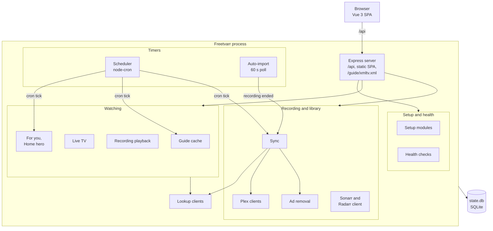
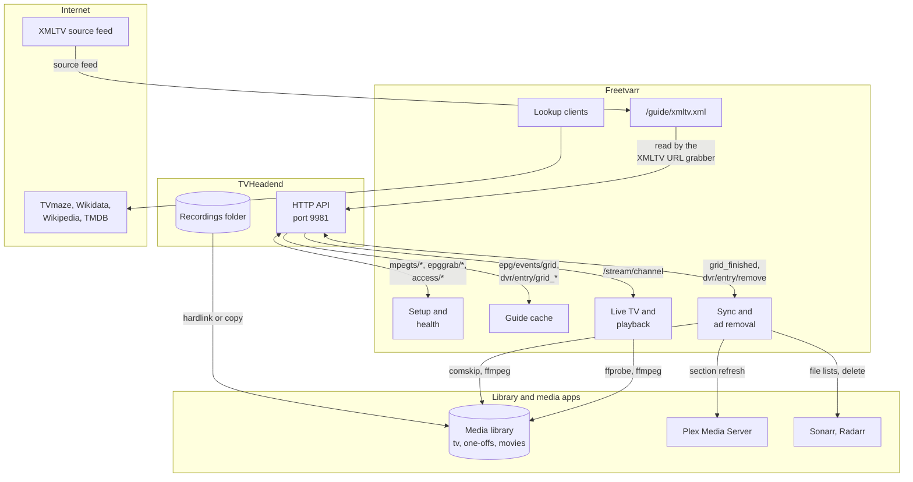
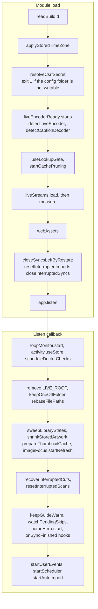
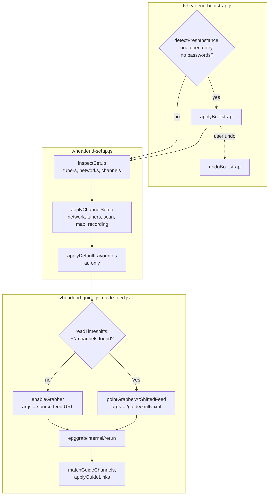
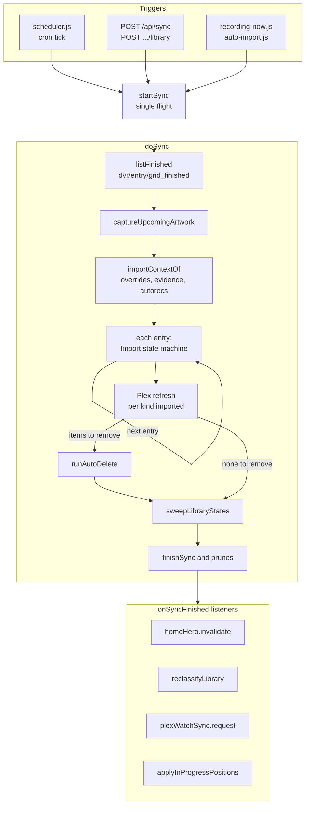
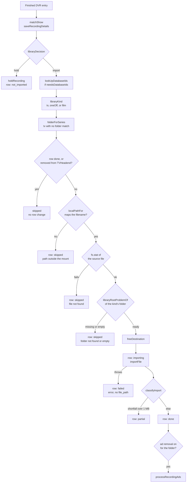
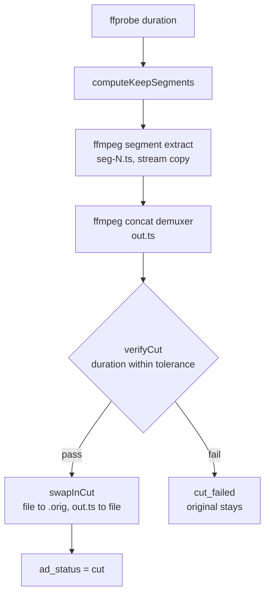
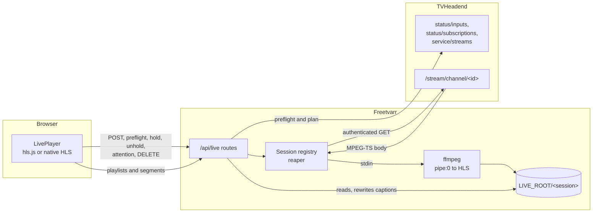
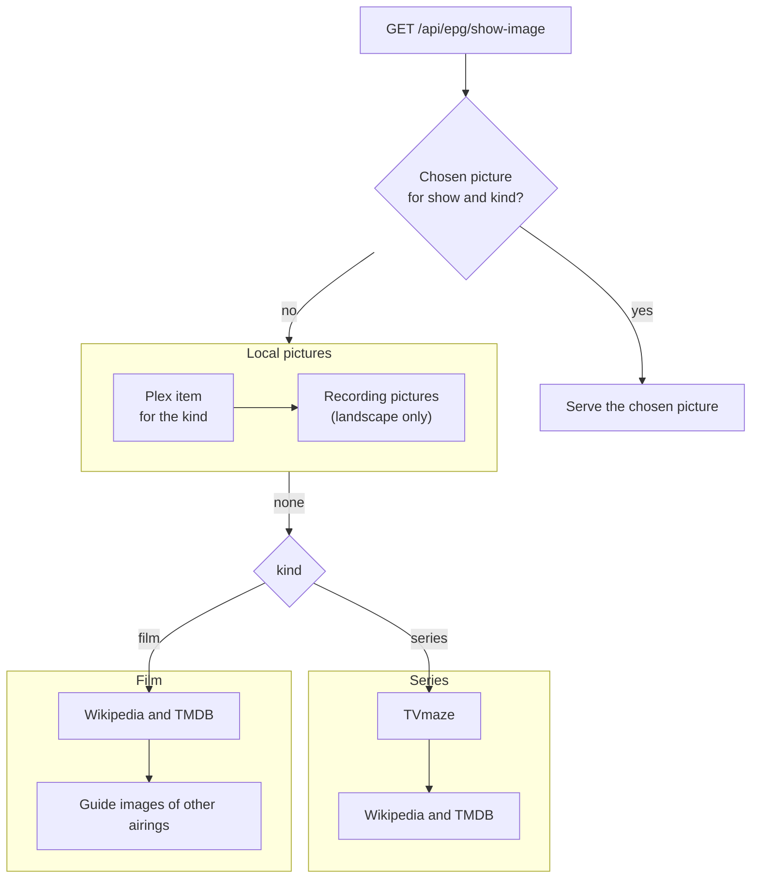

# Technical deep dive

Reference for the Freetvarr implementation: the modules, the data they keep, the calls they make, and the constants they use. The user-facing companion is the [guide](/guide/); the project summary is [`README.md`](https://github.com/furey/freetvarr/blob/main/README.md).

## Contents

- [Overview](#overview)
- [Architecture](#architecture)
- [Startup order](#startup-order)
- [Storage](#storage)
- [TVHeadend client](#tvheadend-client)
- [TVHeadend setup](#tvheadend-setup)
- [Guide](#guide)
- [Recording rules](#recording-rules)
- [Sync pipeline](#sync-pipeline)
- [Import state machine](#import-state-machine)
- [Library kinds](#library-kinds)
- [Ad removal](#ad-removal)
- [Removal from TVHeadend](#removal-from-tvheadend)
- [Live TV](#live-tv)
- [Recording playback](#recording-playback)
- [Pictures and programme info](#pictures-and-programme-info)
- [Plex](#plex)
- [Sonarr and Radarr](#sonarr-and-radarr)
- [For you and Home hero](#for-you-and-home-hero)
- [Search](#search)
- [Jobs and health](#jobs-and-health)
- [Web client](#web-client)
- [Security model](#security-model)
- [Full environment reference](#full-environment-reference)
- [Docker deployment](#docker-deployment)
- [Build and test](#build-and-test)

## Overview

Freetvarr is one [Node.js](https://nodejs.org/en/docs) process. It runs an [Express](https://expressjs.com/) server that serves a REST API under `/api` and a static [Vue 3](https://vuejs.org/guide/introduction.html) single-page app. The process reads the [TVHeadend](https://docs.tvheadend.org/documentation/development/json-api) API, the TVHeadend recordings folder, [Plex](https://support.plex.tv/articles/categories/your-media/), optional [Sonarr](https://sonarr.tv/) and [Radarr](https://radarr.video/), and third-party lookup services. It writes files into the media library folders, rows into a [SQLite](https://www.sqlite.org/docs.html) database, and DVR entries and rules into TVHeadend.

## Architecture

The first diagram shows the modules inside the process and what starts them.



The second diagram shows the external systems and the data paths between them.



### Module map

| Modules                                                                                                                                                       | Job                                                                                                                                                                                  | Talks to                                                                                    |
| ------------------------------------------------------------------------------------------------------------------------------------------------------------- | ------------------------------------------------------------------------------------------------------------------------------------------------------------------------------------ | ------------------------------------------------------------------------------------------- |
| `src/server.js`                                                                                                                                               | Builds the Express app: security middleware, `/api` routes, `/healthz`, the guide feed at `/guide/xmltv.xml`, the static SPA, the startup sequence                                   | Every module below                                                                          |
| `src/scheduler.js`, `src/schedule-runs.js`                                                                                                                    | Runs one [node-cron](https://github.com/node-cron/node-cron) task from the setting `sync_cron`; each tick starts a sync, a guide refresh, viewing-history upkeep, and For you upkeep | `src/sync.js`, `src/epg.js`, `src/user-events-log.js`, `src/for-you-service.js`             |
| `src/sync.js`                                                                                                                                                 | Lists finished TVHeadend recordings, matches them to show rules, imports them, refreshes Plex, removes imported recordings from TVHeadend                                            | `src/tvheadend.js`, `src/plex.js`, `src/commercials.js`, `src/show-folders.js`, `src/db.js` |
| `src/show-folders.js`, `src/show-identity*.js`, `src/database-ids.js`                                                                                         | Name a new show folder; find the TVmaze, TVDB, and TMDB ids of a show                                                                                                                | TVmaze, TMDB, `shows`, `show_identity_picks`                                                |
| `src/auto-import.js`, `src/recording-now.js`                                                                                                                  | Poll the running recordings, then start a sync after a recording ends                                                                                                                | `src/tvheadend.js`, `src/sync.js`                                                           |
| `src/tvheadend.js`, `src/http-auth.js`                                                                                                                        | HTTP client for the TVHeadend API with Digest or Basic auth                                                                                                                          | TVHeadend                                                                                   |
| `src/tvheadend-bootstrap.js`, `src/tvheadend-setup.js`, `src/tvheadend-guide.js`, `src/tv-login.js`                                                           | Wizard steps: lock an open TVHeadend, set up tuners and channels, set up the guide, create a watch-only TV app login                                                                 | TVHeadend `access/*`, `passwd/*`, `mpegts/*`, `epggrab/*`                                   |
| `src/guide-feed.js`, `src/guide-sources.json`                                                                                                                 | Serve the source [XMLTV](https://wiki.xmltv.org/index.php/XMLTVFormat) feed with time-shifted copies of programmes                                                                   | XMLTV source feed                                                                           |
| `src/epg.js`, `src/guide-cache.js`, `src/guide-history.js`, `src/guide-search.js`                                                                             | Cache the TVHeadend guide and recording state; save airings; search the guide                                                                                                        | `src/tvheadend.js`, `src/db.js`                                                             |
| `src/pending-skips.js`, `src/watchlist.js`, `src/repeat-match.js`, `src/autorec-match.js`, `src/title-countries.js`                                           | Single-episode skips, watchlist titles, matching of airings to rules and repeats, and the country words of series rule titles                                                        | `src/epg.js`, `src/tvheadend.js`                                                            |
| `src/live-tv.js`, `src/live-encoder.js`, `src/live-streams.js`, `src/live-benchmark.js`, `src/tuner-status.js`                                                | Pipe a TVHeadend channel stream through [FFmpeg](https://ffmpeg.org/documentation.html) into HLS files; pick the encoder; set the stream limit; read tuner use                       | TVHeadend, `ffmpeg`                                                                         |
| `src/playback.js`, `src/in-progress-playback.js`, `src/in-progress-positions.js`                                                                              | Play library files and running recordings as HLS sessions                                                                                                                            | `ffmpeg`, `ffprobe`, media library, TVHeadend `/dvrfile`                                    |
| `src/commercials.js`, `src/ad-original-routes.js`                                                                                                             | Detect and cut ad breaks with [Comskip](https://github.com/erikkaashoek/Comskip) and `ffmpeg`                                                                                        | `comskip`, `ffmpeg`, `ffprobe`, media library                                               |
| `src/plex*.js`, `src/external-ids*.js`                                                                                                                        | Plex discovery and section refresh; watched-state sync; whole-library listing                                                                                                        | Plex, `plex_watch_state`, `library_items`, `external_ids`                                   |
| `src/arr-*.js`, `src/foreign-delete.js`, `src/delete-manager-check.js`                                                                                        | Optional Sonarr and Radarr client for file lists, unmonitor, and delete                                                                                                              | Sonarr, Radarr                                                                              |
| `src/for-you*.js`, `src/top-rated.js`, `src/user-events*.js`, `src/watch-tracker.js`                                                                          | Record viewing events; score the guide against them; run the heavy work in a child process                                                                                           | `user_events`, `text_embeddings`, Hugging Face models, optional Ollama                      |
| `src/home-hero-service.js`, `src/hero-picture-proof.js`, `src/art-pool.js`                                                                                    | Build the Home hero snapshot                                                                                                                                                         | `src/epg.js`, `src/for-you-service.js`, `settings`                                          |
| `src/artwork*.js`, `src/show-artwork.js`, `src/fallback-artwork.js`, `src/programme-images.js`, `src/image-thumbnails.js`, `src/image-focus*.js`              | Find, store, resize, and crop pictures                                                                                                                                               | TVmaze, TMDB, Wikidata, Wikipedia, Plex, config folder                                      |
| `src/programme-ratings.js`, `src/programme-credits.js`, `src/classification-labels.js`, `src/genre-enrichment.js`, `src/series-ratings.js`, `src/known-as.js` | Look up ratings, cast, classifications, genres, series scores, and alternative titles                                                                                                | `src/outbound-http.js`, lookup tables                                                       |
| `src/outbound-http.js`, `src/lookup-gate.js`, `src/cache-prune.js`                                                                                            | Shared client for third-party requests; hourly lookup limit; daily deletion of expired lookup rows                                                                                   | Third-party hosts, lookup tables                                                            |
| `src/library*.js`, `src/show-folder-rename.js`                                                                                                                | Library listing, watched marks, folder moves, deletes, and folder renames                                                                                                            | `recordings`, `shows`, media library                                                        |
| `src/doctor.js`, `src/health-summary.js`, `src/path-check.js`, `src/docker-host.js`                                                                           | Health checks and the health level in the navigation                                                                                                                                 | TVHeadend, Plex, media library                                                              |
| `src/host-gate.js`                                                                                                                                            | The `Host` check, the allowed hostnames, and the names seen                                                                                                                          | `settings`                                                                                  |
| `src/activity*.js`, `src/progress.js`, `src/event-loop-lag.js`                                                                                                | Job registry, live progress, job-run storage, and event-loop monitoring                                                                                                              | `job_runs`                                                                                  |
| `src/web/`, `src/web-assets.js`, `src/build-id.js`                                                                                                            | Vue 3 client files, asset caching, and the build id                                                                                                                                  | Browser                                                                                     |
| `src/db.js`, `knexfile.js`, `migrations/`                                                                                                                     | [Knex](https://knexjs.org/) connection, settings helpers, and schema                                                                                                                 | `state.db`                                                                                  |

## Startup order

`docker-entrypoint.sh` runs `node node_modules/.bin/knex migrate:latest`, then `exec node src/server.js`. `src/server.js` runs these steps in order.



The module load step registers the routes between `resolveCsrfSecret` and `webAssets`. `liveEncoderReady` and `liveStreams.load` run without a wait; the live routes await `liveEncoderReady` when a session starts.

### Boot timers

| Timer               | Started by                   | First run                 | Repeat                          | Effect                                                      |
| ------------------- | ---------------------------- | ------------------------- | ------------------------------- | ----------------------------------------------------------- |
| Cron tick           | `startScheduler`             | Next match of `sync_cron` | Cron (default `*/30 * * * *`)   | Sync, guide refresh, viewing-history upkeep, For you upkeep |
| Recording poll      | `watchForFinishedRecordings` | `60 s`                    | `60 s`                          | Detects a finished recording ([Auto-import](#auto-import))  |
| Reapers             | Module load                  | `5 s`                     | `5 s`                           | End idle or stalled live and playback sessions              |
| Doctor checks       | `scheduleDoctorChecks`       | `2` min                   | `3` h                           | Refresh the health report                                   |
| Ratings warm-up     | Module load                  | `2` min                   | `1` h                           | Look up ratings for upcoming programmes                     |
| Cache prune         | `startCachePruning`          | `10` min                  | `24` h                          | Delete expired lookup rows                                  |
| Home hero build     | `homeHero.start`             | `20 s`                    | `5` min                         | Rebuild the hero snapshot                                   |
| Library folder sort | Listen callback              | `3` min                   | None                            | `runReclassificationOnce` ([Folder moves](#folder-moves))   |
| Guide warm-up       | `keepGuideWarm`              | Immediate                 | `5 s` after each local midnight | Reload the guide and recording state                        |
| Pending skips       | `watchPendingSkips`          | After each guide load     | `5` min                         | Reload the recording state while a skip or a repeat waits   |
| Watchlist sweep     | `mountWatchlist`             | None                      | `15` min                        | Create a series rule for a title in mode `record`           |

## Storage

Freetvarr stores state in SQLite through Knex and [better-sqlite3](https://github.com/WiseLibs/better-sqlite3). `knexfile.js` sets `useNullAsDefault: true` and runs two pragmas on each new connection: `journal_mode = WAL` ([WAL mode](https://www.sqlite.org/wal.html)) and `synchronous = NORMAL`.

`DB_PATH` sets the database file; the default is `config/state.db` in the repository root. The config folder is the directory of `DB_PATH`. `src/db.js` exports the Knex instance, `getSetting(key)` (the `value`, or `null`), `setSetting(key, value)` (upsert), and `deleteInChunks` (deletes by `rowid` in chunks of `200` and yields between chunks).

### Tables

| Table                       | Migrations                       | Holds                                                                                                                                                                                                                                                                                                                                      | Main writer                            |
| --------------------------- | -------------------------------- | ------------------------------------------------------------------------------------------------------------------------------------------------------------------------------------------------------------------------------------------------------------------------------------------------------------------------------------------ | -------------------------------------- |
| `settings`                  | `0001`                           | Key and text value of every setting                                                                                                                                                                                                                                                                                                        | `src/db.js`                            |
| `shows`                     | `0001`, `0037`, `0038`, `0039`   | Series folders: `show_pattern`, `dest_folder`, `season_template`, `enabled`, `delete_after_import`, `ad_removal`; identity ids and `identity_state`; `kept_folder`; `origin` (`user` or `auto`)                                                                                                                                            | `src/show-folders.js`, `src/server.js` |
| `recordings`                | `0001` and later, `0040`, `0042` | One row per TVHeadend recording: status, paths, sizes, ad status and backups, episode details, playback position, watched time, library state, classification, `genres_json`, `show_title_override`, `log_cleared_at` (hidden from the Recordings log, still in the library), `tvh_remove_pending_at` (a Remove after import to try again) | `src/sync.js`                          |
| `syncs`                     | `0001`                           | One row per sync: start, finish, status, `summary_json`                                                                                                                                                                                                                                                                                    | `src/sync.js`                          |
| `guide_programs`            | `0002`                           | Saved guide airings keyed by `channel_id` and `start`, with `program_json`                                                                                                                                                                                                                                                                 | `src/guide-history.js`                 |
| `show_artwork`              | `0005`                           | Cached picture sources per `title_key`                                                                                                                                                                                                                                                                                                     | `src/show-artwork.js`                  |
| `watchlist`                 | `0008`, `0014`                   | Titles to notify or record, with optional channel and padding                                                                                                                                                                                                                                                                              | `src/watchlist.js`                     |
| `user_events`               | `0010`                           | Viewing-history events                                                                                                                                                                                                                                                                                                                     | `src/user-events-log.js`               |
| `text_embeddings`           | `0011`                           | Embedding vectors per `text_hash` and `model_id`                                                                                                                                                                                                                                                                                           | `src/for-you-engine.js`                |
| `title_genres`              | `0011`                           | Cached genres per `title_key`                                                                                                                                                                                                                                                                                                              | `src/genre-enrichment.js`              |
| `show_nicknames`            | `0012`                           | User-added search names per `show_key`                                                                                                                                                                                                                                                                                                     | `src/search-aliases.js`                |
| `title_known_as`            | `0012`                           | Cached alternative titles per `title_key`                                                                                                                                                                                                                                                                                                  | `src/known-as.js`                      |
| `artwork_lookups`           | `0013`                           | Cached Wikipedia and TMDB picture lookups                                                                                                                                                                                                                                                                                                  | `src/fallback-artwork.js`              |
| `programme_ratings`         | `0015`, `0020`                   | Cached rating lookups, with `miss_reason`; TVmaze series scores under keys that start with `tvmaze:series:`                                                                                                                                                                                                                                | `src/programme-ratings.js`             |
| `programme_classifications` | `0016`, `0041`                   | Classification label per `title_key`, `start_ms`, and `shift_hours`                                                                                                                                                                                                                                                                        | `src/classification-labels.js`         |
| `programme_credits`         | `0017`, `0020`                   | Cached cast and crew lookups, with `miss_reason`                                                                                                                                                                                                                                                                                           | `src/programme-credits.js`             |
| `programme_categories`      | `0019`, `0041`                   | XMLTV category per `title_key`, `start_ms`, and `shift_hours`                                                                                                                                                                                                                                                                              | `src/classification-labels.js`         |
| `art_pools`                 | `0021`                           | Cached picture pools per `pool_key`                                                                                                                                                                                                                                                                                                        | `src/art-pool.js`                      |
| `show_artwork_choices`      | `0022`                           | The chosen picture per `show_key` and `kind`                                                                                                                                                                                                                                                                                               | `src/artwork-choices.js`               |
| `image_focus`               | `0024`, `0027`                   | Focus point and face box per picture URL                                                                                                                                                                                                                                                                                                   | `src/image-focus-service.js`           |
| `pending_skips`             | `0025`, `0031`                   | Skipped single airings by `program_id`                                                                                                                                                                                                                                                                                                     | `src/pending-skips.js`                 |
| `programme_kind_overrides`  | `0028`, `0029`                   | User-set kind per `show_key`                                                                                                                                                                                                                                                                                                               | `src/programme-kind.js`                |
| `job_runs`                  | `0032`                           | Finished job runs as `run_json`                                                                                                                                                                                                                                                                                                            | `src/activity-store.js`                |
| `series_evidence`           | `0033`, `0039`                   | Series facts per `show_key`; `database_ids` and `database_ids_at`                                                                                                                                                                                                                                                                          | `src/series-evidence.js`               |
| `plex_watch_state`          | `0034`                           | Watched snapshot of both sides per `recording_id`                                                                                                                                                                                                                                                                                          | `src/plex-watch.js`                    |
| `library_items`             | `0035`                           | Plex library items keyed by `rating_key` and `part_id`                                                                                                                                                                                                                                                                                     | `src/plex-library-store.js`            |
| `external_ids`              | `0036`                           | TVDB, TMDB, and IMDb ids per `title_key`, `kind`, and `source`                                                                                                                                                                                                                                                                             | `src/external-ids-store.js`            |
| `show_identity_picks`       | `0037`                           | The picked or declined identity per `title_key` and `network_family`                                                                                                                                                                                                                                                                       | `src/show-identity-store.js`           |

### Config folder

| Path                                       | Holds                                                                                              | Set by                                            |
| ------------------------------------------ | -------------------------------------------------------------------------------------------------- | ------------------------------------------------- |
| `state.db`, `state.db-wal`, `state.db-shm` | The database and its WAL files; back them up together                                              | `DB_PATH`                                         |
| `csrf-secret`                              | The CSRF secret when `CSRF_SECRET` is unset ([CSRF](#csrf))                                        | `src/csrf-secret.js`                              |
| `artwork/`                                 | Saved pictures of recordings (`recordings/<uuid>.<ext>`) and channel logos (`channels/<id>.<ext>`) | `ARTWORK_PATH`, else `artwork/` beside `state.db` |
| `uploads/artwork/`                         | Pictures that a user uploads                                                                       | `src/artwork-uploads.js`                          |
| `image-cache/`                             | Resized WebP pictures, `IMAGE_CACHE_MAX_MB` limit                                                  | `src/image-thumbnails.js`                         |
| `models/`                                  | Downloaded For you models                                                                          | `src/for-you-engine.js`                           |
| `comskip.ini`                              | Optional Comskip settings; replaces the bundled `assets/comskip.ini`                               | `src/commercials.js`                              |

## TVHeadend client

TVHeadend exposes a JSON API at `<tvh_url>/api/<path>`. `src/tvheadend.js` holds the HTTP client and the normalisers for TVHeadend objects.

### Transport

- `apiGet(path, params, conn)` sends a `GET` with the parameters in the query string. `apiPost(path, form, conn)` sends a form-encoded `POST`; object fields travel as JSON strings in one field (`node` or `conf`).
- `tvhRead` and `tvhWrite` export `apiGet` and `apiPost`. The setup, guide, bootstrap, and doctor modules build their own paths and call TVHeadend through these two functions.
- `resolveConnection` reads the settings `tvh_url`, `tvh_username`, and `tvh_password`. A caller URL gets the stored password only when it has the origin (scheme, host, and port) of `tvh_url` ([Secret binding](#secret-binding)).
- `sendAuthenticated` sends every request. With a username set, it sends the cached `Authorization` header. On a `401` it stores the `www-authenticate` challenge, signs the request, and sends it once more.
- `authorizationFor` in `src/http-auth.js` gives a Basic header, or a Digest response (MD5 or SHA-256, `qop=auth`). The challenge cache keys by `<url>|<username>` and drops an entry idle for `90 s`.

| Request or cache                          | Value                                                            |
| ----------------------------------------- | ---------------------------------------------------------------- |
| Default API call (`REQUEST_TIMEOUT_MS`)   | `15 s` timeout; also `/dvrfile/<uuid>` and channel icons         |
| Discovery probe                           | `1.5 s` timeout                                                  |
| Programme image (`fetchProgrammeImage`)   | `5 s` timeout, `4 MiB` limit, JPEG, PNG, WebP, GIF, or SVG bytes |
| Live stream (`openChannelStream`)         | No timeout                                                       |
| Past airings cache                        | `10` min; `apiPost` clears it before and after every write       |
| Tuner count and service multiplex caches  | `10` min                                                         |
| Default DVR profile and default languages | Process lifetime                                                 |

### Auto-discovery

`detectServers` serves `POST /api/tvh-detect`:

1. When `TVH_URL` is set, it returns that URL with `source: 'env'` and probes nothing.
2. `rankCandidates` lists URLs on port `9981`: the request hostname and local socket address, then the host IPv4 addresses (private first; `172.17.0.0–172.31.255.255` and `169.254.x.x` excluded), then `tvheadend`, `host.docker.internal`, and `127.0.0.1`.
3. `probeServer` requests `/api/serverinfo` on every candidate in parallel. A hit is a `200` with `sw_version`, or a `401` whose `www-authenticate` contains `tvheadend`.
4. Loopback hits drop when another hit exists. Alias hosts drop when their `serverinfo` body equals that of a numeric-address hit.

With no hit, the route answers `502`.

### Error mapping

`TvheadendError` carries `stage`, `status`, and `code`. `stage` is the API path for transport errors.

| Condition                                          | `stage`                         | `code`                                           |
| -------------------------------------------------- | ------------------------------- | ------------------------------------------------ |
| Network failure                                    | The path                        | The Node error code (for example `ECONNREFUSED`) |
| HTTP `401` or `403`                                | The path                        | `auth`                                           |
| Other HTTP status of `400` or more                 | The path                        | None                                             |
| No `tvh_url` setting                               | `config`                        | `no-url`                                         |
| Stream refused with `401` or `403` / `503` / other | `stream`                        | `auth` / `no-tuner` / `http`                     |
| Connection reset before video                      | `stream`                        | `no-source`                                      |
| Guide load finds no channels                       | `epg`                           | `no-channels`                                    |
| A create call returns no `uuid`                    | `record` or `series`            | `no-uuid`                                        |
| No matching entry or rule                          | `cancel`, `series`, or `remove` | `not-found`                                      |

### Normalised values

- Series key: `seriesKey` returns `` `${channelId}|${title.trim().toLowerCase()}` ``. Events carry it as `series_link`; autorec rules carry it as `seriesLinkId`. An any-channel rule has an empty channel part.
- Season and episode: `parseEpisodeDisp` reads `episode_disp` (for example `Season 3.Episode 7`) with the patterns `Season\s+(\d+)` and `Episode\s+(\d+)`. Guide events carry `seasonNumber` and `episodeNumber`.
- Guide text: `normaliseEvent` and `normaliseEntry` pass the subtitle and synopsis through `cleanGuideText` in `src/consumer-advice.js`. It strips `Consumer Advice: ...`, `Audio Described (AD).`, and a leading `From: <country>.`, and returns the advice letters as a list.
- Channels: `listChannels` drops disabled channels. `hd` follows the DVB service type (`0x11`, `0x19`, `0x1f` give HD; `0x01`, `0x16` give SD), else the channel name. `offAir` is true when every service is disabled.

### Endpoints

`src/tvheadend.js` calls these endpoints.

| Endpoint                                                                          | Use                                                                                                                    |
| --------------------------------------------------------------------------------- | ---------------------------------------------------------------------------------------------------------------------- |
| `serverinfo`                                                                      | **Test connection**, discovery probe, `verifyLogin`                                                                    |
| `channel/grid`                                                                    | Channel lineup, `limit 1000`                                                                                           |
| `epg/events/grid`, `epg/events/load`                                              | Guide events, `2000` per page; one programme by `eventId`                                                              |
| `dvr/entry/grid_upcoming`, `dvr/entry/grid_finished`                              | Scheduled and running entries; finished entries (every page of `5000`), the import queue                               |
| `dvr/entry/grid_failed`, `dvr/entry/grid_removed`                                 | Past airings for repeat checks, cached `10` min; removed entries that each sync marks not in TVHeadend                 |
| `dvr/entry/create_by_event`                                                       | **Record** ([Single recordings](#single-recordings))                                                                   |
| `dvr/entry/cancel`, `dvr/entry/stop`, `dvr/entry/remove`, `dvr/entry/prevrec/set` | Cancel, stop, and remove entries ([Removal from TVHeadend](#removal-from-tvheadend))                                   |
| `dvr/autorec/grid`, `dvr/autorec/create`                                          | Series rules ([Series recordings](#series-recordings))                                                                 |
| `idnode/save`, `idnode/delete`, `idnode/load`                                     | Padding, enable and disable, rule updates, retention; rule and child-entry deletes; one entry for in-progress playback |
| `dvr/config/grid`                                                                 | Default DVR profile (empty name, else the first) and its `storage` path                                                |
| `epggrab/channel/grid`                                                            | Channel logo fallback                                                                                                  |
| `status/inputs`, `status/subscriptions`, `hardware/tree`                          | Tuner readings, tuner holders, tuner count, and the multiplex of each tuner                                            |
| `mpegts/service/grid`, `service/streams`                                          | Multiplex and DVB type of each service; elementary streams of a channel                                                |
| `config/load`                                                                     | Default language for the live audio track                                                                              |
| `/dvrfile/<uuid>`                                                                 | A recording that TVHeadend still writes ([From the start](#from-the-start)); outside `/api`                            |
| `/stream/channel/<uuid>`                                                          | Live TV ([TVHeadend stream request](#tvheadend-stream-request)); outside `/api`                                        |

The setup modules use these endpoint groups:

| Module                       | Endpoints                                                                                                                                                                                                                                                                       |
| ---------------------------- | ------------------------------------------------------------------------------------------------------------------------------------------------------------------------------------------------------------------------------------------------------------------------------- |
| `src/tvheadend-bootstrap.js` | `access/entry/grid`, `passwd/entry/grid`, `access/entry/create`, `passwd/entry/create`, `idnode/load`, `idnode/delete`, `serverinfo`                                                                                                                                            |
| `src/tvheadend-setup.js`     | `hardware/tree`, `mpegts/network/grid`, `mpegts/input/network_list`, `dvb/scanfile/list`, `mpegts/network/create`, `mpegts/network/scan`, `mpegts/mux/grid`, `mpegts/service/grid`, `service/mapper/save`, `service/mapper/status`, `idnode/save`, `config/load`, `config/save` |
| `src/tvheadend-guide.js`     | `epggrab/module/list`, `idnode/load`, `idnode/save`, `epggrab/config/load`, `epggrab/config/save`, `epggrab/internal/rerun`, `epggrab/channel/grid`, `channel/grid`, `epg/events/grid`                                                                                          |
| `src/tv-login.js`            | `access/entry/grid`, `passwd/entry/grid`, `access/entry/create`, `passwd/entry/create`, `idnode/delete`                                                                                                                                                                         |
| `src/doctor.js`              | Read-only grids and `config/load`; `status/inputs` and `dvr/entry/grid_upcoming` as rights probes (a `403` names the missing right)                                                                                                                                             |

## TVHeadend setup

The setup wizard runs three modules against TVHeadend in order: `src/tvheadend-bootstrap.js` (logins), `src/tvheadend-setup.js` (tuners and channels), and `src/tvheadend-guide.js` (guide). Each module takes an `http` object with `get` and `post`; `src/server.js` supplies `tvhRead`, `tvhWrite`, and `verifyLogin`. Each apply runs as a background job with a step list that the `progress` route returns.



| Route group         | Routes                                                                                        | Limiter                                                       |
| ------------------- | --------------------------------------------------------------------------------------------- | ------------------------------------------------------------- |
| Bootstrap           | `GET /api/tvh-bootstrap/status`, `GET .../progress`, `POST .../apply`, `POST .../undo`        | `bootstrapStatusLimiter` (reads), `bootstrapLimiter` (writes) |
| Tuners and channels | `GET /api/tvh-setup/status`, `GET .../progress`, `POST .../tuner-address`, `POST .../apply`   | Same                                                          |
| Guide               | `GET /api/tvh-guide/status`, `GET .../progress`, `POST .../apply`, `GET` and `POST .../links` | Same                                                          |
| TV app login        | `GET`, `POST`, and `DELETE /api/tv-login`                                                     | `bootstrapLimiter` (writes)                                   |

The setup and guide `apply` routes answer `202`. Every `apply` route answers `409` while a run is active.

### Bootstrap

`detectFreshInstance` requests `access/entry/grid` and `passwd/entry/grid` without credentials. The result `reason` is `secured` (TVHeadend answers `401` or `403`), `has-users`, or `open-default-entry` (one access entry with username `*` and `admin: true`, and no password entries; only this one is fresh).

`applyBootstrap` runs these steps in order: `check-fresh`, `create-admin`, `create-freetvarr`, `verify-freetvarr`, `verify-admin`, `back-up-open-entry`, `save-connection`, `remove-open-entry`, `confirm-locked`.

- The user `freetvarr` gets a random password of `24` bytes. Each verify step signs in with `11` attempts, `1 s` apart.
- Both access entries get the comment `Created by Freetvarr`, admin, web UI, streaming, and DVR rights, and the network prefixes from the request.
- `back-up-open-entry` saves the open entry as JSON in the setting `tvh_open_entry_backup`. `save-connection` saves `tvh_url`, `tvh_username`, and `tvh_password`.
- A failure before `remove-open-entry` deletes the created entries. `confirm-locked` waits for an anonymous `serverinfo` to answer `401`.
- `undoBootstrap` posts the saved entry to `access/entry/create`; the undo route then deletes the setting.

### Tuners and channels

`inspectSetup` reads tuners from `hardware/tree`, networks, the channel count, and recordings in progress. A tuner is a leaf of the hardware tree; its class suffix gives its delivery system (`dvbt`, `dvbc`, `atsc_t`, `atsc_c`, or `isdb_t`). `src/zone-countries.js` maps the time zone to a country code, and `pickTransmitter` ranks the `dvb/scanfile/list` transmitters of that country by the time-zone city.

`applyChannelSetup` runs these steps:

| Step id     | Action                                                                                                       |
| ----------- | ------------------------------------------------------------------------------------------------------------ |
| `network`   | Use the chosen network, or create one with `mpegts/network/create` from the transmitter key                  |
| `tuners`    | Turn on each tuner and add the network to it                                                                 |
| `scan`      | Poll every `2 s`; fail with `no-signal` (no services) or `scan-timeout` (`30` min)                           |
| `map`       | Map enabled, unencrypted TV services that have no channel; fail with `map-empty` or `map-timeout` (`20` min) |
| `recording` | When the default DVR profile has `rerecord-errors` of `10`, set it to `0`                                    |

After a successful run, the apply route calls `applyDefaultFavourites` (`src/default-favourites.js`). For time zones that map to `au`, with no pinned channel and the setting `default_favourites_applied` unset, it pins one channel each of ABC, Seven, Nine, Ten, and SBS (HD first).

`tunerAddressConfig` saves a manual [HDHomeRun](https://info.hdhomerun.com/info/hdhomerun_flex_quatro) address as `hdhomerun_ip` through `config/save`. Inside a Docker VM it also saves `local_ip` and `local_port` `9983`.

### Guide feed

`src/guide-sources.json` lists XMLTV feeds from [i.mjh.nz](https://i.mjh.nz/) per country: `au` has eight city feeds and `nz` has one. `suggestGuide` picks the feed whose region equals the time-zone city.

`applyGuideSetup` runs three steps:

1. `feed`: find the module titled `XMLTV URL grabber` (else `no-grabber`), and read the feed channels (`feed-unreachable`, `feed-empty`). Then enable the grabber with `priority` `3` and start an import (below).
2. `download`: poll `epggrab/channel/grid` every `3 s` until every feed channel exists; `download-timeout` after `5` min unless some exist.
3. `link`: match TV channels to guide channels by LCN, then by normalised name; save the links and return unmatched channels with a guess.

The grabber `args` depend on time-shifted channels:

- `readTimeshifts` finds TVHeadend channels named `+N` (pattern `\+\s*(\d+)\s*(hd)?$`) that the feed does not carry, and matches each to a base channel.
- With none, the grabber `args` is the source feed URL.
- With some, `pointGrabberAtShiftedFeed` stores the source URL in the setting `guide_source_url` and sets `args` to the Freetvarr URL of `/guide/xmltv.xml`. When TVHeadend does not request that URL within `150 s`, the grabber falls back to the source URL.
- `keepGuideSaved` turns on `epgdb_periodicsave` and `epgdb_saveafterimport`.

`GET /guide/xmltv.xml` (`serveShiftedFeed` in `src/guide-feed.js`) answers `404` when `guide_source_url` is empty and `502` when the source fails before output. Otherwise it streams the source (gunzipped for `.gz`) through `createShiftedFeedStream`. That stream adds a `<channel>` per shifted channel with the id `<baseId>.plus<hours>`, and writes each base programme twice: the original and a copy moved by the shift hours. It also passes ratings and categories to the classification store ([Classification](#classification)).

After a successful apply, the server clears the guide cache now and again after `2` min (`GUIDE_IMPORT_SETTLE_MS`).

### TV app login

`createTvLogin` (`src/tv-login.js`) makes a TVHeadend login for a TV app such as Kodi ([TV apps](/guide/tv-apps)). The access entry has the comment `TV apps login, created by Freetvarr`, streaming rights only, and the prefix list of the connected user. The password is `12` random bytes in base64url. The settings `tv_login_username`, `tv_login_password`, and `tv_login_auth_code` store the result. `deleteTvLogin` deletes only entries with the stored username and that comment. `POST /api/tv-login` returns `409` (`code` `exists`) while a TV login is stored, before any TVHeadend call.

## Guide

### Guide cache

`getCachedGuide` in `src/epg.js` returns one in-memory guide for the current local day (`createGuideCache` in `src/guide-cache.js`).

- `loadGuide` runs `listChannels`, `listEvents`, `loadTitleGenres`, and `loadSeriesEvidence` in parallel. The window runs from local midnight to the end of day `7` (`GUIDE_DAYS`).
- `listEvents` reads `epg/events/grid` sorted by start, `2000` events a page (`EVENT_PAGE_SIZE`), `4` pages at a time (`EVENT_PAGE_CONCURRENCY`).
- `GUIDE_TTL_MS` is `60` min; an empty guide expires after `60 s`. An expired guide of the same day serves while a reload runs. A failed reload serves the cached guide with `stale: true`. A failed load for a new day (at midnight) also serves the previous day's guide with `stale: true`, and that day loads again only after `GUIDE_STALE_RETRY_MS`. `getGuideDay` builds its day window from `localMidnightMs()`, not from the guide's `startMs`, so the stale guide still shows today.
- One load runs at a time. `clearGuideCache` drops the cache. `onGuideLoaded` listeners run after each load.
- The cron tick (`cron:guide`), `keepGuideWarm`, and guide setup trigger reloads.

`getRecordingState` caches the merged TVHeadend recording state for `45 s` (`createRecordingStateCache` in `src/recording-state-cache.js`). After a failure it serves the last state with `stale: true` for `60 s`. `invalidateRecordingState` clears it after each write, including a write that failed, and bumps a generation counter. Every read after an invalidate starts a new load; an older load that ends later does not write the cache and does not clear the newer load.

### Guide history

`saveGuidePrograms` (`src/guide-history.js`) writes every loaded event to `guide_programs` in one transaction. It deletes rows that overlap the loaded span per channel, inserts the events in chunks of `500`, and deletes rows that ended before the start of yesterday. The columns are `channel_id` and `start` (primary key), `end`, `program_id`, `dvr_state`, `dvr_uuid`, and `program_json`.

`getGuideDay` merges saved rows with live events. A saved row stays only when no live event overlaps it. `toGuideCell` adds `past` and `recorded` (past, with a `dvr_uuid`).

`GET /api/epg/guide?day=0..6` returns one day. `guideDayWindow` gives `dayStart`, `dayEnd`, and `spillEnd` from calendar dates in the process time zone. A daylight-saving day lasts `23` or `25` hours. `spillEnd` is `dayEnd` plus `180` min (`EPG_SPILL_MIN`). A programme that crosses midnight appears in both days.

### Series evidence

`loadGuide` gives each event a `kind` through `displayKindOf` (`src/display-kind.js`), first match wins:

1. `movie` when `isFilmAiring` holds.
2. `one-off` for a sports airing whose stored `databaseIds` is `none`, or is unset and the title has a year.
3. `series` when the title has a TVmaze record, or the event has a season, an episode, or an episode title.
4. `series` when the title airs `3` or more times in the loaded week; otherwise `one-off`.

`saveGuideEvidence` writes per-title facts to `series_evidence`. `facts_json` holds `recurs`, `realSeason`, `sports`, `awardShow`, and `minDatedEpisode`. `recurs` is true when at least `2` distinct episodes first air on `2` different local days. New facts merge with stored facts by logical OR. The sync and the library read the table through `loadSeriesEvidence` ([Library kinds](#library-kinds)).

### Channel order

`getChannelPrefs` reads the settings `epg_pinned_channels` and `epg_hidden_channels` (JSON id arrays), `epg_channel_sort` (`default`, `number`, or `name`), `epg_hide_sd_simulcasts`, and `epg_hide_sd_channels`. `GET` and `PUT /api/epg/channel-prefs` read and write them.

`orderChannels` (`src/web/channel-order.js`, re-exported by `src/channel-order.js`) puts pinned channels first in pin order, then sorts the rest. A channel is hidden when it is not pinned and is in the hidden list, is a hidden SD simulcast, or is SD while `epg_hide_sd_channels` is on.

`GET /api/epg/logo/:channelId` serves the channel's `icon_public_url`, then the `epggrab/channel/grid` icons, then the saved artwork. The memory cache keeps a hit for `24 h` and a miss for `10` min.

### Skipped episodes

A series-rule airing that TVHeadend has not scheduled yet cannot be cancelled. `cancelProgram` then stores a row in `pending_skips` (`program_id`, `channel_id`, `title`, `start_ms`, `end_ms`). On each recording-state load, `withPendingSkipsApplied` disables a newly scheduled entry that matches a row (`idnode/save` with `enabled: false`), then deletes the row. An entry matches when it has the same channel and event id, or else the same channel and title with a start at most `SIMULCAST_START_TOLERANCE_MS` (`2` min) away; of several title matches, the nearest start wins. Rows whose `end_ms` passed are deleted. `watchPendingSkips` reloads the recording state every `5` min while a skip waits.

### Repeats and rules

- `isSameIdentity` (`src/repeat-match.js`) decides whether two airings are the same episode: equal episode URIs; else equal season and episode numbers; else equal titles with equal real subtitles and agreeing descriptions.
- `earlierAiringOfEntry` finds an earlier airing of the same episode for an upcoming entry. `splitRepeats` marks a rule timer (`autorecId` set) as a repeat; a one-off the user scheduled is never a repeat, except a TVHeadend duplicate (`duplicateOfStart`). `withRecordedRepeatsSkipped` disables each enabled repeat whose original is recorded.
- `planUpcomingRecordings` projects expected episodes only from enabled autorecs, so a paused series lists none. It also projects the airings of each title variant of a rule (`titleVariants`), by the series link of that title.
- `autorecMatchesAiring` (`src/autorec-match.js`) tests a guide airing against an autorec rule: channel, title, `serieslink`, weekday, start window, and duration. A title in Freetvarr's whole-title form matches through `isSameShowTitle`; a plain-text title matches as a substring; any other title is a regular expression of up to `200` characters with a cost cap. A rule that sets `tag`, `content_type`, `cat1`–`cat3`, `star_rating`, `btype`, `brand`, or `season` is unsupported and never matches.
- The whole-title form is `^Title` (or `^(Title|Variant|…)` with [title variants](#title-variants)) and then `sameShowSuffixOf(country)`: an optional space, one of `:`, `(`, or `-`, and the rest of the title, in a form TVHeadend reads as POSIX ERE or PCRE2. The country is the install country, `installCountry` in `src/title-countries.js`: `countryForTimeZone(currentTimeZone())`, read again when `process.env.TZ` changes. The suffix refuses a rest that is only a foreign edition tag, with an optional space before it and an optional `)` after it. The refused tags (`excludedEditionTagsOf`) are `UK`, `US`, `USA`, `AU`, `AUS`, and `NZ`, less the own words of the country (`countryTitleWordsOf`), in that order. An `au` or `nz` install refuses `UK`, `US`, and `USA`, so its suffix is the same as in 2.10.1. An unknown country refuses nothing, and its suffix is `( ?[-:(].*)?$`. The suffix has no lookahead: `notAnyOfPattern` builds a trie of the refused rests and writes its complement as nested groups and negated bracket expressions, with both letter cases in each bracket. `isSameShowTitle` applies the same rule, with `excludedTags` (the install country's tags when not given). `anchoredTitlesOf` reads the titles back with the suffix of any country (`knownEditionTagSets`), and gives the refused tags of that suffix as `excludedTags`, so the read-back and the series key do not depend on the install country. It also reads the 2.9.0 suffix `( ?[:(-].*)?$` (`excludedTags: []`), but only with a single title: a group of titles before the 2.9.0 suffix is a hand-made pattern, so the rule keeps its raw title as its name and series key.
- `airingIdentityOf` (`src/airing-identity.js`) groups airings of one broadcast on twin channels: the same title in one channel family (an SD and HD pair, or a channel and its `+N` channels) with base starts `60 s` or less apart (`TWIN_START_TOLERANCE_MS`).

## Recording rules

Freetvarr writes two kinds of rule to TVHeadend: single DVR entries and autorec rules (series recordings). `src/tvheadend.js` makes every call. `src/epg.js` wraps each call and clears the cached recording state after it.

### Single recordings

`POST /api/epg/record` takes `channel_id`, `program_id`, and optional `lead_time`, `lag_time`, and `add_to_library`. When the programme has a row in `pending_skips`, `recordProgram` deletes the row and makes no TVHeadend call. Otherwise `scheduleRecording` runs:

1. When an enabled entry for the same programme exists in `dvr/entry/grid_upcoming`, send `idnode/save` with the padding the request gave (if any), and stop. No second timer is made.
2. When a disabled entry for the same programme exists, send `idnode/save` with `enabled: true` and only the padding the request gave, and stop. A skipped series episode keeps the padding it copied from its rule.
3. Otherwise send `dvr/entry/create_by_event` with `event_id`, `config_uuid` (the default DVR profile), and `comment`.
4. Send `idnode/save` with `start_extra` and `stop_extra` on the new entry. When this save fails, the result is still `ok` with `paddingSaved: false`, and the programme sheet says so.

The `comment` is the library tag: `freetvarr: add to library`, or `freetvarr: not for the library` when `add_to_library` is `false`. `normaliseEntry` reads it back as `libraryChoice` (`include` or `exclude`). The padding defaults are `DEFAULT_LEAD_MINUTES` (`2`) and `DEFAULT_LAG_MINUTES` (`10`), used only for a new entry. `src/recording-defaults.js` stores the **Add to library** default in the setting `add_to_library_default`.

`POST /api/epg/cancel` calls `cancelRecording`. A running entry stops ([Stop a recording](#stop-a-recording)). A scheduled entry from an autorec is disabled with `idnode/save`. A scheduled single entry gets `dvr/entry/cancel`, then `dvr/entry/remove`.

### Series recordings

`POST /api/epg/record-series` takes `series_link`, `channel_id`, `program_id`, and optional `lead_time`, `lag_time`, `episodes_to_keep`, `any_channel`, `paused`, and `add_show_rule`. `enableSeriesTag` returns an existing autorec with the same series key (`existed: true`). Otherwise it sends `dvr/autorec/create` with `conf` from `newAutorecConfOf`:

```javascript
{
  enabled: !paused,
  name: title,
  title: anchorAutorecTitle(title),
  fulltext: false,
  channel: channelId,
  start: 'Any',
  start_window: 'Any',
  weekdays: [1, 2, 3, 4, 5, 6, 7],
  pri: 2,
  record: 1,
  start_extra: leadTime,
  stop_extra: lagTime,
  maxcount: episodesToKeep,
  config_name: configName,
  comment: 'freetvarr',
}
```

- `channel` is `''` when `any_channel` is `true`. `maxcount` defaults to `0` (keep all).
- `record: 1` (`DUPLICATE_DETECTION_EPISODE_NUMBER`) turns on TVHeadend duplicate detection by episode number.
- `title` is `^${escapeAutorecTitle(title)}( ?[:(-].*)?$`. TVHeadend reads the autorec title as a caseless regular expression that matches anywhere, so the anchors stop `The Chase` from recording `The Chase Australia` or `Beat The Chase`. The tail still matches `The Chase (Ep 5)` and `The Chase: Celebrity Special`. It is valid POSIX ERE and PCRE.
- `comment: 'freetvarr'` (`CREATOR_TAG`) marks the rules that Freetvarr made. `listAutorecs` turns each escaped title, with or without the anchors, back into the literal title (`literalTitleOf`), so the series key stays `channel|title`.
- Unless `add_show_rule` is `false`, the route calls `ensureShowFolder` with origin `user` ([Show origin](#show-origin)).

| Route                                | Function               | TVHeadend call                                                             |
| ------------------------------------ | ---------------------- | -------------------------------------------------------------------------- |
| `POST /api/epg/pause-series`         | `setSeriesTagsEnabled` | `idnode/save` with `enabled` on each autorec                               |
| `PATCH /api/library/shows/:key/rule` | `updateSeriesTags`     | `idnode/save` with `maxcount` and padding on every autorec of the show key |
| `POST /api/epg/cancel-series`        | `cancelSeriesRules`    | `idnode/delete` on each autorec ([Stop a recording](#stop-a-recording))    |

`rulePatchFrom` in `src/library.js` limits `episodes_to_keep` to `0–999`, and the padding to `0–240` minutes (`MAX_PADDING_MINUTES`).

### Watchlist

`src/watchlist.js` holds the routes (`GET`, `POST`, `PATCH`, and `DELETE /api/watchlist`) and the sweeper. A `watchlist` row has `title`, `title_key` (unique), `mode` (`notify` or `record`), an optional `channel_id`, padding, `seen_through`, `fulfilled_at`, and `series_link_id`. `guideMatchesFor` lists up to `20` future airings on visible channels with the same show key.

The record sweeper runs every `15` minutes, at each `GET /api/watchlist` (which answers without waiting for it), and after each write that sets `record` mode. For each unfulfilled `record` row, it takes the first match with a `series_link`, calls `recordSeries` with `anyChannel: true`, and sets `fulfilled_at` and `series_link_id`. A row that fails logs a warning and stays unfulfilled; the sweep goes on with the next row. It then calls `ensureShowFolder` with origin `user` when `add_to_library_default` reads as `true`.

## Sync pipeline

`src/sync.js` runs the sync. A sync imports each new finished recording into the library and refreshes Plex. It then removes imported recordings from TVHeadend where the series folder asks for it.

### Triggers

`startSync({ trigger, showId })` starts a sync:

| Trigger              | Caller                                                                                  |
| -------------------- | --------------------------------------------------------------------------------------- |
| `cron`               | `src/scheduler.js`, on each tick of the setting `sync_cron`                             |
| `recording-finished` | `src/auto-import.js`, after a recording ends                                            |
| `manual`             | `POST /api/sync` with no `show_id`                                                      |
| `manual-single`      | `POST /api/sync` with an integer `show_id`; imports only entries that match that folder |
| `manual:import`      | `POST /api/recordings/:recording_id/library` with `choice: 'include'`                   |

`POST /api/sync` returns `202` for a new sync and `200` when one already runs. `syncLimiter` allows `5` requests a minute. For `cron` and `recording-finished`, a missing TVHeadend URL gives `{ skipped: true }` and no `syncs` row.

`scheduleWith` in `src/scheduler.js` validates the expression with node-cron and falls back to `*/30 * * * *`. Each tick runs these jobs through `measureJob`, each independent of the others: `cron:sync`, `cron:guide` (`getGuideSnapshot`), `cron:viewing-history` (`pruneUserEvents`, `backfillUserEvents`), and `cron:for-you` (`runForYouUpkeep`). `startScheduler` runs again when `POST /api/settings` changes `sync_cron` or `time_zone`. `GET /api/sync-status` returns `activeSyncId`, `cron`, and `nextRunAt`.

### Auto-import

`watchForFinishedRecordings` calls `getRecordingNow` (`src/recording-now.js`) every `60 s`; the answer is cached for `4 s`. When an active recording leaves the active list, it loads the entry with `idnode/load` and calls the `onRecordingFinished` listeners. The first poll also announces entries that ended in the last `60` minutes and have no `recordings` row.

`createAutoImport` in `src/auto-import.js` waits for quiet before it starts a sync. Each finished recording resets a `60 s` timer (`QUIET_MS`); the timer never fires later than `5` min (`MAX_WAIT_MS`) after the first finish. When a sync already runs, one follow-up starts from the next `onSyncFinished` call. The poll and the auto-import start only when the cron expression runs on at least one day (`scheduleEverRuns` in `src/schedule-runs.js`).

### Single flight

`inFlight` in `src/sync.js` holds `{ syncId, promise }` of the running sync. `startSync` returns `{ syncId, alreadyRunning: true }` while `inFlight` is set. With `followUp: true` (the Import route sends it), a call during a sync also starts one more sync with that trigger when the running sync ends. `startSync` waits while a folder rename or a library delete runs (`runLibraryChange` in `src/library-busy.js`), for up to `10` min; after that it records a sync with status `error` and does not run; those refuse to start while a sync starts or runs (`isSyncBusy`), and an ad scan refuses while they run. Each sync is a `sync` job in [Activity](#activity), titled `Sync #<id>`.

### Sync order



1. `listFinished` reads every page of `dvr/entry/grid_finished` (`5000` a page, up to `10` pages). A failure here, or in the `shows` read, ends the sync with status `error`. `markRemovedByTvheadend` then reads `dvr/entry/grid_removed` (shared with the `10` min past-airings cache) and sets `deleted_from_tvh_at` on each row whose entry TVHeadend removed itself (`fileremoved` set, for example by **Keep the latest**). A file that is only missing, such as on an unmounted disk, does not count.
2. `captureUpcomingArtwork` saves the image of each enabled upcoming entry ([Recording artwork](#recording-artwork)).
3. `importContextOf` loads the kind overrides, the `series_evidence` facts, the `recordings` rows by show key, and the autorec names.
4. Each finished entry runs through the [Import state machine](#import-state-machine).
5. Each library kind with an import refreshes its Plex section ([Plex](#plex)).
6. `runAutoDelete` removes the queued recordings from TVHeadend, with the earlier removals that wait for a retry ([Remove after import](#remove-after-import)).
7. `sweepLibraryStates` checks that each imported file still exists ([Library delete](#library-delete)).
8. `finishSync` writes the status and summary, then runs `pruneSyncHistory`, `pruneTombstonedRecordings`, and `pruneCutOriginals`.

The `finally` step clears `inFlight`, then calls each `onSyncFinished` listener with `{ syncId, trigger }`, also after an `error`. The status is `ok`, `partial` when any item failed, or `error`. `summary_json` holds the trigger, the counts `imported`, `skipped`, and `failed`, `errors`, up to `100` items (`SYNC_ITEMS_CAP`), milliseconds per step, the Plex results, the `delete` result, and the `ads` counts.

Before `app.listen`, `closeSyncsLeftByRestart` (`src/startup-reconcile.js`) runs `resetInterruptedImports`, which sets each `importing` row back to `pending`, and `closeInterruptedSyncs`, which sets each `running` row to `error` with the message `Freetvarr restarted before this sync finished.` Both only read and write the database, so a sync that starts after the server listens stays `running`.

### Sync history

`src/sync-history.js` serves `GET /api/syncs` (`page`, `pageSize` default `50` and maximum `200`, `show` filters, `trigger` of `manual`, `cron`, or `auto` for `recording-finished`) and `DELETE /api/syncs[/:id]`. An empty sync has status `ok` and no imports, failures, or removals. `pruneSyncHistory` keeps the newest `100` empty syncs, then the newest `500` syncs, and never deletes a `running` row.

## Import state machine

### Show matching

`matchShow(shows, title, { sport })` in `src/sync.js` picks the series folder (a `shows` row) for a title. It takes the longest matching `show_pattern`. A row with `origin` `user` (or none) matches as whole words anywhere in the title, case-insensitive (`wordBoundedPattern`). A row with `origin` `auto` matches when its show key equals the title's show key, or when the title is the pattern followed by a colon, a dash, or a bracket (`isSameShowTitle`, the series rule title form), so the `auto` row `Survivor` does not match `Australian Survivor`. A row of either origin also matches each title in its `title_variants`, the same way: `doSync` adds them from `series_title_variants` by the show key of `show_pattern` (`withTitleVariants`). For a mostly-sport title, an `auto` row matches only when its show key equals the title's show key. So the `auto` row `Rugby League World Cup 2026` does not match `Women's Rugby League World Cup 2026`. Sport means a DVB genre code from `0x40–0x4F`.

### Decision tree

`doSync` runs each finished entry through these steps. `saveRecordingDetails` first upserts the entry's details on its `recordings` row (channel, air time, synopsis, genres, `tvh_filename`).



1. `libraryDecision` decides import or hold, first match wins:
    1. `library_choice` `exclude` on the row holds (`Kept out of the library`).
    2. `library_choice` `include` on the row imports. **Import** in the [Recording log](/guide/recordings#recording-log) sets it.
    3. The entry's library tag `exclude` holds (`Recorded with Add to library off`).
    4. A matched folder, the setting `import_unmatched` not `false`, or the library tag `include` imports.
    5. Anything else holds (`No series folder for this title, and Import every recording is off`).
2. `holdRecording` sets `status` `not_imported`, `error` to the reason, and `file_path`, `purged_at`, and `log_cleared_at` to `null`. So a held row cleared from the log comes back at the next sync while TVHeadend still has it. It leaves a `done`, `partial`, or `importing` row, or a row with `deleted_from_tvh_at`, unchanged.
3. `lookUpDatabaseIds` runs when `needsDatabaseIds` is true ([Sport and database ids](#sport-and-database-ids)).
4. `libraryKind` gives `tv`, `oneOff`, or `film` from `seriesKindOf` ([Library kinds](#library-kinds)). A film with no movies folder gives `oneOff`.
5. For `tv` with no matched folder, `folderForSeries` calls `ensureShowFolder`. An entry from a series recording uses the autorec name and origin `user`; any other entry uses its title and origin `auto`.
6. `processItem` writes `skipped` with the reason in `error` when the path does not map, the source file is missing, or the library folder for the kind is not ready ([Library folder check](#library-folder-check)). A `partial` row keeps its `status` and `file_path`; only `error` changes.
7. `importItem` imports the file and classifies it. When the folder or the copy throws, the row becomes `failed` with the error and no `file_path`, and the next sync tries again. A copy that throws deletes its part-copied file. It runs [Ad removal](#ad-removal) only for a `done` item with a series folder.

Each import is an `import` job in [Activity](#activity), titled `Import · <title>`.

### Library folder check

`libraryRootProblemOf(root)` in `src/library-roots.js` gives `missing` when `readdir` of the folder fails, and `empty` when the folder has no entry other than names that start with `.`, `@`, or `#` while `recordings` rows with `status` `done` or `partial`, no `purged_at`, no `library_state`, and no `library_deleted_at` have a `file_path` under it. Anything else is ready. An empty folder on a new install is ready, because no row points into it. A sync checks each folder once (`createRootCheck`).

- The TV, one-off, and movies imports skip with `<kind> folder <root> not found; mount it or change it in Settings` or `<kind> folder <root> is empty, but imported recordings point into it; check that it is mounted`. No folder is created, so nothing is written to the mount point of an unmounted share, and nothing is removed from TVHeadend.
- `refreshLibraryStates` keeps the stored `library_state` of a row whose file is missing when the row's folder is not ready, so the Library keeps its shows while the share is gone.
- **Import again** (`POST /api/recordings/:id/library` with `include`) answers `409` when the row's `file_path` is under a folder that is not ready.
- The [Library folders](/guide/doctor#paths-mounted) health check warns for each empty folder.

In Docker, a share mounted on the host after the container started does not reach the container, so a restart is needed.

### Path translation

`localPathFor({ tvhFilename, tvhRecordingsPath, recordingsRoot })` replaces the `tvh_recordings_path` prefix of the TVHeadend filename with `recordings_root` ([Full environment reference](#full-environment-reference)). A filename outside that prefix, or with a `..` segment, gives `null` and the error `TVHeadend file path is outside the recordings mount`. Before the import, `processItem` resolves the real path of the source and of `recordings_root`; a source outside the folder is skipped with the error `<path> is outside the recordings folder <root>`.

### Destination paths

| Kind     | Function          | Path                                                                          |
| -------- | ----------------- | ----------------------------------------------------------------------------- |
| `tv`     | `buildDestPath`   | `<media_root>/<dest_folder>/<season folder>/<episodeFilename>`                |
| `oneOff` | `buildOneOffPath` | `<oneoff_root>/<title>/<title> - <YYYY-MM-DD HHMM>[ - <episode title>].<ext>` |
| `film`   | `buildFilmPath`   | `<movies_root>/<name>/<name>.<ext>`; `<name>` is `Title (Year)`, or `Title`   |

- The season folder comes from `shows.season_template`, default `Season {season}`. `{season}` and `{season_padded}` pad to two digits; `{season_unpadded}` does not. No season gives `00`.
- `episodeFilename` gives `<folder> - SxxEyy[ - <episode title>].<ext>`, or `<folder> - <YYYY-MM-DD>[ - <episode title>].<ext>` without episode numbers. The date is the local air day in the server time zone. `<folder>` is `dest_folder` without a `{tvdb-…}`, `{tmdb-…}`, or `{imdb-…}` id hint.
- `<ext>` is the extension of the TVHeadend file, or `ts`. `createValidFilename` removes `\ / : * ? " < > |`.
- `guardWithinRoot` throws `destination escapes media root` when a path resolves outside its root.

`ensureShowFolder` in `src/show-folders.js` returns the enabled folder that `matchShow` finds. With origin `user`, it changes an `auto` row to `user`. With no match, it looks up the show identity with a `5 s` wait ([Show identity](#show-identity)), then inserts a `shows` row. `newShowFolderOf` picks `dest_folder`, first match wins:

1. An existing folder whose name holds the identity's `{tvdb-<id>}` or `{tmdb-<id>}`.
2. An existing folder named as the identity name, or as the title (plus at most a year, country, or id suffix).
3. The identity folder name: `<name> {tvdb-<id>}` or `<name> {tmdb-<id>}`.
4. The title, through `createValidFilename`; else `Recordings`.

### Free destination

`freeDestination` in `src/sync.js` tries the planned path, then `- copy 2`, `- copy 3`, and so on before the extension (`(2)` for a film). Only rows with no `library_deleted_at` and no `purged_at` hold a path. A candidate is free when this row already holds its `file_path`, or when no row holds it and the file is missing, is the same inode as the source, or has the source size (a copy left by a Reset). `importItem` sets `file_path` to `null` on any deleted or purged row that still names the path it takes.

### Hardlink or copy

`importFile` returns at once when the destination exists with the source size. Otherwise it deletes the destination, then calls `fs.link`. On any error it calls `fs.copyFile`, and a `1 s` ticker (`PROGRESS_TICK_MS`) reports the copied size to the [Progress registry](#progress-registry).

A hardlink fails across filesystems and across two bind mounts (`EXDEV`). The example compose file mounts `${DATA_PATH}` once at `/data`, with `RECORDINGS_ROOT=/data/recordings` and `MEDIA_ROOT=/data/media/tv` ([Docker deployment](#docker-deployment)). The [Hardlinks](/guide/doctor#paths-hardlink) health check makes a test link into each library folder.

### Classify and status

`classifyImport({ expectedSize, actualSize })` compares the source size with the imported size. A shortfall over `1,000,000` bytes (`SIZE_TOLERANCE_BYTES`) gives `partial`; the sync counts it as `failed`, and the next sync imports it again. Anything else gives `done`. Both set `imported_at`. When TVHeadend's `status` text is not `Completed OK`, `error` holds `TVHeadend reported: <status>`.

### Recording artwork

`src/artwork.js` stores recording pictures as `recordings/<uuid>.<ext>` in the artwork folder ([Config folder](#config-folder)). `saveArtwork` shrinks a picture over `150 KB` to `960 px` wide. `POST /api/epg/record`, `captureUpcomingArtwork`, and `saveRecordingDetails` save pictures. `saveRecordingDetails` fetches a picture while the row's `image_checked_at` is empty. A source that answers with an error or a non-image is not tried again until a restart. A timeout or network error leaves `image_checked_at` empty, so the next sync tries again, up to `3` tries (`ARTWORK_ATTEMPTS`). **Refresh artwork** clears both lists for the show's sources. Clearing a row that TVHeadend still has from the log deletes its picture and sets `image_path` and `image_checked_at` to `null`, so the picture comes back with the row. `pruneTombstonedRecordings` deletes `recordings` rows whose `deleted_from_tvh_at` is more than `30` days old (`RECORDING_TOMBSTONE_TTL_DAYS`), only when the row is out of the library (`purged_at` set, or `status` not `done` or `partial`) and `ad_backup_saved_at` is empty. `pruneRecordingArtwork` then deletes pictures with no row that are at least `14` days old.

## Library kinds

`seriesKindOf` in `src/series-kind.js` gives `show`, `oneoff`, or `movie` for a title. The import calls it through `libraryKind` in `src/sync.js`; the [Library](/guide/recordings#library) and the folder moves call it through `kindOf` in `src/library.js`. The first rule that applies gives the kind:

1. A user choice in `programme_kind_overrides`: `show`, `one-off`, or `movie`. The choice `not-movie` only switches off rule 4.
2. A user rule gives a show: a series recording for the title, or a folder with origin `user`.
3. A title match (any matched folder) gives a show, or a one-off for a sport one-off (rule 5).
4. A film by the guide's film rules (`looksLikeFilm`) gives a movie when a movies folder is set.
5. A sport one-off gives a one-off ([Sport and database ids](#sport-and-database-ids)).
6. Recordings on two or more local days give a show.
7. Series facts give a show: the title recurs, or it has a real season number (not a year).
8. An event title (`isEventTitle`: for example `grand final`, `awards`, `telethon`, `concert`, `election`), or a TVmaze award show, gives a one-off.
9. An episode number on a year season gives a show. For sport, only episode `2` or above counts.
10. Anything else gives a one-off.

`seriesFactsOf` builds the facts from the recordings, and `mergeSeriesFacts` adds the facts stored in `series_evidence`.

### Show origin

`shows.origin` is `user` or `auto`. **Add title** (`POST /api/shows`), a saved edit (`PATCH /api/shows/:id`), a picked identity, **Record series** with a show rule, the watchlist sweeper, and an import from a series recording set `user`. An import of a title with no series recording, and a folder move to Shows, create `auto` rows. **Record series** reuses an `auto` row only when it matches under the `auto` rule ([Show matching](#show-matching)), so **Record series** on `Australian Survivor` makes its own row and leaves the `auto` row `Survivor` as it is.

### Sport and database ids

`isMostlySport` is true when more than half of a title's recordings carry a DVB sport genre. `isSportOneOff` is true for a mostly-sport title when `series_evidence.database_ids` is `none`, or when no fact is stored and the title holds a four-digit year. `databaseIdsOf` stores `found` when a settled identity lookup has a [TheTVDB](https://thetvdb.com/) or TMDB id, else `none`.

`needsDatabaseIds` in `src/database-ids.js` is true for a mostly-sport title with no override and no user rule, when no fact is stored or a `none` fact is at least `30` days old. The import then waits up to `5 s` for the lookup; a lookup still pending saves its fact later, with a `60 s` wait. The folder-move pass settles up to `5` titles per pass, and retries a title after `30` min.

### Show identity

`showIdentityFor` in `src/show-identity.js` finds the TVmaze show, and a TVDB or TMDB id, for a title. It checks, in order: a pick in `show_identity_picks` (state `chosen`); a remembered result (hits `24 h`, misses `6 h`, up to `500` keys); state `unreachable` within `10` min after a failed lookup; state `off` with TVmaze lookups off; then a new lookup. A lookup longer than `wait` (default `15 s`) gives `pending` and keeps running.

`createShowMatcher` in `src/show-match.js` searches [TVmaze](https://www.tvmaze.com/api) (`/search/shows`, with and without a country tag, then AKAs). It drops shows from another country and shows that premiered after the airing, then scores the rest:

| Score item     | Points | Condition                                                     |
| -------------- | ------ | ------------------------------------------------------------- |
| `airTime`      | `100`  | `/shows/<id>/episodesbydate` has an episode within the airing |
| `network`      | `40`   | A domestic show on the network family of the channel          |
| `titleCountry` | `30`   | The show's country equals the country in the title            |
| `domestic`     | `20`   | A domestic show with the `network` or `airTime` points        |
| `running`      | `5`    | The show ran within a year of the airing                      |

A single show wins. Otherwise the top show needs at least `10` points and a lead of at least `20`. The TVDB id comes from `externals.thetvdb`; with none and a TMDB key set, `tmdbShow` finds the TMDB id. No winner gives `choose` with up to `6` candidates, or `none`.

`GET`, `POST`, and `DELETE /api/shows/:id/identity` show, pick (`tvmaze_id`), and decline an identity. The identity columns on `shows` are `tvmaze_id`, `tvdb_id`, `tmdb_id`, `database_title`, and `identity_state`.

### Folder moves

`src/library-reclassify.js` moves recorded files when a title changes kind. `runReclassification` runs one pass at a time. It groups the `done` and `partial` rows with a `file_path` by show key (`show_title_override`, else `title`). `planReclassification` plans the moves:

- A `show` group: each file in the one-off folder moves to `buildDestPath` under the matched or a new folder.
- A `oneoff` group: each file in the TV folder moves to `buildOneOffPath`.

`applyMove` skips a move while ad removal runs, when `file_path` changed since the plan, when the file is missing, or when the target exists. `moveFile` calls `fs.rename`. On `EXDEV` it copies to `<target>.part`, checks the size, renames the copy into place, and deletes the source; a failed copy deletes the `.part` file. The `.orig` backup and the `.edl` file move with the video. After moves, the Plex TV and one-off sections refresh. `planRetiredTitleMatches` disables each `auto` folder whose title is now a one-off and that keeps no file.

The pass runs `3` min after startup when the setting `library_reclassify_v1` is unset (`runReclassificationOnce`), after every sync, and after `PUT` or `DELETE /api/programme-kind/:showKey`. When TVHeadend's series rules cannot be read, the pass changes nothing. `node scripts/reclassify-library.mjs --db <copy of state.db> --dry-run` prints the planned moves.

### Folder name fix

`src/show-folder-rename.js` renames a series folder to the identity folder name. `GET /api/shows/:id/folder-fix` returns a plan with a state: `not-found`, `kept`, `no-match`, `done`, `managed` (a Sonarr or Radarr file under the folder), `target-exists`, or `ready`. `POST /api/shows/:id/folder-fix` needs state `ready`. It refuses `busy` while a sync, a folder-move pass, or ad removal runs. In one transaction it sets `dest_folder`, rebases `recordings.file_path` and `library_items.file_path`, and renames the folder; a failure renames it back. `POST .../folder-fix/keep` sets `kept_folder` to `dest_folder`.

**Merge into another show** (`POST /api/library/recordings/show`) sets `recordings.show_title_override` on each row. The override sets the show key of the row for the Library, the kind rules, and the folder moves.

## Ad removal

`src/commercials.js` runs Comskip (`comskip`) to find commercial breaks in an imported recording. In `cut` mode it removes the breaks with `ffmpeg` and [`ffprobe`](https://ffmpeg.org/ffprobe.html). The three binaries are in the Docker image. `src/ad-original-routes.js` holds the manual scan and restore routes.

### Ad gates

The sync calls `processRecordingAds` only when all of these hold:

- The setting `ad_removal_enabled` is `'true'` (Settings → RECORDING → Ad removal).
- `shows.ad_removal` is `detect` or `cut` (values `off`, `detect`, `cut`, default `off`; `AD_REMOVAL_MODES` in `src/server.js`).
- The recording has a series folder; one-offs and films never reach ad removal.
- The import classified `done`.

A failure in ad removal never fails the import or the sync. `summary.ads` counts `scanned`, `detected`, `cut`, `failed`, and `adSeconds`. The manual scan route ignores `ad_removal_enabled` and uses `detect` when the show mode is `off`.

### Ad columns

| Column on `recordings` | Meaning                                                                                                                                        |
| ---------------------- | ---------------------------------------------------------------------------------------------------------------------------------------------- |
| `ad_status`            | `null` (not scanned), `scanning`, `detected` (breaks found, file unchanged, `.edl` written), `no_breaks`, `cut`, `detect_failed`, `cut_failed` |
| `ad_breaks_json`       | JSON array of `{ start, end }` in seconds                                                                                                      |
| `ad_processed_at`      | Time of the last scan result                                                                                                                   |
| `ad_cut_at`            | Time of the last cut                                                                                                                           |
| `ad_backup_saved_at`   | Time the `.orig` backup was made; `null` with no backup                                                                                        |
| `ad_backup_uncut`      | `true` when the backup is the recording as imported                                                                                            |

### Ad scan

`scanRecordingAds` sets `ad_status = 'scanning'` and makes the workdir `<recording folder>/.freetvarr-adcut/<file name>`. `detectBreaks` then runs:

1. Copy the ini file to the workdir and append `output_edl=1`. The ini file is `<config folder>/comskip.ini` when it exists, else the bundled `assets/comskip.ini`. `GET /api/settings` reports `comskip_ini_override`.
2. Read the duration with `ffprobe`.
3. Run `nice -n 10 comskip --ini=<workdir>/comskip.ini --output=<workdir> <file>`.
4. Parse the EDL file (`parseEdl`): rows with action `0` or `3` and `end > start`.

The scan timeout is `clamp(round(duration) × 1500 ms, 60 min, 6 h)` (`COMSKIP_TIMEOUT_PER_SECOND_MS`, `MIN_COMSKIP_TIMEOUT_MS`, `MAX_COMSKIP_TIMEOUT_MS`). The `ffmpeg` timeout is `30` min per call; the `ffprobe` timeout is `60 s`.

In `detect` mode, `syncSkipMarkers` writes `<video name>.edl` beside the video, one tab-separated row per break with action `3` (the commercial break action of the [Kodi EDL format](https://kodi.wiki/view/Edit_decision_list)). A result of `cut` or `no_breaks` deletes the file.

### Ad cut

`cutBreaks` runs only in `cut` mode, after a scan finds breaks.



1. `computeKeepSegments` clamps, sorts, and merges the breaks, and returns the gaps between them. An empty keep list fails with `breaks cover the entire recording`.
2. For each keep segment, `ffmpeg -ss <start> -to <end> -i <source> -map 0:v -map 0:a -map 0:s? -c copy -avoid_negative_ts make_zero` writes `seg-<i>.ts`.
3. `ffmpeg -f concat -safe 0 -i list.txt -map 0 -c copy` writes `out.ts`.
4. `verifyCut` fails when `out.ts` is empty, or its duration differs from the summed keep length by more than `max(5, 2 × boundaries)` seconds (`boundaries` is twice the break count).
5. `swapInCut` renames the file to `<file>.orig`, then renames `out.ts` to the file path. If the second rename fails, it renames the `.orig` back.
6. The row gets `size`, `ad_cut_at`, and the backup columns. A saved `playback_position_s` moves back by the break seconds before it (`cutTimeOf`); a cut from the `.orig` first maps it to the original time through the breaks of the last cut (`originalTimeOf`). Putting the `.orig` back maps it to the original time.

The workdir is removed on every exit path. A cut that starts when a `.orig` exists runs on the `.orig` and leaves it in place. A failure at any step leaves the original file, logs `[ads] <file>: <message>`, and stores `cut_failed` or `detect_failed`.

### Ad recovery

At startup, `recoverInterruptedCuts` renames `<file>.orig` back when the file is missing and `ad_status` is `scanning` or `cut_failed`, then clears the cut columns (`restorePatchOf`). Otherwise it reconciles the backup columns with the disk: a `.orig` the row does not track is adopted, and a tracked one that is gone is forgotten only while the episode file exists. `resetInterruptedScans` then sets every `ad_status = 'scanning'` to `null`.

### Original backups

A `.orig` backup stays for `ad_original_retention_days` days after `ad_backup_saved_at` (default `7`). `pruneCutOriginals` runs at the end of every sync: it deletes expired `.orig` files and clears the backup columns. It skips rows with a scan or restore in flight. `GET /api/recordings` and library rows carry `ad_backup_kept_until`.

| Route                                                 | Success                                                               | Main refusals                                                                     |
| ----------------------------------------------------- | --------------------------------------------------------------------- | --------------------------------------------------------------------------------- |
| `POST /api/recordings/:recording_id/ad-scan`          | `202` with `{ started: true, mode }`; the scan runs in the background | `404` unknown row; `409` not imported, no file, file gone, or a scan already runs |
| `POST /api/recordings/:recording_id/restore-original` | `200` with `{ ok: true, uncut, size, plex }`                          | The same, plus `409` outside the library folders, busy, or `.orig` gone           |

`restoreOriginal` renames the `.orig` over the file, deletes the `.edl` file, and clears the ad columns. After a restore, or a manual scan that changes the file, the route refreshes the Plex section of the file's library kind.

`scansInFlight` is a module-level `Set` of recording ids. A second scan, cut, or restore for an id in the set returns `busy`; different recordings run at the same time. `isAdJobRunning(id)` and `adScansRunning()` read the set for the folder rename, the folder moves, and the stream benchmark.

`processRecordingAds` runs as an `ads` job titled `Ad removal · <title>`, or joins the running `import` job. For a `cut` folder, [Remove after import](#remove-after-import) queues the TVHeadend remove only when the result is `cut` or `no_breaks` (`shouldQueueAutoDelete`).

## Removal from TVHeadend

`removeRecordings({ recordingIds })` in `src/tvheadend.js` removes finished recordings. It reads every page of `dvr/entry/grid_finished`. An id not in that list goes to `unknown`. Each known id is removed on its own: a failed id goes to `failed` and the next id still runs. When no id is removed, it throws the first failure, or `not-found` when every id was unknown. For each known id, `removeKeepingHistory` makes these calls in order:

1. `idnode/delete` on each upcoming entry whose `parent` is this recording.
2. `idnode/save` with `retention: 2147483647` (`RETAIN_FOREVER`).
3. `dvr/entry/prevrec/set`, so duplicate detection keeps the episode as recorded.
4. `dvr/entry/remove`, which deletes the file and keeps a removed entry.

`POST /api/recordings/:recording_id/delete-from-tvh` (`src/recording-tvh-routes.js`) answers `409` unless the row is `done` and not yet marked removed. A `not-found` from TVHeadend counts as removed. The Import route (`POST /api/recordings/:recording_id/library` with `include`) answers `409` for a row with `deleted_from_tvh_at`.

The user guide covers the switches ([Remove from TVHeadend](/guide/remove-from-tvheadend)).

### Remove after import

An item goes on the removal list of a sync when it imported `done` in this sync, its series folder has `delete_after_import`, and `shouldQueueAutoDelete` passes. With `ad_removal_enabled` off, a `cut` folder keeps the TVHeadend copy. `runAutoDelete` skips the removal when the setting `delete_after_plex_refresh_only` is on (the default) and the TV section refresh did not return `triggered`, unless Plex is not set up. It sets `deleted_from_tvh_at` on each removed row.

A recording that has a playback session (`usePlaybackCheck`, wired to the playback sessions in `src/server.js`) is not removed. Each row that is skipped (the Plex guard or a playback session) or that TVHeadend refused gets `tvh_remove_pending_at` (migration `0042`). Each later sync that is not limited to one show adds the rows with `tvh_remove_pending_at` that are `done`, still in the finished list, and whose folder still has `delete_after_import` (in `cut` mode only with a stored `ad_status` of `cut` or `no_breaks`), and refreshes the Plex TV section before it removes them. A removal clears the marker. Rows imported before the switch was on never get the marker, so turning the switch on removes no older episodes.

### Stop a recording

`STOP_RECORDING_KEEP_MIN_MS` (`src/web/stop-recording.js`) is `5` min. `recordedMsOf` counts from the later of `start_real` and the entry's `create` time. `stopRecordingEntry` sends `dvr/entry/stop`. Under `5` min of recording, it also removes the entry: steps 2–4 of `removeRecordings` for a series recording, `dvr/entry/remove` for a single entry. Otherwise the next sync imports the stopped entry.

**Cancel series** sends `POST /api/epg/cancel-series` with `series_link_id` or `series_link_ids`. `cancelSeriesRules` calls `disableSeriesTag` for each id. With `stop_recording_now: true`, `disableSeriesTag` lists the rule's recording entries, deletes the autorec, then stops each listed entry; a stop that fails goes to `stopFailed` instead of failing the cancel. An id with no autorec any more (`not-found`) counts as cancelled, so a retry works. With `title_match_id`, the route also deletes that `shows` row.

Under `5` min, the stop dialog of a series episode says that its repeats do not record, because `dvr/entry/prevrec/set` keeps the episode as recorded.

### Series rule title change

`runAutorecAnchorOnce` (`src/autorec-anchor.js`) changes the title of each autorec that Freetvarr made before the current whole-title form to that form. It runs at startup, after each sync, and after a time zone save in `POST /api/settings` (`anchorSeriesRulesQuietly`), until the setting `autorec_titles_anchored_for_country` holds the install country. A time zone in another country makes the run happen again. A call for the country of the run in progress gets that run; a call for another country starts one more run after it. With an unknown country, the run reads nothing, changes nothing, and stores no setting; new rules still get the suffix of the unknown country. On an `au` or `nz` install with no `autorec_titles_anchored_for_country` and the 2.10.0 setting `autorec_titles_reanchored_at`, the run stores the country and changes nothing, because the 2.10.0 suffix is already current there. 2.7.0 to 2.9.0 used the setting `autorec_titles_anchored_at`.

1. Read `dvr/autorec/grid` and `dvr/entry/grid_upcoming`.
2. `anchorPlanOf` picks the rules with `comment` `freetvarr`, `fulltext` and `mergetext` off, a title that does not end with the suffix of the install country (`isCurrentAnchor`), and a title that is `name` itself (a rule from before titles were escaped) or reads back as `name` through `literalTitleOf`, which includes the 2.9.0 suffix. The new title is the escaped and anchored `name`, with the title variants the old title had and those saved in `series_title_variants`. User-made and hand-edited rules are left alone, with a log line each.
3. For each rule, log the old and new title, and log each of its timers whose `disp_title` stops matching (`[rules] timer ... stops matching`).
4. Send `idnode/save` with `uuid` and `title` only. TVHeadend then cancels every scheduled timer of the rule and makes the ones that still match again (`dvr_autorec_changed`), so a per-episode padding change goes back to the rule's padding. No rule is deleted. After the saves, one more `dvr/autorec/grid` read checks each title; a title TVHeadend did not apply counts as failed.
5. A failed save logs the TVHeadend error and keeps the old title. The failed rules go into the setting `autorec_anchor_failed`, the `tvh.rules` Health check warns and names them, and the flag stays unset so the next run tries them again. An unreachable TVHeadend changes nothing.

### Title variants

A title variant is a second guide title that a series rule records as the same series, such as `Big Brother Australia` for `Big Brother`.

The own words of a country (`OWN_TITLE_WORDS` in `src/title-countries.js`) are the words that name it in a guide title. Another known country has its English name (`Intl.DisplayNames`) and its two-letter code, such as `Germany` and `DE`. An unknown country has none. `isVariantTitle` compares a country code (two or three capital letters, such as `US` or `DE`) with the original case of the title, so `Fool Us` is not a variant of `Fool`. It compares a country name, `Encore`, and a year in any case.

| Country       | Own words                                                 |
| ------------- | --------------------------------------------------------- |
| `au` and `nz` | `Australia`, `AU`, `AUS`, `NZ`, `New Zealand`, `Aotearoa` |
| `uk`          | `UK`, `Britain`                                           |
| `us`          | `US`, `USA`, `America`                                    |
| `ca`          | `Canada`                                                  |
| `ie`          | `Ireland`                                                 |

- **Offer**: `getSeries` reads the cached guide (`listGuideAirings`) and indexes the titles of airings that have not ended (`guideTitleIndexOf`). For each series, `variantTitlesOf` lists each title for which `isVariantTitle` is true: the series title plus a space and one variant word, or the reverse. The series title part is compared in any case. The variant words (`variantWordOf`) are the own words of the install country (`countryTitleWordsOf`), `Encore`, and a year `19xx`–`20xx`. The own words are in the table above. A title the rule already matches (`isSameShowTitle`) is left out. `upcoming` counts the airings on the channels of the rule's autorecs, or on all channels when one autorec has no channel. Each entry is `{ title, upcoming, enabled }`, as `titleVariants` on the series. `titleVariantsEditable` is false when an autorec is not `titleEditable` (comment `freetvarr`, no `fulltext` or `mergetext`, and a title that `anchoredTitlesOf` reads).
- **On and off**: `POST /api/epg/series-title-variant` (`src/series-variant-routes.js`) with `series_link_ids`, `variant`, and `enabled` calls `setSeriesTitleVariant`. It reads the series name from the matched autorecs (`listSeriesRules`), never from the request. The current list is the saved variants plus the rule's `titleVariants`. A variant that is not in that list and fails `isVariantTitle` is refused with `400` and `code` `not-a-variant`. Otherwise it adds or removes the variant (case-insensitive), sends the new title to every autorec of the series (`setSeriesTitleVariants`, `idnode/save` with `uuid` and `title`), then saves the list to `series_title_variants` (`series_key` is the show key of the series name). A failed TVHeadend save saves nothing. TVHeadend refuses with `title-not-editable` when an autorec is not `titleEditable`.
- **Read back**: `listAutorecs` gives `name` and `seriesLinkId` from the first title only, so the series key does not change, and gives the others as `titleVariants`. `enabled` is true for a title in `series_title_variants` or in the rule. `recordSeries` adds the saved variants to a new rule.
- **Import**: see [Show matching](#show-matching).

### Library delete

`src/library-delete-routes.js` mounts `POST /api/library/delete/preview` and `POST /api/library/delete`, both with `epgLimiter` and CSRF. The body holds `recording_ids` (up to `1000`), or `show_key` with `scope` (`watched` or `all`); optional `versions` (`both`, `recording`, or `other` per id); and, for the delete, `expected_count` and optional `remove_series`.

The delete answers `409` while a sync runs, while a target is `importing` or `scanning`, when Sonarr or Radarr cannot be reached to check file managers, or when the planned count differs from `expected_count`. It then runs in this order:

1. `runForeign` (`src/foreign-delete.js`) deletes the other copies (Plex items that are not the recording). A copy with no manager is deleted under the root rules; a managed copy goes through its app ([Sonarr and Radarr](#sonarr-and-radarr)).
2. `runDeletion` (`src/library-delete.js`) handles each recording. It refuses a file that TVHeadend still writes. It keeps a file that another live row holds (`kept_shared`) or a `library_replacement` file.
3. It deletes the library file, its `.edl`, and its `.orig`, then up to `2` empty parent folders inside the root.
4. It removes the TVHeadend copy with `removeRecordings`, unless `deleted_from_tvh_at` is set.

Each target must be an absolute path inside the TV, one-off, or movies folder, its parent's `realpath` must stay in the root's `realpath`, and `lstat` must show a regular file. `deletionPatch` sets `library_deleted_at`, `library_choice` `exclude`, and, after a TVHeadend removal, `deleted_from_tvh_at` and `purged_at`. When the TVHeadend removal fails, it sets `library_state` `not_in_library` instead, so the show leaves Home and the Library at once. **Import again** clears `library_deleted_at` and `library_state`. `bytesFreed` counts a file once per inode, only when the request removed all of its hardlinks. Each kind with a change refreshes its Plex section. The status is `200`, or `207` when any result is not `ok`.

`sweepLibraryStates` (`src/library-files.js`) runs in each sync. For each `done` or `partial` row with a missing file, `library_state` becomes `replaced` (another video with the same `SxxEyy` in the same or a sibling `Season N` folder, stored in `library_replacement`) or `not_in_library`. `POST /api/recordings/:recording_id/library` with `choice: 'include'` resets a `not_in_library` row to `pending` and starts a `manual:import` sync.

`POST /api/reset` needs the body `{ "confirm": "reset" }` (else `400`) and uses `syncLimiter`. It returns `409` while a sync runs. Otherwise `resetFreetvarrData` (`src/reset.js`) deletes all rows of `recordings`, `syncs`, and `shows`, and every setting except `tv_login_username`, `tv_login_password`, `tv_login_auth_code`, `tvh_open_entry_backup`, and `allowed_hosts`. The TV login and the closed open-access entry stay in TVHeadend; the allowed hostnames stay so the reset page still loads through a reverse proxy name. The scheduler then restarts.

## Live TV

Freetvarr plays live TV in the browser as [HLS](https://datatracker.ietf.org/doc/html/rfc8216) that its own `ffmpeg` process writes. Each session reads one TVHeadend channel stream as [MPEG-TS](https://en.wikipedia.org/wiki/MPEG_transport_stream) and pipes it into `ffmpeg`. The server code is `src/live-tv.js`, `src/live-encoder.js`, and the `/api/live` routes in `src/server.js`. The guide page is [Live TV](/guide/live-tv).



### Live start

`POST /api/live` takes `channel_id`, an optional `picture_rank`, and an optional `client_token`, and calls `startLiveChannel` (`liveLimiter`, CSRF):

1. `releaseHeld` ends each held session on another channel that this `client_token` started, with the reason `replaced`. It skips a session that any other viewer ever joined, and a session that a viewer still attends (for example in Picture in Picture). The client keeps the token in `localStorage` (`freetvarr.deviceToken`), so it stays the same when a Home Screen app opens again.
2. When a session on the channel exists (`forChannel`), the viewer joins it and nothing else runs.
3. `preflightChannel` checks the tuners. A refusal throws a `LiveTvError` with status `409`.
4. `planForChannel` reads the first service of the channel from `service/streams` and the default languages from `config/load`, then calls `pickStreams`.
5. `sessions.start` applies the [Stream limit](#stream-limit), spawns `ffmpeg`, and opens the TVHeadend stream.

| Code                     | Status | Cause                                                                                 |
| ------------------------ | ------ | ------------------------------------------------------------------------------------- |
| `unknown-channel`        | `404`  | The channel id is not in the guide channel list                                       |
| `off-air`                | `409`  | Every service of the channel is disabled                                              |
| `no-tuner`               | `409`  | No tuner is on the channel's multiplex and no tuner is idle; the body lists `holders` |
| `no-service`, `no-video` | `409`  | The channel has no mapped service, or the service has no video                        |
| `stream-limit`           | `409`  | The live and playback sessions fill the stream limit                                  |

### Live stream plan

`detectLiveEncoder` (`src/live-encoder.js`) runs once at startup. `LIVE_TV_TRANSCODE` selects the encoder: `auto` (default) or `hardware` give [VAAPI](https://ffmpeg.org/ffmpeg-codecs.html#VAAPI-encoders) when the device test passes, else software; `software` gives `libx264`; `copy` maps H.264 video with `-c:v copy`. The VAAPI test opens `LIVE_TV_VAAPI_DEVICE` (default `/dev/dri/renderD128`) and encodes two test frames, with a `20 s` timeout.

`pickStreams` returns the streams, mapped by PID, and a `videoMode`:

| Video                          | Encoder  | Plan                                                                         |
| ------------------------------ | -------- | ---------------------------------------------------------------------------- |
| H.264                          | VAAPI    | `vaapi`, `720`-line cap, deinterlace                                         |
| H.264                          | Software | `transcode`, `540`-line cap, deinterlace                                     |
| H.264                          | Copy     | `copy`                                                                       |
| HEVC, MPEG-2, or VC-1 above SD | VAAPI    | `vaapi` with hardware decode, `1080`-line cap above `1080` lines, else `720` |
| Other video, or no VAAPI       | Software | `transcode`; SD gets a `576`-line cap                                        |

- [libx264](https://ffmpeg.org/ffmpeg-codecs.html#libx264_002c-libx264rgb) uses [yadif](https://ffmpeg.org/ffmpeg-filters.html#yadif-1), `-preset veryfast`, `-tune zerolatency`, `-crf 23`, and `-g 50`. VAAPI uses `deinterlace_vaapi`, `scale_vaapi`, and `h264_vaapi -qp 24`.
- `pickAudio` takes the first normal audio track in a TVHeadend default language, else the first normal track. Audio is always stereo AAC at `128k`.
- A service with `TELETEXT` and `TEXTSUB` streams gets captions when `ffmpeg` has the `libzvbi_teletextdec` decoder (`detectCaptionDecoder`). The page is the `TEXTSUB` PID minus `0x2000`; outside `100–899` it is `801`.

### Live HLS output

`ffmpegArgsFor` reads `-f mpegts -i pipe:0` with a short probe and writes HLS into `LIVE_ROOT/<session>`, where `LIVE_ROOT` is `os.tmpdir()/freetvarr-live`:

| Option or file                         | Value                                                                                                                                                             |
| -------------------------------------- | ----------------------------------------------------------------------------------------------------------------------------------------------------------------- |
| `-hls_time`, `-hls_init_time`          | `2`, `1`                                                                                                                                                          |
| `-hls_list_size`                       | The `LIVE_TV_BUFFER_MINUTES` buffer in `2 s` segments, at least `6`                                                                                               |
| `-hls_flags`                           | `delete_segments+independent_segments+omit_endlist+temp_file+program_date_time`                                                                                   |
| `index.m3u8`, `live.m3u8`, `seg<N>.ts` | Master playlist, media playlist, video segments                                                                                                                   |
| `live_vtt.m3u8`, `live<N>.vtt`         | Caption playlist and segments ([WebVTT](https://developer.mozilla.org/en-US/docs/Web/API/WebVTT_API) from [DVB teletext](https://en.wikipedia.org/wiki/Teletext)) |

`GET /api/live/:session/:file` serves these names only (`LIVE_FILE_PATTERN`), with `Cache-Control: no-store`. A playlist request waits up to `15 s` for the session to go live. The server rewrites files before it sends them: caption labels in `index.m3u8`, the first segment out of the copy-mode playlists, program date-times into `live_vtt.m3u8`, and two-row roll-up cues into each `live<N>.vtt` (`servedCaptionSegment`).

When `ffmpeg` exits while the session is still `tuning`, the session restarts it once per fallback: first with the full probe (for missing codec parameters), then without teletext (for teletext errors). A stop during a restart ends it before the new `ffmpeg` starts.

### TVHeadend stream request

`openChannelStream` in `src/tvheadend.js` sends `GET /stream/channel/<id>?profile=pass&weight=<N>` with `User-Agent: Freetvarr-live/<session id>`. The request goes through `sendAuthenticated`, has no timeout, and uses the session's `AbortSignal`. The credentials never appear in `ffmpeg` arguments. A `503` ends the session with `no-tuner`, a reset before data with `no-source`, and any other refusal with `upstream`.

### Live session registry

`createLiveSessions` keeps one session per channel, shared by every viewer. A session has a `16`-hex-character id, the plan, the weight, a viewer count, `lastSeenAt`, `lastByteAt`, and `heldUntil`. Playlist, segment, and preflight requests refresh `lastSeenAt`.

- `DELETE /api/live/:session` takes one viewer off; the last viewer ends the session.
- `POST /api/live/:session/hold` keeps the session for `LIVE_TV_BUFFER_MINUTES`; with a buffer of `0` it does nothing, and the `20 s` idle rule ends a session that nobody fetches.
- `POST /api/live/:session/unhold` ends the hold, so the idle rule applies again. A preflight or a file request does not end the hold.
- `POST /api/live/:session/attention` takes `{ attending, viewer }` for [Watch tracking](#watch-tracking). `viewer` is a token for each page load; a shared session is attended while any viewer attends.

A session that is ending stays in the registry until its teardown is done, but it no longer counts against the [Stream limit](#stream-limit).

The reaper runs every `5 s` (`LIVE_REAPER_MS`). A session that is not held and has no request for `20 s` ends with `idle`. No bytes for `10 s`, or the end of the TVHeadend response, is a stall. A stall reads `status/subscriptions`: a newer DVR subscription gives `preempted` with the recording title, the session's own subscription gives `no-input`, and neither gives `gone`. Teardown aborts the request, sends `SIGTERM` to `ffmpeg` (then `SIGKILL` after `3 s`), and deletes the session folder. Startup deletes `LIVE_ROOT`.

### Live preflight

`GET /api/live/preflight?channel=<id>` returns the tuner verdict and the session view. `tunerVerdict` gives `shared` (a tuner is on the channel's multiplex), `idle` (a tuner is free), or `no-tuner`. `findConflict` checks each recording that starts in the next `60` minutes; more distinct multiplexes than tuners at that start give a `conflict`. The client polls the preflight every `1 s` while tuning and every `10 s` while playing.

### Live player

`src/web/components/live-player.js` is one Vue component, mounted once in `src/web/app.js` and teleported to `<body>`, so playback continues across pages, in full screen, and in the Miniplayer. The session logic is in `src/web/shared/live-session.js`.

- The client uses native HLS only when `MediaSource` is absent and the browser can play `application/vnd.apple.mpegurl`. Otherwise it imports [hls.js](https://github.com/video-dev/hls.js) from `/vendor/hls.mjs` when a stream starts.
- The hls.js config is `liveSyncDuration: 4`, `liveMaxLatencyDuration: Infinity`, and `backBufferLength: 30`. Video starts when `2 s` are buffered, or `4 s` after metadata loads.
- The player draws its own controls. A scrubber appears when the buffer allows at least `4 s` of rewind. Double taps on the left or right third skip `10 s` (`src/web/double-tap.js`).
- A hidden page sends `POST .../hold` with `keepalive`, and a page that is visible again sends `POST .../unhold`. A `pagehide` that does not persist sends `DELETE`.
- A fatal hls.js network error detaches the video and lets the preflight poll attach it again while the session lives, at most `2` times in a row (`liveErrorActionOf`). The count resets when the video starts.

### Stream limit

`src/live-streams.js` sets how many live and playback sessions run at once. Both session registries check the sum of their sessions against `liveStreams.current()`. The guide page is [Live streams at once](/guide/player#live-streams-at-once).

At every startup, `liveStreams.measure()` runs `src/live-benchmark.js` unless a session or an ad scan runs. The benchmark encodes an `8 s` `1080i` H.264 sample with the live plan for `1`, `2`, `3`, then `4` parallel `nice -n 10 ffmpeg` processes. A round passes when every process runs at `1.2×` real time or faster; the estimate is the last passing round. The result is stored in the setting `live_benchmark`. The copy encoder skips the run and stores `4`.

| Source                     | Effect                                                                |
| -------------------------- | --------------------------------------------------------------------- |
| `LIVE_TV_MAX_SESSIONS`     | An integer `1` or more; replaces the default and caps the user choice |
| Benchmark estimate         | Default, capped at the tuner count and at `4`                         |
| No benchmark               | Default `2` for VAAPI, `1` for software                               |
| Setting `max_live_streams` | User choice `1–4` up to the tuner count, or empty for the default     |

`GET` and `PUT /api/live-streams` read and set the limit. `POST /api/live/benchmark` (**Measure again**) returns `409` with `code: 'busy'` while a stream plays or an ad scan runs.

### Multiview

Multiview plays up to three companion live sessions beside the main player's session. Each companion is an ordinary live session with its own `<video>`, hls.js instance, and preflight. The guide page is [Multiview](/guide/player#multiview).

- `GET /api/live/tuner-status` (`src/tuner-status.js`) returns the tuners, their holders, the stream capacity, and a cost per channel: `free-tuner`, `no-extra-tuner` (shares a tuner with `sharesWith`), or `unavailable`. The client polls it every `5 s` while Multiview is open.
- `src/web/multi-view.js` holds the rules. `pictureLimitOf` caps a phone layout at `2` pictures and other screens at `4`, never above the stream limit. Layouts are **Side by side**, **Big and small**, and **Grid**. One picture at most has sound.
- A companion sends `picture_rank` `1`, `2`, or `3`. `liveStreamWeightOf` gives the subscription weight `50 - 10 × rank`, so the main player has `50` and the companions `40`, `30`, and `20`. TVHeadend takes the lowest weight first when a recording needs a tuner.

## Recording playback

The player plays a recording, or a Plex library item, as HLS from a per-file `ffmpeg` session. The server code is `src/playback.js` and its routes in `src/server.js`; the client code is `src/web/shared/playback-session.js`. Playback sessions count against the [Stream limit](#stream-limit). The guide page is [Playback](/guide/recordings#playback).

| Route                               | Purpose                                                                                        |
| ----------------------------------- | ---------------------------------------------------------------------------------------------- |
| `POST /api/recordings/:id/play`     | Start a session; body `offset`, `replace`, `player`, `part_id`, `client_token` (`playLimiter`) |
| `GET /api/play/:session/:file`      | Serve `index.m3u8`, `play.m3u8`, `play_vtt.m3u8`, `seg<N>.ts`, and `play<N>.vtt`               |
| `POST /api/play/:session/heartbeat` | Refresh the session; `404` with `code: 'gone'` after it ends                                   |
| `POST /api/play/:session/attention` | Set `attending` for watch tracking                                                             |
| `DELETE /api/play/:session`         | Stop the session                                                                               |
| `POST /api/recordings/:id/position` | Save the position (`0–86400` seconds)                                                          |

### Playback start

1. Load the `recordings` row, or the Plex item row for a Plex item id.
2. `playbackCandidates` lists the library `file_path` (status `done` or `partial`), then the TVHeadend file through `localPathFor`. `resolvePlaybackFile` keeps the first whose real path is inside a media, one-off, movies, or recordings folder; none gives `410` with `code: 'missing'`.
3. Probe the file with `ffprobe` (`30 s` timeout, cached by path, size, and time).
4. With no `offset`, `resumeStartFor` resumes from `playback_position_s` unless it is within `30 s` of the end (`RESUME_END_MARGIN_S`).
5. `planForFile` maps the probe onto `pickStreams`, so the plan rules match [Live stream plan](#live-stream-plan).

`playbackArgsFor` puts `-ss <offset>` before `-i <file>`, maps streams by index, and writes `6 s` segments (`PLAY_SEGMENT_SECONDS`) as an `event` playlist into `LIVE_ROOT/play/<session>`. The served playlist gains `#EXT-X-ENDLIST` once `ffmpeg` finishes: it exits with code `0` and no signal, or the offset plus the produced seconds reaches `30 s` before the file length. Any other exit after the first segment ends the session with `ffmpeg`, so the client heartbeat gets `404` and the client starts again at its position. Before the first segment, a failed `ffmpeg` restarts with the full probe, then without teletext, then with the software plan for `vaapi`.

The client sends a heartbeat every `15 s` and saves the position on each heartbeat while it plays. The reaper ends a session after `60 s` with no request. `seekPlan` (`src/web/playback.js`) seeks inside the produced part, or starts a new session at the target offset with `replace` set.

### Playback positions

The position route writes `playback_position_s`, `played_at`, and `watched_at`. `watched_at` is set when the position is within `30 s` of the shorter of `duration_s` and the file length of the active playback session (`playedDurationOf`), so a file with cut ads can still count as watched. At the end of a recording, the client posts the offset plus the played time, not the file length. For a Plex item it calls `saveItemPosition`. A DVR entry that is still recording has no row yet; `rememberInProgressPosition` keeps its position in the setting `in_progress_positions` for `3` days, and `applyInProgressPositions` copies it onto the new row after each sync.

### Watch tracking

`src/watch-tracker.js` turns sessions into `user_events` rows through the `onStart`, `onAttention`, and `onEnd` hooks of both session registries. `src/web/shared/attention-session.js` reports attention every `2 s`: a picture is attended when the page is visible (or in Picture-in-Picture) and the video plays.

| Session  | `watch_start`                               | `watch_end`                                                                        |
| -------- | ------------------------------------------- | ---------------------------------------------------------------------------------- |
| Live     | At session start, with the programme on air | One row per programme that overlaps an attended span of `60 s` or more             |
| Playback | At session start, with the start offset     | One row per viewing, `15 s` after the last session ends, with the attended seconds |

### From the start

**From the start** plays a programme that TVHeadend is still recording. The server code is `src/in-progress-playback.js`; the client calls `watchFromStart` and plays in the live player. The guide page is [Start over](/guide/player#start-over).

`POST /api/play/in-progress` takes `dvrUuid`, `player`, `replace`, and `client_token`. Like the recording play route, it first calls `releaseHeld` for the `client_token` ([Live start](#live-start)):

1. Find the entry in `listActiveRecordings`; none gives `404` with `code: 'not-recording'`.
2. `growingSourceFor` uses the local file when `localPathFor` maps the path, else `GET /dvrfile/<uuid>` with a `Range` header.
3. Probe the source. An HTTP source copies its first `2 MB` to a temporary `head.ts` for `ffprobe`.
4. Start a playback session with a feed: `ffmpeg` reads `pipe:0` and writes `2 s` segments.

The client saves the position with `keepalive` when the page hides. When a heartbeat gets `404`, the client starts **From the start** again and seeks to the played time, at most `2` times in a row (`fromStartGoneAction`). **Try again** in the player starts **From the start** again at the saved position (`retryActionOf`).

`feedGrowing` copies new bytes into `ffmpeg` every `1 s` (`IN_PROGRESS_POLL_MS`). When a read copies nothing, it checks whether the entry still records, at most every `5 s` (`RECORDING_CHECK_MS`). After two empty reads with the entry no longer recording, the feed ends the input. The session view adds `growing`, `recordingStartedAt`, `scheduledEndAt`, and `liveEdgeSeconds`.

## Pictures and programme info

Pictures and programme info come from the guide, Plex, TVmaze, [Wikidata](https://www.wikidata.org/wiki/Wikidata:Main_Page), [Wikipedia](https://www.wikipedia.org/), and [TMDB](https://developer.themoviedb.org/docs/getting-started). Lookups for pictures, scores, reviews, and cast share one outbound client, one lookup gate, and one daily prune.

### Picture routes

| Route                          | Parameters                                                      | Used by                                              |
| ------------------------------ | --------------------------------------------------------------- | ---------------------------------------------------- |
| `GET /api/epg/image/:eventId`  | `w`                                                             | Guide cells, Live TV thumbnails, the programme sheet |
| `GET /api/epg/show-image`      | `title`, `shape` (`poster` or landscape), `kind` (`movie`), `w` | For you, show pages, **Change picture**              |
| `GET /api/epg/logo/:channelId` | `w` (`96` or `192`)                                             | Channel logos                                        |

`w` is one of `192`, `384`, `768`, `1280`, or `1920`; the default is `768`. A found picture answers `200` with `Cache-Control: public, max-age=86400`. A lookup still running answers `404` with `no-store`, and the client asks again after `5 s`. No picture answers `404` with `no-store`.

### Picture sources

A guide image with an absolute URL is fetched with at most `3` redirects (`IMAGE_MAX_REDIRECTS`). A redirect to another host, or from `https` to `http`, gives no image and no request to that host.

`findProgrammeThumbnail` in `src/epg.js` serves the event route. It tries guide images (the event's image, then other airings of the title) within `1.5 s` (`GUIDE_IMAGE_BUDGET_MS`), then the show chain within `3 s` (`SHOW_IMAGE_BUDGET_MS`). The show route starts at the show chain: `findShowThumbnail` for landscape, `findShowPoster` for posters.



A Plex or recording picture ends the chain, so the title gets no TVmaze or online request.

| Source             | Code                                                 | Rule                                                                                                                                                                                                                                |
| ------------------ | ---------------------------------------------------- | ----------------------------------------------------------------------------------------------------------------------------------------------------------------------------------------------------------------------------------- |
| Chosen picture     | `chosenShowImage` in `src/epg.js`                    | Reads `show_artwork_choices`                                                                                                                                                                                                        |
| Plex               | `plexShowSources` in `src/show-artwork.js`           | `art` then `thumb` (posters: `thumb` then `art`) of the item with the same title key in the TV and movies sections; a film takes a movies item only; a movies item is skipped for a series whose guide airings have episode details |
| Recording          | `createLibraryTitles` in `src/library-titles.js`     | Saved recording pictures of the title, newest first; landscape only                                                                                                                                                                 |
| TVmaze             | `createShowArtwork` in `src/show-artwork.js`         | The widest `background` image, then the show image; series only                                                                                                                                                                     |
| Wikipedia and TMDB | `createFallbackArtwork` in `src/fallback-artwork.js` | [Online lookup](#online-lookup)                                                                                                                                                                                                     |

`plexShowSources` lists each section with a `15 s` timeout. A section that fails keeps its entries from the last good list, and a refresh where every section fails keeps the whole list for another `10` min. The setting `show_artwork_lookup` (default on) switches off the TVmaze and online sources. The poster loader accepts portrait images only. The landscape loader puts an image narrower than `1.3:1` on a blurred `16:9` canvas.

### Online lookup

`createArtworkLookup` in `src/fallback-artwork.js` finds a Wikidata item or a TMDB record for a title. `programmeHintsOf` in `src/artwork-match.js` gathers hints from up to `8` airings: the longest synopsis, release years, cast names, episode titles, and channel names. A title with no guide airings takes its hints from Plex library items and recordings (`libraryHintsOf` in `src/library-titles.js`); a Plex film year counts as a release year. A title with no hints and no stored external ids gets no result.

1. With a TMDB key and stored external ids, the lookup goes straight to TMDB.
2. Otherwise it searches Wikidata (`wbsearchentities`), then Wikipedia, for each title variant, and keeps items with the same title key.
3. One [SPARQL](https://www.wikidata.org/wiki/Wikidata:SPARQL_query_service/queries) query keeps films (`Q11424`) and television programmes (`Q15416`), with the year, the English article, and the TMDB and [IMDb](https://www.imdb.com/) ids.
4. `rankEntities` scores the items by year fit, database ids, and search order; `matchEvidenceOf` must accept the article text.
5. With a key, the TMDB id gives the pictures; else the Wikipedia article image is the result. When the TMDB call fails, the Wikipedia image is stored for `6 h` only, so TMDB is asked again.
6. With a key and no Wikidata match, a TMDB search (`/search/movie`, `/search/tv`, or `/search/multi`) runs for each title variant.

`matchEvidenceOf` compares the hints with a candidate's text. It rejects a candidate on a year mismatch or on cast names that do not appear. It accepts a candidate on a cast name, a year within one, or shared proper nouns and distinctive words; else the result is `no-evidence`. TMDB gives up to `8` pictures per kind (`MAX_TMDB_PICTURES`): backdrops at `original` and posters at `w780`, English first.

### Lookup caches

| Store                       | Table                                    | Hit    | Miss                                                               |
| --------------------------- | ---------------------------------------- | ------ | ------------------------------------------------------------------ |
| Wikipedia and TMDB pictures | `artwork_lookups`                        | `30 d` | `6 h`, `24 h`, `3 d`, then `7 d` while the evidence stays the same |
| Plex and TVmaze pictures    | `show_artwork`                           | `30 d` | `7 d` with guide hints; `6 h` without                              |
| **Change picture** pools    | `art_pools`                              | `7 d`  | `1 h`                                                              |
| Ratings, credits            | `programme_ratings`, `programme_credits` | `30 d` | `7 d`; `6 h` for a film with no guide details (`no-guide-details`) |
| TVmaze series scores        | `programme_ratings` (`tvmaze:series:`)   | `7 d`  | `7 d`                                                              |

- Keys start with `wide-v1:` and hold the mode (`tmdb` with a key, `open` without), the kind, and the title key; stored external ids end the key.
- An expired hit stays in use while a background lookup replaces it, until the data is `180 d` old. A refresh with no guide hints, no year, and no stored external ids that finds nothing counts as a failure, so it never replaces a hit.
- A Wikipedia and TMDB miss stores an evidence fingerprint in `reference` (`miss:guide-network-v2:<step>:<fingerprint>`). The fingerprint covers the kind, the sorted years, release years, and channel names, the episode flag, library presence, external ids, and whether a TMDB key is set; it leaves out the synopsis, which changes as airings roll. A changed fingerprint retries at once and starts the steps again.
- A failed lookup is not stored; the key waits `10` min in memory.
- Routes wait for a lookup within a budget, then answer pending: `1.5 s` for guide images and for ratings, `3 s` for a show picture, `6 s` for the **Change picture** list.

### Image cache

`createThumbnailStore` in `src/image-thumbnails.js` resizes pictures to WebP at quality `72` in `image-cache/` beside the database (`<sha256>.webp`), up to `IMAGE_CACHE_MAX_MB` (default `100`); the oldest file goes first. Recording thumbnails use `image-cache/recordings/` with `20 MB`. `createProgrammeImages` (`src/programme-images.js`) keeps `64` source images (`32 MB`) in memory.

### Change picture

`src/artwork-choice-routes.js` serves **Change picture** under `/api/library/shows/:key/`: `artwork-candidates` (the list; `pending` after `6 s`), `artwork-candidates/:id` (one picture), `PUT` and `DELETE artwork/:kind` (choose, clear), and `artwork/:kind/uploads` (upload, delete). `:kind` is `background` or `poster`. Candidates come from Plex, TVmaze, TMDB, Wikipedia, the guide, and uploads, up to `12` per source and kind. The choice goes in `show_artwork_choices` (`show_key`, `kind`, `origin`, `source`, `chosen_at`).

Uploads (`src/artwork-uploads.js`) accept up to `20 MB` and `40` megapixels in `jpeg`, `png`, `webp`, or `heif`, `12` per show and kind. They are stored as WebP at most `1920×1080` (`background`) or `1000×1500` (`poster`) in `uploads/artwork/<showKey>/`.

`src/art-pool.js` builds the picture pools behind the show and episode pages (`GET /api/library/shows/:key/art-pool`, `GET /api/library/recordings/:recording_id/art`).

### Picture focus

Picture focus stores a face box or a focus point for each picture URL, so the client can crop heroes and posters around faces.

- The middleware `imageFocus.tap` (`src/image-focus.js`) queues each served picture on a focus path (`FOCUS_IMAGE_PATHS`) that has no current `image_focus` row.
- `src/image-focus-worker.js` runs as a child process at priority `19`, `16` pictures per run. It runs `assets/models/ultraface-rfb-320.onnx` through `onnxruntime-node` ([ONNX Runtime](https://onnxruntime.ai/docs/)) and keeps faces with a score of `0.7` or more. With no face, the focus is the `sharp` attention point, else the centre.
- The worker pauses `10` min when free memory falls below `400 MB`, and `30` min after a failed run.
- `image_focus` keeps the newest `20000` rows. `method` is `faces`, `attention`, or `centre`.
- `GET /api/image-focus?k=<key>` takes up to `40` keys and returns `{ enabled, items }`. The setting `face_focus_enabled` (default on) switches the feature.

### TMDB key

`src/tmdb-key.js` serves `GET`, `PUT`, and `DELETE /api/artwork/tmdb` and `POST /api/artwork/tmdb/test`. The key lives in the setting `tmdb_api_key`; `GET` returns `{ key_set }`, never the key. `validateTmdbKey` requests `GET /3/configuration`: `401` means `invalid`, other failures mean `unreachable` (the key is saved with `checked: false`). A key with a dot and more than `40` characters goes in `Authorization: Bearer`; any other key goes in the query parameter `api_key`.

### Outbound HTTP

`createOutboundClient` in `src/outbound-http.js` sends every request for pictures, ratings, reviews, cast, and person images. The shared instance is `artworkClient` in `src/fallback-artwork.js`, which sets the host list:

| Host                                   | Concurrency | Gap                                   |
| -------------------------------------- | ----------- | ------------------------------------- |
| `www.wikidata.org`                     | `2`         | `200 ms`                              |
| `query.wikidata.org`                   | `1`         | `1000 ms`                             |
| `en.wikipedia.org`                     | `2`         | `200 ms`                              |
| `upload.wikimedia.org`                 | `2`         | `250 ms`                              |
| `api.themoviedb.org`, `image.tmdb.org` | `4`         | `50 ms`                               |
| `api.tvmaze.com`                       | `1`         | `500 ms`                              |
| `static.tvmaze.com`                    | `2`         | `100 ms`                              |
| `www.tvmaze.com`, `www.themoviedb.org` | `1`         | `1000 ms` (`HEAD /` link checks only) |

| Rule            | Value                                                                                                                                 |
| --------------- | ------------------------------------------------------------------------------------------------------------------------------------- |
| Address         | `https` only, a host from the list, at most `3` redirects that stay on the list                                                       |
| JSON request    | `8 s` timeout (`20 s` for SPARQL), `2 MB` limit, `2` retries                                                                          |
| Image request   | `10 s` timeout, `4 MB` limit, JPEG, PNG, WebP, or GIF, `1` retry                                                                      |
| Queue           | Up to `200` waiting requests per host; more fail with `queue-full`                                                                    |
| Retries         | On `408`, `425`, `429`, `500`, `502`, `503`, `504`, a timeout, or a network error; delay `500 ms` doubling up to `8 s`                |
| `404`, `410`    | The call returns `null`                                                                                                               |
| Circuit breaker | `5` failures in a row open the breaker for `60 s`, doubling per trip up to `30` min                                                   |
| User-Agent      | `Freetvarr (https://github.com/furey/freetvarr)` ([Wikimedia policy](https://foundation.wikimedia.org/wiki/Policy:User-Agent_policy)) |

Errors name the host and the status, never the address, so a TMDB key never reaches a log. Every TVmaze API call goes through `artworkClient`, including genre searches, series scores, and AKA lookups (as background requests) and image lists. Wikidata calls in `src/genre-enrichment.js` and `src/known-as.js`, the Plex section lists in `src/show-artwork.js`, and `fetchProgrammeImage` call [axios](https://axios-http.com/docs/intro) directly.

`src/lookup-gate.js` limits lookups for titles that Freetvarr does not know. A title is known when it is in the guide, `guide_programs`, `recordings`, `watchlist`, or `library_items` (`show_title`, and `title` for items that are not episodes). Unknown titles may start `60` lookups an hour (`UNKNOWN_TITLE_BUDGET`); a refused lookup answers `none`.

`src/cache-prune.js` runs `10` min after start, then daily. It deletes rows of the lookup tables whose `expires_at` is more than `90 d` past, then keeps the newest `20000` rows per table. `src/link-health.js` checks each link host at most every `5` min; links to a host that is down become `null`.

### Ratings and reviews

`GET /api/epg/programme-ratings?title=&kind=movie&year=` returns `{ status, score, votes, source, url, reviews }` (`ratingsLimiter`). `status` is `ready`, `pending`, or `none`. The route waits `1.5 s` for a new lookup, then answers `pending`; the client asks again after `1`, `2`, `4`, `8`, and `15 s`.

| Setting                  | Default | Effect                                                   |
| ------------------------ | ------- | -------------------------------------------------------- |
| `ratings_lookup_enabled` | On      | Scores                                                   |
| `reviews_lookup_enabled` | On      | Review snippets; they need a TMDB key                    |
| `tmdb_api_key`           | None    | Films and reviews need it; series scores work without it |

`createRatingsLookup` in `src/programme-ratings.js` matches the title:

- A film matches TMDB by stored external ids, the stored picture reference, or `/search/movie` with year and evidence rules (`matchedFilm`).
- A series matches TMDB first with a key, then TVmaze (`pickRatedShow`), with the same evidence rules.
- Only story types score. A TMDB type outside `Scripted`, `Documentary`, and `Miniseries`, or a TVmaze type outside `Scripted`, `Animation`, and `Documentary`, ends with the miss `not-story`.
- A TMDB score needs `50` votes or more (`MIN_TMDB_VOTES`). A TVmaze score is `rating.average` with `votes: null`.

`src/review-snippet.js` picks one TMDB review sentence of `50–170` characters with judgement words and no spoiler words. The ratings warm-up (`warmUpcomingRatings` in `src/server.js`) looks up the films and rated categories of the next `24 h`, `2` min after start and then hourly.

### Cast and crew

`GET /api/epg/programme-credits?title=&kind=movie&year=` returns `{ status, overview, cast, crew, source, url }` with the same parameters, wait, and limiter as the ratings route. `cast` holds up to `12` entries `{ name, character, image, url }`. Film crew is the directors, up to `2` writers, and up to `2` producers; films need a TMDB key. Series crew is the creators and up to `2` executive producers, from TMDB when the TMDB match has a cast, else from TVmaze. `/api/epg/person-image` proxies TMDB `w185` and TVmaze person images at `w=192`. The setting `credits_lookup_enabled` (default on) switches the lookup.

### Classification

A classification is one of `G`, `PG`, `M`, `MA15+`, `R18+`, `P`, `C`, or `AV15+` (`CLASSIFICATIONS` in `src/classification-labels.js`).

- `serveShiftedFeed` records the `<rating>` and `<category>` of each XMLTV programme while TVHeadend reads `/guide/xmltv.xml`. It prefers an Australian rating system.
- The labels go in `programme_classifications` and `programme_categories` (`title_key`, `start_ms`, `shift_hours`). A +1 copy stores its label with `shift_hours` `1`, so it never replaces the base channel's label at the same time. Readers, including the sync and upcoming timers, take `shift_hours` from the channel name (`timeshiftHours`). Rows older than `3 d` are deleted after each feed load.
- `fallbackClassification` uses the TVHeadend rating label, else maps the TVHeadend age `15` to `MA15+` and `18` to `R18+`.
- The sync stores the label in `recordings.classification` and keeps the first label. Each prune copies labels into recordings with a `null` label.
- Guide cells, live now and next, upcoming recordings, For you items, library rows, and episode rows carry `classification`. Scores and reviews are not part of list payloads.

## Plex

`src/plex.js` holds the Plex connection and library helpers. The settings are `plex_url`, `plex_token`, `plex_tv_section_id`, `plex_oneoff_section_id`, and `plex_movies_section_id`. The user guide covers the setup ([Plex](/guide/plex)).

| Route                                                         | Does                                                                                                                                            |
| ------------------------------------------------------------- | ----------------------------------------------------------------------------------------------------------------------------------------------- |
| `POST /api/discover-plex`                                     | GDM discovery: a UDP broadcast to port `32414`, replies collected for `2 s` ([Plex GDM](https://developer.plex.tv/pms/)); needs host networking |
| `POST /api/plex-detect-token`                                 | Reads `PlexOnlineToken` from `Preferences.xml`, saves it as `plex_token` with `plex_token_scope = 'this-machine'`, and returns `plex_token_set` |
| `POST /api/plex-sections`                                     | Lists the sections (`key`, `title`, `type`, `locations`)                                                                                        |
| `POST /api/plex-libraries`, `POST /api/plex-libraries/create` | Plans and creates one library each for the TV (`TV Shows`), one-off (`One-offs`), and movies (`Movies`) roots, and saves the section ids        |
| `POST /api/plex-refresh`                                      | Starts a section refresh                                                                                                                        |

- The path of `Preferences.xml` is the setting `plex_prefs_path`, else `PLEX_PREFS_PATH`, else `/plex/Library/Application Support/Plex Media Server/Preferences.xml`. The file name must be `Preferences.xml` or end in `-preferences.xml`.
- `storedPlexTokenFor(url)` gives the stored token to a URL only under the rules in [Secret binding](#secret-binding); otherwise the route answers `Paste the Plex token for this server.`
- Requests to Plex use axios with a `5 s` timeout; a section item list uses `15 s`.
- After a sync, each kind with an import refreshes its section with `GET /library/sections/<id>/refresh`: TV through `notifyPlexSectionRefresh`, one-offs and films through `refreshSection`. With no URL, token, or section, the result is `{ skipped: true, reason: 'plex not configured' }`.

### Watched sync

`createPlexWatchSync` in `src/plex-watch-sync.js` copies watched marks and resume points in both directions. `src/plex-watch.js` wires it to the database; `src/plex-watch-plan.js` holds the decision rules; `src/plex-watch-client.js` holds the Plex requests.

- Rows that take part: imported `done` or `partial` recordings that are not deleted, and items in the three Plex sections.
- `matchPlexItem` in `src/library-actions.js` scores a Plex item by the shared trailing path segments with the recording file. An ambiguous match takes no part.
- Triggers: the end of a sync, a watched or position change (after `10 s`), the Library opening (at most every `2` min), a settings change, and **Sync watched now** (`POST /api/plex/watch-sync/run`). One run executes at a time; requests during a run join one queued run.
- A full pass reads every section item, `500` per page, up to `400` pages (`MAX_PAGES`). It runs for a manual trigger, on the first run, when the last full pass is `24 h` old, or after `1 h` when rows lack a snapshot. A quick pass reads items viewed since the last run less `2` min.

`plex_watch_state` stores one snapshot per recording: `rating_key`, `plex_watched`, `plex_offset_s`, `ft_watched`, `ft_position_s`, and `synced_at`. The plan for a row:

| Rule                    | Detail                                                                                                                            |
| ----------------------- | --------------------------------------------------------------------------------------------------------------------------------- |
| First run (no snapshot) | Watched on either side makes both watched; the side with a resume point wins                                                      |
| Later runs              | The side that changed since the snapshot wins; when both changed, Freetvarr wins for watched and the newer wins for resume points |
| Resume points           | Used only when both sides are unwatched; offsets within `15 s` are equal                                                          |
| End margin              | A Plex resume point within `30 s` of the end marks the recording watched                                                          |
| Toggles                 | `plex_watch_from_plex` and `plex_watch_to_plex` (both on) block writes to one side                                                |

A copy from Plex updates a recording only when its `watched_at` and `playback_position_s` still match what the run read; otherwise that row waits for the next run. When `/library/metadata` answers `404` for a batch, the client asks for each key alone and drops the keys that answer `404`. The run finishes, and `fullPassDue` in the status makes the next run a full pass.

Writes to Plex use `/:/scrobble`, `/:/unscrobble`, and `/:/progress`, `4` at a time. When Plex does not answer, automatic runs wait `5` min doubling up to `2 h`. A `401` stops automatic runs until the token changes. The status is in the setting `plex_watch_status`; `GET` and `PUT /api/plex/watch-sync` read it and set the toggles.

### Whole library

`createLibraryScan` in `src/plex-library-scan.js` runs at the end of each watched sync when the setting `plex_whole_library` is not `false`. The sections are in `plex_library_sections` (default: the TV and movies sections; never the one-off section).

- Each Plex file part becomes a `library_items` row (`rating_key`, `part_id`). A full pass deletes rows that it did not see, except in a section that stopped at `MAX_PAGES`; that section keeps its unseen rows, and the run log warns. `recording_id` is set when the file is a Freetvarr recording.
- `localPathOf` in `src/plex-library.js` maps a Plex path to a local path by the root folder names. A recording also links to a Plex file whose path ends with the recording's path below its library root (at least `2` segments).
- Files deleted through Freetvarr stay out of `library_items` for `30` min, in memory, so a scan before Plex notices the delete does not save them again.
- The scan links each row with no `recording_id` to its Sonarr or Radarr manager, and writes Plex and Sonarr GUIDs to `external_ids`.
- `src/library.js` merges `library_items` with the recordings. A Plex copy of a recording, or a Plex episode with the same show, season, and episode, becomes another version of that recording. Only a recording with a playable file (`done` or `partial`, no `library_state`) takes the Plex episode; a `failed` or `skipped` recording of that episode is dropped and the Plex episode stays. Any other item becomes a row with the id `plex-<ratingKey>`.
- A watched mark or resume point on a `plex-` row sets `pending_push` (`scrobble`, `unscrobble`, or `progress`); the next scan sends it.

`GET` and `PUT /api/plex/whole-library` read and set the switch and sections. `GET /api/library/items/:ratingKey/image` serves Plex artwork through `/photo/:/transcode`.

## Sonarr and Radarr

Sonarr and Radarr link to Freetvarr in three places: the settings routes, the library scan, and the delete flow. The user guide covers the setup ([Sonarr and Radarr](/guide/sonarr-radarr)).

`src/arr-client.js` calls the v3 API of each app with the header `X-Api-Key`. Reads time out after `8 s` with `1` retry and a `20 MB` limit; the full series and movie lists get `60 s` and `200 MB`. Writes time out after `15 s` with no retry. A `401` gives an `ArrError` of kind `key`, `404` gives `missing`, and `409` gives `conflict`. `arrClientFor` in `src/arr-store.js` caches one client and one circuit breaker per `<url>|<apiKey>`.

The settings are `sonarr_url`, `radarr_url`, `sonarr_api_key`, `radarr_api_key`, and `arr_unmonitor_on_delete` (**Stop downloading it again**, default on). Without a saved key, Freetvarr reads `ApiKey`, `Port`, and `UrlBase` from the app's `config.xml` at `SONARR_CONFIG_PATH` or `RADARR_CONFIG_PATH`. The `config.xml` key goes only to a URL on this machine (loopback, `host.docker.internal`, the app's container name, or a local interface address) at the `config.xml` port. A saved URL with a new origin and no key in the same request empties the saved key.

| Route                     | Does                                                                                                                                                                            |
| ------------------------- | ------------------------------------------------------------------------------------------------------------------------------------------------------------------------------- |
| `GET /api/arr`            | `{ sonarr, radarr, unmonitorOnDelete }` with `hasKey` and `keySource`; never the key                                                                                            |
| `PUT /api/arr`            | Saves URLs, keys (`^[A-Za-z0-9]{16,64}$`), and the switch; starts a full watched sync                                                                                           |
| `POST /api/arr/find`      | Sends `GET /ping` (`2 s`) to the hosts of `plex_url` and `tvh_url`, `localhost`, `host.docker.internal`, `sonarr`, and `radarr` on the `config.xml` port, else `8989` or `7878` |
| `POST /api/arr/:app/test` | `{ ok, version, count, recycleBin }`                                                                                                                                            |

A full library pass lists every Sonarr episode file and Radarr movie file, and links `library_items` rows to their manager by exact path, else by the last `3` path segments. `src/delete-manager-check.js` repeats the lookup at delete time; when an app cannot be reached, the delete stops.

A delete of a managed copy (`src/foreign-delete.js`) runs in this order:

1. With `arr_unmonitor_on_delete` on, unmonitor the episodes (`PUT /api/v3/episode/monitor`) or the movie (`PUT /api/v3/movie/editor`). A failure stops the delete.
2. Call `DELETE /api/v3/episodefile/<id>` or `DELETE /api/v3/moviefile/<id>`. A `404` counts as done with `missing`.
3. On any other failure, monitor the items again. On success, delete the `library_items` rows of the file.

With `remove_series: true`, Freetvarr also calls `DELETE /api/v3/series/<id>` with `deleteFiles=false` and `addImportListExclusion=true`.

## For you and Home hero

### Suggestions

`src/for-you.js` ranks the programmes in the next `7` days of the guide for one household.

| Stage      | Module                                               | Mechanism                                                                                            |
| ---------- | ---------------------------------------------------- | ---------------------------------------------------------------------------------------------------- |
| Events     | `src/user-events.js`, `src/user-events-log.js`       | Writes rows to `user_events`                                                                         |
| Profile    | `src/for-you-profile.js`                             | Folds events and recordings into one affinity per show                                               |
| Scoring    | `src/for-you.js`                                     | Scores each airing, then groups the best airing per show into sections                               |
| Similarity | `src/for-you-similarity.js`, `src/for-you-engine.js` | Compares programme texts by [BM25](https://en.wikipedia.org/wiki/Okapi_BM25) or by embedding vectors |
| Upkeep     | `src/for-you-service.js`, `src/series-ratings.js`    | Runs the embeddings, the genre lookups, and the TVmaze series scores once a day                      |

- `user_events` kinds: `watch_start`, `watch_end`, `record_request`, `record_cancel`, `series_stop`, `series_pause`, `series_resume`, `recording_deleted`, `suggestion_shown`, `suggestion_accepted`, `suggestion_dismissed`, `not_interested`, `not_interested_undo`, `thumb_up`, `thumb_down`, `thumb_clear`, `programme_opened`, `theme_muted`, `theme_unmuted`, `theme_boosted`, and `theme_unboosted`.
- `thumb_clear` empties both thumbs of a show; the client sends it when a thumb turns off, and **Show again** writes it with `not_interested_undo` when the newest thumb is down. **Hidden shows** lists `not_interested` shows of the last `90` days and shows whose newest thumb is down.
- The setting `viewing_history_enabled` stops writes when `false`, except the choices in `CHOICE_KINDS` (`not_interested`, `thumb_up`, `thumb_down`, `thumb_clear`, `theme_muted`, `theme_unmuted`, `theme_boosted`, `theme_unboosted`). A feedback post with a choice flushes the events, forgets the cached For you result, and rebuilds the Home hero. `DELETE /api/events` clears the history. Rows older than `730` days, and `suggestion_shown` rows older than `30` days, are deleted on the cron tick.
- `profileOf` decays each event with a half-life of `60` days. A show with `3` or more starts, under `15%` finished, and no thumbs up is abandoned and keeps `0.3` of its affinity.
- Fewer than `5` engaged shows (`COLD_START_SHOWS`) give a cold start: sections `ready-to-watch`, `finish-started`, `tonight-movies`, `top-rated-series`, `premieres`, `top-rated`, and `movies`. A warm response adds `coming-up`, `new-seasons`, and `might-like`.
- The page order is `ready-to-watch`, `finish-started`, `coming-up`, the seasonal row, `new-seasons`, `tonight-movies`, `might-like`, the theme rows, `top-rated-series`, `top-rated`, `movies`, `premieres` (`SECTION_ORDER` in `src/web/for-you.js`; see [Seasonal rows](#seasonal-rows) and [Theme rows](#theme-rows)). A cold start also gets the seasonal row. Airing sections share one list of taken shows: a show goes into the first airing section that takes it, and the airing sections after it skip the show. `ready-to-watch` lists recordings and takes no show from the airing sections, except `finish-started`, which skips a show that has a `ready-to-watch` item. A section with no items is left out.
- The new sections hold up to `12` items (`ROW_LIMIT`). `GET /api/for-you` returns up to `12` items per section by default and up to `20` with `limit`.

| Section            | Selection                                                                                                                                                                                                          | Order                                                      |
| ------------------ | ------------------------------------------------------------------------------------------------------------------------------------------------------------------------------------------------------------------ | ---------------------------------------------------------- |
| `ready-to-watch`   | Recordings with status `done` or `partial`, no `purged_at`, `library_state` not `not_in_library`, no `watched_at` (Plex sync sets it), and no `watch_end` that reached `80%`; the oldest episode per show          | Show affinity, then the newest recording                   |
| `finish-started`   | Shows with `1–3` finished episodes, not abandoned or hidden, active in the last `60` days; their next airing this week                                                                                             | Start time                                                 |
| `tonight-movies`   | Films that start from the later of now and `5 pm` local time until `3 am` local time (from now until `3 am` between midnight and `3 am`), with a score of `0.03` or more or a TMDB score above the prior of `6.5`  | Score plus `0.3` times the weighted TMDB score above `6.5` |
| `top-rated-series` | Series with a saved TVmaze score, a TVmaze `rating.average` of `7` or more, a `weight` of `50` or more, the type `Scripted`, `Animation`, or `Documentary`, and a guide slot of `0.8–2.2` times the TVmaze runtime | TVmaze score, then weight                                  |

- All sections except `ready-to-watch` leave out news and sport where they list episodes, and skip airings that are scheduled, recorded, covered by a series rule, or hidden. `ready-to-watch` items carry `kind: 'ready'`, a `recordingId`, and no start time. A press plays the recording, or opens the show page when the file does not play. They do not go into the Home row or the Home hero.
- The `top-rated-series` section carries `credit` (`{ source: 'TVmaze', href: 'https://www.tvmaze.com' }`); the page shows it as a link beside the heading, as the [TVmaze licence](https://www.tvmaze.com/api#licensing) (CC BY-SA) asks.
- `src/top-rated.js` weights a film score as `(votes / (votes + 1000)) * score + (1000 / (votes + 1000)) * 6.5`, and keeps at most `10` films.
- `scoreAiring` adds weighted features (`affinity`, `interest`, `new-season`, `back`, `premiere`, `habit`, `hour`, `genre`, `similar`, `pinned`, `prime`, `image`) and applies a penalty for dismissals and thumbs down.
- `src/series-ratings.js` searches TVmaze (`GET /search/shows`) for each title in the next `7` days that `title_genres` matched to TVmaze, when the settings `for_you_genre_lookup` and `ratings_lookup_enabled` are both on. It keeps a result only when the same-title show is dominant (`dominantShowOf` in `src/top-rated.js`: weight `50` or more and `3` times the next same-title show), or when it is the only same-title show from the country of the time zone. It waits `1 s` before each request, uses `artworkClient` with an `8 s` timeout and a `256 KB` limit, and looks up at most `300` titles per run. It stores `score`, `weight`, `type`, `runtime`, and the TVmaze page in `programme_ratings` under `tvmaze:series:` and the title key for `7` days; no confident match stores a miss for `7` days. With `ratings_lookup_enabled` off, `loadSeriesRatings` returns no scores, so `top-rated-series` is empty. `60 s` after startup, `warmSeriesRatings` runs one refresh when `programme_ratings` has no `tvmaze:series:` rows; the nightly upkeep shares the same run, so a title is asked once. A failed request stores nothing, so the last good score stays in use. A run stops after `5` failed requests in a row. Upkeep runs it after the genre lookups. The snapshot stamp `seriesRatings` (row count and latest expiry) makes a new score start a new build.
- `src/genre-enrichment.js` stores TVmaze and Wikidata genres in `title_genres` when the setting `for_you_genre_lookup` is on. `lookupOrderOf` merges the entries of one title, so a title that airs as a film is looked up on Wikidata even when it is also a recording or an event. A film miss stores a miss and never falls back to a TVmaze series. A run stops after `5` failed lookups in a row.

`similar` uses one of three levels:

| Level      | Method                                                                                                                                           | Model                                                                                                 |
| ---------- | ------------------------------------------------------------------------------------------------------------------------------------------------ | ----------------------------------------------------------------------------------------------------- |
| `basic`    | BM25 vectors over titles and descriptions                                                                                                        | None                                                                                                  |
| `standard` | Embeddings through [`@huggingface/transformers`](https://huggingface.co/docs/transformers.js) in a child process (`src/for-you-embed-worker.js`) | [`Xenova/all-MiniLM-L6-v2`](https://huggingface.co/Xenova/all-MiniLM-L6-v2), `q8`, `384` dimensions   |
| `plus`     | Embeddings from Ollama when it lists an embedding model, else the local model                                                                    | [`Xenova/bge-small-en-v1.5`](https://huggingface.co/Xenova/bge-small-en-v1.5), `q8`, `384` dimensions |

`src/for-you-capability.js` picks the level: `plus` when Ollama lists an embedding model; `basic` when the ONNX runtime does not load, free memory is under `400 MB`, or the daily texts take over `300 s`; `plus` when the `standard` time times `2.5` is under `120 s`; else `standard`. The setting `for_you_tier_override` forces a level. The embeddings are cached in `text_embeddings`; the model files download into `models/` on first use. When the level changes during an embed run, another run starts with the new model as soon as the first ends (`createLatestRun`, up to `3` runs).

`runForYouUpkeep` runs on each cron tick. It starts upkeep when none has run, the last run is over `36 h` old, or the local hour is `2–5` and the last run was on another day. The service builds the For you result `3 s` after startup and after each guide load.

### Theme rows

Theme rows are For you sections named after a kind of programme, such as `Cooking` or `AFL`. `themeSectionsOf` in `src/for-you.js` builds them in the For you worker, in the same build as the other sections. A cold start has no theme rows.

| Part      | Module                                    | Mechanism                                                                                            |
| --------- | ----------------------------------------- | ---------------------------------------------------------------------------------------------------- |
| Catalogue | `src/for-you-theme-catalogue.js`          | Categories, each with subthemes; each subtheme has `3` or `4` example sentences (`prototypes`)       |
| Tagging   | `src/for-you-themes.js`                   | Gives each title up to one format category and one topic category                                    |
| Affinity  | `src/for-you-themes.js`                   | Sums the household's events per category                                                             |
| Rows      | `src/for-you.js`, `src/for-you-themes.js` | Picks the categories with enough share and enough programmes, then ranks and dedupes the items       |
| Vectors   | `src/for-you-engine.js`                   | Embeds the prototype sentences with the programme texts and keeps their `text_embeddings` rows fresh |

The catalogue (`THEME_CATALOGUE_VERSION` `2`):

- Format categories: `Reality`, `Quiz and game shows`, `Comedy`, `Drama`, `Crime drama`.
- Topic categories: `Cooking`, `Home and property`, `Politics and current affairs`, `True crime`, `Police and rescue`, `Nature and animals`, `Travel`, `History`, `Science and health`, the local-life category, and `Music and arts`.
- `Lifestyle` holds `Motoring`, `Fishing`, `Antiques`, and `Fitness`. Each one is its own row, named after the subtheme.
- `Sport` holds one subtheme per sport: `afl`, `rugby-league`, `rugby-union`, `cricket`, `soccer`, `american-football`, `tennis`, `motorsport`, `horse-racing` (with harness racing), `greyhound-racing`, `golf`, `netball`, `basketball`, `baseball`, `ice-hockey`, `cycling`, and `other-sport`. `other-sport` is never a row.
- `News`, `Kids`, `Shopping`, and `Religion` take titles but are never rows.

The country comes from the time zone (`countryForTimeZone` in `src/zone-countries.js`):

- The local-life row is `Life in <country>`, with the English region name from `Intl.DisplayNames` and `the` before names such as `United Kingdom`. Its prototypes fill `{in}` with `in <country>`. With no known country, the row is `Local life` and `{in}` is empty.
- `sportLabelOf` names each sport row by the sport: `afl` is `Australian rules`, `rugby-league` is `Rugby league`, `rugby-union` is `Rugby union`. `soccer` is `Football (soccer)` in `au`, `Soccer` in `us` and `ca`, else `Football`; `american-football` is `Football` in `us` and `ca`, else `American football`.

Tagging (`tagTitle`):

1. `titleKindOf` sorts each title into `film`, `kids`, `sport`, `fiction`, `factual`, or `unknown`. `kids` is an OP-39 genre code in group `0x5`, a `kids` category, or airings in kids slots only. A channel whose name says `kids` is a kids slot; when its name also says `family`, only airings before `19:00` local time (`FAMILY_EVENING_HOUR`) are. `sport` is a TVmaze type `Sports`, a `sport` category, or a sport XMLTV category. TVmaze `Scripted` is `fiction`; other TVmaze types are `factual`. Films take no theme.
2. Each subtheme lists the kinds it accepts: drama and crime drama take `fiction`, topics take `factual`, sitcoms take `fiction`, comedy panel and stand-up take `factual`, and `unknown` takes both. `Kids` takes only `kids`; sport codes take only `sport`; `Fishing` also takes `sport`.
3. A `sport` title takes its code from the title and channel names first (`sportCodeOf`). League, competition, and show names map to the sport, such as `NRLW`, `State of Origin`, and `NRL 360` to `rugby-league`, and `SANFL`, `WAFL`, and `Footy Classified` to `afl`. The order is `rugby-league`, `afl`, `rugby-union`, `american-football`, `cricket`, `soccer` (so `Cricket World Cup` is cricket and `World Cup` alone is soccer), then the other sports. A plain `football` is `soccer`, or `american-football` in `us` and `ca`, and no code in `au`. A `sport` title with fishing words is `Fishing`.
4. With prototype vectors, the title vector is the mean of up to `6` of its text vectors. A subtheme scores the highest dot product with its prototypes. The best format subtheme and the best topic subtheme stay when they score within `0.08` of the better one.
5. The weight of a kept subtheme ramps from `0` at a score of `0.30` to `1` at `0.45`; two weights that sum above `1` are scaled to sum to `1`. A title is a row member only at a score of `0.42` or more.
6. With no prototype vectors (the `basic` level, or before the first embed run), keyword and genre rules tag the title, each at weight `1`.

The prototype sentences go into the embed run with the programme texts, so they share the model and the `text_embeddings` table. `keepThemeVectors` sets their `created_at` after each run, so the `60`-day prune keeps them. A catalogue change or a new country changes the sentences, so the next embed run embeds them. The worker keeps the tags per vector map and country, so a build with the same guide reuses them.

Affinity (`householdEpisodesOf`, `householdThemesOf`):

| Event                            | Weight |
| -------------------------------- | ------ |
| A recording, or `record_request` | `3`    |
| `watch_start` or `watch_end`     | `2`    |
| `suggestion_accepted`            | `1`    |
| `programme_opened`               | `0.5`  |

- Each event kind counts once per episode. The episode is the season and episode number, else the episode title, else the start minute. An event with a `recording_id` uses the episode of that recording.
- Each count decays with the `60`-day half-life of `profileOf`.
- A category sums the weight of each title times the title's tag weight. One title gives at most `30%` of the category's uncapped sum. Sports have no cap.
- The share is the category sum divided by the weight of all tagged titles. News bulletins are not in the divisor.

Rows (`selectThemeGroups`, `selectSportCodes`):

- A category row needs a share of `4%` or more (`ROW_SHARE`), `3` or more titles with weight, and `4` or more upcoming members. At most `3` theme rows show, highest share first.
- The sport row needs codes with a share of `4%` or more (`ROW_SHARE`), `1` or more titles, and `4` or more upcoming airings. One code gives a row named after the code; more codes give one row named `Sport this week`.
- Candidates are upcoming members that are not films, not excluded like the other sections, and not shows the household already likes. A theme row ranks the subthemes that hold `25%` or more of the category weight first, leaves out the other subthemes, then ranks by the airing score. The sport row lists each airing: `sportAiringKindOf` ranks matches (`v`, `vs`, `live`, finals, rounds, races, and tests in the title or episode title) first, other shows about the sport next, and replays, `Classic`, `Highlights`, and `Flashback` airings last, then by start time. It keeps at most `3` airings of one title.
- A theme row takes no show that an earlier section took. A row is left out when more than half of its first `12` items show in earlier sections, or when fewer than `4` items are left.
- The section key is `theme-<category>` (or `sport` for `Sport this week`); the title is the category name. Each item carries `theme` (`key`, `title`, `phrase`) and a reason with its subtheme name. **Why this?** names the category share and the closest subtheme.

Choices:

- Each theme row and the sport row has a **⋯** button in its header. It opens a sheet with **More &lt;theme&gt;** and **Hide &lt;theme&gt;**.
- **More** sends `theme_boosted` with the series key `theme-<key>`; **Undo** sends `theme_unboosted`. A boost multiplies the category share by `1.5` once; more boosts do not add to it. A mute clears the boost.
- **Hide &lt;theme&gt;**, in the row menu and in the card menu of a theme row, sends `theme_muted`. **Undo** and **Show again** send `theme_unmuted`. An unmute restores a boost that the mute cleared, and a newer boost cancels a mute.
- A mute hides the row and multiplies the category share by `0.2` for `90` days, or until an unmute. After `90` days the share is back to normal. A mute or boost of `sport` covers every sport.
- The setting `for_you_themes_off` holds a JSON list of the themes turned off in Settings. An off theme has no row. Its tags do not count towards any share, and the tag weight of its titles leaves the divisor. The snapshot stamp `themesOff` starts a new build when the list changes.
- `GET /api/for-you/themes` lists every theme and sport (`themeSettingsOf`) with `on`: off when in the list or muted in the last `90` days. A muted `Sport this week` row shows every sport off. `PUT /api/for-you/themes/:key` with `{ on }` updates the list; turning a theme on also sends `theme_unmuted`, and for a sport also unmutes `sport`.
- `GET /api/for-you/hidden` lists the muted themes of the last `90` days (`hiddenThemesOf`) with the hidden shows; a theme entry has the series key `theme:<key>` and a `themeKey`. `DELETE /api/for-you/themes/:key/mute` unmutes a theme in the catalogue, or `sport`; any other key returns `404`. `DELETE /api/for-you/hidden/:seriesKey` only handles shows, so a show such as `theme-park-secrets` unhides as a show.
- The client hides the cards of a muted row at once (`forYouMutedThemes` in `src/web/shared/for-you-session.js`).

### Seasonal rows

A seasonal row is a For you section for an occasion, such as `Christmas` or `Anzac Day`. `seasonalSectionOf` in `src/for-you.js` builds it in the For you worker, in the same build as the other sections. The household share does not count. One build has at most `1` seasonal row.

| Part      | Module                                                     | Mechanism                                                                         |
| --------- | ---------------------------------------------------------- | --------------------------------------------------------------------------------- |
| Occasions | `src/for-you-occasions.js`                                 | The occasions, with countries, dates, windows, words, and prototype sentences     |
| Dates     | `src/for-you-occasions.js`, `src/data/occasion-dates.json` | Code rules for fixed dates, nth weekdays, and Easter; a table for the lunar dates |
| Tagging   | `occasionMatchOf` in `src/for-you-occasions.js`            | Checks each airing against the words of one occasion                              |
| Row       | `seasonalSectionOf` in `src/for-you.js`                    | Picks the occasion, collects and ranks the airings, and checks the row size       |
| Vectors   | `themeTextItems` in `src/for-you-engine.js`                | Embeds the occasion prototype sentences with the theme prototypes                 |

Dates:

- `easterOf` uses the anonymous Gregorian algorithm ([Computus](https://en.wikipedia.org/wiki/Date_of_Easter#Anonymous_Gregorian_algorithm)). `nthWeekdayOf` gives days such as the second Sunday in May.
- `src/data/occasion-dates.json` holds the dates of Lunar New Year, Eid al-Fitr, Hanukkah, Diwali, and Matariki for `2026–2040`. `scripts/build-occasion-dates.mjs` writes it. The script takes the path of a folder with [`date-holidays`](https://github.com/commenthol/date-holidays) installed (`npm install --no-save date-holidays`). It gives the calendar code of `date-holidays` (ISC licence) its own rules for Lunar New Year (`chinese 01-0-01`), Eid al-Fitr (`1 Shawwal`), and Hanukkah (`25 Kislev`), and uses no `date-holidays` data. The Matariki dates are the list in Schedule 1 of the [Te Kāhui o Matariki Public Holiday Act 2022](https://www.legislation.govt.nz/act/public/2022/0014/latest/whole.html) (`MATARIKI_OBSERVANCE_DAYS`, `2022–2052`). It calculates Diwali from the new moon (Meeus, *Astronomical Algorithms*, chapter 49) in India Standard Time. Settings → **Licences** credits `date-holidays` and the Act. Freetvarr has no runtime date dependency. A test fails when the current year is within `3` years of the last year of the table.
- The days are calendar days in the install time zone (`localDayOf`). A window runs from `before` days before the occasion day to `after` days after it. The first day of a day that starts with a daylight saving jump is its first real instant (`localMidnightMsOf`).

| Occasion          | Key               | Countries              | Day                                                               | Window                 |
| ----------------- | ----------------- | ---------------------- | ----------------------------------------------------------------- | ---------------------- |
| `Lunar New Year`  | `lunar-new-year`  | All                    | Table                                                             | `5` before, `1` after  |
| `Waitangi Day`    | `waitangi-day`    | `nz`                   | `6 February`                                                      | `3` before             |
| `Eid al-Fitr`     | `eid-al-fitr`     | All                    | Table                                                             | `5` before, `1` after  |
| `Easter`          | `easter`          | All                    | Easter Sunday                                                     | `7` before, `1` after  |
| `Anzac Day`       | `anzac-day`       | `au`, `nz`             | `25 April`                                                        | `3` before             |
| `Mother's Day`    | `mothers-day`     | `au`, `nz`, `uk`, `us` | Second Sunday in May; in `uk`, `21` days before Easter Sunday     | `3` before             |
| `Father's Day`    | `fathers-day`     | `au`, `nz`, `uk`, `us` | First Sunday in September; in `uk` and `us`, third Sunday in June | `3` before             |
| `Fourth of July`  | `fourth-of-july`  | `us`                   | `4 July`                                                          | `3` before             |
| `NAIDOC Week`     | `naidoc-week`     | `au`                   | First Sunday in July                                              | `7` after              |
| `Matariki`        | `matariki`        | `nz`                   | Table                                                             | `7` before             |
| `Halloween`       | `halloween`       | `au`, `nz`, `uk`, `us` | `31 October`                                                      | `7` before             |
| `Diwali`          | `diwali`          | All                    | Table                                                             | `5` before, `1` after  |
| `Bonfire Night`   | `bonfire-night`   | `uk`                   | `5 November`                                                      | `4` before             |
| `Remembrance Day` | `remembrance-day` | `au`, `nz`, `uk`       | `11 November`; in `uk`, the second Sunday in November             | `3` before             |
| `Thanksgiving`    | `thanksgiving`    | `us`                   | Fourth Thursday in November                                       | `7` before             |
| `Hanukkah`        | `hanukkah`        | All                    | Table (`25 Kislev`)                                               | `1` before, `7` after  |
| `Christmas`       | `christmas`       | All                    | `25 December`                                                     | `24` before, `1` after |
| `New Year's Eve`  | `new-years-eve`   | All                    | `31 December`                                                     | `4` before, `1` after  |

- The country comes from `countryForTimeZone`. With no known country, only the occasions for all countries show.
- `Anzac Day`, `NAIDOC Week`, and `Remembrance Day` are commemorations (`commemoration: true`).

Tagging (`occasionMatchOf`), for each airing:

1. An airing on a channel whose name matches `SHOPPING_CHANNEL` (such as `shop`, `TVSN`, `QVC`, `Gemporia`, or `jewellery`) never matches. A `sport` title never matches. A `kids` title never matches a commemoration. `titleKindOf` gives the kind.
2. The occasion `negatives` are removed from the texts first: `Easter Island`, `Christmas in June`, `Christmas in July`, and `Christmas Island`.
3. A word of the occasion in the title gives `title`. A word in the episode title gives `episode`. An episode title over `80` characters, or with a sentence break, counts as description text.
4. Else the description needs `2` different words of the occasion (`SYNOPSIS_TERMS`) and gives `synopsis`. The `supporting` words (`festival of lights` for Diwali and Hanukkah) count as the second word only, and never in a title or episode title. An airing with a `news` category never matches by description.
5. When the prototypes and the airing text have vectors, a `synopsis` match also needs a dot product of `0.35` or more with a prototype (`OCCASION_PROTOTYPE_FLOOR`).

Row (`seasonalSectionOf`):

1. `activeOccasionsOf` lists the occasions whose window holds today, nearest occasion day first. An occasion turned off or muted is left out.
2. For each occasion in that order, the row takes the allowed airings that match and start before the end of the last day of the window.
3. The items skip the shows in `ready-to-watch`, `finish-started`, and `coming-up`. They rank `title` matches first, then `episode`, then `synopsis`, then by score, picture, and start time. One episode (title and episode title, else description) shows once. A title has at most `2` airings (`SEASONAL_PER_TITLE`). The row has up to `12` items.
4. The first occasion with `4` or more items (`SEASONAL_MIN_ITEMS`) from `3` or more titles (`SEASONAL_MIN_TITLES`) gives the row. Else there is no seasonal row.
5. The row goes after the last of `ready-to-watch`, `finish-started`, and `coming-up`. The sections after it drop the shows in the row. Theme rows treat the row as an earlier section.
6. The section key is `seasonal-<occasion>` and the title is the occasion title. Each item carries `theme` (`key`, `title`, `phrase`, `seasonal: true`, and `commemoration: true` for a commemoration). **Why this?** gives the reason `About <occasion>`, the field that matched, and the occasion date (the first and last day of the window when it runs `2` or more days after the occasion day). The client keeps every airing in the row (`perAiring`, as for the sport row).

Choices:

- The row menu has **Hide &lt;occasion&gt;** only. It sends `theme_muted` with the series key `theme-seasonal-<occasion>`. **Undo** and **Show again** send `theme_unmuted`.
- A mute lasts until the start of the next window of the occasion after the mute day (`mutedUntilOf`). When the table has no later date, the mute lasts `365` days.
- `GET /api/for-you/themes` adds one entry per occasion of the install country (`seasonalSettingsOf`) with `seasonal: true`. The client lists them in the `Seasonal` group. `PUT /api/for-you/themes/seasonal-<occasion>` with `{ on }` updates `for_you_themes_off`. An occasion of another country returns `404`.
- `GET /api/for-you/hidden` lists a muted occasion (`hiddenOccasionsOf`) with `seasonal: true` and `until`.

### Home hero

`src/home-hero-service.js` builds a snapshot of hero slides for the Home page. `GET /api/home/hero` returns it with `Cache-Control: no-store`.

1. `readFeedWith` reads the in-progress episode, new episodes, unwatched films, on-now entries, recordings, the watchlist, and the For you payload (waiting up to `5 s`).
2. `rankedSlidesOf` ranks candidates with `heroCandidatesOf` in `src/web/home-hero.js`.
3. `proofHeroPicture` (`src/hero-picture-proof.js`) tests up to `6` pictures per slide at `1920` px and keeps up to `3`. A picture passes at `640` px wide or more once its picture focus has settled.
4. The snapshot keeps at most `10` candidates (`HERO_CANDIDATE_LIMIT`), one per show, and drops a slide with no proven picture. It is saved in the setting `home_hero_snapshot`.

The build runs `20 s` after start, then every `5` min, and `3 s` after `invalidate()`. A follow-up build runs at the next candidate end or recording start. `invalidate()` runs after a write request on a path in `HOME_HERO_WRITE_PATHS`, after each sync, and after each For you result. When a source read fails and the previous snapshot is under `2 h` old, the build keeps it and sets `stale`.

The client (`heroSlidesOf` in `src/web/home-hero.js`) drops ended candidates, orders them by the hourly remix (`src/web/hero-remix.js`), and shows `5` slides (`HERO_SLIDE_LIMIT`).

## Search

Two indexes share one matching module, `src/web/search-index.js`.

| Index         | Built                                                             | Entries                                                                        | Used by                                                         |
| ------------- | ----------------------------------------------------------------- | ------------------------------------------------------------------------------ | --------------------------------------------------------------- |
| Overlay index | In the browser (`buildShowSearch` in `src/web/search-results.js`) | Shows from `GET /api/search/catalogue` and series rules from `GET /api/series` | `src/web/components/search-overlay.js` (up to `8` show results) |
| Guide index   | On the server (`buildGuideSearch` in `src/guide-search.js`)       | One entry per show key in the guide                                            | `GET /api/epg/search`                                           |

An entry matches on its title and on extra names: curated nicknames (`src/data/show-aliases.json`), user names (`show_nicknames`, routes under `/api/show-nicknames/:key`), and learned names (`title_known_as`, from TVmaze AKAs and Wikidata aliases).

`normaliseSearchText` folds case and accents, removes apostrophes, and turns `&` and `+` into `and`. A query under `2` characters returns nothing. When the query starts with `the` and `2` or more characters follow, `searchIndex` also matches the rest of the query. Those extra hits score `20` below their normal score, so a full-query hit ranks first.

| Reason           | Score              | Rule                                                                                                           |
| ---------------- | ------------------ | -------------------------------------------------------------------------------------------------------------- |
| `title`          | `100`              | The query starts a word of the title                                                                           |
| `contains`       | `90`               | The query without region words (`au`, `australia`, `nz`) occurs inside the title                               |
| `alias`, `yours` | `85`               | The query starts a word of a nickname; an exact nickname scores `101`                                          |
| `known-as`       | `80`               | The query starts a word of a learned name                                                                      |
| `initials`       | `70`               | A one-word query of `3` or more letters equals the title initials; only when direct matches are fewer than `3` |
| `fuzzy`          | `60 × containment` | Trigram match with a typo allowance; only when nothing else matches; at most `3`                               |

Ties sort by the next air time, then recording count. `searchGuideListings` adds episode-title matches (score `50`) for airings that have not ended, and stops at `100` results (`GUIDE_RESULT_CAP`).

### Search: Result groups

`guideGroupOf` in `src/guide-search.js` tags each guide result with one group, using the first rule that fits:

| Group       | Rule                                                                                                                             |
| ----------- | -------------------------------------------------------------------------------------------------------------------------------- |
| `scheduled` | The `program_id` is in `futureRecordings` or `activeRecordingIds` of the live recording state (`scheduledIdsOf` in `src/epg.js`) |
| `series`    | `series_link` matches a series rule from the recording state (`seriesLinkOfProgramme`)                                           |
| `for-you`   | The airing `program_id` is in the cached For you result (`cachedForYouIds` in `src/for-you-service.js`)                          |
| `guide`     | Any other airing                                                                                                                 |

`searchGuideListings` sorts by group (`GUIDE_GROUP_RANK`), then score, then start, and applies the cap after the sort. `GET /api/epg/search` returns each result with its `group`. The For you ids come from the cache only; the search never computes For you.

The overlay (`searchGroupsOf` in `src/web/search-results.js`) adds a `recordings` group from the overlay index. It shows the groups in this order: `scheduled`, `series`, `recordings`, `for-you`, `guide`. Each group shows `5` rows (`GROUP_ROW_LIMIT`) until its **Show all** row expands it and moves focus to the sixth row. A new query collapses every group. The row shows the group total only when the source list is under its cap (`MAX_SHOW_RESULTS` `8`, `MAX_GUIDE_RESULTS` `30`). `Enter` opens the first result only when no search is running. The overlay keeps the previous results until new ones arrive, and shows the Searching state for at least `800` ms (`remainingBusyMs`). The guide view lists the server order, so `scheduled` results come first there too.

## Jobs and health

Background work reports to the job registry in `src/activity.js`. The progress registry in `src/progress.js` holds the live numbers of one recording. The health checks in `src/doctor.js` read the state of the whole installation.

### Activity

`createActivity` makes the in-memory registry; `src/activity.js` exports one instance as `activity`, and the functions `trackJob`, `joinJob`, and `currentJob`.

- `track(options, fn)` starts a job, runs `fn(handle)`, and finishes the job as `done`, or `failed` when `fn` throws. `join({ kinds })` reuses the current job when its kind is in `kinds`.
- A job started inside another job's async context gets that job as `parentId`. The context is an [`AsyncLocalStorage`](https://nodejs.org/api/async_context.html#class-asynclocalstorage) store.
- A handle has `step`, `update`, `total`, `advance`, `fact`, `item`, `log`, `outcome`, `fail`, and `finish`. A job keeps up to `200` items and `100` log lines.
- A job that works on one recording (`import` and `ads`) has a `subject`: `{ recordingId, title, season, episode, episodeTitle, channelName, airedAt, year, film, file }`. `src/activity-subject.js` builds it from the import item (`importSubjectOf`) or from the `recordings` row (`loadRecordingSubject`); `title` is the show title the library groups the recording under, and `film` is true for a film import, a file inside the movies folder, or a show marked as a movie in `programme_kind_overrides`. Every list entry, detail, and `job_runs` row carries it; other jobs have `subject: null`.
- `plan` and `planEvery` register scheduled jobs for UP NEXT: the sync, the health checks, the cache prune, and the ratings warm-up.

`JOB_KINDS` keys are `sync`, `import`, `ads`, `guide`, `history`, `for-you`, `hero`, `focus`, `ratings`, `prune`, `health`, `reclassify`, and `plex-watch`. The kinds `guide`, `history`, `for-you`, `hero`, `focus`, `ratings`, and `plex-watch` are quiet: a finished run replaces the earlier run of the same kind and state.

The recent list keeps finished jobs for `24 h` and failed jobs for `7` days, in a ring of `200`. A failed job is saved to `job_runs`, and startup loads the rows of the last `7` days.

| Route (`src/activity-routes.js`) | Returns                                                                                                                                                              |
| -------------------------------- | -------------------------------------------------------------------------------------------------------------------------------------------------------------------- |
| `GET /api/activity`              | `{ running, upNext, recent, runningCount, recordings, sessions, server }`                                                                                            |
| `GET /api/activity/summary`      | `{ running }`, the count of running jobs that are not quiet                                                                                                          |
| `GET /api/activity/stream`       | A [server-sent event](https://developer.mozilla.org/en-US/docs/Web/API/Server-sent_events) stream of `jobs` events, at most every `500 ms`, with a ping every `15 s` |
| `GET /api/activity/:id`          | One job with `steps`, `facts`, `items`, and `log`                                                                                                                    |

`measureJob(label, fn, job)` in `src/event-loop-lag.js` times `fn` for the loop monitor, and runs it as a job when `job` is set. The monitor checks every `500 ms` and records a stall at `100 ms` or more. `GET /api/health/loop` returns the stalls, delay percentiles, and per-label job times.

### Progress registry

`src/progress.js` holds an in-memory `Map` keyed by recording id. An entry exists while an import copy, an ad scan, or an ad cut runs: `{ phase, percent, etaSeconds, etaLabel, detail, startedAt, updatedAt }`. `phase` is `importing`, `scanning`, `cutting`, or `verifying`. `getProgress` drops an entry not updated for `30 s`. `setProgress` also updates the current Activity job.

- The import copy reports `percent` from the copied size and an ETA from the copy rate.
- The ad scan estimates its time as `duration × 0.5` (`SCAN_REALTIME_FACTOR` in `src/commercials.js`) and caps `percent` at `99`.
- `GET /api/recordings` returns `progress` per row, and library rows return `ad_progress`. The recordings list polls every `2 s` while any row has progress, else every `60 s`.

### Health checks

`src/doctor.js` holds the checks, the runner, the report cache, and the schedule. `src/path-check.js` holds the folder and hardlink probes. `src/docker-host.js` detects a Docker VM from the kernel release (OrbStack, Docker Desktop, or Docker on Windows).

`runDoctor` runs `tvh.reach`, then `tvh.auth`, then the other checks in parallel. A check that needs TVHeadend gets `skip` unless both first checks pass or warn. Each check returns `status` (`pass`, `warn`, `fail`, or `skip`), `detail`, `fix`, and an optional `action`, with an `8 s` timeout (`DEFAULT_TIMEOUT_MS`).

| Id                                                                                  | Checks                                                                                                                                                                                                                                                                                                                                                                                                                                                                                   |
| ----------------------------------------------------------------------------------- | ---------------------------------------------------------------------------------------------------------------------------------------------------------------------------------------------------------------------------------------------------------------------------------------------------------------------------------------------------------------------------------------------------------------------------------------------------------------------------------------- |
| `tvh.reach`, `tvh.auth`, `tvh.rights`, `tvh.open`                                   | TVHeadend answers (`warn` below API version `19`); the login works; the rights probes answer without `403`; no open admin entry                                                                                                                                                                                                                                                                                                                                                          |
| `tvh.tuners`, `tvh.channels`                                                        | At least one tuner turned on; at least one channel                                                                                                                                                                                                                                                                                                                                                                                                                                       |
| `tvh.rules`                                                                         | `warn` when the [series rule title change](#series-rule-title-change) failed for a rule (read from the setting `autorec_anchor_failed`, no TVHeadend call)                                                                                                                                                                                                                                                                                                                               |
| `guide.depth`, `guide.logos`                                                        | `fail` when the guide ends within `12 h`, `warn` within `48 h`; share of channels with an icon                                                                                                                                                                                                                                                                                                                                                                                           |
| `paths.recordings`, `paths.match`, `paths.media`, `paths.mounted`, `paths.hardlink` | Readable recordings folder; DVR profile path equals `tvh_recordings_path`; writable media folder; no library folder empty while imported rows point into it; imports hardlink                                                                                                                                                                                                                                                                                                            |
| `disk.free`                                                                         | `fail` under `10 GB` free; `warn` under `20 GB` or `10%`                                                                                                                                                                                                                                                                                                                                                                                                                                 |
| `plex.reach`, `plex.oneoffs`                                                        | The TV section exists and reads the media folder; `warn` when the Plex one-off library has items and the one-off folder has none                                                                                                                                                                                                                                                                                                                                                         |
| `sync.health`                                                                       | The cron schedule runs; the last sync is not `error` or `partial`                                                                                                                                                                                                                                                                                                                                                                                                                        |
| `live.encoder`, `live.streams`                                                      | `ffmpeg` on the `PATH`; the stream limit is not above the benchmark                                                                                                                                                                                                                                                                                                                                                                                                                      |
| `ads.comskip`                                                                       | `comskip`, `ffmpeg`, and `ffprobe` on the `PATH` when ad removal is on                                                                                                                                                                                                                                                                                                                                                                                                                   |
| `host.env`                                                                          | A known time zone and a LAN address                                                                                                                                                                                                                                                                                                                                                                                                                                                      |
| `host.names`                                                                        | `warn` when Freetvarr was opened in the last `14` days by a name the [Host check](#host-check) does not allow, with **Allow `<name>`** for the most used name with `page_load` that `parseAllowedHosts` accepts (else **Open setup**), or when the list holds `*`. When the `GET /api/doctor` request's own hostname is not allowed, `withHostNamesCheck` replaces the check with one that has no `post` action and says to open the IP address first; `skip` outside the running server |

Each id links to its guide section, for example [`/guide/doctor#tvh-reach`](/guide/doctor#tvh-reach). `getDoctorReport` caches the report for `15 s`. `scheduleDoctorChecks` runs a fresh report `2` min after startup and every `3 h`, with the same live encoder and stream readings as `GET /api/doctor`. `guide.depth` also warns when the enabled XMLTV URL grabber reads a Freetvarr feed address with another host or port than Freetvarr now has, and names both. `GET /api/doctor` returns the report (`?fresh=1` skips the cache), and `npm run doctor` (`scripts/doctor.mjs`) prints it and exits `1` when a check fails.

`getHealthSummary` (`src/health-summary.js`) builds one level (`ok`, `warn`, or `fail`) from the TVHeadend connection, failed recordings in the last day, the last sync, and the doctor checks of the last `6 h`. It is cached for `10 s` and served at `GET /api/health-summary`. `src/web-assets.js` inlines it into `index.html` as `<meta name="freetvarr-health">`; the client then polls every `60 s`.

## Web client

The client is native ES modules served as static files. Vue 3 compiles the in-browser templates at run time from `/vendor/vue.esm-browser.prod.js`. There is no bundler.

| Path                                                       | Content                                                                                                                   |
| ---------------------------------------------------------- | ------------------------------------------------------------------------------------------------------------------------- |
| `src/web/index.html`                                       | Shell with the module preloads, fonts, and stylesheets                                                                    |
| `src/web/app.js`                                           | Creates the Vue app, registers global components, and mounts it                                                           |
| `src/web/route-table.js`, `src/web/shared/router.js`       | Hash routes, aliases, nav entries, and the reactive route                                                                 |
| `src/web/view-modules.js`                                  | `VIEW_ENTRIES`: the lazy-loaded views                                                                                     |
| `src/web/views/`, `src/web/components/`, `src/web/shared/` | Pages, shared components, and state, API client, and session modules                                                      |
| `src/web/styles/`, `src/web/styles.css`                    | Plain stylesheets                                                                                                         |
| `src/web/tailwind.css`                                     | Generated by `npm run build:css` ([Tailwind CSS](https://tailwindcss.com/docs) v4); `test/tailwind-css.test.js` checks it |
| `src/web/view-preloads.js`                                 | Generated by `node scripts/generate-view-preloads.mjs`; `test/view-preloads.test.js` checks it                            |

Both generated files are committed. `src/web/styles.css` has no cascade layer, so its rules override Tailwind utilities in `@layer utilities`.

### Assets and build id

- `src/build-id.js` hashes (SHA-256) the version and every `.html`, `.js`, `.css`, and `.woff2` file under `src/web`. The first `12` hex characters are the build id.
- `src/web-assets.js` rewrites each asset URL to `?v=<build>`. A request with the current build gets `Cache-Control: public, max-age=31536000, immutable`; any other request, and `index.html`, gets `no-cache`.
- `index.html` gets a `modulepreload` link for each module in the static import graph of `/app.js`, and the meta tags `freetvarr-build`, `freetvarr-health`, and `freetvarr-time-zone`.
- `/vendor` serves `vue.esm-browser.prod.js`, `hls.mjs`, and `hls.worker.js` out of `node_modules`.
- Every `/api` response carries `X-Freetvarr-Build`. `src/web/shared/api.js` compares it with the loaded build; a mismatch shows the update card (`src/web/components/stale-build-banner.js`).

### Routing and layout

- Routes use the URL hash. The views are `home`, `for-you`, `live`, `guide`, `recordings`, `settings`, and `welcome`; any other hash resolves to `home`.
- `src/web/app.js` loads each view except `home` through `defineAsyncComponent` and prefetches them at idle time.
- The phone layout (`PHONE_LAYOUT_QUERY`: `(max-width: 767px), (max-height: 500px)`) has a bottom tab bar and a `16 px` gutter. Larger screens have a left rail and a `32 px` gutter, or `40 px` from `1280px`.
- Lists show tables on wide screens and `article.list-row` cards inside `.list-rows` on narrow screens.
- `src/web/manifest.webmanifest` sets `display: standalone`. `src/web` has no service worker.

## Security model

[SECURITY.md](https://github.com/furey/freetvarr/blob/main/SECURITY.md) holds the reporting route and the accepted residual risks. Freetvarr has no login. Every protection below assumes a trusted LAN.

### Response headers

[Helmet](https://helmetjs.github.io/) sets the headers in `src/server.js`, with `useDefaults: false` on the [Content Security Policy](https://developer.mozilla.org/en-US/docs/Web/HTTP/Guides/CSP):

| Directive                       | Value                                                           |
| ------------------------------- | --------------------------------------------------------------- |
| `default-src`                   | `'self'`                                                        |
| `script-src`                    | `'self' 'unsafe-eval'` (Vue compiles templates with `Function`) |
| `style-src`                     | `'self' 'unsafe-inline'`                                        |
| `img-src`                       | `'self' data:`                                                  |
| `media-src`, `worker-src`       | `'self' blob:`                                                  |
| `connect-src`                   | `'self' https://api.github.com`                                 |
| `object-src`, `frame-ancestors` | `'none'`                                                        |
| `base-uri`, `form-action`       | `'self'`                                                        |

- `crossOriginEmbedderPolicy` is `false`. `hsts` is `false`; the service uses plain HTTP.
- `X-Powered-By` is disabled. `trust proxy` is `loopback`.
- Every response carries [`X-Robots-Tag: noindex, nofollow`](https://developers.google.com/search/docs/crawling-indexing/robots-meta-tag#xrobotstag).

### Host check

A DNS-rebinding page in a LAN browser shares one origin with Freetvarr after the rebind, so CSRF does not stop it. The `Host` header of each of its requests carries the attacker's name. `src/host-gate.js` checks that name. Until `3.0.0` the check only reports: it records each unknown name and never refuses a request. From `3.0.0` it refuses unknown names with `403`.

`app.use(hostGate)` runs directly after the `X-Robots-Tag` middleware, before the `/api` build header, `trackRequests`, compression, the body parsers, `cookieParser`, and every route. `GET` and `HEAD` requests to `/healthz` and `/guide/xmltv.xml` skip the check; both return no settings. Every other path and method is checked.

A hostname here is the name part of the `Host` header, without the port. `normaliseHostname` reads `req.hostname` (with `trust proxy` `loopback`, `X-Forwarded-Host` counts only from a loopback proxy), lowercases it, and removes the port, the IPv6 brackets, and one trailing dot. `isAllowedHost` accepts the name when any rule matches:

| Rule                    | Examples                                                                                    | Why a rebinding attacker cannot use it         |
| ----------------------- | ------------------------------------------------------------------------------------------- | ---------------------------------------------- |
| Empty `Host`            | HTTP/1.0 clients                                                                            | Browsers always send one                       |
| IP literal (`net.isIP`) | `192.168.1.10`, `[fe80::1]`, `::ffff:192.168.1.10`                                          | No DNS answer to rebind                        |
| One label               | `nas`, `freetvarr`, `diskstation`                                                           | No public DNS name has one label               |
| Private-use suffix      | `.localhost`, `.local`, `.lan`, `.home`, `.home.arpa`, `.internal`, `.localdomain`, `.corp` | Not delegated in the public root zone          |
| Machine name            | `os.hostname()` and its first label                                                         | The host's own name under `network_mode: host` |
| Extra names             | The setting `allowed_hosts` joined with `FREETVARR_ALLOWED_HOSTS`                           | The user lists them                            |

`parseAllowedHosts` splits on commas, spaces, and new lines. An entry is a hostname (labels of letters, digits, `-`, and `_`, up to `253` characters) or `*.` plus a hostname of at least two labels, which matches subdomains only (`*.com` is invalid). A scheme, port, path, or address range is invalid. One `*` entry accepts any name, and `host.names` warns. `createAllowedHosts` keeps both lists in memory, so a request never reads the database; `PUT /api/allowed-hosts` saves the setting as newline-joined text and updates the memory copy at once. Invalid entries in `FREETVARR_ALLOWED_HOSTS` log a warning and are ignored.

`createSeenHosts` records each unknown name with its request count, first and last time, the client address, and `page_load`. `page_load` is true once a request for the name had `Sec-Fetch-Mode: navigate`, `Sec-Fetch-Dest: document`, and `Sec-Fetch-Site: none` (`isUserPageLoad`): the user opened the page from the address bar, a bookmark, or the Home Screen. A rebinding page reaches Freetvarr with `fetch`, sub-resources, or navigations it starts itself, which carry another `Sec-Fetch-Site`. A browser without Fetch Metadata never sets the flag. The tracker keeps the newest `50` names. It saves them as JSON in the setting `host_check_seen` at once for a new name (at most once a minute), otherwise at most once an hour, and at shutdown, and reads them back at startup. It logs `[host-check] opened as <name> from <ip>; …` once per name per day, and at most `10` such lines an hour across all names; the next line is `[host-check] more unknown names this hour; see Health`, then nothing until the hour ends. Names are cut to `253` characters. Reset awaits `seenHosts.forget()` (cancel the pending save, wait for one in flight, empty the list) before it deletes the settings.

| Route                                 | Body        | Result                                                                                                                                        |
| ------------------------------------- | ----------- | --------------------------------------------------------------------------------------------------------------------------------------------- |
| `GET /api/allowed-hosts`              | None        | `{ hosts, env_hosts, any_host, current: { name, allowed }, seen }`; `seen` holds the names of the last `14` days that the list does not allow |
| `PUT /api/allowed-hosts`              | `{ hosts }` | Saves the list; `400` with `{ error }` naming each invalid entry, or past `100` names                                                         |
| `POST /api/allowed-hosts/allow/:name` | None        | Adds one hostname (the Health action); `400` for `*` or an invalid name                                                                       |

The two write routes use `epgLimiter` and `doubleCsrfProtection`, and answer `403` with `code: 'host-not-allowed'` when the request's own hostname is not allowed, so a rebinding page cannot add its own name. Settings → SYSTEM → Setup → **Allowed hostnames** (`src/web/components/allowed-hosts-setting.js`) lists the saved names, then the `.env` names marked `from the .env file`, which the page cannot remove. When the page was opened by a name that is not allowed, the drawer replaces the field with a line that says to open Freetvarr by its IP address.

### CSRF

- [`csrf-csrf`](https://github.com/Psifi-Solutions/csrf-csrf) protects the state-changing routes with `doubleCsrfProtection` (double-submit cookie).
- `GET /api/csrf-token` returns `{ token }`. The browser sends it in the `x-csrf-token` header, and retries once with a fresh token after a `403` whose message matches `/csrf/i`.
- The cookie is `freetvarr.x-csrf` with `httpOnly: true`, `sameSite: 'strict'`, and `secure: false`. `getSessionIdentifier` returns the constant `'freetvarr'`.

The secret comes from `CSRF_SECRET` when set; a value under `32` characters logs a warning. Otherwise `src/csrf-secret.js` reads the file `csrf-secret` in the folder of `DB_PATH`. When the file is missing, it writes `32` random bytes as hex with mode `0600`. When the folder is not writable, the server exits with code `1`.

### Rate limits

[`express-rate-limit`](https://express-rate-limit.mintlify.app/overview) runs each limiter per client address with a window of `60 s`. `createRateLimiter` in `src/rate-limits.js` builds every limiter; a refused request gets `429` with the JSON body `{ error, code: 'rate-limited' }`. In the web client, `src/web/shared/request-errors.js` turns a `429` with no JSON into the same plain message, and a request that cannot reach the server into an error with `status` `0` and `code` `offline`.

| Limiter                                      | Limit      | Routes                                                                                                                                                                                         |
| -------------------------------------------- | ---------- | ---------------------------------------------------------------------------------------------------------------------------------------------------------------------------------------------- |
| `syncLimiter`                                | `5`        | `POST /api/sync`, `POST /api/reset`                                                                                                                                                            |
| `rowActionLimiter`                           | `30`       | Recording library (import) and TVHeadend-delete routes, ad-scan and restore                                                                                                                    |
| `setupCheckLimiter`                          | `20`       | TVHeadend test, detect, shows list, and path check, Plex discovery and library create                                                                                                          |
| `epgLimiter`                                 | `60`       | Record and cancel routes, library rule and delete routes, Plex, Sonarr, and Radarr settings, watchlist, artwork-choice writes, TMDB key, allowed hostnames, nicknames, programme kind, For you |
| `liveLimiter`                                | `20`       | `POST /api/live`, the stream limit routes, `POST /api/live/benchmark`                                                                                                                          |
| `playLimiter`                                | `30`       | Playback start and From the start                                                                                                                                                              |
| `playPingLimiter`                            | `120`      | Position, heartbeat, attention, watched marks, viewing history                                                                                                                                 |
| `doctorLimiter`                              | `10`       | `GET /api/doctor`, `POST /api/doctor/one-off-placeholder`                                                                                                                                      |
| `bootstrapLimiter`, `bootstrapStatusLimiter` | `10`, `30` | TVHeadend setup writes and reads                                                                                                                                                               |
| `guideFeedLimiter`                           | `10`       | `GET /guide/xmltv.xml`                                                                                                                                                                         |
| `ratingsLimiter`                             | `240`      | Ratings, credits, artwork-choice reads                                                                                                                                                         |
| `showImageLimiter`                           | `1200`     | `GET /api/epg/show-image`                                                                                                                                                                      |

### Errors and paths

- The terminal error handler responds with `err.statusCode`, `err.status`, or `500` and `{ "error": <message> }`. It never sends a stack trace.
- A `process.on('unhandledRejection')` handler logs the reason and does not exit.
- `POST /api/shows` and `PATCH /api/shows/:id` reject `dest_folder` and `season_template` values that start with `/` or `\` or contain `..`, and an empty, blank, or `.` `show_pattern` or `dest_folder` (`showFieldErrorOf` in `src/show-fields.js`). Import paths go through `guardWithinRoot`.
- Live and playback file routes accept only a `16`-hex session id and the HLS file names.
- Library delete checks each target against the library roots with `realpath` and `lstat` ([Library delete](#library-delete)).
- `POST /api/settings` checks each root it changes (`rootSettingsProblem` in `src/path-check.js`). `media_root`, `oneoff_root`, `movies_root`, and `recordings_root` must be absolute, existing folders, and not `/`, `/etc`, `/proc`, `/sys`, `/dev`, `/app`, the config folder, a folder inside it, or a parent of it. `tvh_recordings_path` must be absolute and not `/`. A failure gives `400` with `{ field, error }` and saves nothing.
- Image routes send only JPEG, PNG, WebP, or GIF, with the type read from the image bytes, never from the upstream header, and add `Content-Security-Policy: default-src 'none'; sandbox`. Anything else answers `404`. TVHeadend images and channel logos may be SVG (up to `1 MB`); `createThumbnailStore` renders an SVG with `sharp` to WebP at the requested width, with the density capped between `1` and `2400` dpi, so only raster pixels leave Freetvarr. An SVG with a filter (a `<filter>` element, or a `filter` attribute or style) is refused unrendered. SVG renders run one at a time (`createRenderQueue`), with up to `20` waiting; a request past that answers `404` and is not marked as failed. Any other body that holds an `<svg>` tag never reaches `sharp`. A thumbnail that cannot be resized gives no image, and the store skips that thumbnail for `10` min.

### Credential storage

The TVHeadend password (`tvh_password`), the Plex token (`plex_token`), the Sonarr and Radarr keys, and the TMDB key are plain text in the `settings` table. The read routes return booleans (`tvh_password_set`, `plex_token_set`, `hasKey`, `key_set`), never the values. At startup the server sets mode `0600` on `state.db`, `state.db-wal`, and `state.db-shm`.

### Secret binding

`src/url-binding.js` holds `sameOrigin(a, b)` (scheme, lowercase host, and port; the path and a trailing slash do not count) and `isThisMachineHost(host)` (loopback, `host.docker.internal`, or an address from `os.networkInterfaces()`). Each stored secret goes only to the URL it was saved with:

| Secret                             | Sent to                                                                                                                    | Address change with no secret in the request                                                                                                    |
| ---------------------------------- | -------------------------------------------------------------------------------------------------------------------------- | ----------------------------------------------------------------------------------------------------------------------------------------------- |
| `tvh_password`                     | A URL with the origin of `tvh_url`                                                                                         | `POST /api/settings` and a passing `POST /api/tvh-test` delete it and return `cleared: ['tvh_password']`                                        |
| `plex_token`                       | No `plex_token_scope`: a URL with the origin of `plex_url`. Scope `this-machine` (a detected token): a URL on this machine | `POST /api/settings` keeps it when the new URL passes the rule and then clears the scope; else deletes it and returns `cleared: ['plex_token']` |
| `sonarr_api_key`, `radarr_api_key` | The saved URL; the `config.xml` key only to a URL on this machine at the `config.xml` port                                 | `PUT /api/arr` empties the saved key and returns `cleared: ['sonarr_api_key']` or `['radarr_api_key']`                                          |

A secret typed in the same request is always used as sent. A move between two addresses that are both on this machine keeps an unscoped Plex token and a saved Sonarr or Radarr key (`keepsSecretBinding`). `GET /api/settings` reports `plex_token_set` from the bound token (`storedPlexToken`), so a detected token that no saved URL can use shows as not set. After a save that returns `cleared`, Settings shows `Saved. Enter the <secret> again for the new address.` in a toast that stays until the user closes it (`clearedSecretToastOf` in `src/web/save-notice.js`), and the wizard Plex step stays open with that line under the token field. A refused root folder marks its field in Settings with the error (`rootFieldErrorOf`).

### Supply chain

| Control       | Setting                                                                                                                      |
| ------------- | ---------------------------------------------------------------------------------------------------------------------------- |
| `.npmrc`      | `ignore-scripts=true`, `engine-strict=true`, `audit-level=high`, `save-exact=true`, `package-lock=true`, `min-release-age=3` |
| Install       | `npm ci` from the committed `package-lock.json`                                                                              |
| Native builds | `npm run rebuild:natives` rebuilds only `better-sqlite3` with `--ignore-scripts=false`                                       |
| Signatures    | `npm run setup` ends with `npm audit signatures`                                                                             |
| Actions       | Every `uses:` names a full commit SHA with the tag in a comment; `test/workflow-pins.test.js` fails on a tag-only line       |
| Updates       | `.github/dependabot.yml` opens weekly pull requests for the `github-actions` ecosystem                                       |

## Full environment reference

### Runtime variables

Process code reads these variables. For path variables, a stored setting wins, then the variable, then the default.

| Variable                                   | Default                                                               | Meaning                                                                                                                                                                                                                                                       |
| ------------------------------------------ | --------------------------------------------------------------------- | ------------------------------------------------------------------------------------------------------------------------------------------------------------------------------------------------------------------------------------------------------------- |
| `PORT`                                     | `3733`                                                                | HTTP port                                                                                                                                                                                                                                                     |
| `DB_PATH`                                  | `<repo>/config/state.db`                                              | SQLite file; its folder is the config folder ([Config folder](#config-folder))                                                                                                                                                                                |
| `ARTWORK_PATH`                             | `<config folder>/artwork`                                             | Folder for saved artwork                                                                                                                                                                                                                                      |
| `TZ`                                       | Unset                                                                 | Time zone fallback ([Time zone](#time-zone))                                                                                                                                                                                                                  |
| `CSRF_SECRET`                              | Unset                                                                 | Replaces the generated secret file ([CSRF](#csrf))                                                                                                                                                                                                            |
| `TVH_URL`                                  | Unset                                                                 | `detectServers` returns this address and probes nothing                                                                                                                                                                                                       |
| `MEDIA_ROOT`                               | `/media/tv`                                                           | Default for the setting `media_root` (TV library)                                                                                                                                                                                                             |
| `ONEOFF_ROOT`                              | `/media/one-offs`                                                     | Default for the setting `oneoff_root`                                                                                                                                                                                                                         |
| `MOVIES_ROOT`                              | Empty                                                                 | Default for the setting `movies_root`; empty sends films to the one-off folder. Saving an empty `movies_root` deletes the setting and sets `last_movies_root` to this value (or deletes it when this is empty), so `rebaseFilePaths` leaves filed films alone |
| `RECORDINGS_ROOT`                          | `/recordings`                                                         | Default for the setting `recordings_root` (TVHeadend files as Freetvarr sees them)                                                                                                                                                                            |
| `TVH_RECORDINGS_PATH`                      | `/recordings`                                                         | Default for the setting `tvh_recordings_path` (the prefix TVHeadend reports)                                                                                                                                                                                  |
| `PLEX_PREFS_PATH`                          | `/plex/Library/Application Support/Plex Media Server/Preferences.xml` | Plex `Preferences.xml` for token detection                                                                                                                                                                                                                    |
| `SONARR_CONFIG_PATH`, `RADARR_CONFIG_PATH` | `/sonarr-config.xml`, `/radarr-config.xml`                            | The app `config.xml` for the API key, port, and URL base                                                                                                                                                                                                      |
| `LIVE_TV_BUFFER_MINUTES`                   | `30`                                                                  | Minutes of live TV kept for pause and rewind; clamped to `0–120`                                                                                                                                                                                              |
| `LIVE_TV_TRANSCODE`                        | `auto`                                                                | `auto`, `hardware`, `software`, or `copy`                                                                                                                                                                                                                     |
| `LIVE_TV_VAAPI_DEVICE`                     | `/dev/dri/renderD128`                                                 | VAAPI render device                                                                                                                                                                                                                                           |
| `LIVE_TV_MAX_SESSIONS`                     | Unset                                                                 | Cap on live streams and recording playbacks ([Stream limit](#stream-limit))                                                                                                                                                                                   |
| `IMAGE_CACHE_MAX_MB`                       | `100`                                                                 | Megabytes of resized images in `image-cache/`                                                                                                                                                                                                                 |
| `FREETVARR_ALLOWED_HOSTS`                  | Unset                                                                 | Extra names Freetvarr answers to, joined with the setting `allowed_hosts` ([Host check](#host-check))                                                                                                                                                         |
| `PATH`                                     | System                                                                | The health checks search it for `comskip`, `ffmpeg`, and `ffprobe`                                                                                                                                                                                            |

`NODE_ENV` is `production` in the image and in compose; Express reads it, `src/` does not.

### Time zone

`resolveTimeZone` in `src/time-zone.js` takes the stored setting `time_zone` when it names a known zone, else `TZ`, else the system zone. At startup and on each save, a stored zone is copied to `process.env.TZ`. `GET /api/settings` returns `tz`, `time_zone`, `tz_source`, and `tz_env`. The browser reads the zone from the `freetvarr-time-zone` meta tag.

### Compose variables

Compose reads these variables from `.env`; the container does not see them.

| Variable                                   | Default    | Meaning                                                                                  |
| ------------------------------------------ | ---------- | ---------------------------------------------------------------------------------------- |
| `PUID`, `PGID`                             | `1000`     | Owner of the files; `user:` of Freetvarr and the `PUID` and `PGID` of TVHeadend and Plex |
| `CONFIG_PATH`                              | `./config` | Host root of the config folders                                                          |
| `DATA_PATH`                                | `./data`   | Host root of `recordings/` and `media/`                                                  |
| `FREETVARR_PORT`                           | `3733`     | Becomes `PORT` in the container                                                          |
| `PLEX_PREFS_PATH`                          | Unset      | Host path of `Preferences.xml`; mounted at `/plex-preferences.xml`, or `/dev/null`       |
| `SONARR_CONFIG_PATH`, `RADARR_CONFIG_PATH` | Unset      | Host paths of `config.xml`; mounted read-only, or `/dev/null`                            |
| `COMPOSE_PROFILES`                         | Unset      | `plex` adds the `plex` service                                                           |
| `PLEX_CLAIM`                               | Unset      | Claim token for the `plex` service                                                       |
| `RENDER_GID`                               | None       | Group id of `/dev/dri/renderD128`; required by `docker-compose.hwaccel.example.yml`      |

Compose passes `TZ`, `CSRF_SECRET`, `TVH_URL`, `MOVIES_ROOT`, `IMAGE_CACHE_MAX_MB`, `FREETVARR_ALLOWED_HOSTS`, and the `LIVE_TV_*` variables from `.env` to the container. It sets `NODE_ENV`, `DB_PATH=/config/state.db`, `MEDIA_ROOT`, `ONEOFF_ROOT`, `RECORDINGS_ROOT`, and `TVH_RECORDINGS_PATH` itself.

## Docker deployment

### Image

`Dockerfile` builds `FROM node:24-bookworm-slim`:

1. Install `tini`, `tzdata`, `wget`, `comskip`, and `ffmpeg`, plus `mesa-va-drivers` and, on `amd64` only, `intel-media-va-driver-non-free` (VAAPI drivers).
2. Run `npm install -g npm@11.15.0`, `npm ci --omit=dev --ignore-scripts`, and `npm run rebuild:natives`.
3. Remove the `onnxruntime-node` binaries of other platforms, `onnxruntime-web`, and the unused `@huggingface/transformers` builds.
4. Copy the repository, set `NODE_ENV=production`, and `EXPOSE 3733`.

| Item                   | Value                                                                                                                   |
| ---------------------- | ----------------------------------------------------------------------------------------------------------------------- |
| `HEALTHCHECK`          | `--interval=30s --timeout=5s --start-period=20s --retries=3`, `wget -q --spider http://127.0.0.1:${PORT:-3733}/healthz` |
| `ENTRYPOINT`           | `/usr/bin/tini -- /app/docker-entrypoint.sh` ([tini](https://github.com/krallin/tini) forwards `SIGTERM`)               |
| `docker-entrypoint.sh` | `node node_modules/.bin/knex migrate:latest`, then `exec node src/server.js`                                            |

`.github/workflows/image.yml` builds natively on `ubuntu-24.04` (`amd64`) and `ubuntu-24.04-arm` (`arm64`). It tests that `better-sqlite3` loads, that `ffmpeg` and `comskip` exist, and that `/healthz` answers. A tag `X.Y.Z` (no `v`) publishes `X.Y.Z` and `latest` to `ghcr.io/furey/freetvarr` ([GitHub Container Registry](https://docs.github.com/en/packages/working-with-a-github-packages-registry/working-with-the-container-registry)). A push to `develop` that changes an image input, and a manual run, build and test without a publish.

### Compose services

`install.sh` downloads `docker-compose.example.yml` as `docker-compose.yml`, writes `.env`, creates `CONFIG_PATH` and `DATA_PATH`, and starts the services.

| Service                 | Image                                                                                          | Network | Starts after           |
| ----------------------- | ---------------------------------------------------------------------------------------------- | ------- | ---------------------- |
| `init`                  | [`busybox:stable`](https://hub.docker.com/_/busybox)                                           | `none`  | None                   |
| `tvheadend`             | [`lscr.io/linuxserver/tvheadend:latest`](https://docs.linuxserver.io/images/docker-tvheadend/) | `host`  | `init`                 |
| `freetvarr`             | `ghcr.io/furey/freetvarr:latest`                                                               | `host`  | `init` and `tvheadend` |
| `plex` (profile `plex`) | `lscr.io/linuxserver/plex:latest`                                                              | `host`  | `init`                 |

- The services publish no `ports:`. Freetvarr binds `${FREETVARR_PORT}` on the host; TVHeadend uses `9981` (HTTP) and `9982` (HTSP); Plex uses `32400`. Host networking lets TVHeadend find a network tuner by UDP broadcast.
- `init` creates `/config/tvheadend`, `/config/freetvarr`, `/config/plex`, `/data/recordings`, `/data/media/tv`, and `/data/media/one-offs`, owned by `PUID:PGID`.
- `docker-compose.dev.yml` builds `freetvarr:dev` from the checkout. `docker-compose.hwaccel.example.yml`, saved as `docker-compose.override.yml`, maps `/dev/dri` and adds the group `${RENDER_GID}`.

| Service     | Container path                                                                           | Host path                                             | Content                                                |
| ----------- | ---------------------------------------------------------------------------------------- | ----------------------------------------------------- | ------------------------------------------------------ |
| `tvheadend` | `/config`, `/recordings`                                                                 | `${CONFIG_PATH}/tvheadend`, `${DATA_PATH}/recordings` | TVHeadend settings and DVR entries; `.ts` recordings   |
| `freetvarr` | `/config`                                                                                | `${CONFIG_PATH}/freetvarr`                            | The config folder                                      |
| `freetvarr` | `/data`                                                                                  | `${DATA_PATH}`                                        | `/data/recordings` and `/data/media/*`                 |
| `freetvarr` | `/plex`, `/plex-preferences.xml`, `/sonarr-config.xml`, `/radarr-config.xml` (read-only) | `${CONFIG_PATH}/plex` and the compose path variables  | Plex token and app API keys                            |
| `plex`      | `/config`, `/data/media`                                                                 | `${CONFIG_PATH}/plex`, `${DATA_PATH}/media`           | Plex settings; the library at the paths Freetvarr uses |

> [!IMPORTANT]<br>
> Freetvarr mounts `${DATA_PATH}` once at `/data`. Linux refuses a hardlink between two bind mounts, so an import across two mounts is a copy.

## Build and test

### Local development

```sh
git clone https://github.com/furey/freetvarr
cd freetvarr
cp .env.example .env
npm run setup
npm start
```

- `cp .env.example .env` is optional. `npm start` and `npm run dev` load `./.env` with Node [`--env-file-if-exists`](https://nodejs.org/api/cli.html#--env-file-if-existsfile).
- `npm run setup` installs from the lockfile, rebuilds `better-sqlite3`, and verifies signatures.
- `npm start` runs `npm run migrate` (creates `./config` and applies the migrations), then listens on `http://localhost:3733`.
- `package.json` sets `engines` to Node `>=24.0.0` and npm `>=11.10.0`. The `volta` block ([Volta](https://volta.sh)) pins Node `24.21.0` and npm `11.15.0`. `better-sqlite3` is pinned to `12.11.1`, which has prebuilt binaries for Node 24.
- The TVHeadend address is a runtime setting (`tvh_url`), set in the wizard.

### Scripts

| Command                    | Runs                                                                                                         |
| -------------------------- | ------------------------------------------------------------------------------------------------------------ |
| `npm run setup`            | `npm ci --ignore-scripts && npm run rebuild:natives && npm audit signatures`                                 |
| `npm run migrate`          | `mkdir -p config && knex migrate:latest`                                                                     |
| `npm run migrate:refresh`  | Deletes `./config/state.db`, then migrates                                                                   |
| `npm start`                | `npm run migrate && node --env-file-if-exists=.env src/server.js`                                            |
| `npm run dev`              | The same with `--watch`                                                                                      |
| `npm run build:css`        | `tailwindcss -i src/tailwind.css -o src/web/tailwind.css --minify`                                           |
| `npm test`                 | `node --test --import ./test/setup/no-outbound-network.js 'test/*.test.js'`                                  |
| `npm run test:integration` | `node --test --import ./test/setup/no-outbound-network.js --test-concurrency=1 'test/integration/*.test.js'` |
| `npm run doctor`           | The health checks against the configured database ([Health checks](#health-checks))                          |

### Tests

The runner is the [Node test runner](https://nodejs.org/api/test.html); there are no test dependencies.

- `test/*.test.js` holds the unit tests, named after the module they cover (for example `test/sync.test.js`, `test/live-*.test.js`).
- `test/setup/no-outbound-network.js` loads before every test file. It throws `ENETBLOCKED` for any connection to a non-loopback host and fails the run when one was blocked.
- `test/fixtures/` holds recorded TVHeadend, Plex, and TVmaze responses.
- `test/integration/` tests bootstrap, guide, and channel setup against a real `lscr.io/linuxserver/tvheadend:latest` container that `tvheadend-container.js` starts with `docker run`. These tests need [Docker](https://docs.docker.com/).

### Docs site

The documentation site is a [VitePress](https://vitepress.dev/) project under `docs/` with its own `package.json`. `docs/.vitepress/config.mjs` sets `base` to `/freetvarr/` and rewrites `DEEP_DIVE.md` to `deep-dive.md`. `npm run build` in `docs/` first runs `scripts/fetch-docs-media.sh`. `.github/workflows/docs.yml` builds on pushes to `main` that change `docs/**` and deploys to [GitHub Pages](https://docs.github.com/en/pages).

- Videos, posters, and screenshots are assets of the `docs-media` GitHub release, not files in git. `scripts/docs-media.txt` lists them; `scripts/fetch-docs-media.sh` downloads them; `scripts/upload-docs-media.sh` uploads them and starts the docs workflow.
- The `scripts/capture-*.sh` scripts record the screenshots and videos with [Playwright](https://playwright.dev/docs/docker) against a throwaway server (`scripts/capture-local-server.sh`, port `3801`) and a read-only TVHeadend proxy. Each one ends with the upload script.
