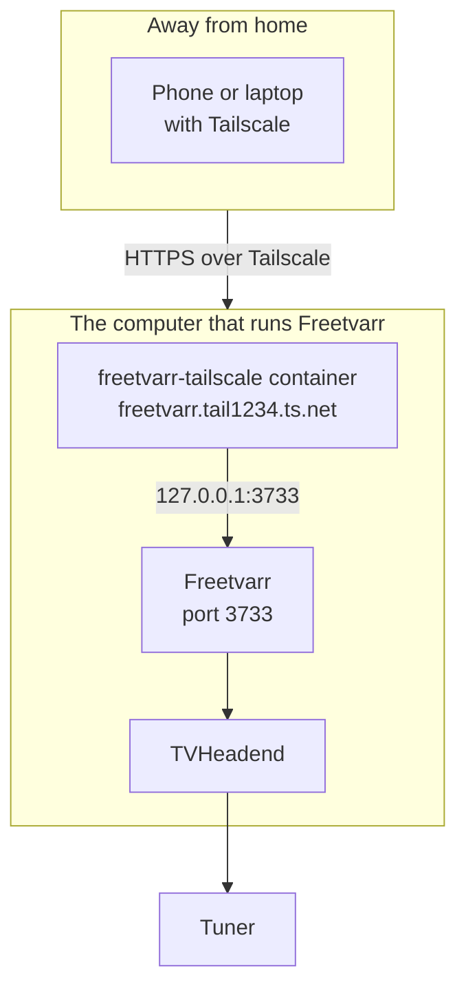

# Away from home

Freetvarr has no login: anyone who can reach its port can watch, record, and change its settings, including its [TVHeadend](https://tvheadend.org/) login. So reach it from outside your home only through a private network that you control, such as [Tailscale](https://tailscale.com/), or through a sign-in that runs in front of it. Never forward a port on your router to Freetvarr.

Tailscale is a VPN (a private, encrypted link between your devices). You install it on each device and sign in with one account. Those devices then form your tailnet (your private Tailscale network), and they reach each other from anywhere, as if they were at home. Nothing on the tailnet is reachable from the internet.

| Way                                                    | Address                             | Use it when                                                 |
| ------------------------------------------------------ | ----------------------------------- | ----------------------------------------------------------- |
| [Tailscale](#tailscale)                                | `http://nas:3733`                   | You want the quickest way                                   |
| [HTTPS name](#tailscale-with-an-https-name)            | `https://freetvarr.tail1234.ts.net` | You want an HTTPS address of Freetvarr's own (recommended)  |
| [Tailscale Serve](#tailscale-serve-on-the-computer)    | `https://nas.tail1234.ts.net`       | The computer already runs Tailscale and serves no other app |
| [Cloudflare Tunnel](#cloudflare-tunnel-with-a-sign-in) | `https://tv.example.com`            | You must reach Freetvarr from a device without Tailscale    |
| [Port forwarding](#port-forwarding)                    | None                                | Never                                                       |

Only your own devices on your tailnet can open the three Tailscale addresses. Anyone who passes Cloudflare's sign-in can open a Cloudflare Tunnel address. Anyone on the internet can open a forwarded port, with no login.

The examples on this page use `nas` for the computer that runs Freetvarr, `tail1234.ts.net` for the tailnet name, and `3733` for Freetvarr's port (the default of `FREETVARR_PORT` in the `.env`; [Configuration](/guide/configuration)). Use your own names and port.

## Why HTTPS

Tailscale already encrypts everything between your devices, so plain `http://nas:3733` over Tailscale is private. An HTTPS address adds these:

- **A real address**: `https://freetvarr.tail1234.ts.net` has a certificate that every browser trusts, so the browser shows no "Not secure" warning.
- **One address everywhere**: the same address works at home and away, on any device with Tailscale turned on. A bookmark or a Home Screen icon ([Save it as an app](/guide/getting-started#_4-save-it-as-an-app)) added from it works in both places. An icon added from the home address, such as `http://192.168.1.10:3733`, works only at home.

## Tailscale

Before you start, make a [Tailscale account](https://login.tailscale.com/start).

1. Install Tailscale on the computer that runs Freetvarr (e.g. the Tailscale package in a NAS's app store, or the Linux install from [Tailscale downloads](https://tailscale.com/download)). [Tailscale on Synology](https://tailscale.com/docs/integrations/synology) covers a Synology NAS.
2. Sign in to Tailscale on that computer.
3. Install Tailscale on your phone, tablet, or laptop.
4. Sign in to Tailscale on that device with the same account.
5. On that device, open `http://nas:3733`, where `nas` is the computer's name in the Machines page of the [Tailscale admin console](https://login.tailscale.com/admin/machines).

The short name `nas` needs [MagicDNS](https://tailscale.com/docs/features/magicdns) (Tailscale's names for your devices), which you turn on in the DNS page of the admin console. Without MagicDNS, use the computer's Tailscale IP address from the Machines page, such as `http://100.64.0.10:3733`.

Freetvarr answers to one-word names and IP addresses with no setup. A full Tailscale name, such as `nas.tail1234.ts.net`, must be on Freetvarr's list of [Allowed hostnames](/guide/troubleshooting#allowed-hostnames) first.

The home address, such as `http://192.168.1.10:3733`, does not work away from home. Tailscale carries only traffic to devices that run Tailscale, unless you set up a [subnet router](https://tailscale.com/docs/features/subnet-routers) (a device that passes tailnet traffic on to your home network).

## Tailscale with an HTTPS name

A small Tailscale container runs next to Freetvarr. It joins your tailnet as its own device, named `freetvarr`, and serves `https://freetvarr.tail1234.ts.net` with a real certificate. Each request it receives goes on to Freetvarr at `http://127.0.0.1:3733` on the same computer. Only devices on your tailnet can open the address.



The container is its own [Docker Compose](https://docs.docker.com/compose/) project in its own folder. Starting or stopping it never restarts Freetvarr, and updating Freetvarr never touches it. The computer itself does not need Tailscale.

### HTTPS name: Prerequisites

Before you start:

- Make a [Tailscale account](https://login.tailscale.com/start).
- Install Tailscale on your phone, tablet, or laptop, and sign in with that account (steps 3 and 4 of [Tailscale](#tailscale)).
- Sign in to the computer that runs Freetvarr in a terminal. On a NAS, sign in over SSH, and use `sudo` before each `docker` command if your user cannot reach Docker.

### 1. Turn on HTTPS certificates

1. Open the DNS page of the [Tailscale admin console](https://login.tailscale.com/admin/dns).
2. Turn on **MagicDNS**.
3. Turn on **HTTPS Certificates**.

The DNS page also shows your tailnet name, such as `tail1234.ts.net`. [HTTPS certificates](https://tailscale.com/docs/how-to/set-up-https-certificates) in Tailscale's documentation has the details.

> [!WARNING]<br>
> Every HTTPS certificate goes into a public log, so the device name (`freetvarr`) and your tailnet name become public. Nothing becomes reachable from the internet: the address still works only on your tailnet.

### 2. Create the folders

In the folder that holds your `freetvarr` folder, create a `freetvarr-tailscale` folder with a `state` folder and a `config` folder inside it:

```sh
mkdir -p freetvarr-tailscale/state freetvarr-tailscale/config
cd freetvarr-tailscale
```

The container keeps its Tailscale login in `state`, and reads its serve settings from `config`.

> [!NOTE]<br>
> On a Synology NAS, Container Manager refuses to start a project when a folder it mounts does not exist. Create both folders before step 6.

### 3. Write the Docker Compose file

In `freetvarr-tailscale`, create `docker-compose.yml` with this content:

```yaml
services:
  freetvarr-tailscale:
    image: tailscale/tailscale:v1.104.1
    container_name: freetvarr-tailscale
    network_mode: host
    environment:
      - TS_AUTH_ONCE=true
      - TS_HOSTNAME=freetvarr
      - TS_STATE_DIR=/var/lib/tailscale
      - TS_USERSPACE=true
      - TS_SERVE_CONFIG=/config/serve.json
      - TS_TAILSCALED_EXTRA_ARGS=--port=41642
    volumes:
      - ./state:/var/lib/tailscale
      - ./config:/config
    restart: unless-stopped
```

| Setting                    | What it does                                                                                                                                                                                         |
| -------------------------- | ---------------------------------------------------------------------------------------------------------------------------------------------------------------------------------------------------- |
| `network_mode: host`       | Puts the container on the computer's own network, so `127.0.0.1:3733` reaches Freetvarr                                                                                                              |
| `TS_HOSTNAME=freetvarr`    | The device name on your tailnet, and the first part of the address                                                                                                                                   |
| `TS_AUTH_ONCE=true`        | Signs in once, then reuses the login kept in `state`                                                                                                                                                 |
| `TS_USERSPACE=true`        | Runs Tailscale inside the container, with no TUN network device (a virtual network card) on the computer                                                                                             |
| `TS_SERVE_CONFIG`          | The serve settings file from step 4                                                                                                                                                                  |
| `TS_TAILSCALED_EXTRA_ARGS` | `--port=41642` uses port `41642` for Tailscale's own traffic. This matters only if the computer already runs Tailscale, which uses `41641`. Without Tailscale on the computer, the line does no harm |

[Tailscale in Docker](https://tailscale.com/docs/features/containers/docker) lists every setting of the `tailscale/tailscale` image. To update the container later, change the version in `image:`, then run `docker compose up -d` in `freetvarr-tailscale`.

### 4. Write the serve settings

In `freetvarr-tailscale/config`, create `serve.json` with this content:

```json
{
  "TCP": { "443": { "HTTPS": true } },
  "Web": {
    "${TS_CERT_DOMAIN}:443": {
      "Handlers": { "/": { "Proxy": "http://127.0.0.1:3733" } }
    }
  }
}
```

Type `${TS_CERT_DOMAIN}` exactly as shown. The container replaces it with its full name, such as `freetvarr.tail1234.ts.net`. If you changed `FREETVARR_PORT`, put your port in place of `3733`.

### 5. Allow the name in Freetvarr

Freetvarr refuses a name that is not on its list of [Allowed hostnames](/guide/troubleshooting#allowed-hostnames), so add the new name before you open it:

1. Open Freetvarr by its home address, such as `http://192.168.1.10:3733`.
2. Open Settings → SYSTEM → Setup → **Allowed hostnames**.
3. Type the full name, such as `freetvarr.tail1234.ts.net`.
4. Press **Add**.

If you cannot open Settings, add the name to `FREETVARR_ALLOWED_HOSTS` in Freetvarr's `.env`, then recreate the Freetvarr container ([Allowed hostnames](/guide/troubleshooting#allowed-hostnames)).

### 6. Start the container

In `freetvarr-tailscale`, run:

```sh
docker compose up -d
```

The first start downloads the `tailscale/tailscale` Docker image.

### 7. Approve the device

You need no auth key (a key that signs a device in to Tailscale without a browser). The container outputs a login link instead.

1. Output the container's log:

   ```sh
   docker logs freetvarr-tailscale
   ```

2. Copy the link that starts with `https://login.tailscale.com/`.
3. Open the link in a browser.
4. Sign in with your Tailscale account.
5. Approve the `freetvarr` device.

### 8. Open the address

On a device with Tailscale turned on, open `https://freetvarr.tail1234.ts.net`. The first certificate takes about a minute, so the first try can fail. Wait, then open the address again.

To use the address as an app, add it to the Home Screen ([Save it as an app](/guide/getting-started#_4-save-it-as-an-app)).

### HTTPS name: Key expiry

By default, Tailscale signs a device out after `180` days, and the address stops working until you sign it in again. To keep the `freetvarr` device signed in, open the Machines page of the [Tailscale admin console](https://login.tailscale.com/admin/machines), open the menu of the `freetvarr` device, and turn off its key expiry ([Key expiry](https://tailscale.com/docs/features/access-control/key-expiry)).

### HTTPS name: Undo

1. In `freetvarr-tailscale`, stop and remove the container:

   ```sh
   docker compose down
   ```

2. In the Machines page of the [Tailscale admin console](https://login.tailscale.com/admin/machines), remove the `freetvarr` device.
3. Delete the `freetvarr-tailscale` folder.
4. Remove the name from Settings → SYSTEM → Setup → **Allowed hostnames**.

## Tailscale Serve on the computer

If the computer that runs Freetvarr already runs Tailscale ([Tailscale](#tailscale)), [Tailscale Serve](https://tailscale.com/docs/features/tailscale-serve) can give it an HTTPS address with one command. The address is the computer's name, such as `https://nas.tail1234.ts.net`, not Freetvarr's. Freetvarr needs the whole address, so that name can serve no other web app.

1. Turn on HTTPS certificates ([step 1](#_1-turn-on-https-certificates) of the HTTPS name).
2. Add the full name, such as `nas.tail1234.ts.net`, to Settings → SYSTEM → Setup → **Allowed hostnames**.
3. In a terminal on the computer, run:

   ```sh
   sudo tailscale serve --bg --https=443 http://127.0.0.1:3733
   ```

4. Open `https://nas.tail1234.ts.net` on a device with Tailscale turned on.

To stop serving, run `sudo tailscale serve --https=443 off`. Other Tailscale Serve settings on the computer stay as they are.

## Cloudflare Tunnel with a sign-in

[Cloudflare Tunnel](https://developers.cloudflare.com/cloudflare-one/networks/connectors/cloudflare-tunnel/) gives Freetvarr a public HTTPS address on a domain you own, such as `https://tv.example.com`, with no port forwarding. Any device can open that address, with no Tailscale.

Anyone on the internet can also open it, and Freetvarr has no login. So put [Cloudflare Access](https://developers.cloudflare.com/cloudflare-one/access-controls/policies/) in front of it: a sign-in that Cloudflare runs before any request reaches Freetvarr. Do not use a tunnel without Access. Add the name to Settings → SYSTEM → Setup → **Allowed hostnames**.

Tailscale is the better choice for most people:

- Every video you watch away from home leaves through your home internet upload, then passes through Cloudflare.
- Cloudflare's [service terms](https://www.cloudflare.com/service-specific-terms-application-services/) let it limit or disable a site that serves video through its network without one of its paid video products.

## Port forwarding

Never forward a port on your router to Freetvarr, and never put it behind a public reverse proxy without a sign-in in front. Freetvarr has no login, so anyone who finds the address can see everything and change its settings, including the TVHeadend, Sonarr, and Radarr credentials that it holds ([Security](https://github.com/furey/freetvarr#security)).
