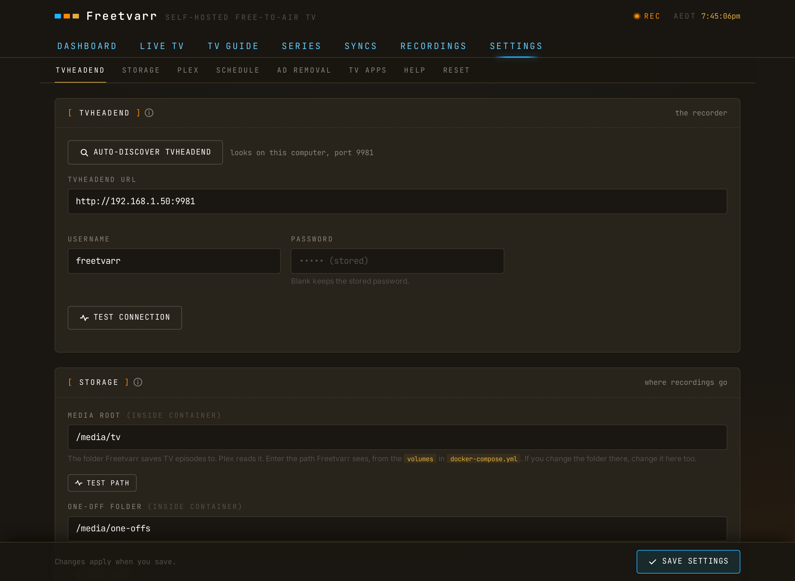

# Configuration

Freetvarr reads settings from two places. Freetvarr's `.env`, next to its Docker compose file in the `freetvarr` folder that the [install script](/guide/getting-started#_1-install) creates, holds deploy settings. You set everything else (the TVHeadend URL and login, the Plex token, the schedule) in Freetvarr's Settings page in a browser.

## Compose environment

Set these in the `.env` alongside `docker-compose.yml`. After a change, restart the Docker containers with the new values. In a terminal in that folder, run:

```sh
docker compose up -d
```

Every value is optional:

| Variable                 | Purpose                                                                                                                                                                                                                                                                              |
| ------------------------ | ------------------------------------------------------------------------------------------------------------------------------------------------------------------------------------------------------------------------------------------------------------------------------------ |
| `CONFIG_PATH`            | Optional. Host folder for the config of each Docker container (Freetvarr, TVHeadend, and Plex with the `plex` profile; default `./config`); Freetvarr's database lives in `${CONFIG_PATH}/freetvarr`                                                                                 |
| `DATA_PATH`              | Optional. Host folder (default `./data`) that holds `recordings/` (TVHeadend's output), `media/tv` (your TV library), and `media/one-offs` (recordings with no series folder), and nothing else. [One shared mount](#one-shared-mount) explains why                                  |
| `PLEX_PREFS_PATH`        | Optional. Path to Plex's `Preferences.xml`, used by the Auto-detect token button, for a Plex you installed yourself on the same computer; omit otherwise                                                                                                                             |
| `COMPOSE_PROFILES`       | Optional. `plex` adds the Plex service to `docker compose up -d` ([No Plex yet?](/guide/plex#no-plex-yet))                                                                                                                                                                           |
| `PLEX_CLAIM`             | Optional, `plex` profile only. The claim code from `https://plex.tv/claim`, which signs the new Plex in to your Plex account. A code expires 4 minutes after you get it                                                                                                              |
| `CSRF_SECRET`            | Optional override. Freetvarr otherwise generates a secret on first start and saves it to `${CONFIG_PATH}/freetvarr/csrf-secret`. See [CSRF secret](#csrf-secret)                                                                                                                     |
| `TZ`                     | Optional IANA timezone (e.g. `Australia/Sydney`). Pre-fills Freetvarr's time zone in setup; a zone chosen in Settings → SYSTEM → Schedule wins over it. Applies to TVHeadend when set. TVHeadend otherwise follows the host clock                                                    |
| `PUID`/`PGID`            | Optional. UID and GID to run as (default `1000`). Set your own user, or the files show an unknown owner in the host's file manager. Every Docker container uses the same pair                                                                                                        |
| `FREETVARR_PORT`         | Host port to serve on (default `3733`)                                                                                                                                                                                                                                               |
| `TVH_URL`                | Optional. Fixes the address **Auto-discover TVHeadend** offers, e.g. `http://192.168.1.10:9981`; omit to let Freetvarr probe port `9981` on the host                                                                                                                                 |
| `LIVE_TV_MAX_SESSIONS`   | Optional. The upper limit for [Live streams at once](/guide/player#live-streams-at-once) in Settings → WATCHING → Playback (`1` to `4`, and no more than your tuner count); when set, it is also the default. Omit it to let the startup measurement of the computer set the default |
| `LIVE_TV_BUFFER_MINUTES` | Optional. How many minutes of [live TV](/guide/live-tv#pause-and-rewind) the player can pause and rewind (default `30`, `0` turns it off, maximum `120`)                                                                                                                             |
| `LIVE_TV_TRANSCODE`      | Optional. How [live TV](/guide/live-tv#video-handling) handles H.264: `auto` (default), `hardware`, `software`, or `copy`                                                                                                                                                            |
| `LIVE_TV_VAAPI_DEVICE`   | Optional. The render device for [hardware encoding](/guide/requirements#hardware-transcoding) (default `/dev/dri/renderD128`)                                                                                                                                                        |
| `MOVIES_ROOT`            | Optional. The default [movies folder](#the-one-off-folder) inside the Freetvarr Docker container, e.g. `/data/media/movies`. The movies folder in Settings wins once saved                                                                                                           |
| `IMAGE_CACHE_MAX_MB`     | Optional. Megabytes of resized guide images and channel logos kept in `${CONFIG_PATH}/freetvarr/image-cache` (default `100`); the least recently shown go first                                                                                                                      |
| `RENDER_GID`             | Only with [`docker-compose.override.yml`](/guide/requirements#hardware-transcoding). The group ID that owns the render device                                                                                                                                                        |
| `SONARR_CONFIG_PATH`     | Optional. Host path to Sonarr's `config.xml`. The Freetvarr Docker container mounts it read-only and reads Sonarr's API key from it ([Sonarr and Radarr](/guide/sonarr-radarr#read-the-api-keys-for-you)); omit otherwise                                                            |
| `RADARR_CONFIG_PATH`     | Optional. Host path to Radarr's `config.xml`, read the same way for Radarr's API key; omit otherwise                                                                                                                                                                                 |

## Backups

Freetvarr keeps its database, its CSRF secret, your uploaded pictures, and its caches in one folder: `${CONFIG_PATH}/freetvarr` on the host (`/config` in the Freetvarr Docker container). The database is `state.db`. Freetvarr writes it in SQLite's WAL mode, so recent changes sit in the files `state.db-wal` and `state.db-shm` beside it until SQLite folds them into `state.db`. A copy of `state.db` alone can miss those changes. Back up the whole folder:

1. Stop Freetvarr. In a terminal in the `freetvarr` folder, run:

   ```sh
   docker compose stop freetvarr
   ```

2. Copy the whole `${CONFIG_PATH}/freetvarr` folder, including `state.db-wal` and `state.db-shm`.
3. Start Freetvarr again:

   ```sh
   docker compose start freetvarr
   ```

To restore, stop Freetvarr, put the copied folder back in place of `${CONFIG_PATH}/freetvarr`, and start Freetvarr. TVHeadend keeps its own settings and recording list in `${CONFIG_PATH}/tvheadend`, so back that folder up too.

## CSRF secret

CSRF (cross-site request forgery) protection stops another website open in your browser from sending changes to Freetvarr. Freetvarr signs its CSRF cookie with a secret. On first start, with `CSRF_SECRET` unset, it generates a random secret and saves it to the file `csrf-secret` in its config folder (`/config/csrf-secret` in the container, `${CONFIG_PATH}/freetvarr/csrf-secret` on the host). Only the Freetvarr user can read the file. Later starts reuse it. A `CSRF_SECRET` in your `.env` overrides the file.

If the config folder is not writable, Freetvarr exits with a message to check that `CONFIG_PATH` is owned by `PUID:PGID`. To replace the secret with a new one, delete the file and restart Freetvarr. Freetvarr generates a new secret at the next start, and browsers get a fresh CSRF token automatically.

## The two recordings paths

Freetvarr keeps two settings for one folder. These are the settings most likely to be wrong:

- **Recordings root** (`recordings_root`; `/recordings` in the code, `/data/recordings` in the example Docker compose file) is where Freetvarr sees TVHeadend's files, inside the Freetvarr Docker container.
- **TVHeadend recordings path** (`tvh_recordings_path`, default `/recordings`) is the path TVHeadend reports in the filenames it hands out, inside the TVHeadend Docker container.

In the example Docker compose file, TVHeadend mounts `${DATA_PATH}/recordings` at `/recordings`, and Freetvarr mounts `${DATA_PATH}` at `/data`. TVHeadend reports `/recordings/...` and Freetvarr sees the same file at `/data/recordings/...`, so the two settings differ and you never touch them. Freetvarr rewrites every TVHeadend filename from the second path to the first. Freetvarr skips a file outside that prefix and adds a note saying so.

The third path, **media root** (`media_root`; `/media/tv` in the code, `/data/media/tv` in the example Docker compose file), is where Freetvarr files finished episodes for your media library.

## The one-off folder

The **one-off folder** (`oneoff_root`; `/media/one-offs` in the code, `/data/media/one-offs` in the example Docker compose file) holds recordings that match no [series folder](/guide/series#recordings-with-no-series). On the host it is `${DATA_PATH}/media/one-offs`. Create the host folder first, owned by `PUID:PGID`. If the folder is missing, these recordings show as **SKIPPED** with a note.

The optional **movies folder** (`movies_root` in Settings, or `MOVIES_ROOT` in the `.env`) takes [films](/guide/series#films) with no series folder. Leave it empty to send films to the one-off folder. It must sit inside the same [shared mount](#one-shared-mount) as the recordings, for example `/data/media/movies`.

When a title moves between the Shows and One-offs shelves of [Recordings](/guide/recordings), Freetvarr moves its files between the TV library and the one-off folder.

**Import every recording**, under **WHAT TO IMPORT** in Settings → RECORDING → Media library, turns the one-off folder on or off. With it off, Freetvarr imports only recordings that match a series folder, or that you recorded with **Add to library** on. **Add to library by default** in the same group sets the starting choice for new recordings in the TV guide. To have Plex refresh the one-off library after an import, choose it as the **One-off section** in Settings → RECORDING → Plex ([The one-off library](/guide/plex#the-one-off-library)); for films, choose the **Movies section**.

## One shared mount

Keep the recordings and your library inside one folder, mounted into the Freetvarr Docker container once. Freetvarr then imports each recording instantly and uses no extra disk space. If they sit in two separate mounts, Freetvarr copies every recording instead, which is slower and takes twice the space.

The example Docker compose file does this. It mounts `${DATA_PATH}` once, at `/data`, and the recordings, the TV library, and the one-off folder are all folders inside it:

```yaml
    volumes:
      - ${DATA_PATH}:/data
    environment:
      - MEDIA_ROOT=/data/media/tv
      - ONEOFF_ROOT=/data/media/one-offs
      - RECORDINGS_ROOT=/data/recordings
      - TVH_RECORDINGS_PATH=/recordings
```

Keep only `recordings/` and `media/` in `${DATA_PATH}`. Freetvarr can write to everything in the mount.

If your folders live in separate places, mount one parent folder that holds both, or move them under one. The [Health](/guide/doctor#paths-hardlink) Hardlinks check tells you whether imports are instant or copied.

For the technically minded: Freetvarr imports with a hardlink (a second name for the same file), and Linux refuses a hardlink across two mounts with the `EXDEV` error.

To move the TV library or the one-off folder, move the folder on the host yourself, then change `media_root` or `oneoff_root` in Settings. Freetvarr updates the file paths stored in its database at startup and when you save Settings, so you do not edit the database.

## Runtime settings

The TVHeadend URL, username, and password, the Plex URL, token, and section, the Sonarr and Radarr URLs and API keys, the storage paths, the ad-removal switches, and the sync schedule are all set in Freetvarr's **Settings** (or in its [setup](/guide/getting-started#_2-run-setup)) and stored in Freetvarr's database. Settings groups its pages as follows:

- **ABOUT**: About Freetvarr (versions and licences) and System diagram. Settings opens on About Freetvarr.
- **WATCHING**: Playback, Channels, Film and TV info, For you, and Watch on TV.
- **RECORDING**: Series rules, Title matches, Media library, Ad removal, Plex, Sonarr and Radarr, and Recording log.
- **SYSTEM**: Setup, Health, Activity, Schedule, and TVHeadend.
- **DANGER ZONE**: Reset.

[Settings](/guide/settings) describes each page. Press **Save settings** to keep your changes. An optional TMDB API key for film posters, film ratings, reviews, and film cast goes in Settings → WATCHING → Film and TV info ([TMDB key](/guide/tv-guide#tmdb-key)); Freetvarr stores it in its database and never sends it to the browser. In Settings → RECORDING → Media library, **Test path** checks each folder (the media root, the one-off folder, the movies folder, and Freetvarr's recordings folder), and **Check TVHeadend** reads TVHeadend's recording path from its DVR profile and compares it with yours.

<!-- markdownlint-disable MD033 -->
<BrowserFrame label="http://freetvarr.lan/#/settings">
  
</BrowserFrame>
<!-- markdownlint-enable MD033 -->

> [!NOTE]<br>
> `MEDIA_ROOT`, `ONEOFF_ROOT`, `RECORDINGS_ROOT`, `TVH_RECORDINGS_PATH`, and `PLEX_PREFS_PATH` also act as defaults for their matching runtime settings. Freetvarr uses the value in Settings first, then the environment variable, then the built-in default.

The full environment reference, including container-side variables like `DB_PATH`, `PORT`, and `NODE_ENV`, is in the [deep dive](/deep-dive#full-environment-reference).
