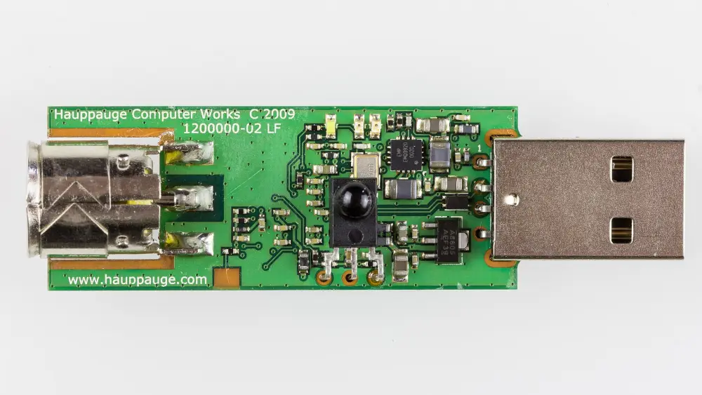
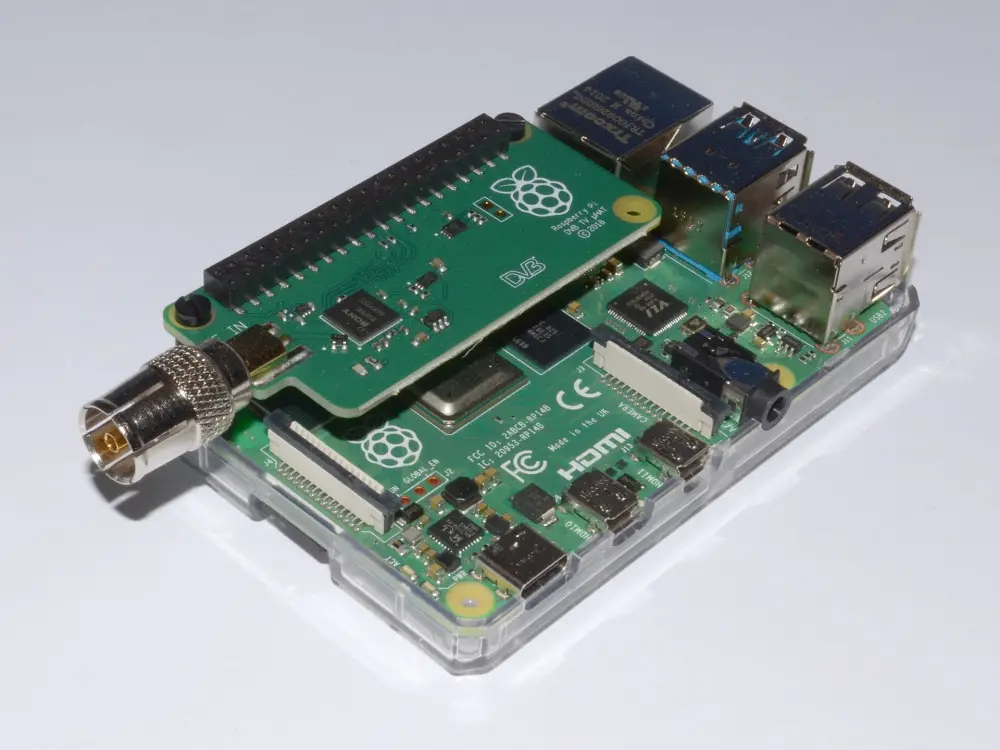
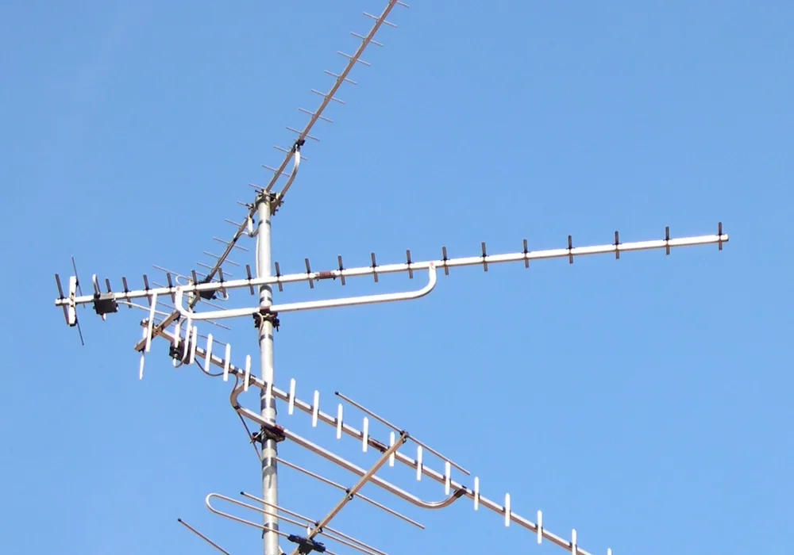
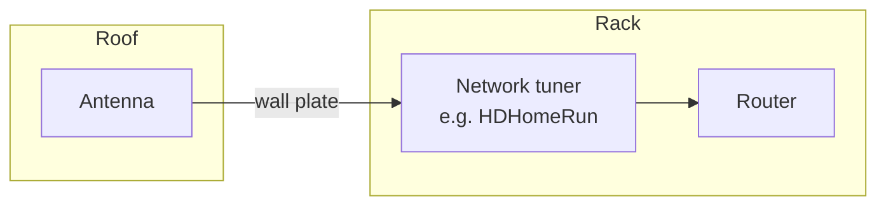
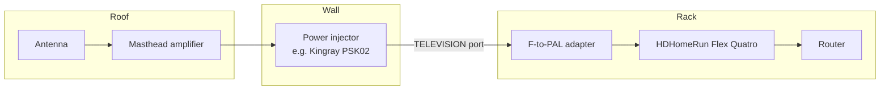

# Hardware

You need one TVHeadend-compatible tuner, and any type works: a network tuner, a USB DVB-T/T2/C/S2 stick, a PCIe card, SAT>IP, or IPTV. Freetvarr talks only to TVHeadend and the recordings folder, so the tuner type makes no difference to it. The author recommends the HDHomeRun Flex Quatro, and it is the only tuner Freetvarr has been tested with. On a NAS a network tuner is the easiest choice, because there is no USB passthrough to arrange (most NAS kernels ship no DVB drivers, so a USB stick gives you no `/dev/dvb` to pass in).

The broadcast standard where you live decides the model: DVB-T/T2 in Australia, New Zealand, the UK, and Europe; ATSC in North America; DVB-C on cable. An HDHomeRun model exists for each, and TVHeadend drives them all the same way. For the computer that runs Freetvarr, see [The computer](#the-computer).

| Region                             | Standard       | HDHomeRun model                                                    |
| ---------------------------------- | -------------- | ------------------------------------------------------------------ |
| Australia, New Zealand, UK, Europe | DVB-T/T2       | `HDFX-4DT` Flex Quatro                                             |
| Europe, cable                      | DVB-C          | `HDHR5-4DT` Connect Quatro (T/T2/C)                                |
| United States, Canada              | ATSC 1.0 / 3.0 | `HDFX-4US` Flex Quatro, `HDHR5-4US` Connect Quatro, or the Flex 4K |

The wiring, the connector, and the signal checks below are the same for every model. Only the model number and the TV guide source change (see [Outside Australia](/guide/tvheadend#outside-australia) on the TVHeadend page for the TV guide).

## The tuner

The rest of this page is the author's own setup, in Australia. Read it as a worked example and substitute your own region's model and retailer.

Buy an **HDHomeRun Flex Quatro**, model `HDFX-4DT`, direct from [SiliconDust](https://shop.silicondust.com/shop/product/hdfx-4dt/). It is `US$199.99`, receives DVB-T and DVB-T2, and carries four tuners, so four things can record at once (or three record while you watch a fourth live).

It is a network tuner: it plugs into your router, or a switch on your home network, with a network (ethernet) cable, and serves its tuners over your home network. Nothing plugs into the NAS. The author's router has a single LAN port, so a `TP-Link TL-SG105` five-port switch connects the router, the NAS, and the tuner.

> [!IMPORTANT] 
> In the order notes, ask for the AU/NZ power adapter and an F-to-PAL aerial adapter. SiliconDust has power adapters for the US, UK, EU, and AU/NZ. The author asked for both in his order notes, and both came in the box.

No Australian retailer stocks a DVB-T HDHomeRun. Buying direct from SiliconDust is the normal route, and shipping to Australia is free.

  
  
The HDHomeRun Flex Quatro: four tuners, an aerial socket, and a network port. <em>Image: <a href="https://shop.silicondust.com/shop/product/hdfx-4dt/">SiliconDust</a>, shown from silicondust.com.</em>

### Direct to a spare NAS port

A NAS with a second ethernet port can take the tuner directly, with no router in between. It works, with two catches. Nothing on that link hands out addresses, so the tuner and the NAS port fall back to link-local addresses (`169.254.x.x`). TVHeadend under host networking still finds the tuner by broadcast on that port. But the tuner no longer appears in your router's client list, and its status page answers only from the NAS itself. Plug the tuner into the router or a switch on your home network if you can.

### Models that work in Australia

| Model                                | Standard   | Tuners | Note                                                                                   |
| ------------------------------------ | ---------- | ------ | -------------------------------------------------------------------------------------- |
| `HDFX-4DT` Flex Quatro               | DVB-T/T2   | 4      | The current model. `2 year` warranty                                                   |
| `HDFX-4DT-R` Flex Quatro refurbished | DVB-T/T2   | 4      | Cheaper, `90 day` warranty, stock comes and goes                                       |
| `HDHR5-4DT` Connect Quatro           | DVB-T/T2/C | 4      | The older model. Works, but usually dearer through AU resellers than a new Flex direct |

### Models that do not work in Australia

Anything with `-US` in the model number, and anything branded 4K, is an ATSC tuner for the American standard. It will not tune a single Australian channel. Most Amazon AU and eBay AU HDHomeRun listings are these. Check the model number before you buy.

### Why not a USB tuner

A `A$20` Xbox One or Hauppauge USB tuner works on a normal Linux computer. It does not work on most NAS units (Synology and QNAP among them): their kernels ship no DVB drivers, so there is no `/dev/dvb` to pass into the TVHeadend Docker container and nothing for TVHeadend to find. A network tuner needs no driver on the NAS. To use a USB tuner anyway, run TVHeadend on a Raspberry Pi and write its recordings to a NAS share instead.

  
  
A USB tuner (Hauppauge WinTV MiniStick). It needs a computer with DVB drivers, such as a Raspberry Pi or a mini PC running Linux. <em>Photo: <a href="https://commons.wikimedia.org/wiki/File:Hauppauge_WinTV_MiniStick-1202.jpg">Raimond Spekking</a>, <a href="https://creativecommons.org/licenses/by-sa/4.0/">CC BY-SA 4.0</a>, via Wikimedia Commons; resized.</em>

  
  
A Raspberry Pi 4 with the Raspberry Pi TV µHAT, a DVB-T/T2 tuner board. TVHeadend drives it the same way as a USB tuner. <em>Photo: <a href="https://commons.wikimedia.org/wiki/File:Raspberry_Pi_4B_DVB_TV_%CE%BCHat_(angle).jpg">Multicherry</a>, <a href="https://creativecommons.org/licenses/by-sa/4.0/">CC BY-SA 4.0</a>, via Wikimedia Commons; resized.</em>

## Wiring it up

  
  
Rooftop TV aerials. Most Australian homes already have one; the tuner uses the same aerial and lead as the old TV or recorder. <em>Photo: Serge Nueffer, public domain, via <a href="https://commons.wikimedia.org/wiki/File:Three_UHF_Yagi_television_antennas.jpg">Wikimedia Commons</a>; cropped and resized.</em>

The tuner takes the place of whatever box was on the end of your aerial lead. Nothing else in the chain changes. For most homes the chain is the aerial lead into the tuner and an ethernet lead into the router:

> [!NOTE] 
> The masthead amplifier, the power injector, and the F-to-PAL adapter below are the author's own installation. None of them is required by Freetvarr or TVHeadend. Skip this section unless your aerial already has an amplifier or your wall plate does not fit the tuner's socket.

### With a masthead amplifier (author's setup)

If a masthead amplifier sits at the antenna, a small box at the wall powers it by sending mains-derived voltage back up the coax. A Kingray `PSK02` is the common one in Australia: the lead from the wall plate plugs into its `ANTENNA` port, and the tuner connects to its `TELEVISION` port.

> [!WARNING] 
> If you have an injector, keep it in the chain. Run a lead from the wall straight to the tuner and the masthead amplifier loses its power, so almost no signal arrives and the tuner finds nothing.

### The connector

The HDHomeRun's antenna input is an F-type threaded socket, so your wall plate may need an adapter. This depends on your country's plug standard. In Australia it does: Australian wall plates and leads use a PAL (Belling-Lee) push-on plug, so the two do not meet. Ask for an F-to-PAL adapter in the order notes, as above. Buyers on the Whirlpool HDHomeRun thread report that it comes in the box. If it is missing, buy one: an F plug that screws onto the tuner with a PAL socket that takes your existing lead. Jaycar `PA3672` is about `$6`, or use a fly lead with a PAL plug on one end and an F plug on the other.

  
  
Left: a PAL (Belling-Lee) plug, which pushes on. Right: an F plug, which screws on. The tuner has an F socket. <em>Photo: <a href="https://commons.wikimedia.org/wiki/File:TV_antenna_connectors.jpg">Sajad-HasanAhmadi</a>, <a href="https://creativecommons.org/licenses/by-sa/4.0/">CC BY-SA 4.0</a>, via Wikimedia Commons; resized.</em>

> [!NOTE] 
> SiliconDust's product page lists only the power adapter as in the box. The F-to-PAL adapter is not a listed item, so a future order could arrive without it.

## Checking the signal

Once the tuner has power and a network cable, find its IP address in your router's list of connected devices, then open `http://<hdhr-ip>/tuners.html` in a browser. That page reports signal strength, signal quality, and symbol quality per tuner. Read it before you blame the tuner for anything.

The common faults:

- **Dropouts and reboots.** The usual cause is a tired `5 V` power supply, not reception. Swap in a `2–3 A` `5 V` supply and re-test.
- **Strong signal, poor quality.** Only with a masthead amplifier: the amplifier plus a short cable run can overload the front end. A `12 dB` inline attenuator between the adapter and the tuner is the first thing to try.

Only with a power injector: if its `TELEVISION` port is not fully isolated it can pass a few volts AC through to the tuner. Tuners tolerate this, but if the readings look strange, a `$5` inline DC block (Jaycar `LT3068`, or any F-type DC block) between the adapter and the tuner removes it.

## The computer

Freetvarr and TVHeadend run in Docker on one computer that stays on: a NAS (e.g. Synology, QNAP, etc.), a mini PC, or an old laptop or desktop. Recording takes almost no processor time, because TVHeadend saves the broadcast to disk as it arrives, with no conversion. The processor and graphics chip matter for live TV in a browser, ad removal, and the For you suggestions.

| Part             | Minimum                                                       | Recommended                                                                                                  | What it changes                                                                                                                                           |
| ---------------- | ------------------------------------------------------------- | ------------------------------------------------------------------------------------------------------------ | --------------------------------------------------------------------------------------------------------------------------------------------------------- |
| Processor        | Any 64-bit `x86-64` or `ARM64` processor with `2` cores       | An Intel processor with Quick Sync, or an AMD processor with graphics (e.g. Intel Celeron J4025, Intel N100) | Quick Sync or AMD graphics converts live TV with almost no processor time (see [Hardware transcoding](#hardware-transcoding))                             |
| Memory (RAM)     | `2GB`                                                         | `4GB` or more                                                                                                | For you (Standard and Plus) and face-aware picture crops need `400MB` free; with less, they wait or stay at Basic                                         |
| Storage          | Room for the recordings you keep: `3–6GB` for each hour of HD | `4TB` or more (about `650–1,300` hours of HD)                                                                | Health warns under `20GB` free, and recordings fail when the disk fills                                                                                   |
| Operating system | Linux with Docker and Compose v2                              | The same, on a NAS or a mini PC that stays on                                                                | A Mac runs Freetvarr, but Docker on a Mac cannot find a network tuner by itself or use the graphics chip. Windows is untested ([Windows](/guide/windows)) |
| Network          | Wired network on the same part of the network as the tuner    | The same                                                                                                     | TVHeadend finds a network tuner by broadcast, which does not cross between subnets                                                                        |

With the minimum, Freetvarr records, imports, and serves every page, but it is limited in these ways:

- **Live TV in the browser:** usually `1` live stream at a time, at `540` lines. Without a graphics chip, Freetvarr converts in software, which needs both cores.
- **Multiview:** each picture needs a live stream, so Multiview shows only as many pictures as **Live streams at once** allows.
- **Ad removal:** a scan takes about `30` minutes per `75`-minute recording on a `2`-core Celeron, and longer on a slower processor.
- **For you:** Freetvarr picks **Basic** when the nightly work with the language model would take more than `5` minutes, or when less than `400MB` of memory is free.

With the recommended computer, you get these:

- **Live TV in the browser:** up to `4` live streams at once at `720` lines (limited also by your tuner count), and so `4` pictures in Multiview on a tablet or computer.
- **Ad removal:** scans that finish sooner on a faster processor, at low priority so imports still run at full speed.
- **For you:** **Standard**, or **Plus** on a fast processor.

At startup, Freetvarr measures how many live streams this computer converts smoothly, and sets the default for **Live streams at once** from the result (see [Live streams at once](/guide/player#live-streams-at-once)). For the suggestion level, see [Suggestion level](/guide/for-you#suggestion-level).

### The computer: Examples

- **A Synology Plus-series NAS with an Intel Celeron**, such as the DS225+. Its Quick Sync chip converts live TV, and the drives hold the recordings.
- **A mini PC with an Intel N100 or N150.** It is cheaper than a NAS and has Quick Sync. It also takes a USB tuner, which a NAS cannot use (see [Why not a USB tuner](#why-not-a-usb-tuner)).
- **An old laptop or desktop that runs Linux.** Many Intel processors with built-in graphics have Quick Sync; the log check in [Hardware transcoding](#hardware-transcoding) shows whether Freetvarr can use it. Without it, live TV converts in software, with the limits above.
- **A Raspberry Pi 5 or another ARM board.** The Freetvarr Docker image is built for `ARM64`, but the author has not tested it on an ARM board. Freetvarr's hardware path uses VAAPI, which Raspberry Pi boards do not offer, so live TV converts in software.

> [!NOTE] 
> The author's computer is a Synology DS220+: an Intel Celeron J4025 with `2` cores, Intel UHD 600 graphics with Quick Sync, and `18GB` of memory after the upgrade in [The computer: Memory upgrade](#the-computer-memory-upgrade) (`6GB` before). It also runs Plex and other Docker containers. The startup check measured `4` smooth live streams in hardware. For you picked Standard (about `64` seconds a day for `510` new descriptions). Face detection takes about `74ms` per picture. Freetvarr 2.0 and TVHeadend together use about `450MB` of memory when idle.

### The computer: Memory upgrade

Some Synology Plus-series NAS units take one extra memory module, and the author fitted one to their DS220+. On `2026-10-27` the author added a Timetec `16GB` DDR4-2666 SO-DIMM (dual rank, part `76TT26NUS2R8-16G`, [Amazon AU](https://www.amazon.com.au/dp/B07H4XNNXK?tag=freetvarr-22)). The DS220+ has `2GB` soldered on and one slot. The new module replaced the `4GB` module in that slot, so the total went from `6GB` to `18GB`.

Before the upgrade, the NAS reported `5.8GB` of memory. Another Docker project on the same NAS (a camera system) used about `2.2GB`, and more than half of that sat in compressed swap (zram), which is memory squeezed into a smaller space. Freetvarr's stall monitor (`GET /api/health/loop`) recorded `47` pauses of `100ms` or longer over `8.4` hours, the worst `1.0s`.

After the upgrade, `free -m` on the NAS reports `17836MB` in total, `13774MB` available, and about `62MB` of swap in use. The stall monitor recorded `23` pauses of `100ms` or longer in the first `2` hours after Freetvarr restarted, the worst `1.1s`. The restart itself (guide load, first sync) causes some of them, so that count says nothing yet about a settled day.

Synology lists a `4GB` module (`D4NESO-2666-4G`) for the DS220+, DS420+, DS720+, and DS920+, and a larger module is not on its list. DSM `7.3.2` on the author's NAS accepted the `16GB` module and reports the full `18GB`. Other DSM versions may warn about third-party memory, and Synology does not support the setup. Check your model's memory page on Synology's site and your DSM version before you buy.

Fitting a module means shutting the NAS down, opening the memory cover on the underside, and clicking the module into the slot. Freetvarr needs none of this: it runs with `4GB` or less.

> [!NOTE] 
> The Amazon link is an affiliate link: as an Amazon Associate I earn from qualifying purchases, at no extra cost to you.

## Hardware transcoding

Live TV in the browser re-encodes H.264 so that Chrome can play interlaced channels (see [Video handling](/guide/live-tv#video-handling)). A graphics chip does this work with almost no CPU. Freetvarr supports Intel Quick Sync and AMD through VAAPI. NVIDIA (NVENC) is not supported. A host without a supported chip needs no setup: Freetvarr uses software and caps the video at `540` lines.

1. In a terminal on the host, find the render group ID: `stat -c %g /dev/dri/renderD128`.
2. Add that number to the `.env` in the `freetvarr` folder: `RENDER_GID=<number>`.
3. Download `docker-compose.hwaccel.example.yml` from the repository (`https://raw.githubusercontent.com/furey/freetvarr/main/docker-compose.hwaccel.example.yml`) and save it as `docker-compose.override.yml` beside `docker-compose.yml`. Docker Compose loads the override file by itself.
4. Recreate the Docker containers: run `docker compose up -d` in the `freetvarr` folder.
5. Check Freetvarr's log: run `docker compose logs freetvarr | grep "\[live\] video"`. The line says `hardware (VAAPI` when it works.

The override file passes `/dev/dri` into the Freetvarr Docker container and adds `RENDER_GID` as a group. Never put `/dev/dri` in the main Docker compose file on a host that lacks it. The Freetvarr Docker container then fails to start. Set `LIVE_TV_VAAPI_DEVICE` in the `.env` if the render node is not `/dev/dri/renderD128`.

> [!NOTE] 
> The author's NAS is a Synology DS220+ (Intel Celeron J4025, UHD 600 graphics) with render group `937`. Hardware `1080i` to `720p` ran at about `6.5x` real time, using about `5%` of one core. Software `720p` ran at only `1.36x` real time on both cores.

## Where next

- **[Getting started](/guide/getting-started)**: install Freetvarr. Its [setup](/guide/getting-started#_2-run-setup) finds the tuner and scans for channels.
- **[Live TV](/guide/live-tv)**: watch the tuner directly, with no recording involved.
