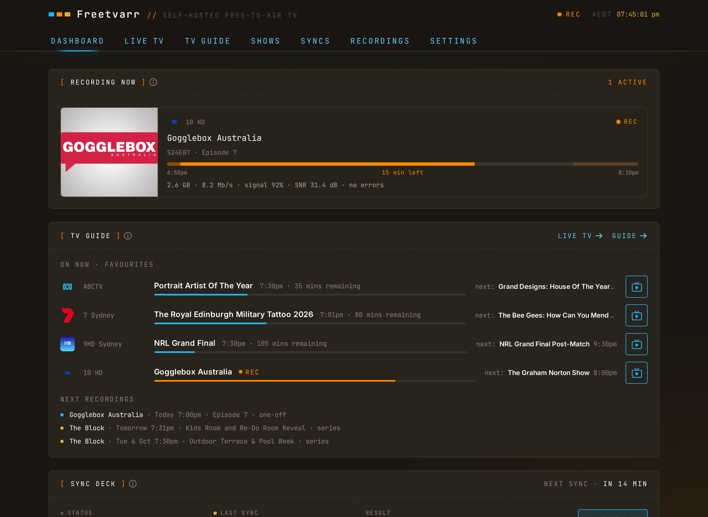

# Home and search

Home is the first page Freetvarr opens. It answers one question: what can I watch now? Its title greets you for the time of day, such as `Good evening`.

<!-- markdownlint-disable MD033 -->
<BrowserFrame label="http://freetvarr.lan/#/home">
  
</BrowserFrame>
<!-- markdownlint-enable MD033 -->

## Navigation

Freetvarr has five destinations: **Home**, **Live TV**, **TV guide**, **Recordings**, and **Settings**. On a phone, a tab bar at the bottom holds them. On a tablet or computer, a rail down the left side holds them, with Settings at the bottom. The rail also has **For you** under Recordings, unless you turn For you off in Settings.

Each page has these controls in its header:

- **Search**: finds a show. See [Search](#search).
- The recording chip, while TVHeadend records, for example `Recording The Block`. Press it to open [Scheduled](/guide/recordings#scheduled). On a phone it is a banner under the page title.
- The clock, on a tablet or computer.

While anything records, the browser tab title also starts with `● REC`.

## Highlights

The top of Home is a set of up to five slides that take turns. Press a dot to pick a slide, or swipe on a touch screen. The pause button keeps the current slide in place.

Freetvarr picks the slides from these, in this order, and leaves out any that has nothing to show:

| Slide                           | What it shows                                                                                  | Buttons                                                                   |
| ------------------------------- | ---------------------------------------------------------------------------------------------- | ------------------------------------------------------------------------- |
| **Continue watching**           | The recording you started most recently and have not finished.                                 | **Resume**, **Episodes**                                                  |
| **New episode**                 | A new episode of a show you watch.                                                             | **Play**, **Episodes**                                                    |
| **Recording now**               | A programme TVHeadend records now.                                                             | **Watch from the start** (when it can play the recording), **Watch live** |
| **For you**                     | A suggestion from [For you](/guide/for-you), with the reason.                                  | **Record** or **Record series**, **Details**                              |
| **Live news** or **Live sport** | A news or sports programme on now on a favourite channel.                                      | **Watch live**, **Record**                                                |
| **Recording tonight**           | The next recording, with **Recording today** or **Recording tomorrow** when it is not tonight. | **Recording options** or **Details**, **Scheduled**                       |
| **Now in the guide**            | A show you asked to be told about, now in the TV guide.                                        | **Record** or **Record series**, **Details**                              |
| **Unwatched movie**             | A film you recorded and have not watched.                                                      | **Play** or **Resume**, **Details**                                       |

**Details** opens the [programme sheet](/guide/tv-guide#recording-a-programme) over Home, where you can record it.

Each slide also has a **⋯** button. It opens the same actions as the matching row below: the episode menu for a recording, the For you menu for a suggestion, and the live or scheduled menu for a programme. See [More actions](#more-actions).

## Rows

Under the highlights, Home has these rows. A row with nothing in it is left out. A row title opens the same page as the link at the right end of the row.

- **New recordings**: episodes you have not watched, newest first, with a `NEW` badge. Press a card to open the show page. **See all** opens [Recordings](/guide/recordings).
- **For you**: suggestions from the next week of the TV guide. Until Freetvarr knows what you like, this row is called **New this week**. **See all** opens the [For you](/guide/for-you) page.
- **On now**: what is on your favourite channels, with the channel logo beside each title and a bar that shows how far through each programme is. Press a card to watch the channel live. **Live TV** opens the [Live TV](/guide/live-tv) page.
- **Recording tonight**: up to three recordings for tonight. Press one to open [Scheduled](/guide/recordings#scheduled).

**On now** shows only favourite channels. To fill it, press the star next to some channels in [Live TV](/guide/live-tv) or the [TV guide](/guide/tv-guide#favourites).

An empty Home says `Nothing recorded yet` and offers **Find a show in the TV guide**.

## More actions

Every card and every **Recording tonight** row has a **⋯** menu. To open it:

- On a computer, point at the card or move to it with the Tab key, then press **⋯**. You can also right-click the card.
- On a touch screen, press and hold the card for half a second.

The menu depends on the row:

| Row                   | Menu                                                                                                                          |
| --------------------- | ----------------------------------------------------------------------------------------------------------------------------- |
| **New recordings**    | The episode menu from [Recordings](/guide/recordings#show-pages), with **Episode info** and **Go to show**.                   |
| **For you**           | **Record this episode**, **Record series**, **Programme info**, feedback, and **Why this?**.                                  |
| **On now**            | **Watch live**, **Record this episode**, **Record series**, and **Programme info**.                                           |
| **Recording tonight** | **Programme info**, **Go to show**, **Recording options** (for a show with a series rule), and **Don't record this episode**. |

For a movie, **Record this episode** reads **Record this movie**, **Don't record this episode** reads **Don't record this movie**, and **Record series** does not show. For a one-off programme they read **Record** and **Don't record this**. The [TV guide](/guide/tv-guide#recording-a-programme) says how Freetvarr tells them apart.

**Episode info** shows the details of a recording. **Programme info** opens the [programme sheet](/guide/tv-guide#recording-a-programme) over Home. **Don't record this episode** cancels that one recording; a series rule still records the next episodes.

## Health alert

When something Freetvarr needs is broken, such as TVHeadend not answering or the last sync failing, Home shows the reason under its title. Press it to open [Health](/guide/doctor). Press **×** to hide the alert for a day; a different problem shows at once. The dot on the Settings icon stays until the problem is fixed.

## Search

Press **Search** in any page header, then type at least two letters. Search covers your recordings, your series rules, and the next 7 days of the TV guide. The results come in two groups:

- **SHOWS**: shows you have recorded or have a series rule for. Press one to open its [show page](/guide/recordings#show-pages).
- **IN THE GUIDE**: programmes in the next 7 days, best match first. Press one to open its programme sheet.

When nothing in the next 7 days matches, the results end with **Watch for “title”**. Press it to list the show under **Watching for** in Scheduled, or to record it when it is in the TV guide. See [Watch for](/guide/tv-guide#watch-for).

Search finds a show in these ways:

- **The title**, or any part of it.
- **A nickname** from a list that ships with Freetvarr, such as `MKR` for My Kitchen Rules or `GBBO` for The Great British Bake Off.
- **Your own names** for a show. Add them under **Also known as** in a show's [Recording options](/guide/recordings#recording-options).
- **Other titles** of a show, such as its title in another country. Freetvarr learns these from TVmaze and Wikidata while it looks up pictures and genres, when those lookups are on.
- **Initials**: `bbt` finds The Big Bang Theory.
- **A close spelling**, when nothing else matches. The result says `Did you mean`.

A result found by another name says which, such as `Also known as MKR` or `Initials BBT`.
