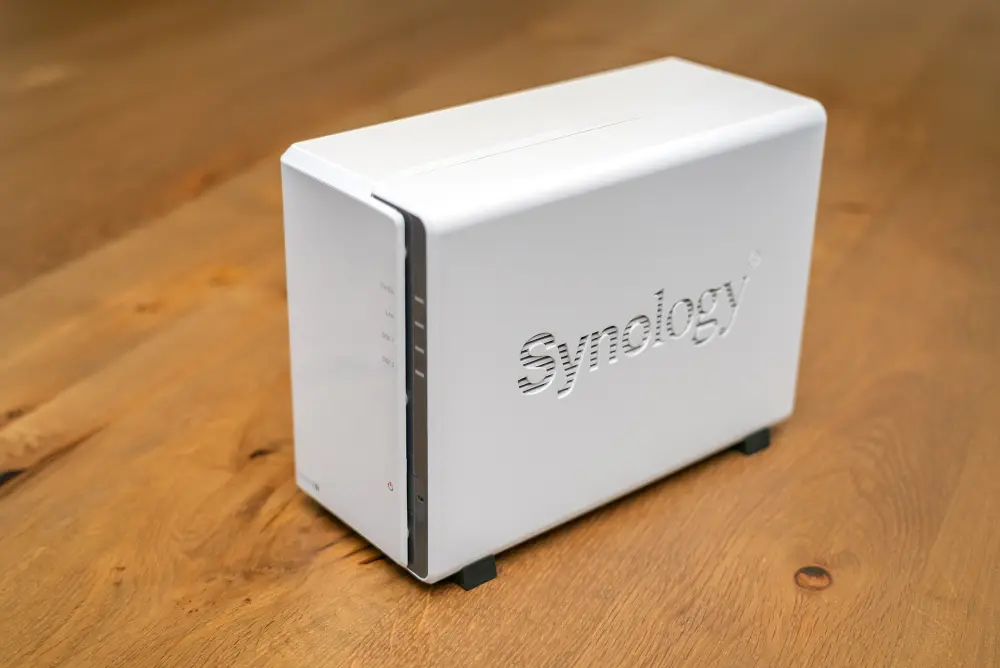
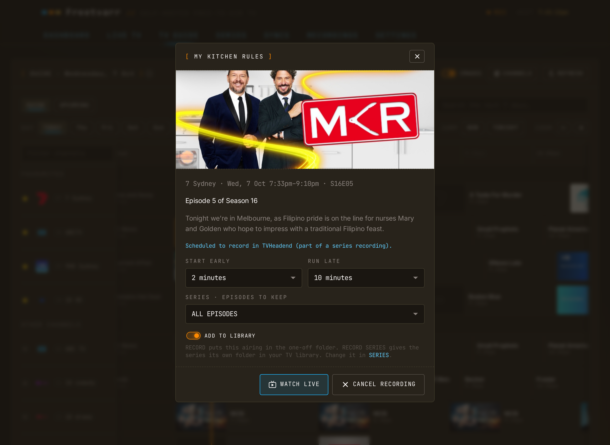
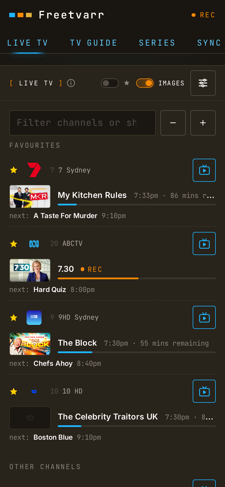
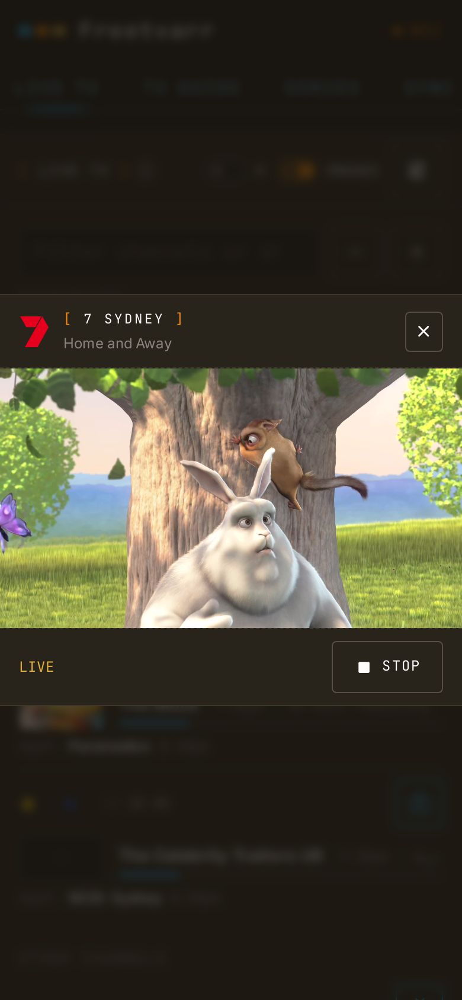
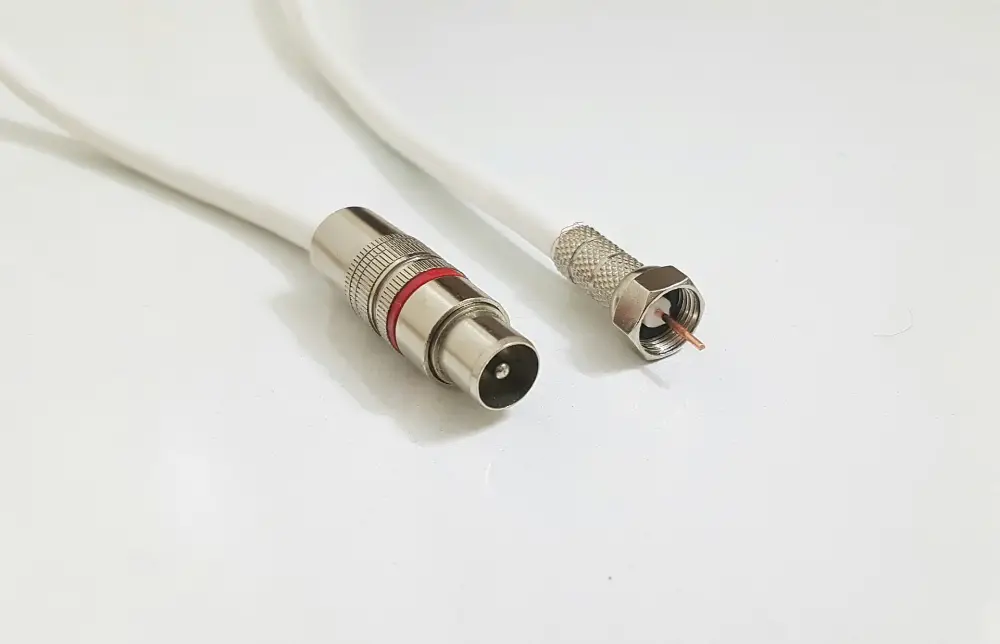
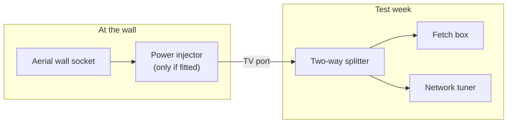

# Leaving Fetch TV

<Illustration name="leaving-fetch" />

Fetch TV is an Australian set-top box service. If you have a Fetch Mini Gen 3 or Mighty Gen 3, Fetch now asks for a one-off levy to keep it working until at least June 2028. Fetch also removes some apps from these boxes, whether you pay or not. The steps below replace the box with hardware you own. Free-to-air TV is free to receive, so after the one-off purchase there is nothing more to pay.

<!-- markdownlint-disable-next-line MD033 -->
<YouTubeVideo id="oNzNmlOxSFs" title="Leaving Fetch TV? Record free-to-air TV with Freetvarr" duration="3:03" />

## What you'll need

1. **A tuner**: a small box that takes your aerial lead and sends live TV over your home network. An HDHomeRun, made by SiliconDust, is a good one. The HDHomeRun Flex Quatro has four tuners inside, so it receives four channels at once.

   <div class="product-shot">
     
     <p>The HDHomeRun Flex Quatro. The aerial lead and a network cable plug into the back.<br><em>Image: <a href="https://shop.silicondust.com/shop/product/hdfx-4dt/">SiliconDust</a>, shown from silicondust.com.</em></p>
   </div>

2. **Somewhere to store recordings**: a hard drive. A NAS (a small storage box with hard drives that stays on) suits this well, because it can also run the recording software.

   <div class="product-shot">
     
     <p>A two-bay NAS (Synology DS223j). It holds two hard drives and stays on all the time.<br><em>Photo: <a href="https://commons.wikimedia.org/wiki/File:Synology_Disk_Station_DS223J_-_NAS-Server.jpg">DYVER</a>, <a href="https://creativecommons.org/licenses/by-sa/4.0/">CC BY-SA 4.0</a>, via Wikimedia Commons; resized.</em></p>
   </div>

3. **Recording software** on a computer that stays on, such as the NAS. It reads the TV guide and records the programmes you choose. Free options include TVHeadend and Jellyfin. Paid options include Plex's own recording feature (it needs a Plex Pass subscription), Channels DVR, and SiliconDust's own recording service. Plex and Jellyfin are also media players: apps that show your recordings and other videos on your TV.

To watch live TV only, you need just the tuner and its free app. The drive and the software are for recording.

[Freetvarr](/guide/) is one more optional piece. Freetvarr's author built it for a home setup and shares it in case it makes things easier. Freetvarr's install includes TVHeadend, and Freetvarr's [setup](/guide/getting-started#_2-run-setup) sets up TVHeadend for you: logins, channels, and the TV guide. Freetvarr can install Plex too. If you already run TVHeadend or Plex, Freetvarr uses yours. You can use any of the other software instead.

> [!TIP]<br>
> If you already pay for a Plex Pass, Plex's own recorder may be all you need: buy the tuner, set up Plex DVR, and skip TVHeadend and Freetvarr. [Plex DVR instead](/guide/plex-dvr) compares the two, including the Plex Pass price if you don't have one.

## What the Fetch box did

Path 1 and Path 2 in the table are the two ways to replace the box: Path 1 is for watching live TV only, and Path 2 also records. [Two paths](#two-paths) compares them.

| Job                 | Fetch box                          | Replacement                                                                     |
| ------------------- | ---------------------------------- | ------------------------------------------------------------------------------- |
| Live free-to-air TV | Fetch's guide and remote           | A network tuner and its free app (Path 1), or Freetvarr in any browser (Path 2) |
| Recording           | Mighty only, to its own hard drive | TVHeadend, free recording software, on an always-on computer (Path 2)           |
| 7-day guide         | Fetch's cloud                      | A free online guide for your city, loaded into TVHeadend (Path 2)               |
| Streaming apps      | Netflix, Stan, Disney+, and others | The apps on your smart TV, or a streaming stick ([FAQ](#streaming-apps))        |

Fetch's paid channel packs and streamed international channels have no free replacement. See [Channel packs](#channel-packs).

## The deadline

The facts below come from Fetch's [levy FAQ](https://main.fetchtv.com.au/gen-3-extended-service-levy), as of `30 October 2026`:

- **Who pays**: households with a Mini Gen 3 (`H626T`) or Mighty Gen 3 (`M616T`) on a retail account and no active Fetch subscription (Fetch Access, Multiroom, Movie Box, or a channel pack). Apps billed through Fetch, such as Netflix, do not count. The cheapest subscription that avoids the levy is Movie Box at `$3.99` a month.
- **More than one box**: a second box needs Multiroom at `$4.49` a month, so most homes with two or more boxes do not pay the levy. They already pay Fetch `$53.88` a year.
- **How much**: `$29.99` once per household, however many Gen 3 boxes you have.
- **How to pay**: submit Fetch's [opt-in form](https://main.fetchtv.com.au/extended-service-levy-opt-in). Fetch's levy FAQ still gives the deadline as `31 October 2026` (checked `31 October 2026`). Fetch support replies seen by members say Fetch extended it to the end of November 2026. Submit the form as soon as you can. Fetch then charges the payment details it holds with at least 7 days' notice, or emails a payment link in November 2026.
- **Concessions and hardship**: pensioners, eligible concession card holders, and households in financial difficulty can ask Fetch Customer Support to review their circumstances. Members of Fetch user groups report that Fetch asks for evidence (e.g. a letter from a financial counsellor, a bank statement, or a statutory declaration), and that some had to raise a concession card more than once.
- **Credit if you upgrade**: if you buy a new Fetch box or start an eligible subscription within 30 days of the levy charge, Fetch credits the full levy to your account. There is no credit after 30 days, or while the account is suspended.
- **What it buys**: service until at least `30 June 2028`. Fetch makes no promise after that. Members report that some Fetch support replies give "at least 31 October 2027" instead, so check the date in your own Fetch email or account.
- **Free trials**: levy payers can claim one month of the Ultimate Pack and Movie Box at `$0`. Each trial continues at the full monthly price unless you cancel it before the month ends.
- **If you do nothing**: Fetch suspends the box in November 2026, then deactivates it permanently. A Mighty loses its recordings for good. While the account is suspended, Fetch can still restore it on request.
- **If you cancel**: Fetch says a cancelled box "cannot be reactivated in the future by you or anyone else". The box still turns on, but it restarts at Fetch's setup screen and asks for an activation code, which needs an active Fetch account, so it shows no TV and lists no recordings.
- **Used boxes**: Fetch says Gen 3 boxes "should not be re-sold", because Fetch does not reactivate a cancelled box. Members report that a Gen 3 box bought secondhand was deactivated and factory reset remotely when its original account was unknown. Do not buy or sell a used Gen 3 box.
- **Apps**: Fetch removes some apps from Gen 3 boxes whether you pay the levy or not. [CyberShack reports](https://cybershack.com.au/consumer-advice/fetch-tv-gen-3/) that the Mini loses Netflix, Paramount+, SBS On Demand, and Hayu, and the Mighty loses Paramount+.

Fetch changed these terms in October 2026. Its September emails said Fetch would charge the card automatically on `1 November 2026` and cover the box until 2027. If your email says that, the FAQ is newer.

Members report that Fetch emailed opt-in links on 28 and 29 October, and that some cannot sign in or reset their password. If that happens to you, contact Fetch through its [contact page](https://www.fetchtv.com.au/contact-us) (an email form or Live Chat) as soon as you can, and keep a copy of what you send.

Fetch's own offer is a new Fetch box, which needs a Fetch Access subscription at `$4.99` a month.

<div class="product-shot">
  
  <p>The new Fetch Mighty and its remote.<br><em>Image: <a href="https://www.fetchtv.com.au/">Fetch TV</a>, shown from fetchtv.com.au.</em></p>
</div>

> [!WARNING]<br>
> Save your recordings before you cancel and before Fetch suspends the box. Once the box is cancelled or suspended, you cannot play or copy them. [Saving your Fetch recordings](#saving-your-fetch-recordings) takes an afternoon; do it before you cancel.

## Two paths

Both paths start with the same network tuner: a small box that takes your aerial lead and sends live TV over your home network. Pick the path that fits you. You can start with Path 1 and add Path 2 later with the same tuner.

The first path needs no technical skill. The second path means installing and setting up software on a computer; if you have never done that, ask a friend who has.

|                  | Path 1: Watch only                  | Path 2: Watch and record                                                                          |
| ---------------- | ----------------------------------- | ------------------------------------------------------------------------------------------------- |
| Cost             | about `A$280–400` once              | about `A$600–1,400` once, or the tuner alone if you already own an always-on computer             |
| What you get     | Live TV on TVs, tablets, and phones | Everything in Path 1, plus a 7-day guide, recordings to watch on your TV, and optional ad removal |
| Your time        | about `30 minutes`                  | `1–2` evenings                                                                                    |
| Needs a computer | No                                  | Yes, one that stays on: a NAS (a home storage box) or a mini PC (a small desktop computer)        |

On cost alone, paying the levy or buying a new Fetch box can come out cheaper. [Staying with Fetch](#staying-with-fetch) has the numbers.

Some households leaving Fetch report two other routes: a smart TV that records free-to-air to a USB drive (check the TV's manual for USB recording), or no recording at all, with the channels' free catch-up apps instead.

### Path 1: Watch only

Buy a network tuner, plug in the aerial lead and a network cable from your router, and install an app that plays live TV from the tuner on your TV, tablet, or phone (e.g. the HDHomeRun app, Kodi, or VLC). The HDHomeRun app is the simplest: it finds the tuner on its own and shows every free-to-air channel with a short TV guide. SiliconDust, the company that makes HDHomeRun tuners, [lists the app](https://www.silicondust.com/hdhomerun/) for iPhone and iPad, Android, Apple TV, Google TV and Android TV, Fire TV, Roku, Xbox, Windows, macOS, and Linux. The app is free, and it can pause and rewind live TV with no subscription.

Add Path 2 later and the TV apps get TVHeadend's 7-day guide too: Freetvarr shows the addresses to copy into Jellyfin or Kodi ([TV apps](/guide/tv-apps)). Members report that with a guide from another source, Jellyfin showed no programmes until they matched each guide channel to a tuner channel by hand in Jellyfin's TV guide settings.

SiliconDust also sells a recording service, its [DVR service](https://info.hdhomerun.com/info/dvr), that works in Australia. Series recording and the longer TV guide cost `US$35` a year, and the service needs a storage device to record to. Path 2 records for free instead.

### Path 2: Watch and record

This is the author's setup. The tuner sends TV to TVHeadend, free recording software that runs on an always-on computer at home. Freetvarr runs alongside it and gives you:

- A 7-day [TV guide](/guide/tv-guide), where you record one programme or a whole series.
- [Recordings](/guide/recordings) filed into your media library (the folders of video files that Plex, Jellyfin, or Kodi reads), so you watch them on your TV in Plex, Jellyfin, or Kodi, with pause, rewind, and skip.
- Optional [ad removal](/guide/ad-removal) from recordings.
- [Live TV](/guide/live-tv) in the browser on any phone, tablet, or computer in the house, with no app to install. On the TV itself, watch live TV with the 7-day guide in Jellyfin or Kodi: Freetvarr shows the addresses to copy into the app ([TV apps](/guide/tv-apps)).

The clip below shows Freetvarr in use.

<!-- markdownlint-disable-next-line MD033 -->
<BrowserFrame />

Recording works like the record button on the Fetch remote. In Freetvarr's [TV guide](/guide/tv-guide), press a programme to open it, then press **Record** for one episode. Pick **Every episode** and press **Record series** for every episode.

<!-- markdownlint-disable MD033 -->
<BrowserFrame label="http://freetvarr.lan/#/guide">
  
</BrowserFrame>
<!-- markdownlint-enable MD033 -->

On a phone, open Freetvarr in the browser, open Live TV, and tap a channel. The browser plays the channel, with no app to install.

<!-- markdownlint-disable MD033 -->
<div class="phone-frames">
  <BrowserFrame phone label="freetvarr.lan/#/live">
    
  </BrowserFrame>
  <BrowserFrame phone label="freetvarr.lan/#/live">
    
  </BrowserFrame>
</div>
<!-- markdownlint-enable MD033 -->

Live TV on a phone: the channel list, then the player.

The always-on computer is a NAS (a small storage box with hard drives) or a mini PC. Setup uses Docker (free software that runs apps such as TVHeadend) and a few commands typed in a terminal (a window where you type commands). The guides linked in [Setting up](#setting-up) show each step.

To use other recording software from [What you'll need](#what-you-ll-need), buy the same tuner, drive, and computer, and follow that software's own setup guide. With a Plex Pass, the simplest choice is Plex's own recorder; see [Plex DVR instead](/guide/plex-dvr).

[Channels DVR](https://getchannels.com/dvr-server/) is paid recording software with its own apps for Apple TV, Fire TV, Google TV, and phones. It costs `US$8` a month or `US$80` a year after a free month, and its apps stop working if you stop paying; your recordings stay on your drive. It has no Australian guide of its own, so you load a free one (e.g. the TV guide Freetvarr uses). It has no app for Roku or most smart TVs.

## Shopping list

Some links below are affiliate links: as an Amazon Associate I earn from qualifying purchases, at no extra cost to you.

Prices are in Australian dollars, as of October 2026, and change often. Check the model number before you buy.

### Path 1 shopping

| Item                                              | Why                                                                                                                                  | Price                                                                                | Where to buy                                                                                                                                                                                                |
| ------------------------------------------------- | ------------------------------------------------------------------------------------------------------------------------------------ | ------------------------------------------------------------------------------------ | ----------------------------------------------------------------------------------------------------------------------------------------------------------------------------------------------------------- |
| HDHomeRun Flex Quatro (`HDFX-4DT`)                | The tuner. It has four tuners inside, so it receives four channels at once                                                           | `US$199.99` direct (about `A$280–330` with GST), `A$370–400` from Australian sellers | [SiliconDust](https://shop.silicondust.com/shop/product/hdfx-4dt/), [Standard Computers](https://www.standard.com.au/silicondust-hd-homerun-quatro-flex-tv-tuner-hdfx-4dt-au-aussie-version/product-detail) |
| HDHomeRun Flex Quatro, refurbished (`HDFX-4DT-R`) | The same tuner, cheaper, with a `90 day` warranty; not always in stock                                                               | `US$174.99` direct                                                                   | [SiliconDust](https://shop.silicondust.com/shop/product/dvb-t-t2-c-hdhomerun-flex-quatro-hdfx-4dt-r/)                                                                                                       |
| F-to-PAL adapter                                  | Australian aerial leads have a PAL plug; the tuner has an F socket. Ask for one in the order notes; buy one only if it does not come | `A$4–6`                                                                              | [Jaycar `PA3672`](https://www.jaycar.com.au/f-59-plug-to-pal-tv-socket/p/PA3672)                                                                                                                            |
| 5-port network switch                             | Only if your router has no free network (ethernet) port                                                                              | `A$23–29`                                                                            | [Amazon AU `TL-SG105`](https://www.amazon.com.au/dp/B00A128S24?tag=freetvarr-22), [Umart](https://www.umart.com.au/product/tp-link-5-port-steel-gigabit-switch-tl-sg105-25339)                              |

<div class="product-shot">
  
  <p>Left: the PAL plug on an Australian aerial lead. Right: an F plug, the type the tuner takes. The F-to-PAL adapter joins the two.<br><em>Photo: <a href="https://commons.wikimedia.org/wiki/File:TV_antenna_connectors.jpg">Sajad-HasanAhmadi</a>, <a href="https://creativecommons.org/licenses/by-sa/4.0/">CC BY-SA 4.0</a>, via Wikimedia Commons; resized.</em></p>
</div>

Buy only a `DT` model. Anything with `US` in the model number, any Flex Duo, and anything branded 4K is built for American TV and cannot receive Australian channels. Most HDHomeRun listings on Amazon AU and eBay AU are these American models. When you order from SiliconDust, write in the order notes that you need the AU/NZ power adapter and an F-to-PAL aerial adapter. SiliconDust has power adapters for the US, UK, EU, and AU/NZ. The author asked for both in the order notes, and both came in the box. Shipping from the US takes about a week, so order early.

### Path 2 shopping

Everything in Path 1, plus an always-on computer and somewhere to store recordings:

| Item                                     | Why                                                                                                                                                          | Price                  | Where to buy                                                                                                                                                               |
| ---------------------------------------- | ------------------------------------------------------------------------------------------------------------------------------------------------------------ | ---------------------- | -------------------------------------------------------------------------------------------------------------------------------------------------------------------------- |
| Synology DS225+ NAS                      | Runs TVHeadend, Freetvarr, and Plex, and holds the recordings. Its Intel graphics chip converts live TV for the browser and leaves the processor almost idle | `A$549–620`, no drives | [Amazon AU](https://www.amazon.com.au/dp/B0FC2888KF?tag=freetvarr-22), [Umart](https://www.umart.com.au/brand/synology-271)                                                |
| NAS hard drive, 4TB                      | Room for about `650–1,300` hours of HD                                                                                                                       | `A$330–360`            | [Scorptec, Seagate IronWolf](https://www.scorptec.com.au/brand/seagate)                                                                                                    |
| NAS hard drive, 8TB                      | Twice that                                                                                                                                                   | `A$590–640`            | [Scorptec, Seagate IronWolf](https://www.scorptec.com.au/brand/seagate)                                                                                                    |
| Or: a mini PC with an Intel N150 or N100 | Cheaper than a NAS. Runs Linux and Docker; its Intel graphics chip converts live TV for the browser                                                          | about `A$290–370`      | [Amazon AU, Beelink EQ14](https://www.amazon.com.au/dp/B0G1M7C1V9?tag=freetvarr-22), [Amazon AU, GMKtec G3 Plus](https://www.amazon.com.au/dp/B0FKYPD8JR?tag=freetvarr-22) |
| Or, with a mini PC: a USB tuner          | Cheaper than a network tuner, but it works only plugged into the Linux computer that runs TVHeadend, not a NAS                                               | `A$100–190`            | [PB Tech, Hauppauge WinTV-dualHD](https://www.pbtech.com/au/product/TVNHGR1590/Hauppauge-WinTV-dualHD-Dual-Tuner-DVB-TT2C-Digital)                                         |

An hour of HD free-to-air takes about `3–6GB` on disk, and SD about half that. Plex is free for watching your own media library at home; see [Plex's plans](https://www.plex.tv/en-au/plans/) for what its paid tier adds.

> [!NOTE]<br>
> The author's own hardware: an HDHomeRun Flex Quatro bought direct from SiliconDust (`A$281.56` with GST, September 2026), a Synology DS220+ NAS that was already at home, and a TP-Link `TL-SG105` switch. The DS220+ is no longer sold; the DS225+ above is the current model with a similar Intel chip. The author also added a `16GB` memory module to the DS220+ (see [Memory upgrade](/guide/hardware-requirements#the-computer-memory-upgrade)); it is optional. Any always-on computer that runs Docker works; [The computer](/guide/hardware-requirements#the-computer) gives minimum and recommended specs.

## Saving your Fetch recordings

Save your recordings before you cancel and before Fetch suspends the box. After that, you cannot reach them.

<YouTubeVideo id="F1yCHcC4i9M" title="Fetch My Recordings: Save your Fetch TV recordings from your Fetch TV box" duration="2:36" />

The simplest way is the [Fetch My Recordings](https://github.com/furey/fetch-my-recordings) desktop app. The [command line](#save-via-command-line) does the same job by hand, and also runs on a NAS or in Docker.

<a id="copy-with-the-app"></a>

### Save via desktop app

[Fetch My Recordings](https://github.com/furey/fetch-my-recordings) is a free desktop app that copies the recordings on a Fetch box to your computer over your home network. It needs no Fetch account, and it deletes nothing from the box. It is open source and not made by Fetch TV: Freetvarr's author built it on the [`fetchtv`](https://github.com/furey/fetchtv) tool. Allow `10 minutes` to set it up, then a few hours of copying, depending on how many recordings you have.

<!-- markdownlint-disable-next-line MD033 -->
<BrowserFrame src="/fetch-my-recordings-demo.mp4" poster="/fetch-my-recordings-demo-poster.jpg" ratio="1600 / 1268" label="Fetch My Recordings" single aria-label="Fetch My Recordings finds a Fetch box, lists its recordings, and saves the chosen ones to a folder with names for Plex, Jellyfin or Kodi turned on" />

Download the app on the computer you will copy to. It must be on the same home network as the Fetch box.

<!-- markdownlint-disable-next-line MD033 -->
<DownloadApp />

The first time you open the app, your computer warns that it cannot check it. [First open](https://github.com/furey/fetch-my-recordings#first-open) in the Fetch My Recordings README shows what to press, with pictures.

1. Download the app for your computer from the download box above.
2. Install the app:
   - On a Mac, open the `.dmg` file, drag Fetch My Recordings into the Applications folder, then open it from Applications.
   - On Windows, open the `.exe` file. It installs the app and opens it.
   - On Linux, make the `.AppImage` file executable (in a terminal, `chmod +x` and the file name), then open it.
3. If your computer warns that it cannot check the app, allow it once. The app has no paid developer signature, so macOS and Windows warn the first time you open it. On a Mac, open System Settings → Privacy & Security and click **Open Anyway**. On Windows, click **More info**, then **Run anyway**.
4. Press **Start**. The app searches your home network for the Fetch box. With one box, it lists the box's recordings; with more than one, choose your box.
5. If the app finds no Fetch box, type the box's IP address (four numbers such as `192.168.1.50`) under **Or type its IP address**, and press **Connect**. The IP address is in your router's list of connected devices, or in the network details of the Fetch box's settings menu.
6. Choose the recordings to save (**Select all** chooses every one), and press **Next**.
7. Check the folder. The app saves to a `Fetch recordings` folder inside your Videos folder (Movies on a Mac). Press **Change** to choose another folder. The app shows how much space the recordings need and how much is free.
8. Turn on **Names for Plex, Jellyfin or Kodi** if the recordings will go into a media library (the folders of video files that Plex, Jellyfin, or Kodi reads). [Adding them to your media library](#adding-them-to-your-media-library) explains the names.
9. Press **Save**.

When the copy ends, the app shows tiles for **Saved**, **Already saved**, and **Not saved**. Press a tile (or its **Show list**) to see those recordings in a list.

If the copy stops part way, or some recordings show as not saved, press **Save again**. It is the main button while anything is unsaved. The app skips the recordings it already saved and carries on with the rest. With hundreds of recordings, expect to do this several times.

The files play in VLC (a free video player). For other ways to watch them, press **How to watch your recordings** in the **I have my files, but now what?** card on the finished screen.

<a id="copy-with-the-terminal"></a>

### Save via command line

<!-- markdownlint-disable-next-line MD033 -->
<YouTubeVideo id="mLbXBfHPvsE" title="Save your Fetch TV recordings before you cancel, with fetchtv" duration="2:46" />

The [`fetchtv`](https://github.com/furey/fetchtv) tool is the manual way: you type its commands in a terminal. The app runs the same tool, so the files get the same names. Use the terminal to run it on a NAS or in Docker (the [`fetchtv` README](https://github.com/furey/fetchtv#installation) covers both), or for options the app does not have, such as leaving out shows by name. These steps run it on a Windows PC or a Mac on the same network as the box. Allow `15 minutes` to set it up.

1. Install Node.js, the free software that runs the tool. Download the LTS (long-term support) installer from [nodejs.org](https://nodejs.org/en/download) and run it.
2. Open a terminal (a window where you type commands): **Terminal** on a Mac, or **Command Prompt** on Windows (search the Start menu for `cmd`). If you use **PowerShell** instead and it says "running scripts is disabled on this system", Windows is blocking PowerShell scripts, which is its default setting. Use Command Prompt, or type `npx.cmd` wherever these steps say `npx`. Running PowerShell as administrator does not change this. (Some PCs already allow PowerShell scripts, e.g. with PowerShell 7, so `npx` works there unchanged.) If Windows says `npx` is not recognized, close the window and open a new one after installing Node.js.
3. Find the box. In the terminal, type this command and press Enter:

   ```sh
   npx fetchtv
   ```

   If the terminal asks to install `fetchtv`, type `y` and press Enter. The tool searches your network and lists each Fetch box it finds, with its IP address (four numbers such as `192.168.1.50`).
4. If the tool finds no Fetch box, look up the box's IP address in your router's list of connected devices, or in the network details of the Fetch box's settings menu.
5. List your recordings. Put your box's IP address in place of the example, and run:

   ```sh
   npx fetchtv shows --ip=192.168.1.50
   ```

6. Check that the computer has enough free disk space. Each hour of HD takes about `3–6GB`.
7. Copy every recording. Put your box's IP address in place of the example, and run:

   ```sh
   npx fetchtv recordings --ip=192.168.1.50 --for-plex --save=./fetch-recordings
   ```

   The `--for-plex` option names each file the way Freetvarr, Plex, Jellyfin, and Kodi expect.

The recordings go into a `fetch-recordings` folder inside the folder the terminal opened in (usually your home folder), with a folder for each show and a `Season` folder inside it (e.g. `Gogglebox Australia/Season 20/Gogglebox Australia - S20E08.ts`). While a recording copies, the tool saves it as a `.part` file and renames it when the copy is complete, so a half-copied recording never looks finished. If the copy stops, run the same command again (the tool skips the files it already copied and resumes the one that was part-way). With hundreds of recordings, expect to run the command several times.

To copy one show only, add `--show=` and part of its name:

```sh
npx fetchtv recordings --ip=192.168.1.50 --for-plex --show=MasterChef --save=./fetch-recordings
```

The [`fetchtv` README](https://github.com/furey/fetchtv#usage) lists every option.

The files play in VLC (a free video player). To make MP4 files for other players, see [Converting recordings to MP4](#converting-recordings-to-mp4).

### Adding them to your media library

On Path 2, your media library (e.g. Plex, Jellyfin, or Kodi) shows your Fetch recordings next to your new ones. With **Names for Plex, Jellyfin or Kodi** turned on in the app, or `--for-plex` in the terminal, the files get the names a media library expects: a folder for each show, a `Season` folder inside it, and file names that end with the season and episode (e.g. `Gogglebox Australia/Season 20/Gogglebox Australia - S20E08.ts`). You do not rename anything.

Once the NAS and Freetvarr are set up (steps 5–7 of [Setting up](#setting-up)), open the NAS's shared folder from your computer (File Explorer on Windows, Finder on a Mac). Drag each folder out of the folder you saved to (`Fetch recordings` from the app, or `fetch-recordings` from the terminal) into one of the folders inside Freetvarr's `media` folder. The install script creates it at `freetvarr/data/media`, with a `tv` and a `one-offs` folder inside:

| Fetch folder                                                                                      | Goes into                                                                         |
| ------------------------------------------------------------------------------------------------- | --------------------------------------------------------------------------------- |
| A series, with `Season` folders and file names that end with a season and episode (e.g. `S20E08`) | `tv`                                                                              |
| A film (saved without a season folder)                                                            | `movies`, if you set a [movies folder](/guide/series#films); otherwise `one-offs` |
| Anything else, such as a news bulletin or a sports final                                          | `one-offs`                                                                        |

Your media library finds the new files on its next scan. To start a scan now, choose **Scan Library Files** from the library's menu in Plex. When Plex has them, Freetvarr's [Recordings](/guide/recordings#library) lists them beside your new recordings, on the same show page (Settings → RECORDING → Plex → [YOUR WHOLE LIBRARY](/guide/plex#your-whole-library) turns this off).

If the NAS is already running when you save your Fetch recordings, you can copy them straight into the NAS and skip the drag. The folder for TV series is `freetvarr/data/media/tv`, inside the NAS shared folder where you installed Freetvarr.

In the app, open the NAS's shared folder from your computer first, so the computer is connected to it. Then press **Change** on **Choose a folder**, choose the `tv` folder, and keep **Names for Plex, Jellyfin or Kodi** turned on.

In the terminal, keep `--for-plex`, and put the path of the `tv` folder in `--save`. To get its path, open the `tv` folder from your computer. On Windows, click the File Explorer address bar and copy the path. On a Mac, hold Option, Control-click the folder in Finder, and choose **Copy as Pathname**. For example, with Freetvarr in a shared folder named `docker` on a NAS named `NAS`, use `--save=\\NAS\docker\freetvarr\data\media\tv` on Windows, or `--save=/Volumes/docker/freetvarr/data/media/tv` on a Mac. Use your own path in place of the example.

This is safe if the NAS already holds Freetvarr recordings: the app and `fetchtv` never overwrite a file they did not save. If a file already has the name a recording would get, the recording is saved as `<name> - copy 2.ts` instead. While a recording copies, it is saved as a `.part` file, which Plex and Freetvarr do not read. The app and `fetchtv` also write a `fetchtv.json` file at the top of the save folder, with a list of the files it saved. Leave it there, so that a later run knows which files are its own (Plex and Freetvarr ignore it).

Films and news shows belong in `movies` or `one-offs`, not `tv`. In the app, save in separate rounds: choose only the series and save them into `tv` with **Names for Plex, Jellyfin or Kodi** turned on, then press **Choose other recordings**, choose the films, and save them into `movies` or `one-offs` with it turned off.

In the terminal, add `--exclude=` with the name of each film or news show to leave it out of the TV folder (e.g. `--exclude=News`). Then save those with `--show=` into `movies` or `one-offs`, without `--for-plex`. These lines use the example path from above:

```console
npx fetchtv recordings --ip=192.168.1.50 --for-plex --exclude=News --save=/Volumes/docker/freetvarr/data/media/tv
npx fetchtv recordings --ip=192.168.1.50 --show="Some Film" --save=/Volumes/docker/freetvarr/data/media/movies
npx fetchtv recordings --ip=192.168.1.50 --show=News --save=/Volumes/docker/freetvarr/data/media/one-offs
```

Fetch numbers episodes from its own guide data, and the numbers can differ from the guide that Freetvarr and Plex use by one (e.g. The Block `S22 E34` on Fetch is `S22E35` in the guide). When a show has Fetch and Freetvarr recordings from the same weeks, compare the air dates and rename the Fetch files where the numbers differ. The app and `fetchtv` cannot see the guide, so they cannot fix the numbers themselves.

## Converting recordings to MP4

The saved recordings are `.ts` files: the broadcast exactly as the Fetch box recorded it, in one file. To convert a recording is to copy its picture and sound into a different kind of video file. MP4 is the kind of video file that most phones, tablets, TVs, and video apps open.

You may not need to convert anything. VLC (a free video player), Plex, Jellyfin, and Kodi play `.ts` files as they are. Convert only the recordings that a device or app you use will not open.

> [!WARNING]<br>
> Download video software only from the official sites named below: VLC from [videolan.org](https://www.videolan.org), HandBrake from [handbrake.fr](https://handbrake.fr), and ffmpeg through Homebrew, `winget`, or your Linux package manager. Search ads and look-alike sites offer "free video converters" that can come with unwanted software or malware.

The ways below go from least to most work:

| Way                                                   | What it does                                        | Time for an hour of HD                                        |
| ----------------------------------------------------- | --------------------------------------------------- | ------------------------------------------------------------- |
| [Play them as they are](#play-them-as-they-are)       | Nothing to convert                                  | None                                                          |
| [Convert via HandBrake](#convert-via-handbrake)       | A free app with buttons; a full convert             | Several minutes to an hour or more, depending on the computer |
| [Convert via command line](#convert-via-command-line) | A fast copy into MP4, or a full convert, by command | Under a minute for a fast copy                                |

### Play them as they are

On a computer, open the recordings in [VLC](https://www.videolan.org), a free video player for Windows, Mac, and Linux.

On a TV, add the recordings to your media library (see [Adding them to your media library](#adding-them-to-your-media-library)) and watch them in Plex, Jellyfin, or Kodi. On an Apple TV, iPhone, or iPad, the Infuse or VLC app plays the files from a shared folder on your computer or NAS. Many TVs and media players also play `.ts` files from a USB drive; check the TV's manual.

### Convert via HandBrake

HandBrake is a free, open-source app for Windows, Mac, and Linux that converts video files. It does a full convert: it makes a new picture and new sound, so it takes a while. The new file plays on almost any device.

1. Download HandBrake from [handbrake.fr](https://handbrake.fr) and install it.
2. Open HandBrake and press **Open Source**. Choose one `.ts` recording.
3. Choose a preset (a saved set of settings) from the **Preset** list, under **General**:
   - **Fast 1080p30** for an HD recording. HandBrake shows the recording's size under **Source**: `1920x1080` is HD.
   - **Fast 576p25** for an SD recording (`720x576`).

   Both presets make an MP4 file with stereo sound. They also fix the interlaced picture that TV broadcasts use (each frame sent as two halves), so moving edges do not look striped.
4. Check the file name in **Save As** and the folder in **To**. Press **Browse** to choose another folder.
5. Press **Start**. A full convert takes several minutes to an hour or more for each hour of recording, depending on the computer.

To convert many recordings, choose a folder in **Open Source** instead of one file, and add every recording to HandBrake's queue (a list of files to convert one after another). HandBrake's [queue guide](https://handbrake.fr/docs/en/latest/advanced/queue.html) shows how on each computer. HandBrake reads only the files directly inside the folder you choose, not the folders inside it, so open each `Season` folder in turn.

### Convert via command line

ffmpeg is a free command-line tool that converts video. You type its commands in a terminal (a window where you type commands). It has two ways to convert:

- **Fast copy**: puts the recording's picture and sound unchanged into an MP4 file. An hour of HD takes seconds to a minute, with no loss of quality. It suits HD recordings.
- **Full convert**: makes a new picture and new sound, like HandBrake. It takes much longer, and the file plays on almost any device. Use it for SD recordings, and for any device that will not play a fast copy.

On the author's 2019 MacBook Pro (Intel Core i9), a fast copy ran at more than `100` times the speed of playback, so an hour of HD took under a minute. A full convert of HD ran at about `2` times the speed of playback, so an hour of HD took about `30–40 minutes`.

#### Installing ffmpeg

1. Install ffmpeg on your computer:
   - **Mac**: install Homebrew, a free tool that installs command-line software. Copy the install command from [brew.sh](https://brew.sh), paste it into **Terminal**, and press Enter. Then run:

     ```sh
     brew install ffmpeg
     ```

   - **Windows**: open **Command Prompt** (search the Start menu for `cmd`) and run:

     ```sh
     winget install Gyan.FFmpeg
     ```

     `winget` is the Windows Package Manager, built into Windows 10 and 11. When it finishes, close the window and open a new one, so that Windows finds `ffmpeg`.
   - **Linux**: on Debian or Ubuntu, run `sudo apt install ffmpeg`. On Fedora, Fedora's own ffmpeg package leaves out the H.264 encoder that the full convert uses. Turn on [RPM Fusion](https://rpmfusion.org/Configuration) first, then run `sudo dnf swap ffmpeg-free ffmpeg --allowerasing`.
2. Check that ffmpeg works. In the terminal, run:

   ```sh
   ffmpeg -version
   ```

   The first line starts with `ffmpeg version`.
3. Go to the folder that holds your recordings. Type `cd` and a space, drag the folder from Finder or File Explorer onto the terminal window, and press Enter. In Command Prompt, type `cd /d` instead of `cd`, so it can change drive too. Command Prompt cannot open a network folder (a path that starts with `\\`); use PowerShell for those (search the Start menu for `PowerShell`).

#### One recording

Each command below reads the `.ts` file named after `-i` and writes the `.mp4` file named last. Put your recording's file name in place of the example in both places, and keep the quotation marks. The commands are the same on Mac, Windows, and Linux.

A fast copy:

```sh
ffmpeg -fflags +genpts -i "Gogglebox Australia - S20E08.ts" -map 0:v:0 -map 0:a -c copy -sn -dn -ignore_unknown -movflags +faststart "Gogglebox Australia - S20E08.mp4"
```

A full convert:

```sh
ffmpeg -fflags +genpts -i "Gogglebox Australia - S20E08.ts" -map 0:v:0 -map 0:a -vf bwdif=mode=send_frame -c:v libx264 -crf 20 -preset medium -pix_fmt yuv420p -c:a aac -b:a 192k -ac 2 -sn -dn -movflags +faststart "Gogglebox Australia - S20E08.mp4"
```

Both keep the picture and every sound track. Both leave out the captions and the TV guide data that broadcasts carry, because an MP4 file cannot hold them in that form; keep the `.ts` file if you watch with captions. The full convert also fixes the interlaced broadcast picture (see [Convert via HandBrake](#convert-via-handbrake)) and turns the sound into stereo, which every TV and phone plays.

Try a fast copy first. Use a full convert instead when:

- The MP4 will not open, or plays sound with no picture. Australian SD channels broadcast an older kind of picture (MPEG-2) that Apple devices and many apps do not play inside an MP4 file.
- The MP4 plays a picture with no sound. To keep the picture as it is and convert only the sound, use `-c:v copy -c:a aac -b:a 192k -ac 2` in place of `-c copy` in the fast copy.

> [!TIP]<br>
> On a Mac, a full convert runs about `4` times faster on the Mac's video chip: use `-c:v h264_videotoolbox -b:v 6M` in place of `-c:v libx264 -crf 20 -preset medium`. Every hour then takes about `2.8GB`, whatever the recording.

#### A whole folder

These commands convert every `.ts` file in the folder the terminal is in, and in every folder inside it (such as the show and `Season` folders that Fetch My Recordings and `fetchtv` create). Each MP4 file goes next to its `.ts` file, with the same name. The `.ts` files stay as they are. If an MP4 file already exists, the command skips that recording, so you can run it again after a stop. If you stop a command part way, delete the last MP4 file it wrote before you run it again, because that file is incomplete.

Choose the tab for your terminal. On a Mac, use **Terminal**.

A fast copy of every recording:

::: code-group

```sh [Mac or Linux]
find . -name '*.ts' -print0 | while IFS= read -r -d '' f; do ffmpeg -nostdin -n -fflags +genpts -i "$f" -map 0:v:0 -map 0:a -c copy -sn -dn -ignore_unknown -movflags +faststart "${f%.ts}.mp4"; done
```

```powershell [Windows PowerShell]
Get-ChildItem -Recurse -Filter *.ts | ForEach-Object { ffmpeg -nostdin -n -fflags +genpts -i $_.FullName -map 0:v:0 -map 0:a -c copy -sn -dn -ignore_unknown -movflags +faststart ([IO.Path]::ChangeExtension($_.FullName, 'mp4')) }
```

```cmd [Windows Command Prompt]
for /r %I in (*.ts) do ffmpeg -nostdin -n -fflags +genpts -i "%I" -map 0:v:0 -map 0:a -c copy -sn -dn -ignore_unknown -movflags +faststart "%~dpnI.mp4"
```

:::

A full convert of every recording:

::: code-group

```sh [Mac or Linux]
find . -name '*.ts' -print0 | while IFS= read -r -d '' f; do ffmpeg -nostdin -n -fflags +genpts -i "$f" -map 0:v:0 -map 0:a -vf bwdif=mode=send_frame -c:v libx264 -crf 20 -preset medium -pix_fmt yuv420p -c:a aac -b:a 192k -ac 2 -sn -dn -movflags +faststart "${f%.ts}.mp4"; done
```

```powershell [Windows PowerShell]
Get-ChildItem -Recurse -Filter *.ts | ForEach-Object { ffmpeg -nostdin -n -fflags +genpts -i $_.FullName -map 0:v:0 -map 0:a -vf bwdif=mode=send_frame -c:v libx264 -crf 20 -preset medium -pix_fmt yuv420p -c:a aac -b:a 192k -ac 2 -sn -dn -movflags +faststart ([IO.Path]::ChangeExtension($_.FullName, 'mp4')) }
```

```cmd [Windows Command Prompt]
for /r %I in (*.ts) do ffmpeg -nostdin -n -fflags +genpts -i "%I" -map 0:v:0 -map 0:a -vf bwdif=mode=send_frame -c:v libx264 -crf 20 -preset medium -pix_fmt yuv420p -c:a aac -b:a 192k -ac 2 -sn -dn -movflags +faststart "%~dpnI.mp4"
```

:::

The Command Prompt lines are for typing at the prompt. In a `.bat` file, write `%%I` and `%%~dpnI` in place of `%I` and `%~dpnI`.

Check that a few MP4 files play before you delete any `.ts` files. If the recordings are in your media library, it has two files for each episode until you delete one of them.

## Setting up

Do these in order. The times are for someone doing it the first time.

1. **[Save your Fetch recordings](#saving-your-fetch-recordings)**. `10 minutes` with the app, plus a few hours of copying.
2. **Order the tuner** ([Shopping list](#shopping-list)). `10 minutes`, then about a week for delivery.
3. **Wire the tuner** ([Hardware requirements](/guide/hardware-requirements)). Move the aerial lead from the Fetch box to the tuner, through the adapter, and plug the tuner into your router. `15 minutes`.
4. **Path 1 stops here**: install a player app (e.g. the HDHomeRun app) and watch live TV. `10 minutes`.
5. **Set up the NAS or mini PC**, and install Docker (on most NAS units, Docker is an app in the vendor's app store). `1–2 hours`.
6. **Install Freetvarr** ([Getting started](/guide/getting-started)). The install script also installs TVHeadend. To get Plex as well, add your Plex claim code before you run it ([No Plex yet?](/guide/plex#no-plex-yet)). If you already run TVHeadend or Plex, Freetvarr connects to them instead ([An existing TVHeadend](/guide/getting-started#an-existing-tvheadend)). `15–30 minutes`.
7. **Run the Freetvarr [setup](/guide/getting-started#_2-run-setup)**. It secures TVHeadend, scans for channels, loads the TV guide, sets the recording folders, and creates your Plex libraries. `30–60 minutes`.
8. **[Add your Fetch recordings](#adding-them-to-your-media-library)** to your media library (e.g. Plex, Jellyfin, or Kodi): drag them into Freetvarr's `media` folder. `15 minutes`, plus copying time.
9. **Watch [Live TV](/guide/live-tv)** in Freetvarr in a browser to check that the whole setup works. `5 minutes`.

## Switching over

1. Move the aerial lead from the Fetch box to the tuner. Some homes have a small power box for an aerial amplifier (a masthead amplifier power injector) between the wall socket and the Fetch box. If yours does, leave it in place and plug the tuner into its TV port.
2. Watch and record for a week. Check that every channel you watch works.
3. Sign in to [Fetch account management](https://www.fetchtv.com.au/manage/account). Your username is your email address, in lower case.
4. Choose **Cancel Service** under **Packages** in the left menu.
5. Choose **Yes, cancel my service**. This cancels every box on the account, so you do not need to remove the boxes one at a time first.
6. Unplug the Fetch box.

After you cancel, signing in to the Fetch account shows "User is disabled". The box itself restarts at Fetch's setup screen ("System is ready. Please continue to setup your Fetch Box.") and lists no recordings on the network, so Fetch My Recordings and `fetchtv` find none. **Continue** leads to "Enter your Activation Code", which a cancelled account cannot supply.

Fetch pays any refund to the card on file. If Fetch owes you money, check your card under **Update Billing Details** before you cancel.

If you got Fetch through your internet provider, cancel through that provider instead. Ask it whether you must return the box.

To keep the Fetch box running during the test week, use a two-way TV splitter: it connects both boxes to one aerial lead. Each side gets less signal, so skip it if your reception is already weak. If your home has an amplifier power injector, put the splitter after it, on its TV port, so the amplifier keeps its power:



If the new setup will not be ready in time, the `$29.99` levy keeps the Fetch box going until at least `30 June 2028` while you finish. Fetch's levy FAQ gives the opt-in deadline as `31 October 2026`; Fetch support replies say the end of November 2026 ([The deadline](#the-deadline)).

## FAQ

### Streaming apps

Netflix, Stan, Disney+, ABC iview, SBS On Demand, and the rest run on most smart TVs. On an older TV, a streaming stick plugged into a spare HDMI port adds them: a Google TV Streamer, a Fire TV Stick, or an Apple TV. These apps do not depend on Fetch, so you keep them when you leave.

### Channel packs

Fetch's paid channel packs and its streamed international channels belong to Fetch. A tuner receives only free-to-air broadcasts, so those channels are gone when you leave. Some of the same programmes are on streaming services.

### A NAS

You need one only for Path 2. Path 1 needs no computer at all. For Path 2, any always-on computer that runs Docker works: a NAS, a mini PC, or an old PC with Linux. A NAS is the simplest choice because it also stores the recordings.

### Watching away from home

Freetvarr works only on your home network and has no sign-in, so never make it reachable from the internet. To watch away from home, connect your phone to your home network with a VPN (a private, encrypted link) such as [Tailscale](https://tailscale.com) or WireGuard. Freetvarr then works as if you were at home.

### Captions

Australian channels send captions in an older format called Teletext. Freetvarr's browser player shows them: open **⋯** in the player and press **Captions** (see [Captions](/guide/live-tv#captions)). The HDHomeRun app may not show them, because SiliconDust does not say it supports Teletext. Kodi and VLC (free video players) show them too (see [Captions in other apps](/guide/live-tv#captions-in-other-apps)).

### Your aerial

If the Fetch box gets a clear picture now, the tuner will too: it uses the same aerial lead. After setup, the tuner's status page shows signal strength for each channel ([Checking the signal](/guide/hardware-requirements#checking-the-signal) explains how to open and read it).

### Staying with Fetch

For many households the cheapest choice is the `$29.99` levy: it keeps the box you already have until at least `30 June 2028`, against about `A$280–1,400` for the two paths. It does not keep the apps Fetch removes ([The deadline](#the-deadline)). This guide is for people who want to leave Fetch anyway.

A new Fetch box can also come out cheaper than either path. Fetch's prices, from its [store](https://store.fetchtv.com.au/) and its [Gen 3 upgrade offer](https://store.fetchtv.com.au/pages/fetch-gen-3-upgrade), in October 2026:

| Box              | Price                                  | Records         | Three years with Fetch Access |
| ---------------- | -------------------------------------- | --------------- | ----------------------------- |
| Mini Gen 5       | `A$149` for Gen 3 owners (RRP `A$199`) | No              | about `A$300`                 |
| Mighty Gen 4     | `A$659`                                | Yes, `1TB` disk | about `A$840`                 |
| Mighty Gen 4 Pro | `A$799` pre-order (RRP `A$999`)        | Yes, `2TB` disk | about `A$980`                 |

Every new box needs Fetch Access at `A$4.99` a month (`A$59.88` a year). With the Mighty Gen 4 Pro, Fetch also sells Fetch Access for Life: a one-off `A$250` instead of the monthly fee, for as long as the Fetch account stays active. Fetch Access includes Movie Box, 30+ streamed channels, and games; apps such as Netflix cost extra. Gen 3 owners who buy the Mini also get `A$29.94` of credit, which is six months of Fetch Access. The offer ends on `31 October 2026`.

Path 1 costs about `A$280–400` once, about the same as a Mini over three years. Path 2 costs about `A$600–1,400` once, so a Mighty can cost less than a new NAS and drive. After three years, a Fetch box still costs `A$59.88` a year, and the tuner route costs nothing more.

What the tuner route buys is control: you own the hardware and the recordings, and no company can add a levy, remove an app, or switch the box off. The way Fetch brought in the levy has annoyed enough people that some will pay a bit more for that.

### Former Fetcharr users

Fetcharr is the earlier tool by the same author, which filed recordings from a Fetch box into a media library. See [From Fetcharr](/guide/from-fetcharr) for what carries over.
