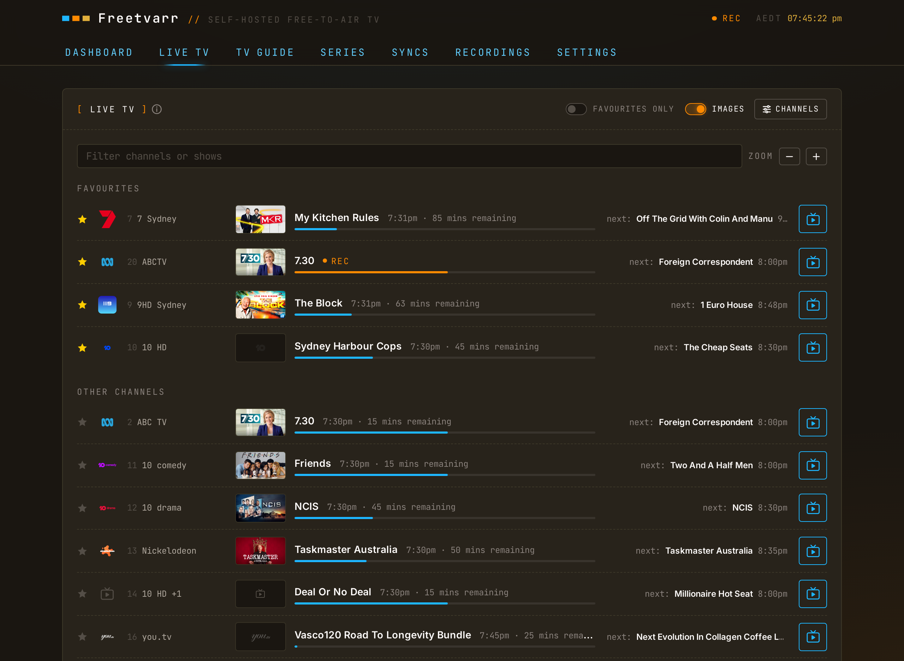

# Live TV

A network tuner streams live channels to any device on your home network, and TVHeadend streams from any tuner it controls. None of it costs anything. Freetvarr has its own player for a quick look in a browser. The apps below suit an evening on the couch and need no Freetvarr at all.

To watch with the TV guide in Jellyfin or Kodi on your TV, copy the addresses from Freetvarr's **SETTINGS → WATCH ON YOUR TV** ([TV apps](/guide/tv-apps) has the steps).

## The options

| App                                 | Platforms                                | Points at              | Note                                                                        |
| ----------------------------------- | ---------------------------------------- | ---------------------- | --------------------------------------------------------------------------- |
| Freetvarr                           | Any modern browser, phones included      | TVHeadend              | No install. Pause and rewind `30` minutes. Captions                         |
| The tuner's own app, e.g. HDHomeRun | Apple TV, iOS, Android, Fire TV, Windows | The tuner              | No server in the path. Simplest thing that works                            |
| Plex live TV                        | Every Plex client                        | The tuner              | Free. Plex Pass is only needed to record, which you already do in TVHeadend |
| Jellyfin live TV                    | Apple TV, iOS, Android, web              | TVHeadend or the tuner | Free, and carries the TV guide. [TV apps](/guide/tv-apps) sets it up        |
| Kodi + TVHeadend PVR add-on         | Apple TV, Android, Shield                | TVHeadend              | Full guide, and it renders captions. [TV apps](/guide/tv-apps) sets it up   |

## In Freetvarr

<!-- markdownlint-disable MD033 -->
<BrowserFrame label="http://freetvarr.lan/#/live">
  
</BrowserFrame>
<!-- markdownlint-enable MD033 -->

Tap a channel in the **LIVE TV** tab, or under **LIVE NOW** in the dashboard's **WHAT'S ON** panel, to watch it. A channel with no guide listing plays too. The **INFO** button at the end of each row opens the programme's details in the TV Guide; close them to return to the list. In the TV Guide, click a programme that is on air to open it, then press **WATCH LIVE**. The player keeps playing while you switch tabs. Close the player with the **✕** button to free the tuner.

A dimmed channel marked **OFF AIR** is not broadcasting right now, so a tap shows a message instead of starting a stream. The mark clears by itself once TVHeadend sees the channel again, after a channel scan.

The **zoom buttons** above the channel list change the row size. Zoom out for more channels on screen; zoom in for bigger pictures and text. Each browser remembers its zoom.

<!-- markdownlint-disable MD033 -->
<BrowserFrame label="http://freetvarr.lan/#/live">
  
</BrowserFrame>
<!-- markdownlint-enable MD033 -->

## Programme info

Press the **i** button beside the status under the picture, or the `i` key on a computer, to show what is on. On a phone turned sideways, the button sits on the picture. The panel sits over the bottom of the picture and shows:

- The channel logo, number, and name.
- The title, the episode title, and the season and episode number.
- The start and end times, and how much of the programme has played.
- The genre, the classification, and the start of the description.
- The programme that is on next, and when it starts.

On a wide screen, the panel also shows the programme picture. While you watch from the rewind buffer, the panel describes what you are watching, not what is on air, and reads **FROM BUFFER**. The title at the top of the player changes when a new programme starts. If the guide has nothing for the channel, the panel says so.

Press the button again, press `Esc`, or click the picture above the panel to close it. That click closes the panel only: it does not pause or skip. The player's own controls come back when the panel closes. Press the full-screen button beside **CC**, double-click the middle of the picture, or press the `f` key to go full screen. In full screen, the info, **CC**, and exit full-screen buttons show at the top right of the picture. To stop watching, exit full screen first, then close the player.

## Captions

Press the **CC** button beside the **i** button, or the `c` key on a computer, to turn captions on. Press it again to turn them off. Captions are off until you turn them on, and each browser remembers your choice for the next channel. While the programme info panel is open, captions hide and the **CC** button is dimmed. Closing the panel brings them back if they were on.

Captions come from the broadcast's Teletext subtitles. A channel shows the **CC** button only when it carries them, and some programmes on that channel have no captions at all. To watch captions in other apps, see [Captions in other apps](#captions-in-other-apps).

## Record from the player

Press **RECORD** in the player to record the programme on now, or **SERIES** to record every episode. Both buttons open the same dialog as the TV Guide, with **RECORD** for this airing, **SERIES** where the programme belongs to a series, the folder it saves to, and the option to keep it out of your library. Under the status line, the dialog says what each button does. A recording starts from the moment you confirm, so the part that already aired is not included.

If the guide has no listing for what is on now, both buttons are dimmed. **SERIES** turns gold with a tick while a series recording records the programme; press it to change or cancel the series.

While the programme on now records, the record button reads **STOP REC** with a flashing orange dot (on a phone, the dot alone). Press it to open the dialog, then press **STOP RECORDING**. The dialog says what happens to the part already recorded:

- After `5` minutes or more, the recording stops and the part recorded so far stays, and imports to your library like any finished recording.
- Before `5` minutes, the recording stops and Freetvarr deletes the part recorded so far.

Stopping an episode of a series recording stops that episode only. The series keeps recording future episodes, and it does not record the stopped episode again.

## Pause and rewind

Press **PAUSE** under the picture, or the space bar or `k` key on a computer, to pause. The status reads **PAUSED** and the channel keeps recording into the buffer. Press **PLAY** to carry on from where you paused, or **GO LIVE** to jump to now. Pausing for longer than the buffer resumes from the oldest part the buffer still holds.

Pause the player, or drag back along its timeline, to rewind up to `30` minutes. While you are behind live, the player shows how far behind you are, and **GO LIVE** jumps back to now. Set `LIVE_TV_BUFFER_MINUTES` in the `.env` to keep more or fewer minutes, or `0` to turn it off.

To skip, double-tap (phone or tablet) or double-click (computer) the left third of the picture to go back `10` seconds, or the right third to go forward `10` seconds. Keep tapping to skip further. On a computer, the left and right arrow keys skip `10` seconds too. Skipping stops at the start of the buffer and at live. Safari on an iPhone shows no timeline for live TV, so double-tap is the way to rewind there.

If you lock the phone or switch to another app, Freetvarr keeps the channel and its buffer for as long as the buffer lasts (`30` minutes by default), so you can come back to it. The tuner stays in use for that time (close the player with **✕** to free it at once).

The buffer starts when you open the channel, so you can rewind only as far back as that. A paused channel keeps its tuner. Changing channel or closing the player deletes the buffer.

Freetvarr keeps the buffer on disk, in the Freetvarr Docker container's temporary folder. At typical broadcast quality, `30` minutes takes about `1–2GB` for each channel that is playing.

## Stream handling

If a channel takes longer than about `15` seconds to start, the player says it is still waiting for a signal. If a stream stops, the player says why (for example, a recording took the tuner), and **RETRY** tunes the channel again.

Freetvarr gets the channel from TVHeadend and converts it with ffmpeg into a stream that any browser can play:

- **H.264 video** is deinterlaced and re-encoded to progressive H.264. See [Video handling](#video-handling).
- **MPEG-2 or HEVC video** is re-encoded to H.264 in software, because browsers cannot play MPEG-2. Standard-definition channels stay at `576` lines; HD channels in those formats drop to `540` lines to keep the CPU load down.
- **Audio** becomes stereo, in TVHeadend's default language, without the audio-description track.

Each channel needs a tuner, unless a tuner already carries its multiplex, in which case the two share it. If every tuner is busy, the player says what is using each one. If a recording in the next hour needs the tuner, the player warns you. When the recording starts, the recording takes the tuner and the live stream stops.

Stream limits:

- **Two channels at once** by default. Set `LIVE_TV_MAX_SESSIONS` in the `.env` to change it. Viewers of the same channel share one stream.
- **The stream stops 20 seconds** after the last viewer closes the player or the tab. A locked phone or a hidden tab keeps it for the buffer length instead ([Pause and rewind](#pause-and-rewind)).
- **CPU**: a software re-encode costs far more CPU than a hardware one. See [Video handling](#video-handling).

> [!NOTE] 
> The Freetvarr user in TVHeadend needs the streaming right, which the [TVHeadend guide](/guide/tvheadend#_8-make-a-user-for-freetvarr) already grants. TVHeadend gives Freetvarr's stream a low priority (`weight` `50`), so a recording always takes the tuner first.

## Video handling

Many broadcasters send HD as interlaced H.264 (Australian 1080i, for example). Chrome cannot play interlaced H.264; Safari can. So Freetvarr deinterlaces H.264 and re-encodes it to progressive H.264.

At startup Freetvarr reads `LIVE_TV_TRANSCODE` and picks one method:

| Value            | Behaviour                                                                                                  |
| ---------------- | ---------------------------------------------------------------------------------------------------------- |
| `auto` (default) | Hardware if a test encode passes on the VAAPI device, software otherwise                                   |
| `hardware`       | The same test and the same fallback as `auto`                                                              |
| `software`       | Always software: `yadif` and `libx264`, capped at `540` lines. Costs much more CPU                         |
| `copy`           | The old behaviour: H.264 passes through untouched. Safari plays it; Chrome cannot play interlaced channels |

Hardware means VAAPI on Intel Quick Sync or AMD, set up as in [Hardware transcoding](/guide/hardware#hardware-transcoding). The result is capped at `720` lines. The device defaults to `/dev/dri/renderD128`; set `LIVE_TV_VAAPI_DEVICE` in the `.env` to use another. NVIDIA (NVENC) is not supported, so an NVIDIA host uses software.

Freetvarr logs the choice and the reason on a line that starts with `[live] video`. To read it, run `docker compose logs freetvarr | grep "\[live\] video"` in a terminal in the `freetvarr` folder.

> [!NOTE] 
> The author's NAS (Synology DS220+, Intel Celeron J4025 with two cores) re-encodes `1080i` to `720p` in hardware at about `6.5x` real time, using about `5%` of one core. Software at `720p` ran at only `1.36x` real time on both cores, which is why the software path caps at `540` lines.

## Browser notes

If an HD channel fails in Chrome, see [Playback failed on HD channels](/guide/troubleshooting#playback-failed-on-hd-channels).

## The tuner's own app

The author uses the HDHomeRun app, which finds the tuner by itself. The app talks to the tuner directly and skips TVHeadend, so it competes with recordings for tuners. A USB or PCIe tuner has no app of its own, so watch it through TVHeadend with Jellyfin or Kodi instead ([TV apps](/guide/tv-apps)).

## Plex

Plex discovers an HDHomeRun the same way its own DVR feature does, and plays live channels on any client without a Plex Pass ([Plex: Live TV & DVR](https://support.plex.tv/articles/225877347-live-tv-dvr/)). You need a Plex Pass only to *record* through Plex, and TVHeadend and Freetvarr already do that for free. With a USB or PCIe tuner, watch through Jellyfin or Kodi connected to TVHeadend instead.

## Captions in other apps

Captions arrive either as Teletext or as DVB subtitles, and your broadcaster decides which. Australian broadcasters send Teletext, and not every app shows it:

- **The native HDHomeRun app is unproven.** SiliconDust documents DVB subtitle support but says nothing about Teletext, and the author has not tested it on an Australian channel.
- **Kodi, VLC, and Channels do render them.** If captions are a requirement, watch through one of those.

> [!NOTE] 
> The same applies to recordings. A `.ts` from TVHeadend carries the Teletext stream, so a player that decodes Teletext shows captions and one that doesn't shows nothing.

## Tuner budget

Recording and watching share your tuners. The author's Flex Quatro has four tuners, so recording three overlapping programmes leaves one tuner for live TV. In TVHeadend's web interface, **Status → Stream** shows what is using each tuner.
