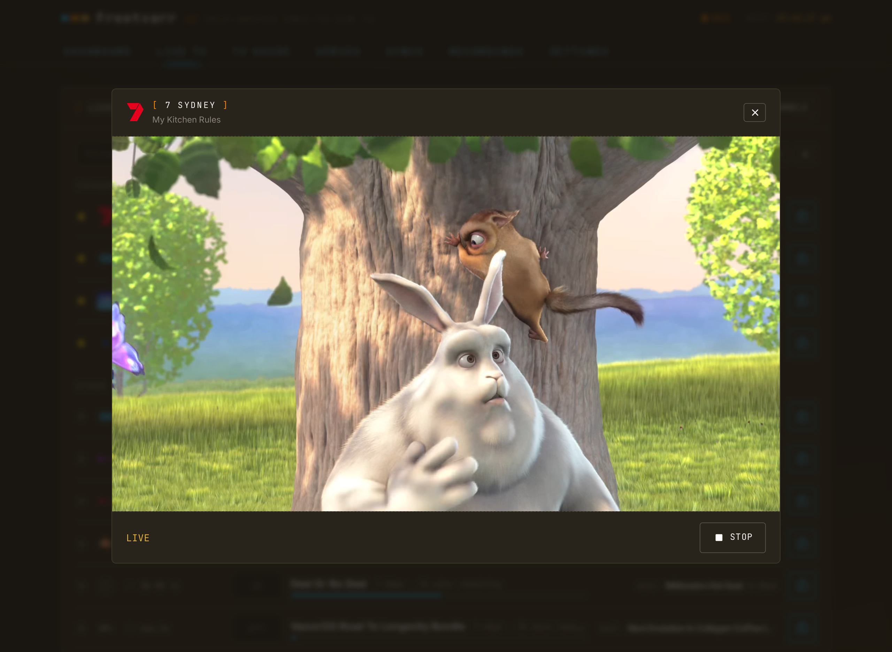

# Player

Freetvarr has one player for live TV and for recordings. It works in any modern browser, on a phone, a tablet, or a computer, and it fills the screen. Open it from [Live TV](/guide/live-tv), from a [programme sheet](/guide/tv-guide#recording-a-programme) with **Watch live**, or from an episode in [Recordings](/guide/recordings#playback).

<!-- markdownlint-disable MD033 -->
<BrowserFrame label="http://freetvarr.lan/#/live">
  
</BrowserFrame>
<!-- markdownlint-enable MD033 -->

## Controls

The top bar has these controls:

- The back button closes the player. For live TV, closing also frees the tuner.
- The channel logo and the title of what is playing.
- **Multiview** (live TV only): watch up to four channels at once. See [Multiview](#multiview).
- **AirPlay** (recordings only): sends the episode to an Apple TV. It shows in Safari when Safari finds an AirPlay device.
- **Miniplayer**: shrinks the player so you can use the rest of Freetvarr. See [Miniplayer](#miniplayer).
- **Series** and **Record** (live TV only): record what is on. See [Record from the player](/guide/live-tv#record-from-the-player).
- **Info**: shows what is playing. See [Programme info](/guide/live-tv#programme-info) and [Recording info](/guide/recordings#recording-info).
- The sound button: turns the sound on or off. See [Sound](#sound).
- **⋯** (**More**): **Captions**, **Pop out (picture in picture)**, and **Full screen**. Buttons that do not fit in the top bar, such as **Multiview** or **Miniplayer**, move into this menu.

The centre of the picture has **Start over**, the large **Pause** or **Play** button, and, for live TV, **Go live** or the `LIVE` mark. The position bar sits under the picture.

On a phone or tablet, tap the picture to show or hide the controls. On a computer, move the mouse to show them, and click the picture to pause or carry on. The controls hide again after `2` seconds; change the delay in [Playback settings](#playback-settings).

Double-tap (phone or tablet) or double-click (computer) the left third of the picture to go back `10` seconds, or the right third to go forward `10` seconds. Keep tapping to skip further.

## Start over

**Start over** works differently for live TV and for recordings.

For live TV, **Start over** does one of these:

- **From the start**: plays the programme from its first minute, while TVHeadend keeps recording it. This is possible only when TVHeadend is recording that programme on that channel. Freetvarr plays the recording in progress, so you can watch a show you started late from the beginning.
- **Back to when you tuned in**: jumps to the oldest part of the rewind buffer. This is possible a few seconds after you tune in.

When both are possible, **Start over** asks which one you want and shows the clock time for each. When only one is possible, **Start over** does it straight away. In Multiview, **Start over** always goes back to when you tuned in.

While you are behind live, **Go live** returns to now, and the text under it says how far behind you are, such as `2 min behind`.

For a recording, **Start over** shows when the player resumed where you stopped, and plays the episode from the start.

## Sound

The sound button at the right of the top bar shows a speaker. When the sound is off, the button turns amber and the speaker has a cross. Press the button, or press `m` on a keyboard, to switch. Point at the button with the mouse to see **Mute (M)** or **Unmute (M)**. Freetvarr remembers the choice on each device, and the next channel or recording starts the same way.

To start every video muted on a device, turn on **Start muted** in [Playback settings](#playback-settings).

## Captions

Open **⋯**, then press **Captions** to turn captions on or off. The menu row shows **On** or **Off**. On a keyboard, press `c`. Each browser remembers the choice, for live TV and recordings alike.

**Captions** shows only when the channel or the recording carries the broadcast's Teletext subtitles. Some programmes on such a channel still have none. See [Captions](/guide/live-tv#captions).

## Miniplayer

Press **Miniplayer** in the top bar (or in the **⋯** menu, when the bar has no room for it) to shrink the player, or swipe down on the picture on a phone. The video keeps playing while you move between pages in Freetvarr.

- On a phone, the Miniplayer is a bar above the tab bar.
- On a tablet or computer, it is a small card in a corner of the screen.
- On a tablet or computer, drag the curved grip on the corner of the card that faces the middle of the screen to resize it, between a fifth and just under half of the screen width (the same limits as the small picture in Multiview **Big and small**); double-click the grip to reset it, and this device keeps the size you choose.

Tap the Miniplayer, or point at it with the mouse, to show its controls: pause, close, and a **⋯** menu. A tablet or computer also shows the sound button. The menu has **Back to full player**, **Pop out (picture in picture)** where the browser supports it, **Sound** on a phone, and **Captions** on a wider screen. Tap the picture while the controls show to go back to the full player. Close stops the video, and for live TV frees the tuner.

## Pop out

**Pop out (picture in picture)** in the **⋯** menu moves the video into a small window that the browser keeps on top of other apps and windows. It shows only in a browser that supports picture in picture. Press **Close pop out (picture in picture)** to bring the video back.

## Full screen

Open **⋯**, then press **Full screen**. On a computer, you can also press `f`, or double-click the picture.

On a phone, turn the phone sideways while the player is open, and the player goes full screen.

## Multiview

**Multiview** plays up to four live channels at once, for example several sports matches. A tablet or computer shows up to `4` pictures; a phone shows up to `2`. Each picture needs a live stream, so **Live streams at once** also sets the most pictures you get; see [Live streams at once](#live-streams-at-once).

1. Open a channel in the player.
2. Press **Multiview** in the top bar. A sheet lists your favourite channels first, then the other channels.
3. Press the second channel.

Each channel in the sheet has a tag that says what it costs:

| Tag                                     | What it means                                                                                       |
| --------------------------------------- | --------------------------------------------------------------------------------------------------- |
| `Uses a free tuner`                     | A tuner is free, and the channel takes it.                                                          |
| `No extra tuner`                        | The channel shares a multiplex (a group of channels on one frequency) with a channel already tuned. |
| `Unavailable: all tuners busy`          | Every tuner is in use. You cannot pick the channel.                                                 |
| `Unavailable: off air`                  | The channel is not broadcasting now.                                                                |
| `Unavailable: 1 stream already playing` | Freetvarr already plays as many live streams as **Live streams at once** allows.                    |

The tuner count at the top of the sheet, such as `2 of 4 tuners`, opens **How this works**, which explains tuners and multiplexes for your hardware. Recordings always come first: if a recording needs a tuner, it takes one from live TV.

To add a third or fourth channel, press **Add channel** in the Multiview header, or the empty **Add channel** slot. The sheet shows a box for each picture on screen and one for the new picture. On a phone, the sheet says that phones show up to `2` pictures.

With two channels playing:

- **Side by side** shows the two pictures next to each other. **Big and small** shows one picture full size and the other in a corner. On a phone held upright, the pictures stack instead; turn the phone sideways to choose a layout.
- The swap button swaps the two pictures.
- In **Big and small**, drag the small picture to any corner. Double-tap it (double-click with a mouse) to make it the big picture.
- On a tablet or computer, you can resize the pictures. In **Side by side**, drag the bar between the pictures. Each picture takes from `30%` to `70%` of the width, and the bar snaps at a third, a half, and two thirds. In **Big and small**, drag the grip on the small picture's inner corner (the corner nearest the middle of the screen). The small picture takes from `20%` to `45%` of the screen width, and its outer corner stays where it is.
- Point at a picture with the mouse, or tap it, to show its own controls: **Start over** (back to when you tuned in), **Pause** or **Play**, **Go live** or the `LIVE` mark, and a position bar. The first tap only shows the controls; it never pauses. Tap the picture again, or wait, and the controls hide.
- A paused picture dims, its badge reads `PAUSED`, and a large **Play** button stays on it until you press it. Each picture pauses and plays on its own.
- Each picture has its own **Sound** or **Muted** button. Press **Muted** on a picture to hear it; the other picture mutes. Press **Sound** on the picture you hear to mute both. An outline marks the picture you hear.
- Each picture's **⋯** menu has **Full screen** (keep this channel and stop the other), **Change channel**, and **Stop watching**.
- The back button stops both channels and closes the player.

With three or four channels playing:

- **Grid** shows the pictures in two rows of two. **Big and small** shows one main picture and the others in a strip: on the right when the screen is wider than it is tall, and below the main picture otherwise. The swap button goes away.
- While you can add another channel, the free place in the layout is an **Add channel** slot.
- Double-tap a small picture in **Big and small** (double-click with a mouse) to make it the main picture.
- In **Big and small** on a tablet or computer, drag the bar between the main picture and the strip to resize them. The main picture takes from `60%` to `80%` of the width. The bar is there only when the strip is on the right. **Grid** has no bar.
- Only one picture has the sound. Press **Muted** on any picture to hear it; the others mute.
- Each picture's **⋯** menu has **Make main**, **Change channel**, **Full screen** (keep this channel and stop the others), and **Remove**.
- The back button stops every channel and closes the player.

To find a bar or grip, point at it with the mouse. On a touch screen, tap a picture: the bar or grip shows while the picture's controls show. While you drag, a label shows the new size. With the keyboard, press Tab to reach the bar or grip, then use the arrow keys to change the size in `5%` steps, and **Home** or **End** to go to the smallest or largest size.

Freetvarr remembers the size for each layout and number of pictures in this browser. The swap button and **Make main** keep the size. **Reset size** in the Multiview header shows when a size is not the default; press it, double-click the bar or grip, or press **Enter** on it, to go back to the default. Phones always use the default sizes.

If a recording needs a tuner that Multiview uses, only the pictures on that tuner stop. The stopped picture says `Stopped for a recording:` and the programme name, with **Pick a channel** and **Remove**. If you were listening to it, the sound moves to the main picture. When Freetvarr starts a picture, it asks TVHeadend to take the tuner of the newest picture first.

## Playback settings

Under **THIS DEVICE**, Settings → Watching → **Playback** holds two choices for the device you use:

- **Start muted**: every video starts with the sound off. This is the same choice as the sound button.
- **Hide player controls after**: `1 s` to `5 s`. The default is `2 s`.

Both are saved in the browser, so each device keeps its own. Under **LIVE TV**, the same page holds [Live streams at once](#live-streams-at-once), one setting for every device in the home.

## Live streams at once

**Live streams at once**, under **LIVE TV** in Settings → Watching → **Playback**, sets how many live streams Freetvarr plays at the same time: `1` to `4`. The choices stop at your tuner count. Recordings that play in Freetvarr's player count against the same limit. Two viewers of the same channel share one stream.

Each stream costs processor time, because Freetvarr converts it for the browser ([Video handling](/guide/live-tv#video-handling)). When Freetvarr starts, it measures how many streams the computer can convert at once, and sets the default from the result. The measurement converts a short `1080i` test recording the same way as live TV: first one copy, then two at the same time, and so on up to four. A number passes when every copy converts at least `1.2` times faster than real time. The setting shows the result, such as `Measured: this NAS can convert 2 live streams at once (hardware, measured 20 Oct 5:55pm).` If you choose more than the measured number, the setting says so instead, such as `You chose 2. The last measurement managed 1 smoothly, so the second picture may stutter.` Press **Measure again** to run the measurement again. It takes up to `30` seconds, and it waits until no live TV, recording playback, or ad scan runs.

`LIVE_TV_MAX_SESSIONS` in the `.env` sets a hard limit that the setting cannot go above. See [Configuration](/guide/configuration#compose-environment).

## Keyboard shortcuts

On a computer, the player takes these keys:

| Key                   | What it does                                                              |
| --------------------- | ------------------------------------------------------------------------- |
| Space or `k`          | Pauses, or carries on. In Multiview, acts on the picture you hear.        |
| Left and right arrows | Skip back or forward `10` seconds. For live TV, within the rewind buffer. |
| `f`                   | Enters or exits full screen.                                              |
| `i`                   | Shows or hides the programme or recording info.                           |
| `c`                   | Turns captions on or off, when the channel or recording has them.         |
| `m`                   | Mutes or unmutes. In Multiview, acts on the picture you hear.             |
| `Esc`                 | Closes the info panel, or else closes the player.                         |
