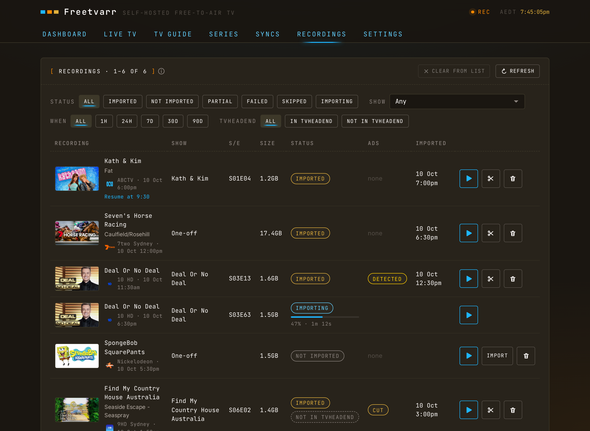

# Recordings

The RECORDINGS tab lists every recording TVHeadend has finished, with its programme image, channel, and air time, and what Freetvarr did with it.

Freetvarr saves each programme image while the recording is still scheduled, because TV guide image links often stop working once the programme has aired. A recording with no saved image shows its channel logo.

<!-- markdownlint-disable MD033 -->
<BrowserFrame label="http://freetvarr.lan/#/recordings">
  
</BrowserFrame>
<!-- markdownlint-enable MD033 -->

## Statuses

- **IMPORTED**: the file on disk matches the size TVHeadend reported.
- **PARTIAL**: the imported file came up more than `1MB` short. The next sync imports it again.
- **SKIPPED**: there was nothing to import. Either TVHeadend has no file for the entry yet (it's still recording, or the recording failed), or the path it reported sits outside the recordings folder Freetvarr can see. The row's error text says which.
- **FAILED**: the import hit an error.
- **NOT IMPORTED**: Freetvarr left the recording in TVHeadend. You recorded it with **ADD TO LIBRARY** off, or it matches no series folder and **IMPORT EVERY RECORDING** is off in **SETTINGS**. Press **IMPORT** to add it to the library at once.
- **REPLACED**: Freetvarr imported the recording, but its library file is gone, and the folder has another file for the same episode. Another app, such as Sonarr, replaced it. See [Replaced recordings](/guide/troubleshooting#replaced-recordings).
- **NOT IN LIBRARY**: Freetvarr imported the recording, but its library file is gone and no other copy of the episode is in the folder. Press **IMPORT AGAIN** to import the TVHeadend copy again, while TVHeadend still has it.

With ad removal on, an ad status also appears: **SCANNING**, **DETECTED**, **NO BREAKS**, **CUT**, **DETECT FAILED**, or **CUT FAILED**. See [Ad removal](/guide/ad-removal).

> [!NOTE] 
> A recording still in progress shows as **SKIPPED**. The first sync after TVHeadend finishes the recording imports it, up to ten minutes after the programme ends because of the padding.

## Playback

Press the play button on a finished recording to watch it in Freetvarr's player, in any browser, on a phone or a computer. The player works like the [live TV player](/guide/live-tv): the channel and the programme sit at the top, the **×** at the top right closes the player, and the row under the picture holds the **i** button, the status, and the buttons. Under `480` pixels wide, the buttons show only their icons.

- **PLAY** or **PAUSE**: pauses and carries on. The space bar or `k` key does the same on a computer.
- **START OVER**: shows when Freetvarr resumed where you stopped last time, and plays from the start.
- The full-screen button beside the info button, a double-click in the middle of the picture, or the `f` key: full screen. The position bar stays in full screen, and its full-screen button exits it.
- The position bar under the picture: drag it to move through the recording.

The player uses the imported file, or the TVHeadend copy when the recording is not imported. Freetvarr remembers where you stopped and starts there next time. To skip, double-tap (phone or tablet) or double-click (computer) the left third of the picture to go back `10` seconds, or the right third to go forward `10` seconds. Keep tapping to skip further. On a computer, the left and right arrow keys skip `10` seconds too. If ad detection found breaks in the recording (see [Ad removal](/guide/ad-removal)), a **SKIP AD** button appears at the bottom right of the picture while you watch a break. Press it to jump to the end of the break. On an iPhone, use AirPlay to send the recording to an Apple TV.

### Recording info

Press the **i** button, or the `i` key on a computer, to show the recording's details over the picture. On a phone turned sideways, the button sits on the picture. The panel shows:

- The channel, and **FROM LIBRARY** or **FROM TVHEADEND** for the file that plays.
- The title, the season and episode, and the episode title.
- When it aired, with a bar for how much you have watched.
- The length, and the import status as the RECORDINGS tab shows it, such as **IMPORTED** with its date, or **NOT IN TVHEADEND**.
- The description.
- **ADS**: the ad breaks a scan found or cut, when ad removal has scanned the recording.
- **SAVES TO**: the library file. It reads **REPLACED BY** and the other file when another app replaced it, and **FILE MISSING** when Freetvarr cannot find the file; the player then plays the TVHeadend copy if TVHeadend still has it.

Press the button again, press `Esc`, or click the picture above the panel to close it. The position bar and **SKIP AD** hide while the panel is open. A second `Esc` closes the player.

The player converts the file as it plays, the same way it converts [live TV](/guide/live-tv#stream-handling), so live channels and recordings share the `LIVE_TV_MAX_SESSIONS` limit. A recording still in progress cannot be played until it finishes. On the TV itself, a media player that reads your library (Plex, Jellyfin, Kodi, or Infuse) is still the better way to watch.

## Live progress

A hardlink import is instant. A copy between filesystems, an ad scan, or a cut takes longer, so the row shows its progress and the time left.

## Re-scan and re-cut

On the RECORDINGS tab, re-run an ad scan or cut on a file you have already imported. This does not change TVHeadend. Press the scissors button on the row. A dialog says what the scan does before it starts:

- When the series folder's ad removal is **DETECT** or **OFF**, the scan writes the ad break times to a `.edl` file beside the recording, and the recording file stays as it is.
- When it is **CUT**, the scan saves the recording again without the breaks and keeps the original as `<file>.ts.orig` for the days set in **SETTINGS**. If a second cut of a cut recording finds more ads, it replaces that backup with the first cut, so the full original is lost.

The dialog also gives the expected time: finding the ads takes about half the length of the recording. Press **FIND ADS** or **CUT ADS** to start, or close the dialog to leave the recording as it is.

The ad scan button is greyed out when the library file is gone, for example after another app replaced or removed it.

## Remove from TVHeadend

An imported recording that TVHeadend still has shows a delete button. Press it, then press **REMOVE FROM TVHEADEND** in the dialog. TVHeadend deletes its copy of the recording, and your library copy stays. TVHeadend keeps a note that it recorded the episode, so a series recording does not record it again. You cannot undo this. [Remove from TVHeadend](/guide/remove-from-tvheadend) explains the TVHeadend calls.

## Not in TVHeadend

A recording that TVHeadend has deleted shows a **NOT IN TVHEADEND** marker next to its status. Hover over the marker to see when TVHeadend deleted it. The episode is still in your library, so you can play it, scan it for ads, or cut it again.

These rows leave the list 30 days after the removal. To remove them sooner, press **CLEAR FROM LIST** in the panel header, then **CLEAR FROM LIST** in the dialog. The dialog states the number of rows it clears, across every page and filter. To clear one row, press its delete button, then **CLEAR FROM LIST** in the dialog. Both remove rows from the list only (the files stay in your library). For 10 seconds after a clear, **UNDO** puts the rows back.

## Failed rows

To clear a **FAILED**, **SKIPPED**, or **NOT IMPORTED** row, press its delete button, then **CLEAR FROM LIST** in the dialog. TVHeadend keeps the recording. While TVHeadend has it, the next sync adds the row back and decides again whether to import it.

## Filters and time

Filter by **IN TVHEADEND** or **NOT IN TVHEADEND**, or by time with **WHEN**. Times show in the time zone chosen in **SETTINGS** (or `TZ` from your `.env` until you choose one), whatever device you browse from.
