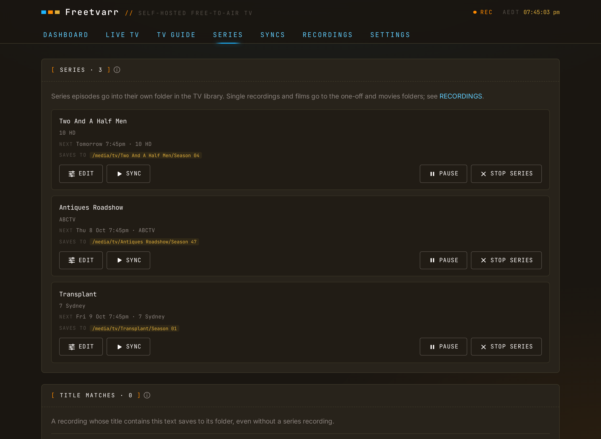

# Series rules and folders

A series has two parts: a [series recording](#how-a-series-recording-works) in TVHeadend and a folder in your media library. TVHeadend records each episode. Freetvarr imports every recording TVHeadend finishes, and files the episodes of a series into its own folder at the next sync (a [sync](/guide/syncs) is one pass over TVHeadend's finished recordings). Settings → RECORDING → **Series rules** lists both parts together. Settings → RECORDING → **Title matches** lists the [title matches](#title-matches).

[Recording options](/guide/recordings#recording-options) on a show page change one show.

<!-- markdownlint-disable MD033 -->
<BrowserFrame label="http://freetvarr.lan/#/settings/system/series">
  
</BrowserFrame>
<!-- markdownlint-enable MD033 -->

## Add a series

1. In Freetvarr, open the [TV guide](/guide/tv-guide#recording-a-programme).
2. Press a programme of the series to open its programme sheet.
3. Pick **Every episode**.
4. Press **Record series**.

Freetvarr creates the series folder at the same time, unless you first turn off **Add to library** under **Advanced** in the programme sheet. The default for **Add to library** is in Settings → RECORDING → Media library. [Series folder names](#series-folder-names) explains how Freetvarr names the folder.

Matching is by title: a recording goes to the folder whose title appears in the recording's title. When more than one folder matches, the longest title wins, so `NRL Grand Final` beats `NRL`.

## Series folder names

Freetvarr looks up each new series on [TVmaze](https://www.tvmaze.com) and names its folder after the show it finds, with the show's TVDB number (its ID on TheTVDB, an online TV database) in curly brackets:

```text
Gruen {tvdb-83281}
Big Brother (AU) {tvdb-76237}
```

The country code in brackets, such as `(AU)` or `(UK)`, appears only when shows from other countries have the same title. Freetvarr uses the channel, the air time, and the country of your time zone to choose between them. The TVDB number tells Plex which show the folder holds, so Plex does not mix up `Big Brother` from Australia with `Big Brother` from the US. TVmaze needs no account or key. When TVmaze has no TVDB number for the show and you added a [TMDB key](/guide/tv-guide#tmdb-key), the folder carries the TMDB number instead, such as `{tmdb-12345}`.

Freetvarr uses an existing folder first:

1. A folder with the same TVDB or TMDB number, whatever its name.
2. A folder with the same name as the show, such as `Big Brother (AU)`.
3. A folder with the same name as the series, such as `Big Brother`, or with the name plus a year or a country, such as `Bluey (2018)` or `Ghosts (US)`, when only one such folder exists. Freetvarr skips a folder that names another country or carries another show's number.

When TVmaze finds no show, finds more than one with no clear winner, or does not answer in time, the folder is named after the series, such as `Big Brother`. The **Show** row in the [edit form](#edit-a-series-folder) of the series then says why, and you can [check which show it is](#check-which-show-this-is) and [rename the folder](#rename-folder) later. Freetvarr does not look up shows when **Missing pictures** is off in Settings → WATCHING → Film and TV info.

Folders that already exist keep their names. New episodes of a series keep going to its folder until you rename it.

> [!NOTE]<br>
> Plex reads the TVDB number in the folder name. Jellyfin reads `{tvdb-…}` from Jellyfin 12; older Jellyfin versions ignore it and match the show by name, where the country code helps. Infuse, reading the share directly, matches by the folder and file names; if it picks the wrong show, correct the match in Infuse's own metadata editor.

### Check which show this is

The **Show** row in the [edit form](#edit-a-series-folder) of a series names the show that Freetvarr found, with its country, network, and years. When Freetvarr is not sure, the row says **Check which show this is**:

- **Freetvarr thinks this is …**: Freetvarr took the TVDB number from an earlier run of the same show in the same country. Check that it is the right show.
- **Freetvarr found more than one show called …**: Freetvarr could not choose. The folder keeps the plain name until you pick.

To pick the show:

1. Press the **Show** row.
2. Press your show in the list, or press **None of these** to keep the plain folder name.

Freetvarr remembers your pick for that title on that network, so a new series recording of the same title gets the same show. **None of these** clears that pick.

When the row says **No show found**, **TVmaze not reachable**, or **Still looking**, there is nothing to pick yet. Open the series again later.

### Rename folder

When a series folder does not carry the show's TVDB number yet, the edit form shows **Rename folder** and the new name. To rename it:

1. Press **Rename folder**.
2. Check the old and the new name, the number of recordings Freetvarr updates, and the number of videos in the folder that Freetvarr did not record (they move with the folder).
3. Press **Rename folder**.

Freetvarr renames the folder on the disk, updates the path of every recording in it, saves new episodes to the new folder, and asks Plex to rescan. Before you rename a folder that Plex already shows, read [Renamed folders](/guide/plex#renamed-folders).

To keep the current name, press **Keep this name** instead. Freetvarr then stops offering the rename for that folder until you pick a show again.

Freetvarr does not offer **Rename folder**:

- For a [title match](#title-matches).
- For a folder you typed into **Saves to** yourself.
- While a sync runs, while [ad removal](/guide/ad-removal) works on one of its episodes, or while Freetvarr moves recordings into their library folders. Try again when it finishes.
- When Sonarr also saves episodes in the folder. Renaming it would break Sonarr's path to the series, so rename the series in Sonarr instead.
- When a folder with the new name already exists in your TV library.

The edit form says which of the last two applies.

## Record on any channel

Turn on **Any channel** in the programme sheet before you press **Record series**. The series recording then matches on title alone, and records the show on whichever channel airs it, for example when it moves from 7 to 7mate. Episodes it already has are not recorded again. It is off by default.

Use it for a show that moves between channels, such as a series that airs on 7 one season and on 7mate the next. Series rules shows `Any channel` where it normally shows the channel names.

An episode that airs on two channels records once. The series recording skips an episode whose episode number it has already recorded, on any channel. This needs episode numbers in your TV guide, as in [How a series recording works](#how-a-series-recording-works). Where they are missing, TVHeadend records every airing, so the same episode can record twice.

To change the setting on an existing series, open its show page, press **Recording options**, and pick **Any channel** under **Channels**.

## How a series recording works

A series recording is one TVHeadend autorec entry (an automatic recording rule in TVHeadend). It matches on **title plus channel** (or on title alone, with [any channel](#record-on-any-channel)), across all days and all start times. It skips an episode whose episode number it has already recorded. The **Keep the latest** option in [Recording options](/guide/recordings#recording-options) (**Keep** in the programme sheet) maps to the maximum-count field of TVHeadend, so TVHeadend removes the oldest episodes itself.

- **One channel**: an SD channel and its HD simulcast are separate channels, so a series recording on the HD channel does not cover SD airings. Series rules shows both as one series.
- **Episode numbers**: duplicate detection needs them. XMLTV feeds carry them inconsistently, so your TV guide source decides what you get. Where they are missing, TVHeadend records every airing.

## Series rows

Each row shows one series:

- The title, with the channels and the number of episodes to keep.
- **Next**: the next airing, or the next expected airing, with its channel.
- **Saves to**: the full path where the next sync saves new episodes, such as `/media/tv/Bluey (2018)/Season 01`. The season comes from the next airing; when the TV guide has no season number, the path shows `Season …`. A series with no series folder shows the new folder that its next import makes, named after the series recording, such as `/media/tv/Bluey`; after that import, the row shows that folder. A series you moved to One-offs in [Recordings](/guide/recordings#library) shows a path in the [one-off folder](#recordings-with-no-series), such as `/media/one-offs/Bluey`. When **Import every recording** is off in Settings → RECORDING → Media library, a series with no series folder shows that its episodes wait in the [recording log](/guide/recordings#recording-log).

A row shows a **Paused** badge when the series recording in TVHeadend is paused. A row with no badge records new episodes as normal.

**Sync** (on a row with a series folder) imports the new episodes of this series now.

Press a row to open the series under it. Press the row again, or press `Esc`, to close it. The open series shows:

- **Series recording**: whether TVHeadend records new episodes, with **Pause** and **Cancel series**.
- A series with a series folder shows the [edit form](#edit-a-series-folder).
- A series with no series folder shows where its episodes go and **Assign folder**, which lets you choose the folder in your media library before the next import. See [Assign a folder](#assign-a-folder).
- **Pause** stops TVHeadend recording new episodes of this series. Episodes already recorded still import. **Resume** starts it again. On an SD and HD pair, both series recordings pause and resume together.
- **Cancel series** removes the series recording from TVHeadend. See [Cancel a series recording](#cancel-a-series-recording).

## Sort and filter

The controls above the series rows narrow and order the list:

- **Filter series or channels**: type part of a title, a channel name, `any channel`, or part of a **Saves to** path.
- **Sort**: **A–Z** (the default), **Next airing**, or **Recently added**. **A–Z** ignores a leading "The", so `The Block` sorts under B. **Next airing** puts series with nothing in the TV guide last. **Recently added** uses the date the series got its series folder, so a series with no series folder sorts last.
- **Status**: **All**, **Paused**, **Not in guide** (nothing in the TV guide for the next `7` days), or **Recording now**.

The group title shows how many series match. **Clear filters** shows all series again. The browser remembers the sort order; the filter and status reset when you leave the page.

## Cancel a series recording

In Series rules, press a row, then **Cancel series**. **Stop recording this show** in [Recording options](/guide/recordings#recording-options), the programme sheet of the TV guide, and the live player reach the same question. TVHeadend stops recording new episodes and removes the upcoming ones. Episodes already recorded stay, and so do their files. Before it cancels, Freetvarr asks:

- **Stop the episode on now** (shown while an episode records): on by default. After `5` minutes or more of recording, the episode stops and the part recorded so far stays. Before `5` minutes, Freetvarr deletes it. Turn the switch off to let the episode record to the end.
- **Keep title match** (shown when a [title match](#title-matches) saves this series): off by default when **Record series** made the title match, so cancelling removes it. A title match records nothing by itself; it only decides the folder for recordings with that text in the title. Turn the switch on to keep saving them to the same folder.

To change nothing, close the question. **Keep series** goes back.

## Assign a folder

Press a series with no series folder, then **Assign folder**. A dialog opens before anything changes:

1. Check the folder name. Freetvarr fills in an existing folder with the same name under your media root (the TV folder of your media library, set as **Media root** in Settings → RECORDING → Media library), or a new folder named after the series.
2. To use another folder, type its name, or choose it from the list of existing folders.
3. Press **Assign folder** to save the folder for the series.

The dialog shows the full path for future episodes. Episodes already imported stay where they are; Freetvarr does not move them. After that, the [edit form](#edit-a-series-folder) opens under the row.

## Edit a series folder

Press a series with a series folder to open these fields under the row:

- **Saves to**: the folder under your media root (shown before the field) where the series goes. As you type, Freetvarr suggests matching folders that are already there.
- **Show**: the show the folder is named after. See [Check which show this is](#check-which-show-this-is). Title matches have no **Show** row.
- **Season folders**: the [season template](#season-template).
- **Recording titles that contain**: the title that Freetvarr matches. It ignores case.
- **Ad removal**: **Off**, **Detect**, or **Cut**. See [Ad removal](/guide/ad-removal). The field is off until you turn on ad removal in Settings → RECORDING → Ad removal.
- **Remove from TVHeadend after import**: remove the TVHeadend copy once Plex confirms the file. See [Remove from TVHeadend](/guide/remove-from-tvheadend).

Press **Save** to keep the changes. To close the form without saving, press the row again, or press `Esc`. A change to **Saves to** applies to future episodes only (episodes already imported stay where they are). To move the episodes as well, use [Rename folder](#rename-folder) when the form offers it.

A series folder stays while the series recording exists, because each import of a series recording gives the series a folder. To save a series to the one-off folder instead, choose **Move to One-offs** in its ⋯ menu in [Recordings](/guide/recordings#library).

## Season template

Each folder has a season template that decides where episodes are saved. The default is `Season {season}`. `{season}` and `{season_padded}` give the zero-padded number (`01`), and `{season_unpadded}` gives the plain number (`1`). Freetvarr writes to `<media_root>/<dest_folder>/<season>/…`, where `<dest_folder>` is the **Saves to** folder, and it rejects any template that would point outside your media root.

## Filenames

Freetvarr renames every file as it imports it, into the shape Plex, Jellyfin, and Kodi read:

```text
Show Name - S01E02 - Episode Title.ts
```

When the TV guide gave no episode number, the air date stands in:

```text
Show Name - 2026-09-21 - Episode Title.ts
```

Freetvarr leaves the episode title out when the TV guide did not supply one, and when the title only repeats the episode number, such as `Episode 2` or `Episode 2 of Season 1`:

```text
Show Name - S01E02.ts
```

The file name starts with the series folder name without its TVDB or TMDB number, so a folder named `Big Brother (AU) {tvdb-76237}` holds files such as `Big Brother (AU) - S17E06.ts`. Files already imported keep their names, so a folder that you named with a number yourself can hold both shapes.

TVHeadend's own file names stay as they are, because nothing downstream reads them.

### Name clashes

An import never replaces a file that is already in the library. When the folder already has a file with the same name, and that file is not this recording, Freetvarr saves the recording under a copy name and logs a warning in the sync:

```text
Show Name - S01E02 - Episode Title - copy 2.ts
Isle Of Dogs (2018)/Isle Of Dogs (2018) (2).ts
```

The other file stays as it is. This happens, for example, when Sonarr already downloaded the same episode into the folder.

## Title matches

A recording whose title contains this text as whole words saves to its folder, even without a series recording. `NRL` matches `NRL Friday Night Football`, but not `NRLW`. For a sport recording, a title match that Freetvarr made by itself at an import matches only that exact title, so `Rugby League World Cup 2026` does not catch `Women's Rugby League World Cup 2026`. Settings → RECORDING → **Title matches** lists each title with no series recording: a title you added by hand, such as `NRL`, or a series you cancelled with **Keep title match** on. Each title has a **Saves to** path and **Sync**, like a series row. Press the row to open the edit form under it. In the edit form, **Remove title match** removes the title after you confirm (recordings already imported stay where they are).

To add a title:

1. Under **ADD TITLE**, enter the **Recording titles that contain** text. Press **Refresh titles** to list the titles TVHeadend has recorded.
2. Under **Saves to**, enter the folder under your media root. Freetvarr suggests an existing folder, or a new folder named after the title.
3. Set the season folders, ad removal, and **Remove from TVHeadend after import**.
4. Press **Add title**.

## Recordings with no series

A programme that airs once, such as a sports final or a special, goes to the one-off folder. So does sport with no entry on TheTVDB or TMDB, such as each game of a tournament. The one-off folder is `/data/media/one-offs` in the Docker compose file that the install script downloads. Each title gets its own folder, and the file name carries the air date and start time:

```text
NRL Grand Final/NRL Grand Final - 2026-10-04 1930.ts
```

A TV series with no series folder does not go there. Freetvarr adds a series folder for it on its first import, named after the series recording or the title. See [Library](/guide/recordings#library) for how Freetvarr tells a series from a one-off.

The one-off folder stays out of the TV folder on purpose. Plex, Jellyfin, and Infuse match a TV library against online listings, and a one-off title rarely matches. In your media server, point a separate library at the folder instead (in Plex, use the **Other Videos** library type). See [Configuration](/guide/configuration#the-one-off-folder) for the mount and the **Import every recording** switch in Settings → RECORDING → Media library that turns this off.

## Films

Set a **movies folder** in Settings → RECORDING → Media library, and a film with no series folder goes there instead, named the way movie libraries expect:

```text
Isle Of Dogs (2018)/Isle Of Dogs (2018).ts
```

Freetvarr treats a recording as a film when the TV guide gives it a film or drama genre, no season or episode number, and a length of at least 75 minutes. A title that has a series recording or a series folder is never a film. The year appears only when the TV guide supplies one. Without a movies folder, films go to the one-off folder.

When Freetvarr gets a film wrong, choose **Not a movie** or **This is a movie** in its menu on Home or For you, or from the link in the programme sheet. The choice decides the folder of the next recording, and you can undo it in Settings → WATCHING → Film and TV info → **Movie corrections**.

## Import, not download

TVHeadend already wrote the file to a folder Freetvarr can see, so there is nothing to download. The import is a hardlink when Freetvarr sees both folders through one mount, and a copy when it does not ([One shared mount](/guide/configuration#one-shared-mount)). A hardlink is instant and uses no extra disk space. A copy shows its progress in the [recording log](/guide/recordings#recording-log).

## Per-series switches

These options are set per series folder in the [edit form](#edit-a-series-folder):

- **Remove from TVHeadend after import**: remove the TVHeadend copy once Plex confirms the file. See [Remove from TVHeadend](/guide/remove-from-tvheadend).
- **Ad removal**: **Off**, **Detect**, or **Cut**. See [Ad removal](/guide/ad-removal).
