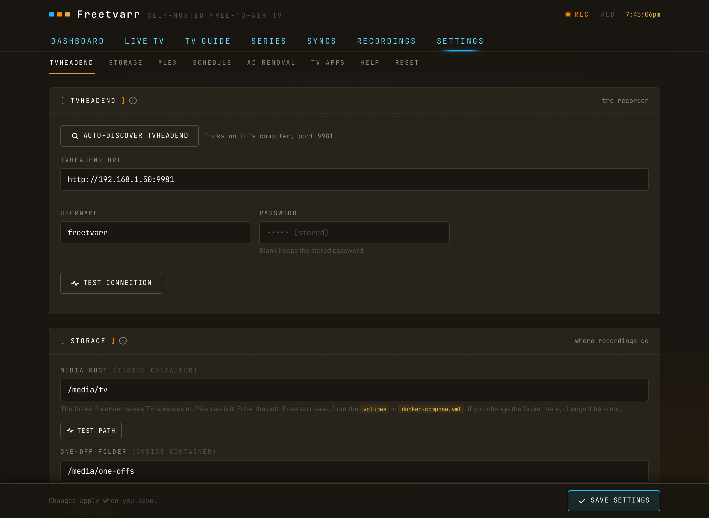

# Settings

Settings groups its pages under five headings: **ABOUT**, **WATCHING**, **RECORDING**, **SYSTEM**, and **DANGER ZONE**. On a phone, Settings opens on the list of pages; press a page to open it. On a tablet or computer, the list sits beside the open page, and Settings opens on **About Freetvarr**.

<!-- markdownlint-disable MD033 -->
<BrowserFrame label="http://freetvarr.lan/#/settings">
  
</BrowserFrame>
<!-- markdownlint-enable MD033 -->

When [Health](/guide/doctor) finds a problem, a dot shows on the Settings icon and on the **Health** row.

## Search

Type in **Search settings**, under the Settings title, to find a page or a single setting. The list shows each match with its place, such as `Recording → Media library`. Old page names find the new pages too: `recording folders` finds **Media library**, and `library and plex` finds **Plex**.

Press a match to open its page. Freetvarr scrolls to the setting and marks it for a moment; a setting inside **Token not found?** (a folded section on the Plex page) opens that section first. On a keyboard, the arrow keys choose a match, **Enter** opens it, and **Esc** clears the search. The search stays when you go back to the list. It looks in Settings only; to find shows and programmes, use [search](/guide/home#search).

## About

- **About Freetvarr**: links to **Setup** and **Health checks**, the versions of Freetvarr, [TVHeadend](https://tvheadend.org/), and [Node](https://nodejs.org/) with the uptime, the licences, and the data credits.
- **System diagram**: a diagram of each component, from the aerial to the TV, and how a recording moves between them.

### System diagram

Press a component to see its function, whether it is required, and who supplies it. On a wide screen the card sits beside the component you chose; press the component again, press **×**, or press Esc to close it. **Current** shows the value Freetvarr uses now, such as the TVHeadend address or the recordings folder. For **TV library**, the card lists the folder for TV episodes, movies, and one-offs instead. **Existing setup** says what to use if you already have that component. The buttons under it open the matching Settings pages.

The info sheets on the TVHeadend, Media library, Plex, Ad removal, Film and TV info, Watch on TV, Channels, and Setup pages have a **System diagram** button. It opens the diagram with that component selected.

## Watching

| Page                 | What it holds                                                                                                                                                                                                                                                                                                                                                                                                                                                                                                                                                                                                                                                                                                                                                                                                                            |
| -------------------- | ---------------------------------------------------------------------------------------------------------------------------------------------------------------------------------------------------------------------------------------------------------------------------------------------------------------------------------------------------------------------------------------------------------------------------------------------------------------------------------------------------------------------------------------------------------------------------------------------------------------------------------------------------------------------------------------------------------------------------------------------------------------------------------------------------------------------------------------- |
| **Playback**         | Under **THIS DEVICE**, **Start muted** and **Hide player controls after** ([Playback settings](/guide/player#playback-settings)). Under **LIVE TV**, **Live streams at once**, `1` to `4`, for every device in the home ([Live streams at once](/guide/player#live-streams-at-once)).                                                                                                                                                                                                                                                                                                                                                                                                                                                                                                                                                    |
| **Channels**         | **Hide SD simulcasts** and **Hide SD channels**, the same switches as in the channel settings of the TV guide and Live TV ([TV guide](/guide/tv-guide#favourites)).                                                                                                                                                                                                                                                                                                                                                                                                                                                                                                                                                                                                                                                                      |
| **Guide**            | The merged guide and its confirm step, **Use first** (**Automatic** or one source), **SOURCE HEALTH**, and **CHANNEL SOURCES** ([Guide](#guide)).                                                                                                                                                                                                                                                                                                                                                                                                                                                                                                                                                                                                                                                                                        |
| **Film and TV info** | The **LOOK UP ONLINE** switches **Missing pictures** ([Missing pictures](/guide/tv-guide#missing-pictures)), **Ratings**, **Reviews** ([Ratings and reviews](/guide/tv-guide#ratings-and-reviews)), **Cast and crew** ([Cast and crew](/guide/tv-guide#cast-and-crew)), and **Genres** ([For you](/guide/for-you#for-you-settings)); the optional **TMDB API key** ([TMDB](https://www.themoviedb.org/) is a film and TV database; [TMDB key](/guide/tv-guide#tmdb-key)); **Keep faces in view**; under **STILLS FROM RECORDINGS**, **Use stills**: **Off**, **When nothing else**, or **Before series picture**, for frames from inside recordings ([Episode frames](/guide/tv-guide#episode-frames)); and **Movie corrections**, the shows you marked **Not a movie** or **This is a movie** to fix a wrong label, each with **Undo**. |
| **For you**          | For you, its suggestion level, and your viewing history ([For you](/guide/for-you#for-you-settings)).                                                                                                                                                                                                                                                                                                                                                                                                                                                                                                                                                                                                                                                                                                                                    |
| **Watch on TV**      | A TVHeadend login and the addresses for [Jellyfin](https://jellyfin.org/) and [Kodi](https://kodi.tv/) ([TV apps](/guide/tv-apps)).                                                                                                                                                                                                                                                                                                                                                                                                                                                                                                                                                                                                                                                                                                      |

Each **LOOK UP ONLINE** switch sends programme titles to online services: **Missing pictures** to [TVmaze](https://www.tvmaze.com/), [Wikidata](https://www.wikidata.org/), Wikipedia, and TMDB; **Ratings** to TVmaze and TMDB; **Reviews** to TMDB; **Cast and crew** to TVmaze and TMDB; and **Genres** to TVmaze and Wikidata. TMDB receives titles only after you add a key. Turn a switch off to keep those titles on your network.

### Guide

Freetvarr merges the free guide sources of your country into one guide file, and serves it to TVHeadend at `http://<freetvarr-host>:3733/guide/xmltv.xml`. In Australia the sources are [Freeview](https://www.freeview.com.au/) (listings for the next `9` days) and the [i.mjh.nz](https://i.mjh.nz/) feed (channel names, gaps, and the days after). Freetvarr builds the file every `6` hours.

**MERGED GUIDE** holds a one-time confirm step. TVHeadend reads its guide as before until you confirm. The step shows what changes:

- **TVHeadend guide grabber**: the guide address TVHeadend reads now, and the Freetvarr address it reads after.
- **Guide channels**: the channel count now and after, and the channels that only Freeview lists.
- **Days ahead**: how many days each source covers.

Press **Use the merged guide** to make the change. Freetvarr turns on the merged guide, points the TVHeadend XMLTV URL grabber at Freetvarr, waits for TVHeadend to fetch the file, links the channels that only Freeview lists, and checks that the TVHeadend guide updated. Each step shows as it runs. If a step fails, such as TVHeadend not fetching the file within `150` seconds, Freetvarr points the grabber back at the earlier address and turns the merged guide off again. Press **Keep my grabber as it is** to leave TVHeadend unchanged; the confirm step stays on this page if you change your mind. When the merged guide is ready, Home and Health show a notice with **Review**, which opens this page; press **×** to hide the notice.

After you confirm, the page shows:

- **Use first**: **Automatic** (the default) reads Freeview first. When the Freeview listings of a channel stay degraded for two builds in a row, that channel uses i.mjh.nz until Freeview recovers, and Activity lists each channel that changed. Choose **Freeview** or **i.mjh.nz** to read that source first for every channel, even while it is degraded; [Health](/guide/doctor#guide-sources) then warns you and offers **Switch to Automatic**.
- **SOURCE HEALTH**: for each source, the share of channels with healthy listings, how many days ahead it goes, and when Freetvarr last read it.
- **CHANNEL SOURCES**: each channel that uses another source, or that you pinned, with a list to change it. **Pin a channel** makes one channel read one source first, even while it is degraded. Choose **Automatic** in a channel's list to remove the pin.

Freetvarr scores each source on each channel at every build: the hours of the next `48` hours it covers, the days ahead, the share of programmes with a title and a description, the share of programmes that the other source lists within `5` minutes with the same title, and the share of downloads that failed. A source is degraded on a channel when, in two builds in a row, it covers less than half its usual hours (the median of the last `14` days), runs less than `3` days ahead, or agrees with the other source on less than `60%` of programmes.

## Recording

| Page                  | What it holds                                                                                                                                                                                                                                                                                                                                                                                                                           |
| --------------------- | --------------------------------------------------------------------------------------------------------------------------------------------------------------------------------------------------------------------------------------------------------------------------------------------------------------------------------------------------------------------------------------------------------------------------------------- |
| **Series rules**      | Every series recording with its folder ([Series rules and folders](/guide/series)).                                                                                                                                                                                                                                                                                                                                                     |
| **Title matches**     | The title matches that save recordings to a folder without a series recording ([Title matches](/guide/series#title-matches)).                                                                                                                                                                                                                                                                                                           |
| **Media library**     | Under **WHAT TO IMPORT**, **Import every recording** and **Add to library by default** ([Configuration](/guide/configuration#the-one-off-folder)). Then **Media root**, **One-off folder**, **Movies folder**, and the recordings folder as Freetvarr and TVHeadend each see it ([Configuration](/guide/configuration#the-two-recordings-paths)).                                                                                       |
| **Ad removal**        | **Enable ad removal**, how long to keep the original after a cut, and the detection settings ([Ad removal](/guide/ad-removal)).                                                                                                                                                                                                                                                                                                         |
| **Plex**              | The [Plex](https://www.plex.tv/) server, token, and libraries, and **Wait for Plex before removing recordings from TVHeadend** ([Plex](/guide/plex)). Under **YOUR WHOLE LIBRARY**, **Show your whole Plex library** and the libraries to show ([Your whole library](/guide/plex#your-whole-library)). Under **WATCHED STATE**, **From Plex**, **Back to Plex**, and **Sync watched now** ([Watched state](/guide/plex#watched-state)). |
| **Sonarr and Radarr** | [Sonarr](https://sonarr.tv/) and [Radarr](https://radarr.video/) download TV episodes and films. This page holds **Find Sonarr and Radarr**, the address and API key of each, and **Stop downloading it again**, so a file you delete in Freetvarr does not download again ([Sonarr and Radarr](/guide/sonarr-radarr)).                                                                                                                 |
| **Recording log**     | Every recording TVHeadend has finished, with the full import detail ([Recording log](/guide/recordings#recording-log)).                                                                                                                                                                                                                                                                                                                 |

## System

| Page          | What it holds                                                                                                                                                                                                                                                                                                                                                                                                                                                                                                          |
| ------------- | ---------------------------------------------------------------------------------------------------------------------------------------------------------------------------------------------------------------------------------------------------------------------------------------------------------------------------------------------------------------------------------------------------------------------------------------------------------------------------------------------------------------------- |
| **Setup**     | What Freetvarr uses now: TVHeadend, channels, the TV guide, folders, Plex, the time zone, and **Allowed hostnames** (the extra names, such as a reverse proxy name, that Freetvarr answers to; [Allowed hostnames](/guide/troubleshooting#allowed-hostnames)). Press a row to check or change that part, such as **Scan again** for channels (a dialog asks you to confirm before the scan starts). **Run the whole setup from the start** opens setup again ([Getting started](/guide/getting-started#_2-run-setup)). |
| **Health**    | The checks, the last and next sync, **Sync now**, and the free disk space ([Health](/guide/doctor)).                                                                                                                                                                                                                                                                                                                                                                                                                   |
| **Activity**  | **Now** lists what the server is doing, such as a sync, an import, or ad removal, with what records and plays now and what runs next. **Syncs** lists every sync. While a job runs, the Settings list shows the number running beside **Activity** ([Activity](/guide/syncs)).                                                                                                                                                                                                                                         |
| **Schedule**  | The time zone and the **Sync schedule** ([Activity](/guide/syncs#scheduled-and-manual)).                                                                                                                                                                                                                                                                                                                                                                                                                               |
| **TVHeadend** | The TVHeadend address and login, **Auto-discover TVHeadend**, the TVHeadend open-access check, and the tuner list ([TVHeadend](/guide/tvheadend)).                                                                                                                                                                                                                                                                                                                                                                     |

## Danger zone

| Page      | What it holds                                                                                                                                                                                                                                                                                                                                                                                                                                                                                                               |
| --------- | --------------------------------------------------------------------------------------------------------------------------------------------------------------------------------------------------------------------------------------------------------------------------------------------------------------------------------------------------------------------------------------------------------------------------------------------------------------------------------------------------------------------------- |
| **Reset** | **Reset Freetvarr** deletes Freetvarr's settings, [series folders](/guide/series), list of recordings, and sync history, then setup starts from the beginning. Your video files, and the recordings and settings in TVHeadend, stay where they are. Freetvarr keeps the [TV login](/guide/tv-apps) it made, and the [Allowed hostnames](/guide/troubleshooting#allowed-hostnames). You can still delete the TV login, or restore open access, after setup. You cannot undo a reset, and you cannot reset while a sync runs. |

## Saving changes

On the Film and TV info, Ad removal, Media library, Plex, Sonarr and Radarr, TVHeadend, and Schedule pages, press **Save settings** to keep a change. The TMDB key (**Save key**), **Movie corrections**, and the Channels, Playback, and For you pages save each change at once.

## Old addresses

Settings pages have their own addresses, such as `#/settings/player` or `#/settings/system/health`. A page keeps its address when its name changes: **Playback** is `#/settings/player`, and **Media library** is `#/settings/storage`.
