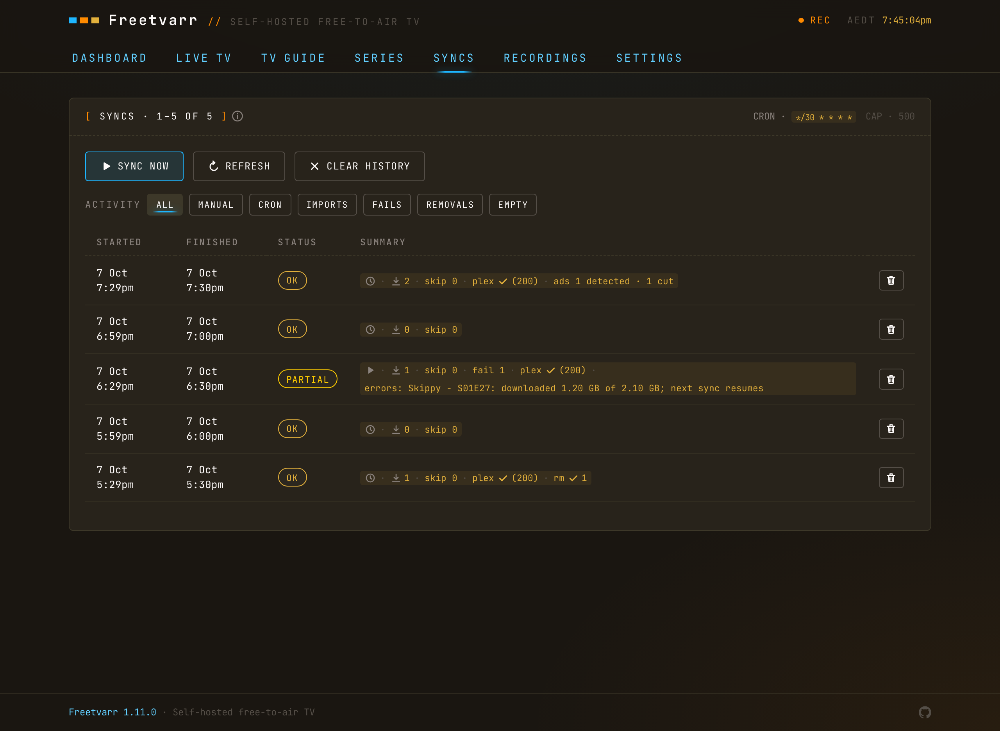

# Syncs

A sync is one pass over TVHeadend's finished recordings: list them, match them against your series folders, import anything new, then refresh Plex if you use it and something imported. The SYNCS tab is the history of those passes.

<!-- markdownlint-disable MD033 -->
<BrowserFrame label="http://freetvarr.lan/#/syncs">
  
</BrowserFrame>
<!-- markdownlint-enable MD033 -->

## Dashboard sync deck

The dashboard shows whether a sync is running, when the last one ran and what it did, and when the next one is due. Press `SYNC NOW` to run one at once, or press `LAST SYNC` to open the SYNCS tab.

**RECENT SYNCS** under it lists the last five syncs. A sync that imported, failed, or removed something has an arrow at the end of its row. Press the row to open that sync on the SYNCS tab with its [details](#sync-details) open. Empty and running syncs have no link.

On a phone, **RECENT SYNCS** shows the latest sync and what it did, then a bar for each of the last `12` syncs, with the newest on the right. A tall bar is a sync that imported, removed, or failed something; a short bar is a sync that found nothing new. Below the bars, only those tall-bar syncs get a row.

## Pull to refresh

In the Freetvarr Home Screen app on an iPhone, pull down from the top of a page to reload its data. Filters and scroll position stay as they were. A pull does not reload the app itself, so after you update Freetvarr, close and reopen the Home Screen app.

## Scheduled and manual

Choose how often Freetvarr checks TVHeadend in SETTINGS → SCHEDULE, with **SYNC SCHEDULE**: `Every 15 minutes`, `Every 30 minutes` (the default), `Every hour`, or `Custom`. `Custom` opens a field for a cron expression (the `* * * * *` timing string), such as `0 */2 * * *` for every two hours. A saved change takes effect without a restart. Until the setup wizard connects TVHeadend, scheduled syncs skip without an entry in the SYNCS list. You can also press `SYNC NOW` on the dashboard to sync every series and title match at once, or press **SYNC** on a single series in the [SERIES tab](/guide/series#series-rows).

The SYNCS tab states the schedule in plain words, such as "Syncs run every 30 minutes." On a phone this line sits above the buttons; on a wider screen it sits in the panel header. A schedule that has no plain description shows its cron expression instead.

Only one sync runs at a time. A second request while one runs returns the running sync.

## Reading a sync

The SYNCS tab groups syncs under a heading for each day: `Today`, `Yesterday`, or a date such as `10 Oct`. Each row shows:

- a status mark: a tick for **OK**, a warning sign for **PARTIAL**, a cross for a sync that failed, or a spinner while it runs;
- the start and finish times, such as `9:04–9:05am`;
- the result in words, such as `2 imported`, `1 failed`, `1 removed`, or `nothing new`;
- how long the sync took.

A failed sync also shows its first error under the row. On a wider screen, a **DETAILS** column shows whether the schedule or you started the sync, how many recordings it skipped, and the Plex result.

A sync is marked **OK** unless something failed. A short import (a **PARTIAL** recording) counts as a failure, not a skip. A sync that runs past midnight sits under the day it started, such as `11:58pm – 12:04am`.

## Sync details

Press a sync to open its details, and press it again to close them. The details list each recording the sync imported or failed to import, up to `100`. Each recording shows:

- its title, season and episode, and episode title;
- whether it went to a series folder, the one-off folder, or the movies folder;
- the channel, when it aired, and how long the programme ran;
- the file size, ad removal results, and how long the import took;
- **removed from TVHeadend**, when [Remove after import](/guide/remove-from-tvheadend) deleted the TVHeadend copy;
- the error, when the import failed.

Under the recordings, each step of the sync shows its result and how long it took: reading TVHeadend, importing files, refreshing each Plex library, removing recordings from TVHeadend, and checking the library.

A sync still running shows its details when it finishes. Syncs from Freetvarr versions before this list was added show only their counts.

To delete one sync from the history, open its details and press `DELETE SYNC`. The recordings it imported stay in your library.

Each sync has its own address, `#/syncs/<number>`. Open that address to show the sync with its details open.

## History

Sync history keeps the latest 500 syncs. Empty syncs, which found nothing new, take at most 100 of those, so syncs that did something stay in the history longer. The tab shows 50 per page (press `PREV` and `NEXT` to see older syncs). Delete one sync from its [details](#sync-details), or press `CLEAR HISTORY` to clear them all.

Two filters choose which syncs the tab lists:

- **SHOW**: `IMPORTS`, `FAILS`, `REMOVALS`, and `EMPTY`. Turn on as many as you like. `EMPTY` is off at first, and a line under the list counts the empty syncs it hides. Press **Show them** on that line to turn `EMPTY` on.
- **FROM**: `ANY`, `SCHEDULE` (syncs the sync schedule started), or `MANUAL` (syncs you started).

The browser remembers your choice. A running sync always shows.

After each sync, Freetvarr trims the history, drops removed recordings older than 30 days, and deletes expired `.orig` backups from ad cutting.
