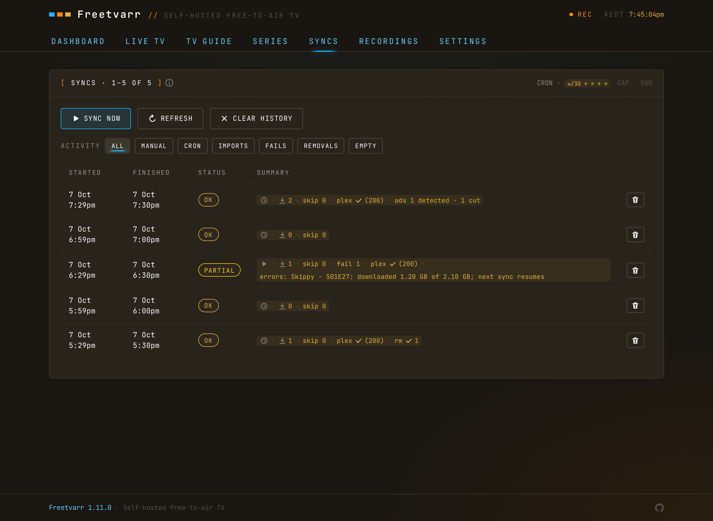

# Activity

<Illustration name="activity" />

**Activity** shows what the Freetvarr server does now, and every sync it has run. A sync is one pass over [TVHeadend](https://tvheadend.org/)'s finished recordings: list them, match them against your [series folders](/guide/series), import anything new, then refresh [Plex](/guide/plex) if you use it and something imported.

Open Activity from Settings → SYSTEM → **Activity**. While jobs run, the Settings menu shows how many beside **Activity**, such as "2 running".

A job is a task the server runs, such as a sync, an import, or an ad removal scan. The page has two tabs:

- **Now**: what the server does at this moment, and what it did in the last `24` hours. Its address is `#/settings/system/activity`.
- **Syncs**: the history of syncs, with **Sync now**. Its address is `#/settings/system/activity/syncs`.

The **Activity** row on [Health](/guide/doctor) opens the **Syncs** tab.

## Now

The line above the jobs on **Now** shows how long the server has run, how often it paused for more than `100 ms`, and how many tuners are in use.

**Now** has these groups:

- **RUNNING NOW**: the jobs that run at this moment, with their progress, and each recording TVHeadend makes now, with its channel, tuner, and time left.
- **WATCHING NOW**: each live TV channel or recording that someone plays in Freetvarr, with the device and browser.
- **UP NEXT**: the jobs that run on a timer, such as the next sync, and when each one starts.
- **FINISHED**: the jobs that finished in the last `24` hours, newest first. The group shows the latest `5`; press **Show all** to see the rest. Failed jobs stay for `7` days, also after a restart.

Press a row to see its steps, details, and log, and press it again to close them. A job that belongs to a sync has an **Open sync** link to that sync on the **Syncs** tab.

An import or an ad removal works on one recording. Its row names the show, and its second line starts with the episode:

- the season and episode, such as `S17 E10`
- the air date, such as `Mon 2 Nov`, when the guide gives no episode number
- the episode title, when the guide gives no episode number and no air date
- the year, such as `2000`, for a film

Press the row to see the show, the episode and its title, when it aired, the channel, the file name, and the folder that holds the file. **Open show** (**Open movie** for a film) opens the recording's page in Recordings.

### Job types

- **Sync**, with an **Import** row for each recording it copies. An import shows its steps (copy from TVHeadend, then check the file), and an **Ad removal** row under it when the show removes ads ([Ad removal](/guide/ad-removal)). When another file already has the episode's file name, the import saves under a new name and its log says so.
- **Ad removal**, for an import or for a scan you start from a recording.
- **Library folders**, when Freetvarr moves recorded files between the one-off and TV folders ([Recordings](/guide/recordings)).
- **Plex watched sync** (the [watched state check](/guide/plex#watched-state)), **TV guide refresh**, **Viewing history upkeep**, **For you rebuild**, **Home hero rebuild**, **Picture focus**, and **Ratings warm-up**. These run often, so **Now** keeps only the latest finished run of each.
- **Cache prune** and **Health checks**. A health run lists each check and its result.

**Now** only shows what runs. To start a sync, use **Sync now** on the **Syncs** tab.

<!-- markdownlint-disable MD033 -->
<BrowserFrame label="http://freetvarr.lan/#/settings/system/activity">
  
</BrowserFrame>
<!-- markdownlint-enable MD033 -->

## Health summary

[Health](/guide/doctor) shows whether a sync is running, when the last one ran and what it did, when the next one is due, and how many recordings imported in the last `7` days. Press **Sync now** there, or on Activity, to run a sync at once.

## Pull to refresh

In the Freetvarr Home Screen app on an iPhone ([Save it as an app](/guide/getting-started#_4-save-it-as-an-app)), pull down from the top of a page to reload its data. Filters and scroll position stay as they were. A pull does not reload the app itself, so after you update Freetvarr, close and reopen the Home Screen app.

## Scheduled and manual

Choose how often Freetvarr checks TVHeadend in Settings → SYSTEM → **Schedule**, with **Sync schedule**: `Every 15 minutes`, `Every 30 minutes` (the default), `Every hour`, or `Custom`. **Custom** opens a field for a [cron expression](https://crontab.guru/) (the `* * * * *` timing string), such as `0 */2 * * *` for every two hours. A saved change takes effect without a restart. Until the [setup](/guide/getting-started#_2-run-setup) connects TVHeadend, scheduled syncs skip without an entry in the Activity list. You can also press **Sync now** to sync every series and [title match](/guide/series#title-matches) at once, or press **Sync** on a single series in [Series rules](/guide/series#series-rows).

Activity states the schedule in plain words, such as "Syncs run every 30 minutes." A schedule that has no plain description shows its cron expression instead.

Freetvarr also syncs about a minute after a recording finishes, so the episode joins the library without a wait for the next scheduled sync. Recordings that finish close together share one sync. When a sync is already running, Freetvarr waits for it to end and then syncs again. A custom schedule that never runs, such as `0 0 31 2 *` (31 February), turns these syncs off too. In Activity, these syncs say `Sync after a recording finished`.

Only one sync runs at a time. A second request while one runs returns the running sync.

## Restart during a sync

When Freetvarr restarts in the middle of a sync, it marks that sync **stopped by a restart**, not failed. About `30` seconds after Freetvarr starts again, it runs a new sync, which says `Sync after a restart`. Before that, Freetvarr sets each import that the restart stopped back to waiting, and puts the original file back for each ad cut that the restart stopped. The new sync then imports the waiting recordings. Freetvarr skips the new sync in these cases:

- a scheduled sync is due within `2` minutes, so that sync runs instead;
- scheduled syncs are off (a custom schedule that never runs);
- the restart stopped a sync that Freetvarr itself started after an earlier restart. If Freetvarr restarts again and again, it leaves the next sync to the schedule.

## Reading a sync

Activity groups syncs under a heading for each day: `Today`, `Yesterday`, or a date such as `10 Oct`. Each row shows:

- a status mark: a tick for **OK**, a warning sign for **Partial**, a cross for a sync that failed, a dash for a sync that a [restart stopped](#restart-during-a-sync), or a spinner while it runs;
- the start and finish times, such as `9:04–9:05am`;
- the result in words, such as `2 imported`, `1 failed`, `1 removed`, `nothing new`, or `stopped by a restart`;
- how long the sync took.

A failed sync also shows its first error under the row. A sync that a restart stopped shows when Freetvarr ran it again, such as `Ran again at 9:05am`. On a wider screen, a **Details** column shows whether the schedule or you started the sync, how many recordings it skipped, and the Plex result.

A sync is marked **OK** unless something failed. A short import (a **PARTIAL** recording, whose file came up more than `1MB` short of the TVHeadend recording file) counts as a failure, not a skip. A sync that runs past midnight sits under the day it started, such as `11:58pm – 12:04am`.

## Sync details

Press a sync to open its details, and press it again to close them. The details list each recording the sync imported or failed to import, up to `100`. Each recording shows:

- its title, season and episode, and episode title;
- whether it went to a series folder, the one-off folder, or the movies folder;
- the channel, when it aired, and how long the programme ran;
- the file size, ad removal results, and how long the import took;
- **removed from TVHeadend**, when [Remove after import](/guide/remove-from-tvheadend) deleted the TVHeadend copy;
- the error, when the import failed.

Under the recordings, each step of the sync shows its result and how long it took: reading TVHeadend, importing files, refreshing each Plex library, removing recordings from TVHeadend, and checking the library.

A sync still running shows its details when it finishes. Syncs from Freetvarr versions before this list was added show only their counts.

To delete one sync from the history, open its details and press **Delete sync**. The recordings it imported stay in your library.

Each sync has its own address, `#/settings/system/activity/<number>`. Open that address to show the sync with its details open.

## History

Sync history keeps the latest 500 syncs. Empty syncs, which found nothing new, take at most 100 of those, so syncs that did something stay in the history longer. Activity shows 50 per page (press **Previous** and **Next** to see older syncs). Delete one sync from its [details](#sync-details), or press **Clear history** to clear them all.

Two filters choose which syncs Activity lists:

- **Show**: **Imports**, **Fails**, **Removals**, and **Empty**. Turn on as many as you like. **Empty** is off at first, and a line under the list counts the empty syncs it hides. Press **Show them** (or **Show it**) on that line to turn **Empty** on.
- **From**: **Any**, **Schedule** (syncs the sync schedule started), **Manual** (syncs you started), or **After a recording** (syncs that started when a recording finished).

The browser remembers your choice. A running sync, and a sync that a restart stopped, always show. A sync that a restart stopped is not a fail, so **Fails**, Health, and the Settings health dot leave it out.

After each sync, Freetvarr trims the history, drops recordings that TVHeadend removed more than 30 days ago and that are not in your library, and deletes expired `.orig` backups (the originals that [ad removal](/guide/ad-removal#backups-and-retention) keeps after a cut).
