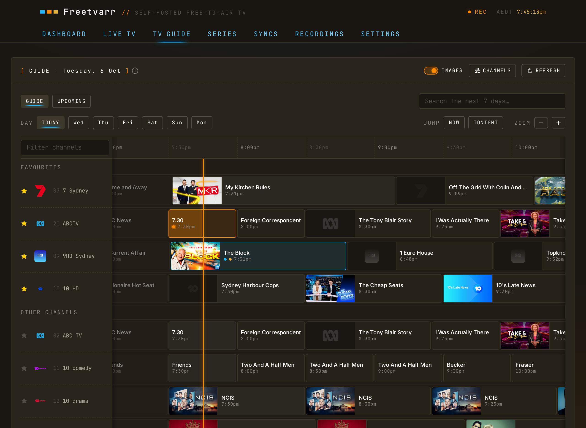
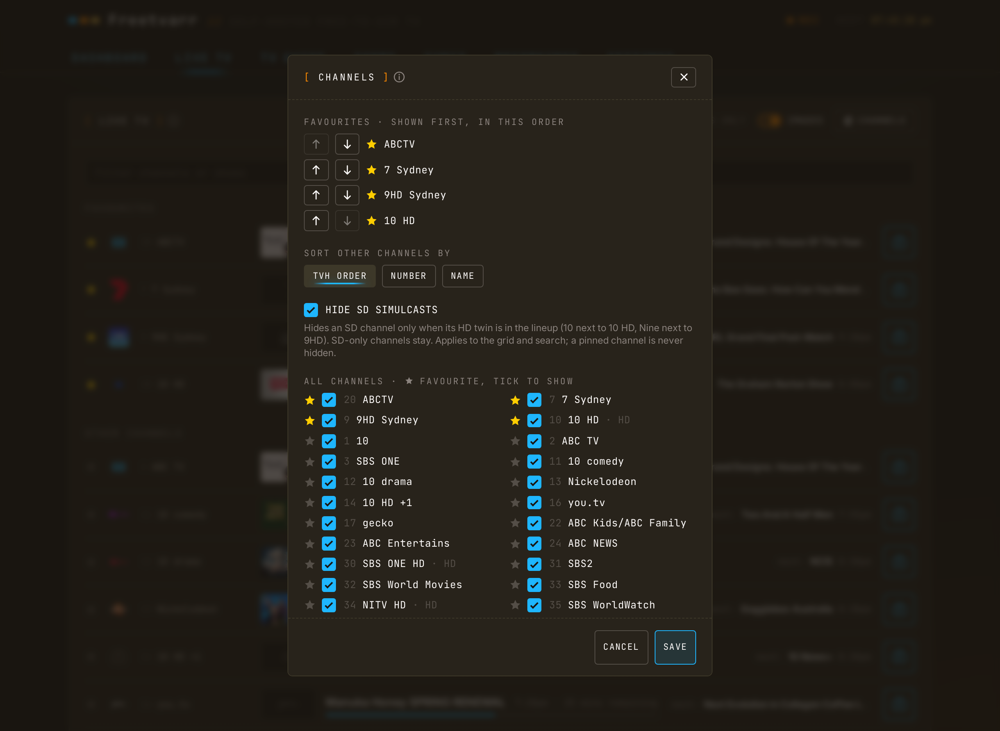

# Guide

The Guide is a 7-day programme guide. Press a programme to record it, cancel it, record a whole [series](/guide/series), or ask to be told when it airs. Freetvarr imports each recording into your library after TVHeadend records it.

The Guide shows only the listings you loaded into TVHeadend. With the XMLTV guide feed set up ([step 6](/guide/tvheadend#_6-load-the-xmltv-guide)) you get seven days with episode numbers. Without it you get what the broadcast carries: about a day, with little detail.

<!-- markdownlint-disable MD033 -->
<BrowserFrame label="http://freetvarr.lan/#/guide">
  
</BrowserFrame>
<!-- markdownlint-enable MD033 -->

## The grid

Channels run down the page and time runs across. The Guide opens at the current half hour.

- The **day chips** switch between today and the next six days. **Now** and **Tonight** jump within the day.
- **Zoom** has three levels, **S**, **M**, and **L**, that change the time scale. **Images** shows a programme picture on each cell that is wide enough. Each browser remembers both.
- The **search** button searches all 7 days on the grid. It finds a show by nickname, initials, or a close spelling too, as [Search](/guide/home#search) does.
- The **Channels** button opens the channel settings.
- The `N scheduled` chip opens [Scheduled](/guide/recordings#scheduled). It replaces the old `UPCOMING` view.
- A dot on a cell marks a scheduled recording, and a ring marks a recording now. A programme you watch for has its own dot; the legend under the grid names it **Watching for**. Past programmes are dimmed, and programmes on air have a lighter cell.
- A line marks the current time.
- Programmes that ended earlier today stay in the grid. TVHeadend drops a programme once it ends, but Freetvarr keeps its own copy.
- Hover over a programme, or tab to it, to see its full title, times, and synopsis.
- Drag the edge of the channel column to make it wider or narrower. At its narrowest the column shows only the stars and channel logos, and the filter box reads **Filter**. Each browser remembers the width.
- A dimmed channel with `OFF AIR` beside its name is not broadcasting right now: TVHeadend has switched off every service for it. The note clears by itself once TVHeadend sees the channel again, after a channel scan.
- Each channel in the channel settings shows `HD` or `SD` before its name, read from the TV service type that TVHeadend reports. **Hide SD simulcasts** uses it to pair an SD channel with its HD twin, even when both have the same name.

## After midnight

Each day's grid runs to 3am the next morning, so a late film stays on the same page. Programmes after midnight are dimmed, but they work like any other. While midnight is in view, a button with the next day's date opens that day at the same time of night.

## Recording a programme

Press a programme's cell to open its programme sheet: the programme image, title, season and episode, channel, time, and synopsis. On a phone the sheet slides up from the bottom. On a wide screen it opens as a dialog. To close it, press **Close**, press `Esc`, press outside it, or swipe it down on a phone. The image comes from the XMLTV guide feed (a TV guide fed only by the broadcast has none); see [Missing pictures](#missing-pictures) for what Freetvarr shows when the feed has no image.

<!-- markdownlint-disable MD033 -->
<BrowserFrame label="http://freetvarr.lan/#/guide">
  
</BrowserFrame>
<!-- markdownlint-enable MD033 -->

A switch in the sheet picks what to do. One line under it says what the main button does.

- **This episode** with **Record** schedules the single airing. **Start early** and **Finish late** pad the recording, 2 minutes before and 10 minutes after by default, because free-to-air broadcasts often run late.
- **Every episode** with **Record series** creates a series recording in TVHeadend. **Keep** sets how many episodes to keep. **Any channel** follows the show to another channel. See [How a series recording works](/guide/series#how-a-series-recording-works).
- **Notify me** lists the show to watch for. See [Notify me](#notify-me).
- **Advanced** holds **Add to library**. It decides what Freetvarr does with the recording. With the switch off, the recording stays in TVHeadend only. With it on, **Record series** also creates the series folder, so the episodes go to the TV library. The note under the switch says where the file will go: the series folder when one matches, the movies folder for a film, or the one-off folder when neither does. The default is in Settings → Library and Plex. To change a folder later, open [Series rules](/guide/series).
- **Watch live** shows when the programme is on air.
- **Show in Guide** shows when you open the sheet outside the Guide. It opens the Guide at that channel and time.
- A scheduled programme shows **Cancel recording** instead. For an episode of a series recording, the button reads **Skip this episode**: TVHeadend keeps the episode disabled, so the series recording does not schedule it again. To turn it back on, open the episode later and press **Record**.
- A programme that is recording now shows **Stop recording**. After `5` minutes or more, the part recorded so far stays and imports to your library; before `5` minutes, Freetvarr deletes it. The sheet says which applies.
- A programme with a series recording also shows **Cancel series**. See [Cancel a series recording](/guide/series#cancel-a-series-recording).

Many networks show the same programme on an SD channel and an HD channel, such as 7 Sydney and 7HD Sydney. If you press **Record** or **Record series** on the SD channel and the TV guide has the same programme at the same time on an HD channel, Freetvarr asks whether to record the HD channel instead. Your padding, episodes-to-keep, and **Add to library** choices carry over.

The same sheet opens from [Home](/guide/home), [For you](/guide/for-you), [Live TV](/guide/live-tv), [Search](/guide/home#search), and the [player](/guide/live-tv#record-from-the-player). It opens over the page you are on, and closing it leaves you there.

[Scheduled](/guide/recordings#scheduled) lists what will record: the recordings TVHeadend has scheduled, plus the episodes your series recordings will catch over the next 7 days. [Series rules](/guide/series) lists the series recordings themselves.

## Notify me

**Notify me** is for a show that is not in the Guide yet, or one you are not sure about. Freetvarr lists the show under **Watching for** in Scheduled, with a number badge for new airings. Nothing records unless you turn on **Record when it appears**.

1. Press a programme of the show.
2. Pick **Notify me**.
3. To record the show as soon as it airs, turn on **Record when it appears**.
4. Press **Notify me**. With the switch on, the button reads **Record when it appears**.

**Record when it appears** sets an any-channel series recording the first time the show is in the Guide. The sheet of a show you already watch for says `You are watching for this show.` and offers **Stop watching**.

Freetvarr sends no push message or email. The list in Scheduled is the notice.

## Favourites

Press the star next to a channel to make it a favourite. Favourites sit at the top of the grid and of [Live TV](/guide/live-tv).

To reorder them on a tablet or computer:

1. Press **Edit order** at the right of the **Favourites** heading. In a narrow channel column it is an icon with two arrows.
2. Drag a favourite by its handle (three lines) to its new place. With the keyboard, tab to a handle, press Space, move it with the arrow keys, then press Space again.
3. Press **Done**, or press Esc.

**Edit order** shows when you have two or more favourites and the filter box is empty. On a phone, **Edit order** opens a list to reorder instead. You can also reorder favourites in the channel settings, or on the [Live TV](/guide/live-tv#in-freetvarr) page.

In Australia, the wizard's channel scan starts you with five favourites: the HD channels of ABC, Seven, Nine, 10, and SBS, or the SD channel where a network has no HD channel. The wizard does this only when you have no favourites, and only once. Remove or reorder them like any other favourite.

The **Channels** button above the grid opens the channel settings. The same settings open from the channel settings button on Live TV. On a phone, the settings come first and the list follows. The settings are:

- **Favourites, shown first in this order**: remove a favourite, or press **Edit order** to reorder them.
- **Sort other channels by**: TVHeadend order, channel number, or name.
- **Hide SD simulcasts**: hides an SD channel when its HD twin is in the lineup. SD-only channels stay.
- **Hide SD channels**: shows only HD channels. SD-only channels (for example 7flix) are hidden too. It applies to the grid, search, Live TV, and the channel list. Favourites are never hidden. While it is on, **Hide SD simulcasts** is on and locked, because it hides the same channels.
- **All channels**: turn a channel off to hide it. Favourites are always shown.
- **Listings**: fix the shows of a channel that has the wrong ones, or none. See [Channel listings](#channel-listings).

Press **Save** to apply the changes. Press **Cancel** to close without saving.

<!-- markdownlint-disable MD033 -->
<BrowserFrame label="http://freetvarr.lan/#/guide">
  
</BrowserFrame>
<!-- markdownlint-enable MD033 -->

## Channel listings

Each channel's shows come from one channel in the TV guide you set up, such as the Sydney guide chosen in the **Guide** step of the [setup wizard](/guide/getting-started#_2-run-the-wizard). The setup wizard links each channel to a guide channel for you. If a channel shows the wrong shows, or none, pick a different guide channel for it:

1. In the Guide, press **Channels** above the grid.
2. Press the pencil next to the channel (**Change guide source**). The row shows the current guide channel in a box you can type in.
3. Type part of the guide channel's name to find it (`7` finds Seven and 7two), then pick the one that matches. Guide channels with no shows in the guide are at the end of the list, marked `(no shows in this guide)`, and you cannot pick them. The arrow keys and `Enter` also work, and `Esc` closes the list. Press the tick (**Use this guide source**, or `Enter` with the list closed). Press the cross (**Keep the current guide source**, or `Esc`) to keep the current pick.
4. Press **Save** to save the new listings.

Each row shows the name of its guide channel, or `No listings`. A row you changed is marked until you press **Save**. Opening another channel's pencil drops an unconfirmed pick.

Pick **No listings** to remove a channel's shows. The channel's shows go at once. Two channels can use the same guide channel, such as `SBS ONE` and `SBS ONE HD`.

Freetvarr saves the pick in TVHeadend, removes the channel's old shows, and asks TVHeadend to load the TV guide again. The channel stays empty while TVHeadend downloads the guide. In the channel's row, after the current time, the Guide shows `Loading the new listings. This can take a couple of minutes.` When the new shows are in TVHeadend, the Guide shows them and the note goes.

Freetvarr also turns off TVHeadend's **Auto EPG channel** setting for a channel you change. TVHeadend then does not add a guide channel to it again by name or number.

Shows that already ended stay in the Guide under their old listings. A scheduled recording on the channel stays at its time, but no longer follows a guide programme.

If the pencils are missing, the TV guide is not set up yet. Open the setup wizard and proceed to its **Guide** step.

A [series recording](/guide/series#how-a-series-recording-works) matches on title and channel. When you fix a channel's listings, that channel gets different programmes, so its series recordings can catch different episodes. Check [Scheduled](/guide/recordings#scheduled) after the change.

If saving the listings fails, the dialog says so on its own line. Your favourites and hidden channels are still saved.

## On a phone

The Guide works in a phone browser, with **Now**, **Tonight**, and the zoom buttons over the grid. To run it full-screen, [add Freetvarr to your Home Screen](/guide/getting-started#_4-save-it-as-an-app). In that Home Screen app, pull down from the top of a page to refresh it (see [Pull to refresh](/guide/syncs#pull-to-refresh)).

## Live TV page

The Live TV page lists every channel with what is on now and next, favourites first. See [Live TV](/guide/live-tv).

## Missing pictures

Some programmes in a guide feed have no image, or an image link that no longer works. Freetvarr then looks for a picture in this order:

1. Another airing of the same programme in the guide.
2. The show's background or poster in your Plex TV or movies library, matched by title.
3. The show's picture on [TVmaze](https://www.tvmaze.com), a free online TV database, matched by exact title.
4. With a [TMDB key](#tmdb-key), the film or show's backdrop or poster on [TMDB](https://www.themoviedb.org).
5. The lead picture of the film or show's English [Wikipedia](https://en.wikipedia.org) article.

For steps 4 and 5, Freetvarr finds the film or show on [Wikidata](https://www.wikidata.org) by exact title, then checks the match before it uses a picture: a year in the synopsis must match the release year, a cast list in the synopsis must name someone in the article, and otherwise names and words from the synopsis must appear in the article. A programme with no synopsis gets no picture from these steps. An episode never matches a film.

While Freetvarr looks, the programme sheet shows a title card: the programme's name on a coloured background. The title card stays when no step finds a picture. A grid cell shows only its text until a step finds a picture, then the picture appears beside the text. With **Images** off, the grid does not ask for these pictures.

A lookup sends the programme title to TVmaze, Wikidata, and Wikipedia, and to TMDB when you add a key. Freetvarr keeps each answer for 30 days, or 7 days when there is no match. When a service does not answer, Freetvarr waits 10 minutes before it asks about that title again, and stops asking a service that keeps failing for up to 30 minutes. To turn the lookups off, go to Settings → Pictures and turn off **Look up missing pictures online**.

### TMDB key

A free [TMDB](https://www.themoviedb.org) API key adds film and TV posters and backdrops, which are often sharper than the Wikipedia picture. To add one:

1. Sign up at [themoviedb.org](https://www.themoviedb.org/signup).
2. Open [TMDB API settings](https://www.themoviedb.org/settings/api) and request a free developer key.
3. Copy the **API Key** or the **API Read Access Token**.
4. In Freetvarr, go to Settings → Pictures and paste it into **TMDB API key (optional)**.
5. Press **Test key**, then **Save key**.

The key stays on the Freetvarr server; the browser never receives it. **Remove key** deletes it, and Freetvarr then makes no requests to TMDB. This product uses the TMDB API but is not endorsed or certified by TMDB.

## Caching

Freetvarr keeps a copy of the TV guide for an hour and the recording state for 45 seconds, to limit the requests to TVHeadend. Press the refresh button to fetch them again. If TVHeadend stops answering, the Guide shows its cached copy with a note, and updates when TVHeadend is back.
